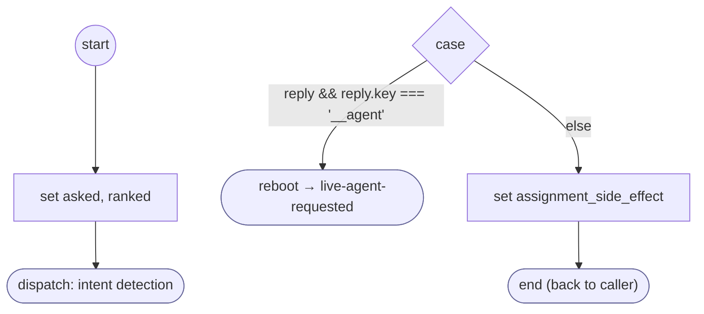

# ReadProviderReply

<!-- generated:start -->
**ReadProviderReply** · `read-provider-reply` · version 1.0.0 · worker (called by other flows) · steps · isolated scope

> Rank a menu reply its phrases do not settle: a fact or action it picks, the other facts it also asks for, or a request for a person; a withdrawal or a new request leaves.

- **Parameters:** 
  - `question`: 
  - `question_es`: 
  - `choices`: 
- **Calls:** [live-agent-requested](live-agent-requested.md) (reboot)
- **Tools:** none
- **Called by:** [provider-menu](provider-menu.md)

### Steps

<!-- generated:end -->
