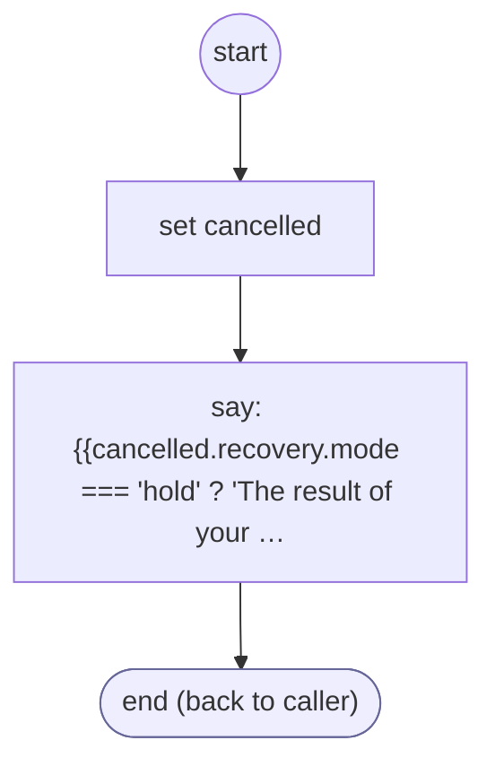

# RequestCancelled

<!-- generated:start -->
**RequestCancelled** · `request-cancelled` · version 1.0.0 · worker (called by other flows) · steps · isolated scope

> Retire an explicitly withdrawn owning request and acknowledge it; preserve unknown actions for reconciliation.

- **Parameters:** 
  - `form`: 
- **Calls:** no other flow
- **Tools:** none
- **Called by:** nothing (unreachable)

### Steps

<!-- generated:end -->
