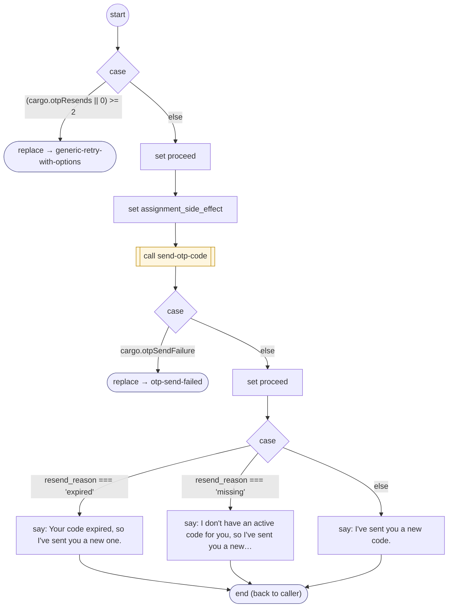

# ResendOtpCode

<!-- generated:start -->
**ResendOtpCode** · `resend-otp-code` · version 1.1.3 · worker (called by other flows) · steps

> Worker: send a fresh one-time code to the destination authenticate-user used. Params: resend_reason.

- **Parameters:** 
  - `resend_reason`: 'expired' | 'missing' | 'requested'
- **Calls:** [generic-retry-with-options](generic-retry-with-options.md) (replace), [authenticate-user](authenticate-user.md) (retry_flow of generic-retry-with-options, retry_flow), [send-otp-code](send-otp-code.md) (call), [otp-send-failed](otp-send-failed.md) (replace)
- **Tools:** none
- **Called by:** [validate-otp-code](validate-otp-code.md)

### Steps

<!-- generated:end -->
