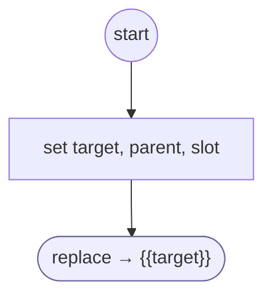

# ResumeForm

<!-- generated:start -->
**ResumeForm** · `resume-form` · version 1.0.0 · worker (called by other flows) · steps · isolated scope

> Resume an owned form instance with its validated progress and saved arguments.

- **Parameters:** 
  - `form`: 
- **Calls:** {{target}} (replace)
- **Tools:** none
- **Called by:** [run-form](run-form.md)

### Steps

<!-- generated:end -->
