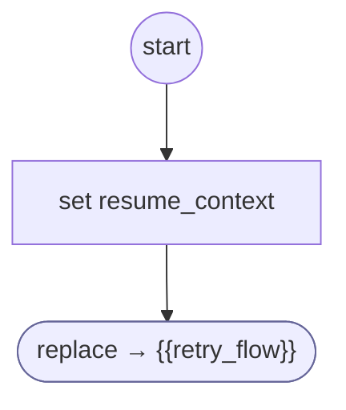

# ResumeIdentityCaller

<!-- generated:start -->
**ResumeIdentityCaller** · `resume-identity-caller` · version 1.0.0 · worker (called by other flows) · steps · shared scope

> Resume the caller of an account recovery with its original FORM instance and gate policy.

- **Parameters:** 
  - `retry_flow`: Caller definition to resume
  - `parent_form`: Owning task FORM instance
  - `gate_options`: Gate policy retained across recovery
  - `cell_number`: New phone identifier
  - `email`: New email identifier
  - `acct_number`: New account identifier
- **Calls:** {{retry_flow}} (replace)
- **Tools:** none
- **Called by:** nothing (unreachable)

### Steps

<!-- generated:end -->
