# RunForm

<!-- generated:start -->
**RunForm** · `run-form` · version 1.0.0 · worker (called by other flows) · steps

> Worker (shared scope, called by a form flow): the FORM loop. Merges the form's activation parameters into cargo.forms[rf_form] once, then each pass finds the first missing input whose `when` holds, collects it (collect-input) or runs its sub-form, and replaces itself until nothing is missing. Sets rf_status: 'complete' | 'stopped' (a path in rf_stop was set) | 'unwound'. Reads the form's `inputs`, `parent_form`, `result_input`, `questions`, `provides`, `exit_context(_es)`.

- **Parameters:** 
  - `rf_resume_parent`: Yield a context collector when its owning form accepts a change
  - `rf_form`: The form id (the calling form flow id)
  - `rf_resume`: 'true' on the loop's own replays
  - `rf_stop`: A cargo path (or list) that ends the form when set
- **Calls:** [resume-form](resume-form.md) (reboot), [provide-queued-data](provide-queued-data.md) (call), [collect-input-accept](collect-input-accept.md) (call), [run-form](run-form.md) (replace), [confirm-input-proposal](confirm-input-proposal.md) (call), {{rf_next_form}} (call), [collect-input](collect-input.md) (call)
- **Tools:** none
- **Called by:** [run-form](run-form.md), [collect-phone](collect-phone.md), [collect-email](collect-email.md), [collect-zip](collect-zip.md), [collect-street-address](collect-street-address.md), [collect-city](collect-city.md), [collect-card-number](collect-card-number.md), [collect-card-expiration](collect-card-expiration.md), [collect-card-cvv](collect-card-cvv.md), [collect-card-zip](collect-card-zip.md), [collect-address](collect-address.md), [collect-credit-card](collect-credit-card.md), [collect-service-answer](collect-service-answer.md), [collect-geocoded-address](collect-geocoded-address.md), [confirm-input-proposal](confirm-input-proposal.md), [collect-contextual-answer](collect-contextual-answer.md), [shopify-ql-get-search-query](../shopify/shopify-ql-get-search-query.md) (shopify), [shopify-ql-product-dialog](../shopify/shopify-ql-product-dialog.md) (shopify), [shopify-ql-product-stores](../shopify/shopify-ql-product-stores.md) (shopify), [shopify-ql-product-variant](../shopify/shopify-ql-product-variant.md) (shopify), [shopify-ql-product-location-retry](../shopify/shopify-ql-product-location-retry.md) (shopify), [shopify-ql-product-links](../shopify/shopify-ql-product-links.md) (shopify), [shopify-ql-order-question](../shopify/shopify-ql-order-question.md) (shopify), [shopify-ql-tracking-inputs](../shopify/shopify-ql-tracking-inputs.md) (shopify), [shopify-ql-policy-question](../shopify/shopify-ql-policy-question.md) (shopify)

### Steps

```mermaid
flowchart TD
   START(("start"))
   n0["set assignment_side_effect, rf_parent_resume"]
   START --> n0
   c1{"case"}
   n0 --> c1
   b2["set assignment_side_effect"]
   c1 -- "rf_parent_resume" --> b2
   c3{"case"}
   b2 --> c3
   c1 -- "else" --> c3
   b4(["reboot → resume-form"])
   class b4 endstep
   c3 -- "rf_parent_resume" --> b4
   n5["set assignment_side_effect, rf_status"]
   c3 -- "else" --> n5
   c6{"case"}
   n5 --> c6
   b7(["end (back to caller)"])
   class b7 endstep
   c6 -- "rf_status === 'unwound'" --> b7
   n8["set rf_max"]
   c6 -- "else" --> n8
   c9{"case"}
   n8 --> c9
   b10(["dispatch: intent detection"])
   class b10 endstep
   c9 -- "cargo.forms[rf_form].replays #gt; rf_max" --> b10
   c11{"case"}
   c9 -- "else" --> c11
   b12["set rf_status"]
   c11 -- "[].concat(rf_stop #124;#124; []).some(function(p) #123; return !!formPath(#123;cargo:…" --> b12
   c13{"case"}
   b12 --> c13
   c11 -- "else" --> c13
   b14(["end (back to caller)"])
   class b14 endstep
   c13 -- "rf_status === 'stopped'" --> b14
   n15["set rf_deferred"]
   c13 -- "else" --> n15
   c16{"case"}
   n15 --> c16
   b17[["call provide-queued-data"]]
   class b17 flowstep
   c16 -- "rf_deferred.length #gt; 0" --> b17
   n18["set rf_pending"]
   b17 --> n18
   c16 -- "else" --> n18
   c19{"case"}
   n18 --> c19
   b20[["call collect-input-accept"]]
   class b20 flowstep
   c19 -- "rf_pending.length #gt; 0" --> b20
   c21{"case"}
   b20 --> c21
   c19 -- "else" --> c21
   b22(["replace → run-form"])
   class b22 endstep
   c21 -- "rf_pending.length #gt; 0" --> b22
   n23["set rf_proposal_readings"]
   c21 -- "else" --> n23
   c24{"case"}
   n23 --> c24
   b25[["call collect-input-accept"]]
   class b25 flowstep
   c24 -- "rf_proposal_readings.length #gt; 0" --> b25
   c26{"case"}
   b25 --> c26
   c24 -- "else" --> c26
   b27(["end (back to caller)"])
   class b27 endstep
   c26 -- "!cargo.forms[rf_form]" --> b27
   n28["set rf_proposal"]
   c26 -- "else" --> n28
   c29{"case"}
   n28 --> c29
   b30[["call confirm-input-proposal"]]
   class b30 flowstep
   c29 -- "rf_proposal" --> b30
   c31{"case"}
   b30 --> c31
   c29 -- "else" --> c31
   b32(["replace → run-form"])
   class b32 endstep
   c31 -- "rf_proposal #124;#124; rf_proposal_readings.length #gt; 0" --> b32
   n33["set rf_next"]
   c31 -- "else" --> n33
   c34{"case"}
   n33 --> c34
   b35(["dispatch: intent detection"])
   class b35 endstep
   c34 -- "rf_next === '__blocked__'" --> b35
   n36["set rf_next_form, rf_status"]
   c34 -- "else" --> n36
   c37{"case"}
   n36 --> c37
   b38(["end (back to caller)"])
   class b38 endstep
   c37 -- "rf_status === 'complete' #124;#124; rf_status === 'stopped'" --> b38
   n39["set rf_questions, rf_provides"]
   c37 -- "else" --> n39
   c40{"case"}
   n39 --> c40
   b41[["call #123;#123;rf_next_form#125;#125;"]]
   class b41 flowstep
   c40 -- "rf_next_form" --> b41
   b42[["call collect-input"]]
   class b42 flowstep
   c40 -- "else" --> b42
   n43(["replace → run-form"])
   class n43 endstep
   b41 --> n43
   b42 --> n43
   classDef endstep fill:#eef,stroke:#669
   classDef toolstep fill:#efe,stroke:#696
   classDef flowstep fill:#fef6e0,stroke:#b80
   classDef inputstep fill:#f3eefc,stroke:#75a
```

<!-- generated:end -->
