# SendCopy

<!-- generated:start -->
**SendCopy** · `send-copy` · version 1.1.0 · **entry point** (intent detection can start it) · steps · isolated scope

> Asks to be sent something by text or email, whatever it is ('email me that', 'text me the case number', 'can I have that emailed to me', 'send me a copy of this chat', 'mándame eso por mensaje', 'me lo puede mandar por correo'). Not: continuing the conversation by text (SwitchToText); a payment receipt (PaymentReceipt); a statement (SendStatement).

- **Parameters:** 
  - `item`: What the user asks to have sent: the reply or document they name or point to. 'That', 'it', 'this', 'eso' or 'lo que me dijo' is the latest reply; the whole chat, conversation or transcript ('toda la conversación') is the whole conversation.
  - `medium` (text / email): How the user asks to have it sent: text for a text message or SMS ('mensaje', 'texto'), email for an email ('correo').
  - `destination`: The phone number or email address the user gave to send it to, as given.
  - `other_destination`: true when the user asks to send it to a different, new or other phone number or email than their own, without saying what it is ('another number', 'a different email', 'otro número', 'a mi otro correo'); false when they give the number or email, or name none.
- **Calls:** [ask-choice](ask-choice.md) (call), [ask-email](ask-email.md) (call), {{sc_item.sender}} (call), [send-text](send-text.md) (call), [send-email-message](send-email-message.md) (call)
- **Tools:** none
- **Called by:** intent detection

### Steps

```mermaid
flowchart TD
   START(("start"))
   n0["set sc_items"]
   START --> n0
   c1{"case"}
   n0 --> c1
   b2["say: I don't have anything to send yet. Is there anything else I…"]
   c1 -- "!sc_items.length" --> b2
   c3{"case"}
   b2 --> c3
   c1 -- "else" --> c3
   b4(["end (back to caller)"])
   class b4 endstep
   c3 -- "!sc_items.length" --> b4
   n5["set sc_key, sc_item, sc_last, sc_last_head, sc_doc_list"]
   c3 -- "else" --> n5
   c6{"case"}
   n5 --> c6
   b7["say: I can send you: #123;#123;sc_doc_list#125;#125;. Tell me which one, and whe…"]
   c6 -- "!sc_item && !sc_last" --> b7
   c8{"case"}
   b7 --> c8
   c6 -- "else" --> c8
   b9(["end (back to caller)"])
   class b9 endstep
   c8 -- "!sc_item && !sc_last" --> b9
   c10{"case"}
   c8 -- "else" --> c10
   b11["set sc_offer_q"]
   c10 -- "!sc_item" --> b11
   c12{"case"}
   b11 --> c12
   c10 -- "else" --> c12
   b13["set sc_offer_q_es"]
   c12 -- "!sc_item" --> b13
   c14{"case"}
   b13 --> c14
   c12 -- "else" --> c14
   b15[["call ask-choice sc_offer_q"]]
   class b15 flowstep
   c14 -- "!sc_item" --> b15
   c16{"case"}
   b15 --> c16
   c14 -- "else" --> c16
   b17["set sc_item"]
   c16 -- "!sc_item" --> b17
   c18{"case"}
   b17 --> c18
   c16 -- "else" --> c18
   b19["say: Okay. Tell me what you'd like me to send, for example: text…"]
   c18 -- "!sc_item" --> b19
   c20{"case"}
   b19 --> c20
   c18 -- "else" --> c20
   b21(["end (back to caller)"])
   class b21 endstep
   c20 -- "!sc_item" --> b21
   n22["set sc_email, sc_phone, sc_medium, sc_media, sc_forced"]
   c20 -- "else" --> n22
   c23{"case"}
   n22 --> c23
   b24["say: I can only send that by email, so I'll email it."]
   c23 -- "sc_forced === 'email'" --> b24
   c25{"case"}
   b24 --> c25
   c23 -- "else" --> c25
   b26["say: I can only send that by text, so I'll text it."]
   c25 -- "sc_forced === 'text'" --> b26
   n27["set sc_medium, sc_medium_q, sc_medium_q_es"]
   b26 --> n27
   c25 -- "else" --> n27
   c28{"case"}
   n27 --> c28
   b29[["call ask-choice sc_medium_q"]]
   class b29 flowstep
   c28 -- "!sc_medium" --> b29
   c30{"case"}
   b29 --> c30
   c28 -- "else" --> c30
   b31["set sc_medium"]
   c30 -- "!sc_medium" --> b31
   c32{"case"}
   b31 --> c32
   c30 -- "else" --> c32
   b33(["end (back to caller)"])
   class b33 endstep
   c32 -- "!sc_medium" --> b33
   n34["set sc_other"]
   c32 -- "else" --> n34
   c35{"case"}
   n34 --> c35
   b36[["call ask-choice What phone number should I text it to?"]]
   class b36 flowstep
   c35 -- "sc_other && sc_medium === 'text'" --> b36
   c37{"case"}
   b36 --> c37
   c35 -- "else" --> c37
   b38["set sc_phone"]
   c37 -- "sc_other && sc_medium === 'text'" --> b38
   c39{"case"}
   b38 --> c39
   c37 -- "else" --> c39
   b40["say: Sorry, I couldn't read that phone number. Is there anything…"]
   c39 -- "sc_other && sc_medium === 'text' && !sc_phone" --> b40
   c41{"case"}
   b40 --> c41
   c39 -- "else" --> c41
   b42(["end (back to caller)"])
   class b42 endstep
   c41 -- "sc_other && sc_medium === 'text' && !sc_phone" --> b42
   c43{"case"}
   c41 -- "else" --> c43
   b44["set assignment_side_effect"]
   c43 -- "sc_other && sc_medium === 'email'" --> b44
   c45{"case"}
   b44 --> c45
   c43 -- "else" --> c45
   b46[["call ask-email"]]
   class b46 flowstep
   c45 -- "sc_other && sc_medium === 'email'" --> b46
   c47{"case"}
   b46 --> c47
   c45 -- "else" --> c47
   b48["set sc_email"]
   c47 -- "sc_other && sc_medium === 'email'" --> b48
   c49{"case"}
   b48 --> c49
   c47 -- "else" --> c49
   b50(["end (back to caller)"])
   class b50 endstep
   c49 -- "sc_other && sc_medium === 'email' && !sc_email" --> b50
   n51["set sc_given"]
   c49 -- "else" --> n51
   c52{"case"}
   n51 --> c52
   b53["set assignment_side_effect"]
   c52 -- "!!sc_item.sender" --> b53
   c54{"case"}
   b53 --> c54
   c52 -- "else" --> c54
   b55[["call #123;#123;sc_item.sender#125;#125;"]]
   class b55 flowstep
   c54 -- "!!sc_item.sender" --> b55
   c56{"case"}
   b55 --> c56
   c54 -- "else" --> c56
   b57["say: Sorry, I couldn't send it. Is there anything else I can hel…"]
   c56 -- "!!sc_item.sender && cargo.copyHandled !== true" --> b57
   c58{"case"}
   b57 --> c58
   c56 -- "else" --> c58
   b59(["end (back to caller)"])
   class b59 endstep
   c58 -- "!!sc_item.sender && cargo.copyHandled !== true" --> b59
   c60{"case"}
   c58 -- "else" --> c60
   b61(["end (back to caller)"])
   class b61 endstep
   c60 -- "!!sc_item.sender" --> b61
   c62{"case"}
   c60 -- "else" --> c62
   b63["set assignment_side_effect"]
   c62 -- "sc_medium === 'text'" --> b63
   c64{"case"}
   b63 --> c64
   c62 -- "else" --> c64
   b65[["call ask-choice What phone number should I text it to?"]]
   class b65 flowstep
   c64 -- "sc_medium === 'text' && !cargo.textTo" --> b65
   c66{"case"}
   b65 --> c66
   c64 -- "else" --> c66
   b67["set assignment_side_effect"]
   c66 -- "sc_medium === 'text' && !cargo.textTo" --> b67
   c68{"case"}
   b67 --> c68
   c66 -- "else" --> c68
   b69["say: Sorry, I couldn't read that phone number. Is there anything…"]
   c68 -- "sc_medium === 'text' && !cargo.textTo" --> b69
   c70{"case"}
   b69 --> c70
   c68 -- "else" --> c70
   b71(["end (back to caller)"])
   class b71 endstep
   c70 -- "sc_medium === 'text' && !cargo.textTo" --> b71
   c72{"case"}
   c70 -- "else" --> c72
   b73["set assignment_side_effect"]
   c72 -- "sc_medium === 'text'" --> b73
   n74["set sc_to"]
   b73 --> n74
   c72 -- "else" --> n74
   c75{"case"}
   n74 --> c75
   b76["set assignment_side_effect"]
   c75 -- "sc_medium === 'email' && !sc_to" --> b76
   c77{"case"}
   b76 --> c77
   c75 -- "else" --> c77
   b78[["call ask-email"]]
   class b78 flowstep
   c77 -- "sc_medium === 'email' && !sc_to" --> b78
   c79{"case"}
   b78 --> c79
   c77 -- "else" --> c79
   b80["set sc_to"]
   c79 -- "sc_medium === 'email' && !sc_to" --> b80
   c81{"case"}
   b80 --> c81
   c79 -- "else" --> c81
   b82(["end (back to caller)"])
   class b82 endstep
   c81 -- "sc_medium === 'email' && !sc_to" --> b82
   n83["set sc_subject, sc_content"]
   c81 -- "else" --> n83
   c84{"case"}
   n83 --> c84
   b85[["call send-text"]]
   class b85 flowstep
   c84 -- "sc_medium === 'text'" --> b85
   c86{"case"}
   b85 --> c86
   c84 -- "else" --> c86
   b87[["call send-email-message"]]
   class b87 flowstep
   c86 -- "sc_medium === 'email'" --> b87
   n88["set sc_sent"]
   b87 --> n88
   c86 -- "else" --> n88
   c89{"case"}
   n88 --> c89
   b90["say: Done. I texted it to the number ending in #123;#123;cargo.textTo4#125;#125;…"]
   c89 -- "sc_sent && sc_medium === 'text'" --> b90
   c91{"case"}
   b90 --> c91
   c89 -- "else" --> c91
   b92["say: Done. I emailed it to #123;#123;sc_to#125;#125;. Is there anything else I c…"]
   c91 -- "sc_sent && sc_medium === 'email'" --> b92
   c93{"case"}
   b92 --> c93
   c91 -- "else" --> c93
   b94["say: Sorry, I couldn't send it. Is there anything else I can hel…"]
   c93 -- "!sc_sent" --> b94
   c95{"case"}
   b94 --> c95
   c93 -- "else" --> c95
   b96(["end (back to caller)"])
   class b96 endstep
   c95 -- "!sc_sent" --> b96
   DONE(["end (back to caller)"])
   class DONE endstep
   c95 -- "else" --> DONE
   classDef endstep fill:#eef,stroke:#669
   classDef toolstep fill:#efe,stroke:#696
   classDef flowstep fill:#fef6e0,stroke:#b80
   classDef inputstep fill:#f3eefc,stroke:#75a
```

<!-- generated:end -->
