# SendCopy

<!-- generated:start -->
**SendCopy** · `send-copy` · version 1.1.0 · **entry point** (intent detection can start it) · steps · isolated scope

> Asks to be sent, by text or email, something the assistant said in this conversation, or a copy of the whole conversation ('text me that', 'send me that by email', 'email me a copy of this chat', 'mándame eso por mensaje', 'envíeme toda la conversación al correo'). Not: continuing the conversation by text (SwitchToText); a person (LiveAgentRequested).

- **Parameters:** 
  - `item`: What the user asks to have sent: the reply or document they name or point to. 'That', 'it', 'this', 'eso' or 'lo que me dijo' is the latest reply; the whole chat, conversation or transcript ('toda la conversación') is the whole conversation.
  - `medium` (text / email): How the user asks to have it sent: text for a text message or SMS ('mensaje', 'texto'), email for an email ('correo').
  - `destination`: The phone number or email address the user gave to send it to, as given.
- **Calls:** [ask-choice](ask-choice.md) (call), {{sc_item.sender}} (call), [ask-email](ask-email.md) (call), [send-text](send-text.md) (call), [send-email-message](send-email-message.md) (call)
- **Tools:** none
- **Called by:** intent detection

### Steps

```mermaid
flowchart TD
   START(("start"))
   n0["set sc_items"]
   START --> n0
   c1{"case"}
   n0 --> c1
   b2["say: I don't have anything to send yet. Is there anything else I…"]
   c1 -- "!sc_items.length" --> b2
   c3{"case"}
   b2 --> c3
   c1 -- "else" --> c3
   b4(["end (back to caller)"])
   class b4 endstep
   c3 -- "!sc_items.length" --> b4
   n5["set sc_key, sc_item, sc_last, sc_last_head, sc_doc_list"]
   c3 -- "else" --> n5
   c6{"case"}
   n5 --> c6
   b7["say: I can send you: #123;#123;sc_doc_list#125;#125;. Tell me which one, and whe…"]
   c6 -- "!sc_item && !sc_last" --> b7
   c8{"case"}
   b7 --> c8
   c6 -- "else" --> c8
   b9(["end (back to caller)"])
   class b9 endstep
   c8 -- "!sc_item && !sc_last" --> b9
   c10{"case"}
   c8 -- "else" --> c10
   b11[["call ask-choice Should I send you my last answer: #quot;#123;#123;sc_last_head…"]]
   class b11 flowstep
   c10 -- "!sc_item" --> b11
   c12{"case"}
   b11 --> c12
   c10 -- "else" --> c12
   b13["set sc_item"]
   c12 -- "!sc_item" --> b13
   c14{"case"}
   b13 --> c14
   c12 -- "else" --> c14
   b15["say: Okay. Tell me what you'd like me to send, for example: text…"]
   c14 -- "!sc_item" --> b15
   c16{"case"}
   b15 --> c16
   c14 -- "else" --> c16
   b17(["end (back to caller)"])
   class b17 endstep
   c16 -- "!sc_item" --> b17
   n18["set sc_email, sc_phone, sc_medium, sc_media, sc_forced"]
   c16 -- "else" --> n18
   c19{"case"}
   n18 --> c19
   b20["say: I can only send that by email, so I'll email it."]
   c19 -- "sc_forced === 'email'" --> b20
   c21{"case"}
   b20 --> c21
   c19 -- "else" --> c21
   b22["say: I can only send that by text, so I'll text it."]
   c21 -- "sc_forced === 'text'" --> b22
   n23["set sc_medium, sc_medium_q, sc_medium_q_es"]
   b22 --> n23
   c21 -- "else" --> n23
   c24{"case"}
   n23 --> c24
   b25[["call ask-choice sc_medium_q"]]
   class b25 flowstep
   c24 -- "!sc_medium" --> b25
   c26{"case"}
   b25 --> c26
   c24 -- "else" --> c26
   b27["set sc_medium"]
   c26 -- "!sc_medium" --> b27
   c28{"case"}
   b27 --> c28
   c26 -- "else" --> c28
   b29(["end (back to caller)"])
   class b29 endstep
   c28 -- "!sc_medium" --> b29
   n30["set sc_given"]
   c28 -- "else" --> n30
   c31{"case"}
   n30 --> c31
   b32["set assignment_side_effect"]
   c31 -- "!!sc_item.sender" --> b32
   c33{"case"}
   b32 --> c33
   c31 -- "else" --> c33
   b34[["call #123;#123;sc_item.sender#125;#125;"]]
   class b34 flowstep
   c33 -- "!!sc_item.sender" --> b34
   c35{"case"}
   b34 --> c35
   c33 -- "else" --> c35
   b36["say: Sorry, I couldn't send it. Is there anything else I can hel…"]
   c35 -- "!!sc_item.sender && cargo.copyHandled !== true" --> b36
   c37{"case"}
   b36 --> c37
   c35 -- "else" --> c37
   b38(["end (back to caller)"])
   class b38 endstep
   c37 -- "!!sc_item.sender && cargo.copyHandled !== true" --> b38
   c39{"case"}
   c37 -- "else" --> c39
   b40(["end (back to caller)"])
   class b40 endstep
   c39 -- "!!sc_item.sender" --> b40
   c41{"case"}
   c39 -- "else" --> c41
   b42["set assignment_side_effect"]
   c41 -- "sc_medium === 'text'" --> b42
   c43{"case"}
   b42 --> c43
   c41 -- "else" --> c43
   b44[["call ask-choice What phone number should I text it to?"]]
   class b44 flowstep
   c43 -- "sc_medium === 'text' && !cargo.textTo" --> b44
   c45{"case"}
   b44 --> c45
   c43 -- "else" --> c45
   b46["set assignment_side_effect"]
   c45 -- "sc_medium === 'text' && !cargo.textTo" --> b46
   c47{"case"}
   b46 --> c47
   c45 -- "else" --> c47
   b48["say: Sorry, I couldn't read that phone number. Is there anything…"]
   c47 -- "sc_medium === 'text' && !cargo.textTo" --> b48
   c49{"case"}
   b48 --> c49
   c47 -- "else" --> c49
   b50(["end (back to caller)"])
   class b50 endstep
   c49 -- "sc_medium === 'text' && !cargo.textTo" --> b50
   c51{"case"}
   c49 -- "else" --> c51
   b52["set assignment_side_effect"]
   c51 -- "sc_medium === 'text'" --> b52
   n53["set sc_to"]
   b52 --> n53
   c51 -- "else" --> n53
   c54{"case"}
   n53 --> c54
   b55["set assignment_side_effect"]
   c54 -- "sc_medium === 'email' && !sc_to" --> b55
   c56{"case"}
   b55 --> c56
   c54 -- "else" --> c56
   b57[["call ask-email"]]
   class b57 flowstep
   c56 -- "sc_medium === 'email' && !sc_to" --> b57
   c58{"case"}
   b57 --> c58
   c56 -- "else" --> c58
   b59["set sc_to"]
   c58 -- "sc_medium === 'email' && !sc_to" --> b59
   c60{"case"}
   b59 --> c60
   c58 -- "else" --> c60
   b61(["end (back to caller)"])
   class b61 endstep
   c60 -- "sc_medium === 'email' && !sc_to" --> b61
   n62["set sc_subject, sc_content"]
   c60 -- "else" --> n62
   c63{"case"}
   n62 --> c63
   b64[["call send-text"]]
   class b64 flowstep
   c63 -- "sc_medium === 'text'" --> b64
   c65{"case"}
   b64 --> c65
   c63 -- "else" --> c65
   b66[["call send-email-message"]]
   class b66 flowstep
   c65 -- "sc_medium === 'email'" --> b66
   n67["set sc_sent"]
   b66 --> n67
   c65 -- "else" --> n67
   c68{"case"}
   n67 --> c68
   b69["say: Done. I texted it to the number ending in #123;#123;cargo.textTo4#125;#125;…"]
   c68 -- "sc_sent && sc_medium === 'text'" --> b69
   c70{"case"}
   b69 --> c70
   c68 -- "else" --> c70
   b71["say: Done. I emailed it to #123;#123;sc_to#125;#125;. Is there anything else I c…"]
   c70 -- "sc_sent && sc_medium === 'email'" --> b71
   c72{"case"}
   b71 --> c72
   c70 -- "else" --> c72
   b73["say: Sorry, I couldn't send it. Is there anything else I can hel…"]
   c72 -- "!sc_sent" --> b73
   c74{"case"}
   b73 --> c74
   c72 -- "else" --> c74
   b75(["end (back to caller)"])
   class b75 endstep
   c74 -- "!sc_sent" --> b75
   DONE(["end (back to caller)"])
   class DONE endstep
   c74 -- "else" --> DONE
   classDef endstep fill:#eef,stroke:#669
   classDef toolstep fill:#efe,stroke:#696
   classDef flowstep fill:#fef6e0,stroke:#b80
   classDef inputstep fill:#f3eefc,stroke:#75a
```

<!-- generated:end -->
