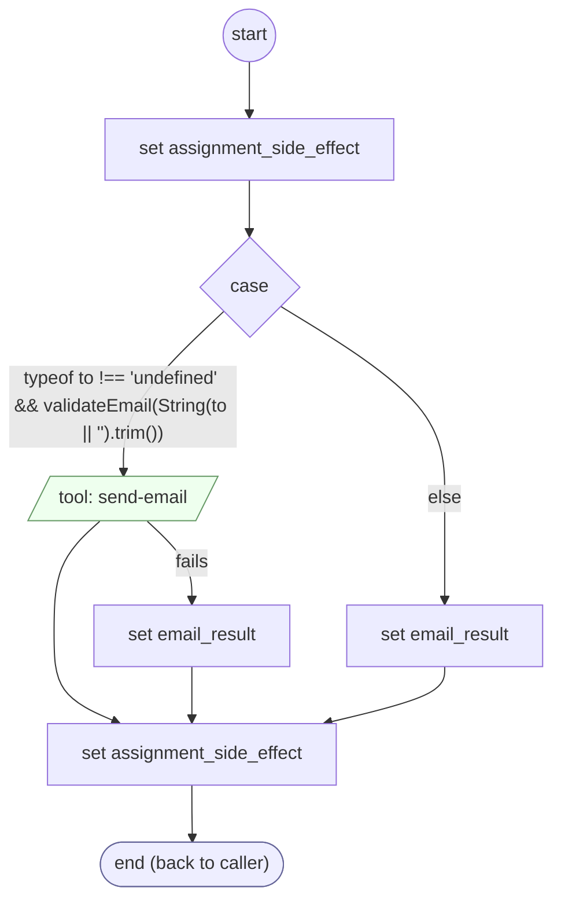

# SendEmailMessage

<!-- generated:start -->
**SendEmailMessage** · `send-email-message` · version 1.0.0 · worker (called by other flows) · steps

> Worker: emails `message` with `subject` to `to`, with an optional copy to `cc` (e.g. the account's email on file when the caller chose another address; owner 2026-10-17). Any valid address: sendEmail refuses one that cannot receive mail (mailbox verification). Sets cargo.emailSent; a refused or failed send leaves it false.

- **Parameters:** 
  - `to`: The email address
  - `subject`: The subject line
  - `message`: The email text
  - `cc`: An optional copy address; empty for none
- **Calls:** no other flow
- **Tools:** `send-email`
- **Called by:** nothing (unreachable)

### Steps

<!-- generated:end -->
