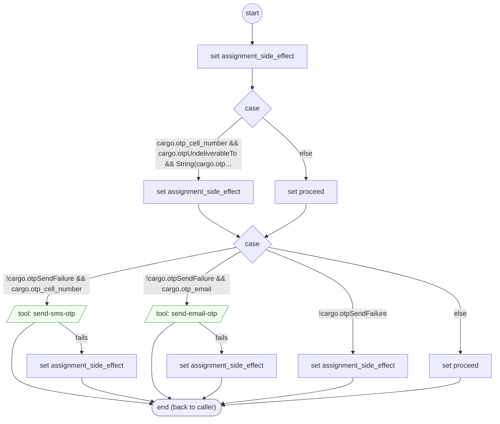

# SendOtpCode

<!-- generated:start -->
**SendOtpCode** · `send-otp-code` · version 1.0.0 · worker (called by other flows) · steps

> Worker: sends a one-time code to cargo.otp_cell_number (SMS) or cargo.otp_email. Never texts a number that cannot receive texts (cargo.otpUndeliverableTo). Sets cargo.otpSendFailure ('' | 'undeliverable' | 'sms' | 'email' | 'none'); the caller hands a failure to otp-send-failed.

- **Parameters:** none
- **Calls:** no other flow
- **Tools:** `send-sms-otp`, `send-email-otp`
- **Called by:** [authenticate-user](authenticate-user.md), [resend-otp-code](resend-otp-code.md)

### Steps

<!-- generated:end -->
