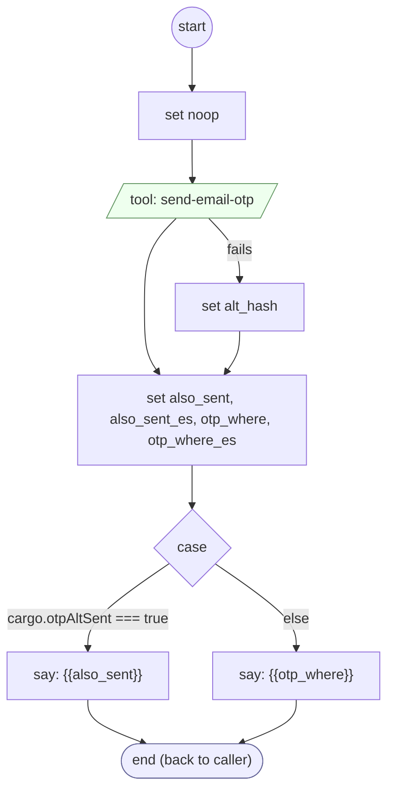

# SendOtpEmailToo

<!-- generated:start -->
**SendOtpEmailToo** · `send-otp-email-too` · version 1.0.0 · worker (called by other flows) · steps · shared scope

> Email a second one-time code to the account's email beside the texted one, and say so.

- **Parameters:** none
- **Calls:** no other flow
- **Tools:** `send-email-otp`
- **Called by:** [validate-otp-code](validate-otp-code.md)

### Steps

<!-- generated:end -->
