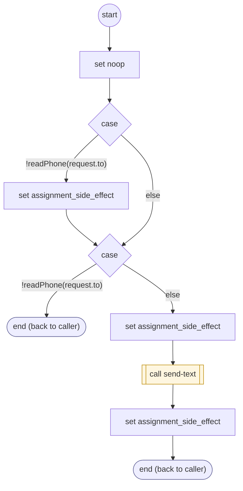

# SendTextAction

<!-- generated:start -->
**SendTextAction** · `send-text-action` · version 1.0.0 · worker (called by other flows) · steps · isolated scope

> Worker: send the explicitly prepared text through the platform transport; sent or unknown result, with no automatic resend.

- **Parameters:** 
  - `request`: 
  - `key`: 
- **Calls:** [send-text](send-text.md) (call)
- **Tools:** none
- **Called by:** [shopify-ql-product-links](../shopify/shopify-ql-product-links.md) (shopify)

### Steps

<!-- generated:end -->
