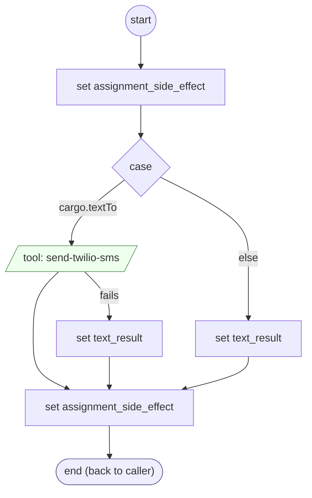

# SendText

<!-- generated:start -->
**SendText** · `send-text` · version 1.0.0 · worker (called by other flows) · steps

> Worker: texts `message` to cargo.textTo (call text-destination first). Sets cargo.textSent.

- **Parameters:** 
  - `message`: The text to send
- **Calls:** no other flow
- **Tools:** `send-twilio-sms`
- **Called by:** [send-text-action](send-text-action.md)

### Steps

<!-- generated:end -->
