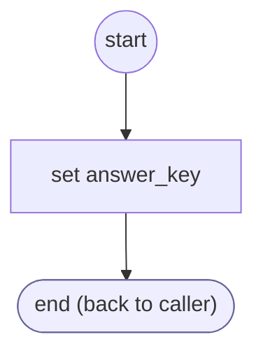

# ServiceAnswerRaw

<!-- generated:start -->
**ServiceAnswerRaw** · `service-answer-raw` · version 1.0.0 · worker (called by other flows) · steps · shared scope

> Leave protocol commands to their owning service rather than the generic menu transport.

- **Parameters:** 
  - `answer`: Raw answer
- **Calls:** no other flow
- **Tools:** none
- **Called by:** [collect-service-answer](collect-service-answer.md) (answer_precheck, by name)

### Steps

<!-- generated:end -->
