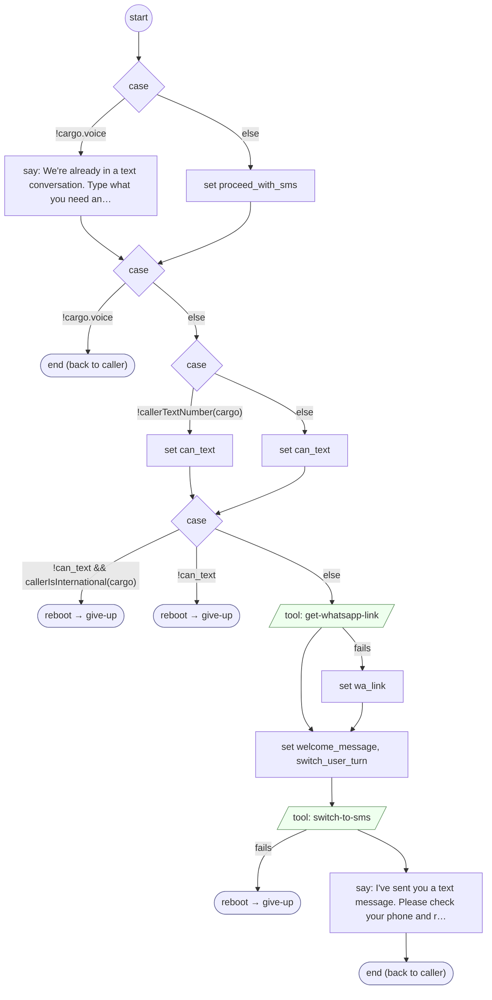

# SwitchToText

<!-- generated:start -->
**SwitchToText** · `switch-to-text` · version 1.2.4 · **entry point** (intent detection can start it) · steps

> Customer explicitly asks to continue this conversation by text message / SMS ('switch to text', 'text me instead', 'can we continue by text', 'pásame a texto', 'seguimos por mensaje de texto'). Not: asking for a live agent or a person (LiveAgentRequested); asking to have one thing texted, such as a link, an address or a statement, a yes or no, or any answer that does not mention text or SMS (None).

- **Parameters:** none
- **Calls:** [give-up](give-up.md) (reboot)
- **Tools:** `get-whatsapp-link`, `switch-to-sms`
- **Called by:** intent detection, [validate-otp-code](validate-otp-code.md), [generic-retry-with-options](generic-retry-with-options.md), [ask-choice](ask-choice.md), [9](9.md)

### Steps

<!-- generated:end -->
