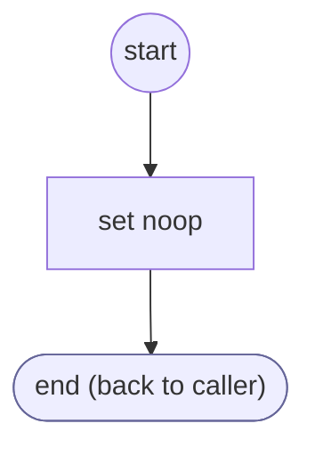

# TaskGate

<!-- generated:start -->
**TaskGate** · `task-gate` · version 1.0.0 · worker (called by other flows) · steps · isolated scope

> Mark the lifecycle of a task-owned gate so private provider questions wait for the existing gate rather than opening another.

- **Parameters:** 
  - `form`: Owning FORM instance
  - `gate`: Stable gate service identifier
  - `active`: Whether this gate is active
- **Calls:** no other flow
- **Tools:** none
- **Called by:** [authenticate-user](authenticate-user.md)

### Steps

<!-- generated:end -->
