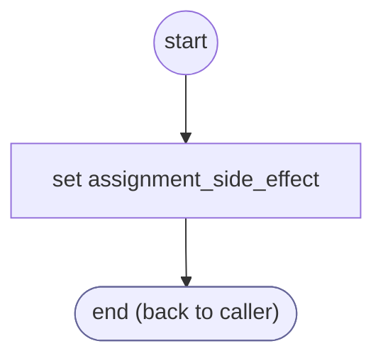

# TextDestination

<!-- generated:start -->
**TextDestination** · `text-destination` · version 1.0.2 · worker (called by other flows) · steps

> Worker: where a text to the customer can go. Sets cargo.textTo (10 digits: the verified cell, else the caller's phone on a call; '' when there is none, no sender, or the line cannot receive texts) and cargo.textTo4 (its last four, spaced on voice).

- **Parameters:** none
- **Calls:** no other flow
- **Tools:** none
- **Called by:** [shopify-ql-product-search](../shopify/shopify-ql-product-search.md) (shopify), [shopify-ql-product-links](../shopify/shopify-ql-product-links.md) (shopify)

### Steps

<!-- generated:end -->
