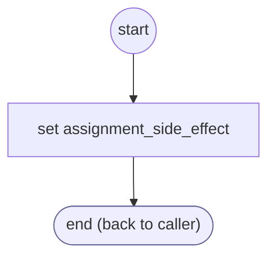

# ValidateCardCvv

<!-- generated:start -->
**ValidateCardCvv** · `validate-card-cvv` · version 1.0.0 · worker (called by other flows) · steps · isolated scope

> Validator: the security code has the length of its card brand, 4 digits for American Express (34, 37) and 3 for every other brand; with no card number yet, 3 or 4. Params: input, value, values.

- **Parameters:** 
  - `input`: input name
  - `value`: the reading
  - `values`: the form's values, for the card number
- **Calls:** no other flow
- **Tools:** none
- **Called by:** [collect-card-cvv](collect-card-cvv.md) (validator), [collect-credit-card](collect-credit-card.md) (validator), [confirm-form](confirm-form.md) (validator)

### Steps

<!-- generated:end -->
