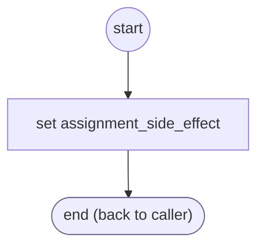

# ValidateCardNumber

<!-- generated:start -->
**ValidateCardNumber** · `validate-card-number` · version 1.0.0 · worker (called by other flows) · steps · isolated scope

> Validator: a card number passes the Luhn check (validateCardNumber). Params: input, value.

- **Parameters:** 
  - `input`: input name
  - `value`: the reading
- **Calls:** no other flow
- **Tools:** none
- **Called by:** [collect-card-number](collect-card-number.md) (validator), [collect-credit-card](collect-credit-card.md) (validator), [confirm-form](confirm-form.md) (validator)

### Steps

<!-- generated:end -->
