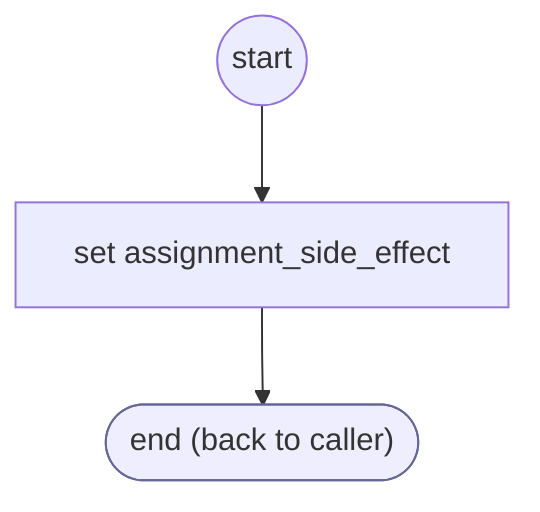

# ValidateCreditCard

<!-- generated:start -->
**ValidateCreditCard** · `validate-credit-card` · version 1.0.0 · worker (called by other flows) · steps · isolated scope

> Form validator: the security code has the length of the card brand, 4 digits for American Express (34, 37) and 3 for every other brand. Params: form, values.

- **Parameters:** 
  - `form`: form instance
  - `values`: the form's values
- **Calls:** no other flow
- **Tools:** none
- **Called by:** [collect-credit-card](collect-credit-card.md)

### Steps

<!-- generated:end -->
