# ValidateInputBatch

<!-- generated:start -->
**ValidateInputBatch** · `validate-input-batch` · version 2.0.0 · worker (called by other flows) · steps · isolated scope

> Worker: validate dependency-ordered candidates; return accepted, rejected and pending readings before a single commit.

- **Parameters:** 
  - `hits`: 
  - `accepted`: 
  - `rejected`: 
  - `pending`: 
  - `ignored`: 
- **Calls:** [prepare-input](prepare-input.md) (call), [read-form-response](read-form-response.md) (call), {{vb_h.validator}} (call), {{vb_proposal.prepare}} (call), [validate-input-batch](validate-input-batch.md) (replace)
- **Tools:** none
- **Called by:** [collect-input-accept](collect-input-accept.md), [validate-input-batch](validate-input-batch.md)

### Steps

```mermaid
flowchart TD
   START(("start"))
   n0["set accepted, rejected, pending, ignored, vb_h"]
   START --> n0
   c1{"case"}
   n0 --> c1
   b2["set assignment_side_effect"]
   c1 -- "!vb_h" --> b2
   c3{"case"}
   b2 --> c3
   c1 -- "else" --> c3
   b4(["end (back to caller)"])
   class b4 endstep
   c3 -- "!vb_h" --> b4
   n5["set vb_rest, vb_relevant, vb_ready"]
   c3 -- "else" --> n5
   c6{"case"}
   n5 --> c6
   b7[["call prepare-input"]]
   class b7 flowstep
   c6 -- "vb_ready === true" --> b7
   n8["set vb_values, vb_known, vb_outcome, assignment_side_effect, vb_response"]
   b7 --> n8
   c6 -- "else" --> n8
   c9{"case"}
   n8 --> c9
   b10[["call read-form-response"]]
   class b10 flowstep
   c9 -- "vb_ready === true && vb_h.current && vb_response && !vb_known && !vb_…" --> b10
   c11{"case"}
   b10 --> c11
   c9 -- "else" --> c11
   b12[["call #123;#123;vb_h.validator#125;#125;"]]
   class b12 flowstep
   c11 -- "vb_ready === true && vb_h.validator && !vb_known && !vb_h.invalid && …" --> b12
   c13{"case"}
   b12 --> c13
   c11 -- "else" --> c13
   b14["set assignment_side_effect"]
   c13 -- "vb_h.refused === true #124;#124; vb_h.incompleteMoney === true" --> b14
   n15["set vb_candidate, vb_proposal, vb_proposal_values, assignment_side_effect"]
   b14 --> n15
   c13 -- "else" --> n15
   c16{"case"}
   n15 --> c16
   b17[["call #123;#123;vb_proposal.prepare#125;#125;"]]
   class b17 flowstep
   c16 -- "vb_proposal && vb_proposal.prepare" --> b17
   n18["set vb_proposal_ok, assignment_side_effect"]
   b17 --> n18
   c16 -- "else" --> n18
   n19(["replace → validate-input-batch"])
   class n19 endstep
   n18 --> n19
   classDef endstep fill:#eef,stroke:#669
   classDef toolstep fill:#efe,stroke:#696
   classDef flowstep fill:#fef6e0,stroke:#b80
   classDef inputstep fill:#f3eefc,stroke:#75a
```

<!-- generated:end -->
