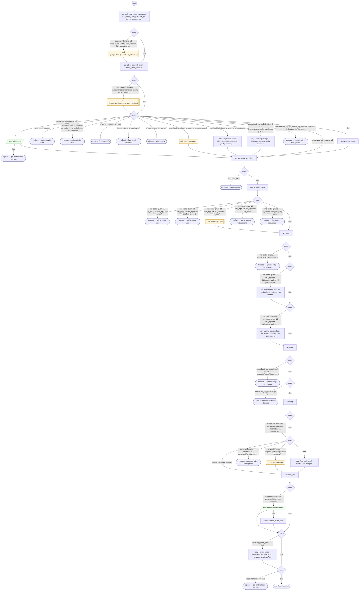

# ValidateOtpCode

<!-- generated:start -->
**ValidateOtpCode** · `validate-otp-code` · version 1.0.0 · worker (called by other flows) · steps · shared scope

> Validate a challenge response with explicit bounded retries, alternate-contact handling and tenant callbacks.

- **Parameters:** none
- **Calls:** [contact-support](contact-support.md) (value, by name), {{cargo.authOptions.code_validator}} (call), {{cargo.authOptions.answer_handler}} (call), [get-and-validate-otp-code](get-and-validate-otp-code.md) (replace), [authenticate-user](authenticate-user.md) (replace, retry_flow of generic-retry-with-options, retry_flow, by name), {{otp_cancel}} (reboot), [live-agent-requested](live-agent-requested.md) (reboot), [switch-to-text](switch-to-text.md) (reboot), [resend-otp-code](resend-otp-code.md) (call), [generic-retry-with-options](generic-retry-with-options.md) (replace)
- **Tools:** `validate-otp`, `send-whatsapp-invite`
- **Called by:** [get-and-validate-otp-code](get-and-validate-otp-code.md), [generic-retry-with-options](generic-retry-with-options.md)

### Steps

<!-- generated:end -->
