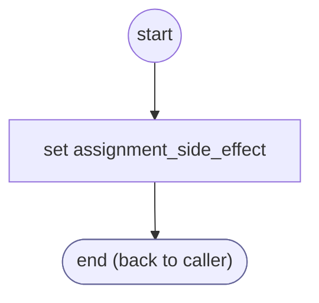

# ValidateUsPhone

<!-- generated:start -->
**ValidateUsPhone** · `validate-us-phone` · version 1.0.0 · worker (called by other flows) · steps · isolated scope

> Validator: a US or Canada phone number, 10 digits or 11 starting with 1 (validatePhone); normalizes to its 10 digits. The phone reader alone also takes an 11-13 digit international number. Params: form, input, value, values, reading (it reads value).

- **Parameters:** 
  - `input`: input name
  - `value`: the reading
- **Calls:** no other flow
- **Tools:** none
- **Called by:** nothing (unreachable)

### Steps

<!-- generated:end -->
