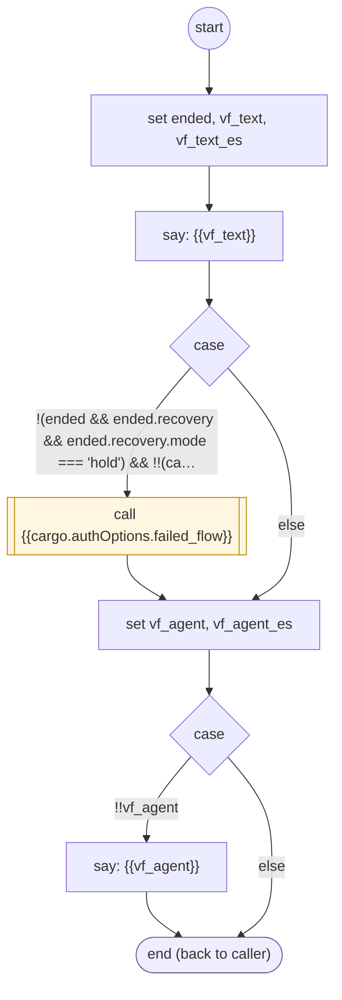

# VerificationFailed

<!-- generated:start -->
**VerificationFailed** · `verification-failed` · version 1.0.0 · worker (called by other flows) · steps · shared scope

> End a verification that ran out of attempts: retire the owning task, set cargo.verificationFailed, report it unresolved (verification_failed), say so, run the failed_flow given to authenticate-user, then offer an agent.

- **Parameters:** 
  - `form`: Owning task FORM instance
- **Calls:** {{cargo.authOptions.failed_flow}} (call)
- **Tools:** none
- **Called by:** [validate-otp-code](validate-otp-code.md), [resend-otp-code](resend-otp-code.md)

### Steps

<!-- generated:end -->
