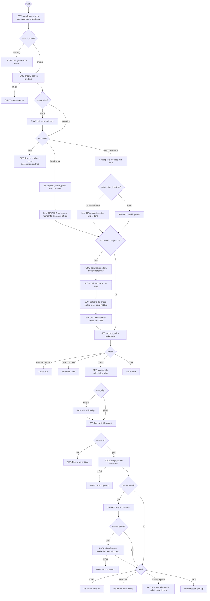
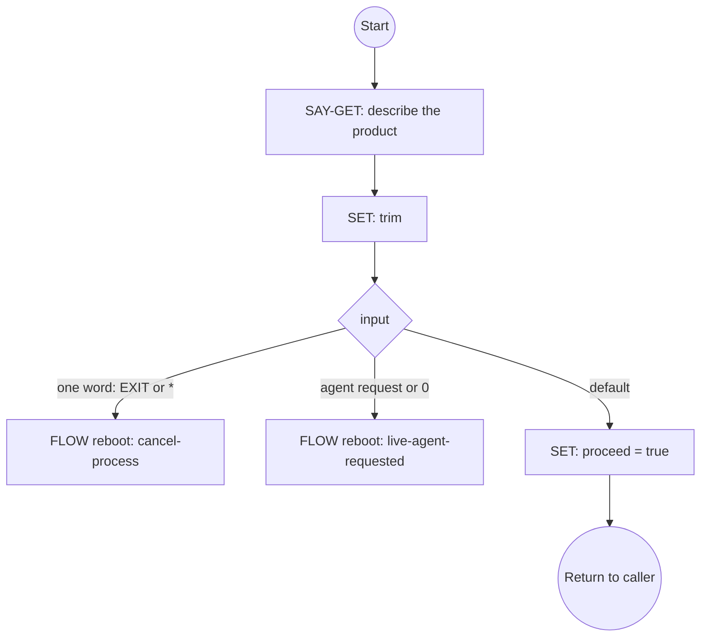
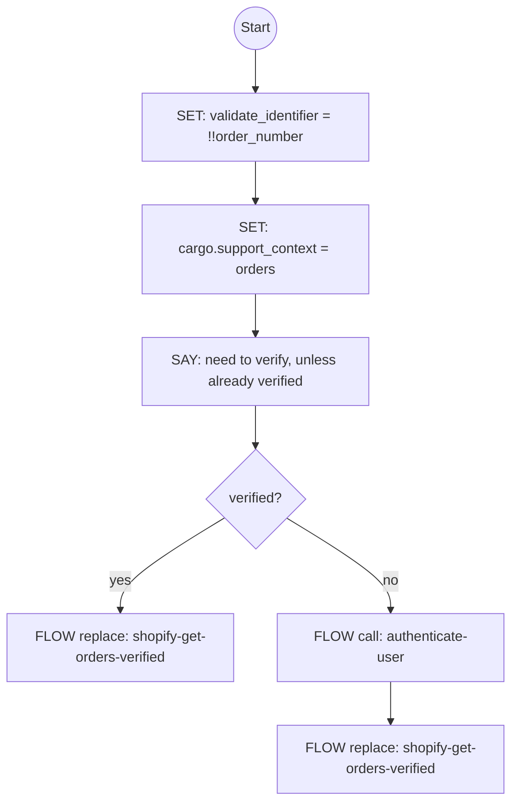
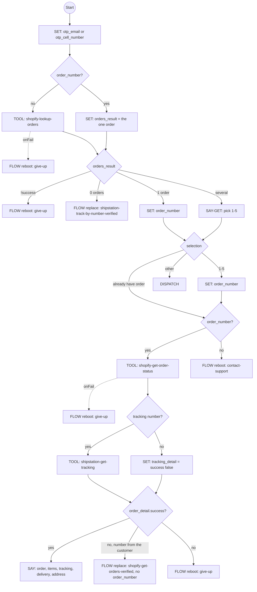
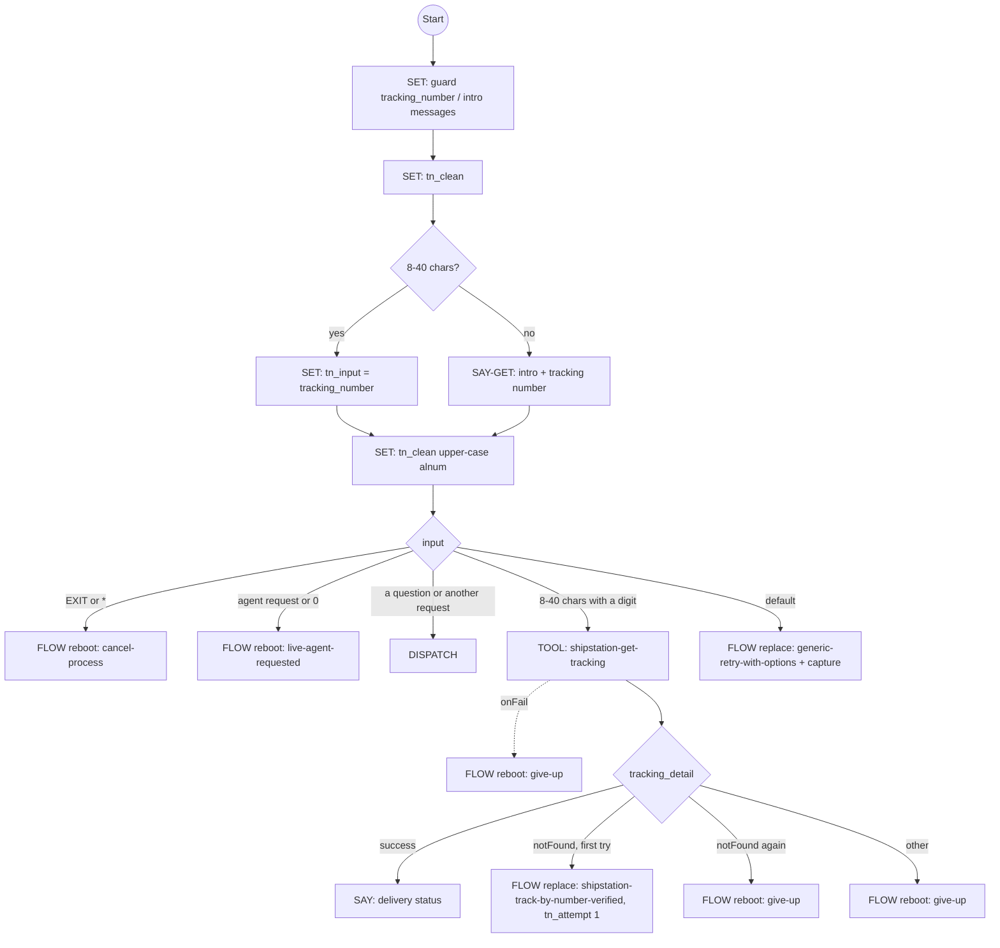
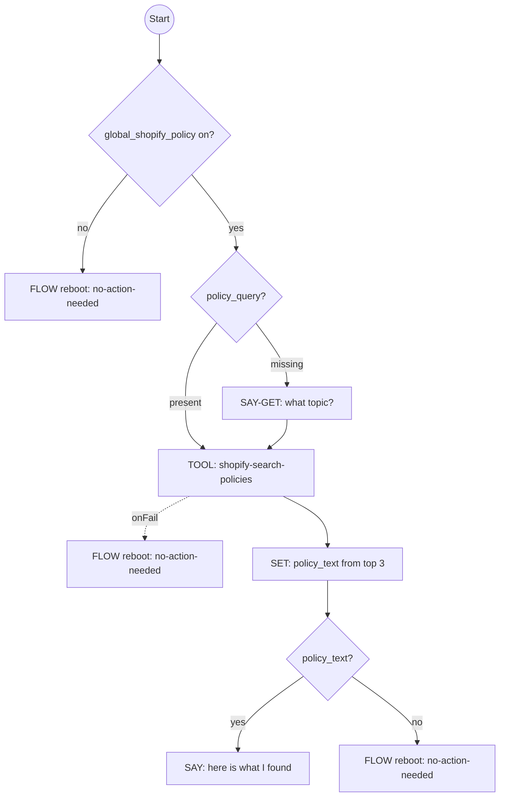

# Shopify Flows Library

This document details the e-commerce flows in `flows/shopify.flows.json` and the tools in `flows/shopify.tools.json`. These flows provide integration with Shopify (and ShipStation for carrier tracking) for product search, local store availability, order tracking and store policy questions.

Everything below is read from the JSON. The flows call the system flows (`no-action-needed`, `cancel-process`, `contact-support`, `live-agent-requested`, [give-up](system-flows.md#giveup), `authenticate-user`, `generic-retry-with-options`, [`text-destination`](system-flows.md#textdestination), [`send-text`](system-flows.md#sendtext)) and the system tool [`get-whatsapp-link`](system-flows.md#get-whatsapp-link). Call types, `onFail` behaviour, cargo fields and the host-supplied expression helpers (`isAnswer`, `isAgentRequest`, `pickChoice`, `matchesChoice`…; these flows also call `amountToSpeech`) and the shared answer vocabulary work as described in [System Flows → Conventions](system-flows.md#conventions-used-by-these-flows).

## Table of Contents
- [Flows](#flows)
  - [ShopifyProductSearch](#shopifyproductsearch)
  - [GetSearchQuery](#getsearchquery)
  - [ShopifyTrackOrder](#shopifytrackorder)
  - [ShopifyGetOrdersVerified](#shopifygetordersverified)
  - [ShipStationTrackByNumberVerified](#shipstationtrackbynumberverified)
  - [ShopifyStorePolicies](#shopifystorepolicies)
- [Tools](#tools)
  - [shopify-search-products](#shopify-search-products)
  - [shopify-get-product](#shopify-get-product)
  - [shopify-get-cart](#shopify-get-cart)
  - [shopify-add-to-cart](#shopify-add-to-cart)
  - [shopify-apply-discount](#shopify-apply-discount)
  - [shopify-search-policies](#shopify-search-policies)
  - [shopify-lookup-orders](#shopify-lookup-orders)
  - [shopify-get-order-status](#shopify-get-order-status)
  - [shopify-store-availability](#shopify-store-availability)
  - [shipstation-get-tracking](#shipstation-get-tracking)

**Tenant inputs these flows read:** the global variables `global_store_locations` (an array of store records, required for the local-stock offer in ShopifyProductSearch), `global_store_locator` (optional; the store-locator address ShopifyProductSearch offers when a city is not found) and `global_shopify_policy` (opt-in for ShopifyStorePolicies). They also read the cargo fields `cargo.voice`, `cargo.verb` / `verb_es`, `cargo.otpVerified`, `cargo.otp_email`, `cargo.otp_cell_number`, and `cargo.textTo` / `cargo.textTo4` / `cargo.textSent` (written by text-destination and send-text). `shopify-track-order` writes `cargo.support_context` / `support_context_es`.

---

## Flows

## ShopifyProductSearch
**ID**: `shopify-product-search` · **Version**: 1.6.2 · **Primary** (prompt "product search" / "buscar producto")  
**Description**: Customer asks to find a product, whether one is in stock (online or at a store near them), or what it costs ('do you have air fryers', 'is this TV in stock in Phoenix', 'how much is the iPhone 16', '¿tienen refrigeradores?', '¿cuánto cuesta?'). Not: general advice without asking for a product (None); an order already placed (ShopifyTrackOrder); returns, shipping or other store policies (ShopifyStorePolicies). The product number is read by pickChoice, so a number with courtesy or a YES around it ("Yes 1", "1 please") picks it. On a call: the results are spoken — up to three, each with its name, price and stock, no links — and TEXT / TEXTO texts the links (text-destination, send-text), then the question is asked again; with no phone that can receive texts the TEXT option is not offered. The text ends with how to continue: by replying, and on WhatsApp (get-whatsapp-link, the search pre-filled) when the tenant invites callers there.

### Parameters
*   `search_query` (string): The product name, brand and/or features the user specified.
*   `user_city` (string): The city, or the store by its city, where the customer wants the product ("in Phoenix"); empty when none is named. When given, the city question is not asked.

### Variables
`search_query` (initial `""`), `search_result`, `product_choice` (initial `""`; the answer to the product question), `product_idx`, `selected_product`, `selected_variant`, `user_city` (initial `""`), `store_availability`, `user_prompt` (the user's follow-up when no stores are defined; dispatched to intent detection), `variant_gid` (initial `""`; the selected variant id, set by `variant_ok`), `user_city_retry` (initial `""`; the second city or ZIP, after the first was not found). Also set without a declaration: `product_pick`, `sps_wants_text`, `sps_wa`, `sps_links`.

### Steps
1. `query_from_prompt` (SET) - `search_query` = the parameter, else the user's input (`userInput`, trimmed) unless it starts with `START `, else `''`.
2. `get-search-query-if-no-param` (CASE) - `!search_query` → FLOW `get-search-query` (`call`).
3. `search_products` (CALL-TOOL [`shopify-search-products`](#shopify-search-products)) - `{query: search_query, context: "Customer searching via chat", limit: 5, language}` into `search_result`. `onFail` → FLOW [give-up](system-flows.md#giveup) (`reboot`), `context: "the product search"` / `context_es: "la búsqueda de productos"`.
4. `sps_text_where` (CASE) - on voice → FLOW [`text-destination`](system-flows.md#textdestination) (`call`), which sets `cargo.textTo` / `cargo.textTo4`. Otherwise nothing.
5. `display_results` (CASE) - `search_result.products` non-empty → `show_results_by_channel`:
   - on voice, SAY up to **3** products, with no links: "I found {n} for "{query}". One: {title}, {price}, {stock}. Two: …" (Spanish "Encontré {n} para "{query}". Uno: … Dos: … Tres: …"). The price is `price_range.min` (UCP amounts are cents, divided by 100), spoken through `amountToSpeech(amount, language, true)` (in the reference host, `foundation/text/amount-to-speech.js`: the amount in words, "Fifty Dollars and Twenty Five Cents" / "Cincuenta dólares…"), led by "from" / "desde" when `price_range.max` differs; the stock is ", in stock", ", some options in stock" or ", out of stock" ("disponible", "algunas opciones disponibles", "agotado"), or nothing when the product has no variants.
   - otherwise, SAY "Great! Here's what I found for '{query}':" followed by up to **5** products. Each shows its title; its price, from `price_range.min.amount` / `max.amount` divided by 100: "$89.99", or a range "$a - $b", or "Price varies"; a stock line, from `variants[].availability.available` (or `variants[].available`): "In Stock", "Limited Stock (n/m options available)", "Out of Stock", or nothing when the product has no variants; and "View: {url}".

   No products → **`RETURN`** "I couldn't find any products for '{query}' in our online store. You can describe it another way, or ask me anything else." (Spanish: "No encontré productos para '{query}' en nuestra tienda en línea. Puedes describirlo de otra forma o preguntarme cualquier otra cosa."), the query trimmed of leading `¿` / `¡` and trailing `.` `?` `!`, **`outcome: "unresolved"`, `reason: "no_products_found"`**.
6. `check_global_store_locations` (CASE, first match wins), with N = the number of products shown (at most 3 on voice and 5 otherwise):
   - on voice → SAY-GET `product_choice`: "[Say TEXT and I'll text you the links. ][To check which stores near you have one, say its number. ]Or say DONE." (Spanish "[Diga TEXTO y le envío los enlaces por mensaje. ][Para ver qué tiendas cercanas lo tienen, diga su número. ]O diga LISTO."). The TEXT sentence only when `cargo.textTo` is set; the store sentence only when `global_store_locations` is a non-empty array.
   - `global_store_locations` is a non-empty array → SAY-GET `product_choice`: "Would you like to check which stores near you have any of these in stock? Tell me the product number (1-N), or type 'done' if you're all set." ("1" alone when N is 1; Spanish "… o escribe 'listo' si ya terminaste.").
   - otherwise → SAY-GET `user_prompt`: "Is there anything else I can help you with today?"
7. Links by text (on voice only):
   - `sps_wants_text` (SET) - on voice, with `cargo.textTo`, and the answer holds text, texto, mensaje, message, send, envía / envíalos / envíamelos or manda / mándalos / mándamelos (as words).
   - `sps_whatsapp` (CASE) - when it does → CALL-TOOL [`get-whatsapp-link`](system-flows.md#get-whatsapp-link) `{notTemplateInvite: true}` into `sps_wa`; `onFail` → `''`. Otherwise `sps_wa = ''`.
   - `sps_links` (SET) - "Links for "{query}":" then, per product shown, "{n}. {title}" and its URL on the next line, then a blank line and "You can continue your product search right here by sending me a text[, or over WhatsApp: {sps_wa}?text={query, URL-encoded}]." (Spanish "Enlaces para "{query}": … Puede continuar su búsqueda de productos aquí mismo enviándome un mensaje[, o por WhatsApp: …]."; without a link the sentence ends with a period).
   - `sps_send_links` (CASE) - when it does → FLOW [`send-text`](system-flows.md#sendtext) (`call`) with `message: {{sps_links}}`.
   - `sps_links_sent` (CASE) - sent (`cargo.textSent`) → SAY "Done, I texted the links to the phone ending in {cargo.textTo4}. You can continue your search on your cell responding to the text I sent." (Spanish "Listo, le envié los enlaces al teléfono que termina en {cargo.textTo4}. …"); not sent → SAY "Sorry, I couldn't text the links right now." / "Lo siento, no pude enviar los enlaces en este momento."
   - `sps_ask_again` (CASE) - after a TEXT answer → SAY-GET `product_choice` again: "[To check which stores near you have one, say its number. ]Or say DONE." (the store sentence as in step 6).
8. `read_product_pick` (SET) - when `global_store_locations` is a non-empty array, `product_pick = pickChoice(answer, [{ key: '1', words: ['1'] }, … up to N], false)`; otherwise `''` (no number was offered, so a number is another request, DISPATCHed in step 9). With a store list, a product number with courtesy or a YES around it ("Yes 1", "1 please") picks it, under the [AskChoice matching rules](system-flows.md#matching-pickchoice).
9. `check_product_choice` (CASE, first match wins):
   - `user_prompt` set (the answer to "Anything else?") → **`DISPATCH`**: the answer goes to intent detection (another flow can start at once), else to the host.
   - `done | no | exit | listo | no gracias | salir` (whole answer, case-insensitive) → `RETURN` "Cool! If you need anything else, just ask." (Spanish: "¡Genial! Si necesitas algo más, solo pregunta.")
   - `product_pick` is `1`–`5` → SET `product_idx` (0-based).
   - anything else → **`DISPATCH`**.
10. `set_selected_product` → `search_result.products[product_idx]`.
11. `ask_city_unless_given` (CASE) - `user_city` empty → SAY-GET `user_city`: "What city are you near? I'll find stores with this item in stock." Otherwise no question. Then `normalize_city` trims it.
12. `set_selected_variant` - the first variant that is available, else the first variant, else `null`.
13. `check_variant_valid` (CASE) - a variant id (`id` or `variant_id`) → `variant_ok` SETs `variant_gid`. Otherwise `RETURN` "Sorry, I couldn't get variant information for this product."
14. `lookup_store_availability` (CALL-TOOL [`shopify-store-availability`](#shopify-store-availability)) - `{variantId: variant_gid, city: user_city, storeLocations: global_store_locations, maxStores: 3}` into `store_availability`. `onFail` → FLOW [give-up](system-flows.md#giveup) (`reboot`), `context: "checking the store availability"` / `context_es: "la disponibilidad en tiendas"`.
15. `ask_city_again_if_not_a_place` (CASE) - `store_availability.success === false` with an `error` matching `could not geocode` (case-insensitive) → SAY-GET `user_city_retry`: "I couldn't find "{user_city}" as a city. What city or ZIP code are you near?"
16. `lookup_again_with_new_city` (CASE) - the same geocode failure and a non-blank `user_city_retry` → CALL-TOOL `shopify-store-availability` again with `city: user_city_retry` (other args unchanged) into `store_availability`. Same `onFail` (give-up). The answer is not trimmed, and there is one retry only.
17. `display_availability` (CASE):
    - `success && found && stores.length > 0` → `RETURN` "{productTitle}[ - {variantTitle}] Available for pickup at:", then per store "{n}. {name} ({city}) / {available} in stock - {distance.toFixed(1)} miles away / {address} / {phone}", then "Need anything else?".
    - `success && !found` → `RETURN` "Sorry, this product is not currently available for in-store pickup at any location. You can order it online for delivery."
    - still a geocode failure → `RETURN` "I couldn't find that location. You can see all our stores at {global_store_locator}, or tell me your city any time." When `global_store_locator` is not set: "I couldn't find that location. Tell me your city any time."
    - otherwise (`availability_error`) → FLOW [give-up](system-flows.md#giveup) (`reboot`), `context: "checking the store availability"` / `context_es: "la disponibilidad en tiendas"`.

A number above N (a product that was not shown) is not a product choice and is DISPATCHed. A product search or store-availability failure reboots into give-up, which says "Sorry, I wasn't able to help with {context}." and hands the customer to `live-agent-requested`. On voice the product question is asked whether or not `global_store_locations` is set, and a product number is taken in both cases.

### Ends
By `RETURN` (all flows end; no products found ends `unresolved`), by `DISPATCH` (the answer goes to intent detection, else to the host), or by a `reboot` into give-up (a search or store-availability failure).

### Flowchart

---

## GetSearchQuery
**ID**: `get-search-query` · **Version**: 1.0.1 · **Sub-flow**  
**Description**: Get a search query string from the user for product search.

### Steps
1. `ask_what_looking_for` (SAY-GET `search_query`) - "Please describe the product you are looking for, using natural language. You can also mention brand names or features." Then `normalize_search` trims the answer.
2. `check_for_exit` (CASE):
   - `isAnswer(…, 'exit')` (EXIT words or `*`) in a one-word answer → FLOW `cancel-process` (`reboot`).
   - `isAgentRequest` (the whole answer asks for a person, or is `0`) → FLOW `live-agent-requested` (`reboot`). A product that contains an AGENT word ("customer service headset") is searched.
   - default → SET `proceed = true`.

### Ends
By completion, returning `search_query` to `shopify-product-search` (shared variables), or by one of the reboots.

### Flowchart

---

## ShopifyTrackOrder
**ID**: `shopify-track-order` · **Version**: 1.0.2 · **Primary** (prompt "track order" / "rastrear pedido")  
**Description**: Customer asks about an order or purchase they placed: its status, when it will arrive or be ready for pickup, where it is, its tracking, a package that has not arrived, or a list of their orders ('where is my order', 'order status', 'my order', 'help with an order', 'track my package', 'when will my delivery arrive', 'order #1234', '¿dónde está mi pedido?', 'mi pedido', 'estado de mi orden', '¿cuándo llega mi pedido?', '¿ya está listo para recoger?', 'no me ha llegado mi pedido', 'rastrear mi pedido'). Not: finding a product (ShopifyProductSearch); a return, refund or shipping policy (ShopifyStorePolicies); cancelling an order (None).

### Parameters
*   `order_number` (string): Order number in the message ('#1234').

### Variables
`order_number` (initial `""`), `cell_number` (initial `""`), `email` (initial `""`), `order_detail`, `validate_identifier`.

### Steps
1. `set_validate_if_from_param` - `validate_identifier = !!order_number`. An order number taken from the user's prompt must be checked against the verified identity.
2. `set_support_context` - `cargo.support_context = 'orders'`, `cargo.support_context_es = 'pedidos'` (read by `contact-support`).
3. `explain_verification` (SAY) - "I can help you track your order. For your security, I'll need to verify your identity first." Empty when already verified (`cargo.otpVerified` and `cargo.otp_email || cargo.otp_cell_number`).
4. `check_otp_status` (CASE):
   - already verified (same test) → FLOW `shopify-get-orders-verified` (`replace`).
   - otherwise → FLOW `authenticate-user` (`call`) with `retry_flow: "shopify-track-order"`, `cancel_flow: "contact-support"`.
5. `proceed_to_orders` - FLOW `shopify-get-orders-verified` (`replace`), reached when `authenticate-user` returns.

The flow does not re-check `cargo.otpVerified` after `authenticate-user` returns. The order tools enforce OTP themselves (they return `success: false` with `requiresOTP: true`). In `shopify-get-orders-verified`, a failed order lookup or order-status call ends in [give-up](system-flows.md#giveup).

### Ends
By `replace` into `shopify-get-orders-verified`, or through `authenticate-user`'s exits.

### Flowchart

---

## ShopifyGetOrdersVerified
**ID**: `shopify-get-orders-verified` · **Version**: 1.1.2 · **Sub-flow**  
**Description**: Get order list for verified customer.

Reached by `replace` from `shopify-track-order`, so it keeps that flow's variables (`order_number`, `validate_identifier`).

### Variables
`orders_result`, `order_number`, `user_choice` (initial `""`), `shopify_identifier`, `tracking_detail` (ShipStation real-time tracking result).

### Steps
0. `note_number_source` (SET) - `number_from_customer = !!order_number` when the flow starts: the customer gave the number (it was not picked from their list).
1. `set_shopify_identifier` - `cargo.otp_email || cargo.otp_cell_number` (the verified contact).
2. `call_tool_if_no_param` (CASE):
   - `!order_number` → CALL-TOOL [`shopify-lookup-orders`](#shopify-lookup-orders) `{identifier: shopify_identifier, container: cargo}` into `orders_result`. `onFail` (`lookup_failed`) → FLOW [give-up](system-flows.md#giveup) (`reboot`), `context: "your order"` / `context_es: "su pedido"`.
   - otherwise → SET `orders_result = {success: true, orders: [{orderNumber: order_number}]}` (skips the lookup).
3. `display_orders` (CASE):
   - `!orders_result || !orders_result.success` (`lookup_error`) → FLOW [give-up](system-flows.md#giveup) (`reboot`), `context: "your order"` / `context_es: "su pedido"`.
   - no orders → FLOW `shipstation-track-by-number-verified` (`replace`) with `intro_message`: "Sorry, I couldn't find any orders associated with your account. If you have a package tracking number, I can look it up directly." (and Spanish).
   - one order → SET `order_number = orders_result.orders[0].orderNumber`.
   - several → SAY-GET `user_choice`: "Hi {orders_result.customer.firstName}! Here are your recent orders:", then up to 5 entries: "{n}. Order {orderNumber} / Date: {createdAt as locale date, or 'N/A'} / Status: {status}[ / Payment: {payment}] / Total: ${total.amount or 'N/A'}". Then "To see details for a specific order, {verb} the order number (e.g., '1' for the first order). Or {verb} anything else if you're done."

     **Status** is "Cancelled" when `cancelled`; otherwise `fulfillmentStatus` in words: `UNFULFILLED` / `OPEN` / `RESTOCKED` → "Not shipped yet", `PARTIALLY_FULFILLED` → "Partly shipped", `FULFILLED` → "Shipped", `IN_PROGRESS` / `PENDING_FULFILLMENT` → "Being prepared", `ON_HOLD` → "On hold", `SCHEDULED` → "Scheduled", `REQUEST_DECLINED` → "Delayed", `FULFILLMENT_NOT_REQUIRED` → "Nothing to ship", any other value lower-cased with spaces; "Processing" when there is none. **Payment** (only when `financialStatus` is set): `AUTHORIZED` → "Authorized", `PAID` → "Paid", `PARTIALLY_PAID` → "Partly paid", `PENDING` → "Pending", `REFUNDED` → "Refunded", `PARTIALLY_REFUNDED` → "Partly refunded", `VOIDED` → "Voided", `EXPIRED` → "Expired", any other value lower-cased with spaces. The Spanish text uses Spanish labels for both.
4. `check_single_order` - `go_to_details = !!order_number`.
5. `handle_selection` (CASE) - `go_to_details` → continue. `1`–`5` → `order_number = orders_result.orders[n-1]?.orderNumber || ''`. Otherwise → **`DISPATCH`**: the answer goes to intent detection, else to the host.
6. `get_specific_order` (CASE):
   - `order_number` → CALL-TOOL [`shopify-get-order-status`](#shopify-get-order-status) `{orderNumber: order_number, identifier: shopify_identifier, container: cargo, validateIdentifier: validate_identifier}` into `order_detail`. `onFail` (`order_detail_failed`) → FLOW [give-up](system-flows.md#giveup) (`reboot`), `context: "your order"` / `context_es: "su pedido"`.
   - otherwise → FLOW `contact-support` (`reboot`).
7. `fetch_shipstation_tracking` (CASE) - when `order_detail.success` and `order_detail.order.fulfillments[0].tracking[0].number` exists → CALL-TOOL [`shipstation-get-tracking`](#shipstation-get-tracking) `{trackingNumber: that number, container: cargo}` into `tracking_detail`. Its `onFail` is SET `tracking_detail = {success: false}`. Without a tracking number → SET `tracking_detail = {success: false}`.
8. `show_order_detail` (CASE):
   - `order_detail.success && order_detail.order` → SAY:
     - "Order {orderNumber}" / "Status: {status}" / "Payment: {payment}" / "Total: ${total.amount}", with status and payment in words as in the order list ("Cancelled" when `cancelled`; the Payment line is empty when `financialStatus` is not set);
     - "Items:" with "- {title} (x{quantity})" per line item;
     - "Tracking: {fulfillments[0].tracking[0].company} - {number}" and "Track: {url}" when present;
     - when `tracking_detail.success`: "Delivery status: {statusDescription}", "Delivery issue: {exception}", "Last update: {lastEvent}", then "Delivered on: {actualDelivery}" or "Estimated delivery: {estimatedDelivery}";
     - "Shipping to:" with the name, `address1`, "city, province zip" from `shippingAddress`, or "N/A";
     - "Anything else I can help with?"

     The Spanish text maps `tracking_detail.status` codes (AC, IT, DE, EX, AT, NY, SP, UN) to Spanish labels and uses `lastEventEs`.
   - `number_from_customer` (the customer gave the number) → FLOW `shopify-get-orders-verified` (`replace`) with `order_number: ''`, which looks up and lists the customer's recent orders. A number picked from that list, or the only order picked automatically, is never re-listed, so the flow cannot loop.
   - otherwise (`order_not_found`) → FLOW [give-up](system-flows.md#giveup) (`reboot`), `context: "your order"` / `context_es: "su pedido"`.

The step-7 `onFail` is non-FLOW, so it runs immediately after the failed tool and the flow then continues to step 8 (see Conventions); the order detail is shown without the delivery lines. Give-up says "Sorry, I wasn't able to help with your order." and hands the customer to `live-agent-requested`.

### Ends
By completion after the order detail (the SAYs carry `variable: continue_choice`, which is not read). Otherwise by `DISPATCH` (an answer that is not 1-5), `reboot` into give-up (a failed lookup or order-status call, or an order not found) or `contact-support` (no order number at step 6), or `replace` into `shipstation-track-by-number-verified` (no orders) or into `shopify-get-orders-verified` itself (`go_to_details` and the order not found).

### Flowchart

---

## ShipStationTrackByNumberVerified
**ID**: `shipstation-track-by-number-verified` · **Version**: 1.0.5 · **Sub-flow**  
**Description**: Collect a tracking number and read back real-time ShipStation tracking for verified customer.

Reached by `replace` from `shopify-get-orders-verified` when the verified customer has no Shopify orders. It retries into itself via `generic-retry-with-options` (an invalid number) and once directly (a number not found).

### Variables
`tracking_number` (initial `""`; also the smart-capture target), `tn_attempt` (a parameter, not declared; `'1'` on the retry after a number was not found), `tn_input`, `tn_clean`, `intro_message` / `intro_message_es` (optional text spoken before the question), `tracking_detail`.

### Steps
1. Guards - `tracking_number` (as a string), `intro_message` and `intro_message_es` default to `''` when undefined.
2. `clean_param` - `tn_clean` = `tracking_number` with non-alphanumerics removed.
3. `ask_if_missing` (CASE) - `tn_clean` is 8–40 characters → `tn_input = tracking_number` (no prompt). Otherwise → SAY-GET `tn_input` (`digits: {min 8, max 34}`): "[{intro_message} ]Please {verb} [or enter] your tracking number[, followed by the pound key if entered using the dial pad]. To exit anytime … EXIT."
4. `normalize_input` - `tn_clean` = the first word of `tn_input` that is 8–40 letters and digits with a digit (a tracking number said inside a sentence), else the whole of `tn_input`; alphanumerics only, upper-cased.
5. `route_input` (CASE):
   - `isAnswer(…, 'exit')` (EXIT words or `*`) in an answer of at most two words → FLOW `cancel-process` (`reboot`).
   - `isAgentRequest` (the whole answer asks for a person, or is `0`) → FLOW `live-agent-requested` (`reboot`).
   - no word of the answer is 8+ letters and digits with a digit, and the answer is a question (`?` or `¿`) or holds three or more words → **DISPATCH** (another request: "where can I find my tracking number?", "I'm trying to pay for it").
   - `tn_clean` is 8–40 characters and contains a digit → CALL-TOOL [`shipstation-get-tracking`](#shipstation-get-tracking) `{trackingNumber: tn_clean, container: cargo}` into `tracking_detail`. `onFail` (`shipstation_lookup_failed`) → FLOW [give-up](system-flows.md#giveup) (`reboot`), `context: "your tracking"` / `context_es: "el rastreo de su paquete"`.
   - default → FLOW `generic-retry-with-options` (`replace`): "That doesn't look like a valid tracking number. Tracking numbers are at least 8 letters and digits.", `retry_flow: "shipstation-track-by-number-verified"`, `cancel_flow: "contact-support"`, `capture_patterns: [{variable: "tracking_number", regex: "\b(?=[A-Za-z0-9]*[0-9])[A-Za-z0-9]{8,40}\b"}]`. The capture is the first whole word of 8 to 40 letters and digits that holds a digit (`normalizeAndFindCapture` returns the matched part), so "my tracking number is 1Z…" captures the `1Z…` number and reboots this flow with it. No `retry_call_type` is passed, so a YES or `1` at the menu reboots this flow afresh and asks for the number (see [GenericRetryWithOptions](system-flows.md#genericretrywithoptions)).
6. `show_result` (CASE):
   - `tracking_detail.success` → SAY "Here's the latest on tracking number {number}:", then the delivery status, issue, last update and delivered / estimated date (same rendering as ShopifyGetOrdersVerified), then "Anything else I can help with?". On voice the number is read as "ending in 1, 2, 3, 4" (its last four characters).
   - `tracking_detail.notFound` on the first try (`tn_attempt` not set) → FLOW `shipstation-track-by-number-verified` (`replace`) with `tracking_number: ''`, `tn_attempt: '1'` and `intro_message`: "I couldn't find that tracking number in our shipping system." (Spanish: "No encontré ese número de rastreo en nuestro sistema de envíos."), so the customer is asked for the number again.
   - `tracking_detail.notFound` again (`tn_attempt` set) → FLOW [give-up](system-flows.md#giveup) (`reboot`) (`tracking_not_found_again`), `context: "your tracking"` / `context_es: "el rastreo de su paquete"`.
   - otherwise (`tracking_error`) → FLOW [give-up](system-flows.md#giveup) (`reboot`), same context.

Give-up says "Sorry, I wasn't able to help with your tracking." and hands the customer to `live-agent-requested`.

### Ends
By completion after the tracking SAY, by `replace` into itself (a number not found the first time), or by a `reboot` / `replace` into another flow (give-up on a failed lookup, a second number not found or an error).

### Flowchart

---

## ShopifyStorePolicies
**ID**: `shopify-store-policies` · **Version**: 1.1.1 · **Primary** (prompt "store policies" / "políticas de la tienda")  
**Description**: Customer asks about a store policy: returns, refunds, exchanges or shipping ('what is your return policy', 'do you ship to Canada', '¿cuál es su política de devoluciones?'). Not: a specific order (ShopifyTrackOrder); finding a product or its price (ShopifyProductSearch); other questions about the store or its products (None).

### Parameters
*   `policy_query` (string): The user's question about store policies.

### Variables
`policy_query` (initial `""`), `policy_result` (array of `{question, answer}`, the tool's `returns`), `policy_text` (the formatted answers; empty when none).

### Tenant opt-in: `global_shopify_policy`
The flow answers from Shopify **only when the tenant global variable `global_shopify_policy` is on**. It is on when all of these hold:
- it is defined;
- it is truthy;
- `String(global_shopify_policy).trim().toLowerCase()` is not `"false"`, `"0"` or `""`.

So `true`, `"true"`, `"yes"` or `1` turn it on, while an absent variable, `false`, `0`, `"false"`, `"FALSE"`, `" 0 "` or `""` leave it off. When it is off, the first step reboots into `no-action-needed`, which hands the question to the host (e.g. its RAG pipeline).

### Steps
1. `check_shopify_policy_optin` (CASE) - not opted in → FLOW `no-action-needed` (`reboot`). Otherwise continue.
2. `check_policy_param` (CASE) - `!policy_query` → SAY-GET `policy_query`: "I can help you find information about our store policies. What would you like to know about? For example: return policy, shipping, refunds, or exchanges."
3. `search_policies` (CALL-TOOL [`shopify-search-policies`](#shopify-search-policies)) - `{query: policy_query, context: "Customer asking about store policies via chat"}` into `policy_result`. `onFail` → FLOW `no-action-needed` (`reboot`).
4. `format_policy_answers` - when `policy_result` is a non-empty array, it takes the first 3 matches. On voice, their `answer`s are joined with spaces. On text, each becomes a line "• {question} — {answer}". Anything else (e.g. an error string) → `''`.
5. `display_policy` (CASE) - `policy_text` → SAY "Here's what I found for '{policy_query}': {policy_text} Is there anything else you'd like to know?". Empty → FLOW `no-action-needed` (`reboot`).

### Ends
By completion after the answer, or by a `reboot` into `no-action-needed` (host answers) when not opted in, on failure, or when nothing matched.

### Flowchart

---

## Tools

All ten are `local` tools; the host supplies each `implementation.function` through `APPROVED_FUNCTIONS`. Their `parameters` are in the flat form, so the engine passes **positional arguments: the `required` names in order, then the remaining properties in definition order**. The engine does not read `implementation.args`. Where the engine's order differs from the `implementation.args` list, the entry says so.

Each tool declares `returns`, a JSON Schema of the value the CALL-TOOL `variable` receives. It is documentation, plus an optional warning when the host sets `engine.validateToolReturns = true`. The summaries below paraphrase it. Money differs by API: UCP catalog amounts are **integer cents**, while Admin API order totals are **decimal strings in major units** (`"129.99"`).

`security.requiresAuth` / `authType: "otp"` are declarative; the order and tracking functions check the OTP status in `container` themselves (see their `requiresOTP` failure). The engine enforces `security.rateLimit`.

### shopify-search-products
**Search Shopify Products** - search the store catalog with a natural-language query.  
**Implementation**: `searchShopifyProducts(query, context, limit, language)`, timeout 10000 ms, 30 per 60 s.

| Parameter | Type | Required | Default / notes |
|---|---|---|---|
| `query` | string | yes | e.g. "65 inch TV" |
| `context` | string | no | "Customer browsing" |
| `limit` | integer | no | 5 |
| `language` | string | no | BCP 47 tag, falls back to `en` |

**Returns** the Shopify UCP `search_catalog` response, passed through unchanged: `{ ucp, products[], pagination{has_next_page, cursor}, messages }`. Each product has:
- `id` (`gid://shopify/Product/<n>`), `title`, `url` (`…/products/<handle>`), `handle`, `description{html}`;
- `price_range.min` / `price_range.max` as `{amount: cents, currency}`, and `list_price_range` (compare-at, same shape);
- `variants[]`: `{id (ProductVariant GID), sku, title, price{amount, currency}, availability{available}, checkout_url}`;
- `options`, `media`.

Paths the flow reads: `products[].title`, `.url`, `.price_range.min/max.amount`, `.variants[].availability.available`, `.variants[].id`.

Failure shapes: a **string** when the MCP text was not JSON (e.g. an upstream error with `isError: true`); any other JSON value; or the raw JSON-RPC result `{content[], isError}` when it had no text item.

### shopify-get-product
**Get Product Details** - one product with variants, pricing and availability. Not used by the flows in this library.  
**Implementation**: `getShopifyProductDetails(productId, variantOptions)`, timeout 5000 ms, 30 per 60 s.

| Parameter | Type | Required | Default / notes |
|---|---|---|---|
| `productId` | string | yes | Shopify product ID |
| `variantOptions` | object | no | `null`; variant options to select |

**Returns** the UCP `get_product` response unchanged: `{ ucp, product, messages }`. `product` has the same shape as a search result product, plus `selected`. Failure shapes as for search.

### shopify-get-cart
**Get Shopping Cart** - current cart contents, totals and checkout URL. Not used by the flows in this library.  
**Implementation**: `getShopifyCart(cartId)`, timeout 5000 ms, 30 per 60 s. Parameter: `cartId` (string, required).

**Returns** the Shopify MCP cart response unchanged. The object is upstream-defined; the code neither builds nor reads it. Failure shapes as for search.

### shopify-add-to-cart
**Add to Cart** - add items to the cart, creating one when `cartId` is not provided. Not used by the flows in this library.  
**Implementation**: `addToShopifyCart`, timeout 10000 ms, 20 per 60 s.

| Parameter | Type | Required | Default / notes |
|---|---|---|---|
| `cartId` | string | no | `""`; existing cart ID |
| `items` | array | yes | `[{variantId, quantity}]` |

**Argument order:** `implementation.args` lists `(cartId, items)`, but by the engine's rule (required first) the function is called as **`addToShopifyCart(items, cartId)`**.

**Returns** the MCP cart response unchanged (as for get-cart).

### shopify-apply-discount
**Apply Discount Code** - apply a discount or promo code to the cart. Not used by the flows in this library.  
**Implementation**: `applyShopifyDiscount(cartId, discountCode)`, timeout 5000 ms, 10 per 60 s. Parameters: `cartId`, `discountCode` (strings, both required).

**Returns** the MCP cart response unchanged (as for get-cart).

### shopify-search-policies
**Search Store Policies** - store policies, FAQs, returns, shipping and contact details.  
**Implementation**: `searchShopifyPolicies(query, context)`, timeout 5000 ms, 20 per 60 s.

| Parameter | Type | Required | Default / notes |
|---|---|---|---|
| `query` | string | yes | the question |
| `context` | string | no | `""` |

**Returns** the upstream `search_shop_policies_and_faqs` response unchanged. Live, it is a JSON **array of `{question, answer}`**, which ShopifyStorePolicies reads as `policy_result[i].question` / `.answer`. Other possible shapes: an object (not observed), including the raw result `{content[], isError}`; a string (MCP text that was not JSON, e.g. an upstream error); or another JSON scalar.

### shopify-lookup-orders
**Lookup Customer Orders** - order history for a verified customer, by phone or email. Requires OTP verification first.  
**Implementation**: `lookupCustomerOrders(identifier, container)`, timeout 15000 ms, 10 per 60 s.

| Parameter | Type | Required | Notes |
|---|---|---|---|
| `identifier` | string | yes | the verified phone or email |
| `container` | object | yes | session cargo; OTP status is read from it |

**Returns** `{ success, … }` on every path.
- **Success**: `success: true`, `customer{firstName, lastName, email, phone}` (each may be null) and `orders[]`, up to 10, newest first. Each order has:
  - `orderNumber` (`Order.name`, e.g. `#1001`), `orderId` (GID), `createdAt` (ISO);
  - `financialStatus` (e.g. `PAID`, nullable) and `fulfillmentStatus` (e.g. `UNFULFILLED`, `FULFILLED`, nullable);
  - `cancelled` (boolean, true when the order was cancelled);
  - `overallStatus`: the fulfillment status or `CANCELLED[:reason]`, followed by the financial status, e.g. `FULFILLED PAID`;
  - `total{amount (decimal string), currencyCode}`;
  - `tracking[]{number, url}` (the first fulfillment only);
  - `shippingAddress{address1, city, province, zip}`.

  A customer with no orders returns `orders: []` together with `customer`.
- **No matching customer**: `success: true`, `orders: []`, `message: "No orders found for this email"` (or "…phone"), and no `customer`.
- **Failure**: `success: false` and `error`, for example "Shopify Admin API is not configured", "Session container is invalid", "OTP verification required before order lookup", a GraphQL message, "Failed to fetch orders" or "Failed to lookup orders". The OTP / container failures also carry `requiresOTP: true`.

Paths ShopifyGetOrdersVerified reads: `success`, `orders.length`, `orders[i].orderNumber`, `.createdAt`, `.cancelled`, `.fulfillmentStatus`, `.financialStatus`, `.total.amount`, `customer.firstName`.

### shopify-get-order-status
**Get Order Status** - detailed status of one order, including tracking. Requires OTP verification first.  
**Implementation**: `getShopifyOrderStatus`, timeout 15000 ms, 10 per 60 s.

| Parameter | Type | Required | Notes |
|---|---|---|---|
| `orderNumber` | string | yes | `#1001` or `1001` |
| `identifier` | string | yes | the verified phone or email |
| `container` | object | yes | session cargo; OTP status |
| `validateIdentifier` | boolean | no | whether to check the order's email/phone against `identifier` |

**Argument order:** `implementation.args` lists only `(orderNumber, identifier, container)`. The engine passes all declared properties: **`getShopifyOrderStatus(orderNumber, identifier, container, validateIdentifier)`**.

**Returns** `{ success, … }` on every path.
- **Success**: `success: true` and `order`:
  - `orderNumber`, `createdAt`, `financialStatus` (nullable);
  - `fulfillmentStatus` (e.g. `UNFULFILLED` / `FULFILLED`; not cancellation-aware) and `cancelled` (boolean);
  - `total{amount (decimal string), currencyCode}`;
  - `items[]{title, quantity}`;
  - `fulfillments[]{status, tracking[]{number, url, company}, estimatedDelivery}`;
  - `shippingAddress{firstName, lastName, address1, city, province, zip}` (nullable).
- **Failure**: `success: false` and `error`: "Shopify Admin API is not configured", "OTP verification required" (with `requiresOTP: true`), "Order not found. Please verify the order number.", "Order email does not match the provided email.", "Order phone number does not match the provided phone number.", a GraphQL message, or "Failed to fetch order status".

Paths ShopifyGetOrdersVerified reads: `order_detail.success`, `order_detail.order.orderNumber`, `.cancelled`, `.fulfillmentStatus`, `.financialStatus`, `.total.amount`, `.items[].title` / `.quantity`, `.fulfillments[0].tracking[0].number` / `.company` / `.url`, `.shippingAddress.*`.

### shopify-store-availability
**Find Nearest Stores With Stock** - the nearest stores that have a variant in stock.  
**Implementation**: `findNearestStoresWithStock(variantId, city, storeLocations, maxStores)`, timeout 10000 ms, 20 per 60 s.

| Parameter | Type | Required | Default / notes |
|---|---|---|---|
| `variantId` | string | yes | e.g. `gid://shopify/ProductVariant/12345` |
| `city` | string | yes | the customer's city (geocoded) |
| `storeLocations` | array | yes | the tenant's store records with coordinates (the flow passes `global_store_locations`) |
| `maxStores` | number | no | 3 |

**Returns** `{ success, … }`.
- **In stock somewhere**: `success: true`, `found: true`, `productTitle`, `variantTitle`, `stores[]` and `totalStoresWithStock` (the count before the `maxStores` cut). `stores[]` holds 1..`maxStores` entries sorted by distance; each is `{name, city, address, state, phone, available (quantity > 0), distance (miles)}`, where name/city/address/state/phone come from the tenant's `storeLocations` entry.
- **Nowhere**: `success: true`, `found: false`, `message: "This product is currently not available for in-store pickup at any location."`.
- **Failure**: `success: false` and `error`, e.g. "Product variant not found", "Could not geocode city: <city> after 2 retries", or an inventory/GraphQL message.

### shipstation-get-tracking
**Get ShipStation Tracking** - real-time carrier status and events for a tracking number, via ShipStation. Requires OTP verification first.  
**Implementation**: `getShipStationTracking(trackingNumber, container)`, timeout 15000 ms, 10 per 60 s.

| Parameter | Type | Required | Notes |
|---|---|---|---|
| `trackingNumber` | string | yes | the carrier tracking number |
| `container` | object | yes | session cargo; OTP status |

**Returns** `{ success, … }`.
- **Success**: `success: true` and:
  - `trackingNumber`;
  - `status` (ShipStation code `AC`, `IT`, `DE`, `EX`, `AT`, `NY`, `SP`, `UN`; default `UN`), `statusDescription` (default "Unknown") and `delivered` (`status` is `DE` or `SP`);
  - `exception`, `shippedDate`, `estimatedDelivery`, `actualDelivery` (each may be null);
  - `lastEvent` / `lastEventEs`: the newest event rendered "description - City, ST - date" in en-US / es-US, or `''` when there are no events;
  - `events[]`: at most 5, newest first, each `{occurredAt, description, city, state, eventCode}`.
- **Not a ShipStation label**: `success: false`, `notFound: true`, error "Shipment not found in ShipStation". Expected for labels not bought through ShipStation.
- **Other failures**: `success: false` and `error`: "OTP verification required" (with `requiresOTP: true`), "ShipStation is not configured", "No tracking number provided", "ShipStation label lookup failed (<status>)", "ShipStation tracking request failed (<status>)", or "Failed to fetch ShipStation tracking".

Paths the flows read: `success`, `notFound`, `status`, `statusDescription`, `exception`, `lastEvent`, `lastEventEs`, `actualDelivery`, `estimatedDelivery`.
