# System Flows Library

This document details the standard system flows in `flows/system.flows.json` and the tools they call in `flows/system.tools.json`. These flows handle common utility tasks such as authentication, error recovery, live-agent requests and channel switching.

Everything below is read from the JSON. Where a flow's `description` text and its steps disagree, the steps are what runs, and the difference is called out.

## Table of Contents
- [Conventions Used by These Flows](#conventions-used-by-these-flows)
- [Flows](#flows)
  - [NoActionNeeded](#noactionneeded)
  - [CancelProcess](#cancelprocess)
  - [ContactSupport](#contactsupport)
  - [SwitchToText](#switchtotext)
  - [AuthenticateUser](#authenticateuser)
  - [GetCellOrEmail](#getcelloremail)
  - [GetAndValidateOtpCode](#getandvalidateotpcode)
  - [ValidateOtpCode](#validateotpcode)
  - [ResendOtpCode](#resendotpcode)
  - [GenericRetryWithOptions](#genericretrywithoptions)
  - [OtpSmsFailed](#otpsmsfailed)
  - [OtpTextUndeliverable](#otptextundeliverable)
  - [RetryAuthenticateGeneric](#retryauthenticategeneric)
  - [LiveAgentRequested](#liveagentrequested)
- [Tools](#tools)
  - [send-sms-otp](#send-sms-otp)
  - [send-email-otp](#send-email-otp)
  - [send-whatsapp-invite](#send-whatsapp-invite)
  - [validate-otp](#validate-otp)
  - [set-user-name](#set-user-name)
  - [switch-to-sms](#switch-to-sms)
  - [send-twilio-sms](#send-twilio-sms)
  - [get-live-connect-link](#get-live-connect-link)

---

## Conventions Used by These Flows

**Primary vs. sub-flow.** Two system flows are `primary: true`, so intent detection can start them: `switch-to-text` and `live-agent-requested`. The others omit `primary` and are reached from a `FLOW` step or an `onFail`. Both primary flows are also reached that way (the retry menus reboot into `switch-to-text`, and every "agent" answer reboots into `live-agent-requested`).

**Call types** (as used here):
- `call`: run the sub-flow, then resume the caller. The sub-flow works on the caller's variables (the same object), so what it sets (`cell_number`, `email`, `contact_valid`, `auth_result`…) is visible to the caller. Any `value` the sub-flow's `variables` block declares is written into that shared object when it starts.
- `replace`: the current frame becomes the target. Its remaining steps are dropped, and its variables are kept with the FLOW step's `parameters` merged in. The target's declared variable defaults are **not** applied.
- `reboot`: clear every active flow and start the target as the only flow, with fresh variables (the global variables, the target's declared defaults, then the `parameters`). SAY output accumulated before the reboot is kept and delivered with the target's output.

**Ending a flow.**
- `RETURN` terminates **all** flows and makes its value the response. `RETURN ''` (used by `no-action-needed`) produces an empty response, so the host handles the user's message itself.
- `END` returns from the current flow only, resuming its caller.
- `DISPATCH` terminates **all** flows (queued SAYs included) and routes the turn's input through intent detection; with no match the response is empty and the host answers. The ended flows' declared outcome is kept only on a no-match. Used by `get-cell-or-email` for an off-topic answer and by `generic-retry-with-options` for an unrecognised one.
- A terminal step may declare `outcome` / `reason` (both may be `{{…}}` templates; an outcome that interpolates to empty declares nothing). The engine reports a declared outcome once in `sessionContext.lastFlowOutcome`, and `unresolved` also fails that flow's transaction. The system flows declare:

| Flow | Step | `outcome` / `reason` |
|---|---|---|
| contact-support | `say_support_message` (SAY) | `support_outcome` or `unresolved` / `support_reason` or `contact_support_fallback` |
| get-cell-or-email | `off_topic_handoff` (DISPATCH) | `unresolved` / `auth_prompt_off_topic` (kept only when no flow matches) |
| generic-retry-with-options | `dispatch_unrecognised` (DISPATCH) | `caller_outcome` / `caller_reason` (empty = none) |
| live-agent-requested | `say_live_connect` (RETURN) | `resolved` / `live_connect_link` |
| live-agent-requested | `say_cannot_connect` (RETURN) | `resolved` / `no_agent_reachable` |
| live-agent-requested | `no_agent_available`, `no_agents_available` (RETURN) | `unresolved` / `agent_unavailable` |

**`onFail` on a CALL-TOOL.** A `FLOW` `onFail` runs with its `callType` (default `replace`): `replace` / `reboot` leave the failed flow, `call` runs the handler and then resumes the failed flow at its next step. A non-FLOW `onFail` (SAY / SET / RETURN) runs **immediately** after the failed tool step; a SAY or SET then lets the flow continue with its remaining steps, a RETURN ends it. Before the onFail runs, the CALL-TOOL `variable` holds the error text (a truthy string with no `.success`), so a SET `onFail` that writes a `{ success: false }`-style value is the safest pattern, and a SAY `onFail` is followed by the flow's remaining steps, which may contradict it. This behaviour needs jsfe 0.9.89 or later.

**Cargo the flows read or write** (`sessionContext.cargo`, set by the host unless noted):

| Field | Used by | Meaning |
|---|---|---|
| `cargo.voice` | most flows | truthy on a voice call. Adds keypad wording ("press 1", "the asterisk key") to prompts, and turns on the engine's AI voice-input cleanup for SAY-GET answers |
| `cargo.verb` / `cargo.verb_es` | most prompts | the verb inserted into prompts ("Please {{cargo.verb}} …") |
| `cargo.callerId` | get-cell-or-email, switch-to-text, generic-retry-with-options, retry-authenticate-generic | the caller's number, offered as the contact. Without it `switch-to-text` cannot text, and the retry menus do not offer TEXT |
| `cargo.twilioNumber` | authenticate-user, resend-otp-code, switch-to-text, validate-otp-code | the `from` number for SMS |
| `cargo.agentPhoneNumber` | live-agent-requested | a transfer number for this turn; absent when no agent can take a transfer now |
| `cargo.agentHours` / `cargo.agentHours_es` | live-agent-requested | the agent hours of the phone number's schedule, as a sentence (in or out of hours). Empty when the number has no agent schedule; absent on every non-phone channel |
| `cargo.agentUnavailableMessage` | live-agent-requested | the phone number's own "no agent available" wording (a voice setting); empty = the flow's default |
| `cargo.contact_info` | contact-support, live-agent-requested | the support contact text (one value for both languages) |
| `cargo.support_context` / `_es` | contact-support | topic phrase, e.g. set to `orders` / `pedidos` by `shopify-track-order`, or written by contact-support from its `support_context` / `support_context_es` parameters |
| `cargo.sessionResolved` | contact-support | truthy when something was resolved earlier in the session; contact-support then thanks instead of apologizing. The reference host sets it when a flow declares outcome `resolved` |
| `cargo.otpVerified` | authenticate-user, validate-otp-code, retry-authenticate-generic | written by the `validate-otp` tool on success |
| `cargo.otp_cell_number` / `cargo.otp_email` | written by authenticate-user; read by get-and-validate-otp-code, validate-otp-code, resend-otp-code | where the OTP was sent |
| `cargo.otpSentOn` | get-and-validate-otp-code | how the code went out (`sms`, `email`, `whatsapp`), written by the host's send functions. `whatsapp` = the code was sent in this WhatsApp chat |
| `cargo.otpFailure` | validate-otp-code | why `validate-otp` refused a code: `missing`, `expired` or `mismatch`. Written by the host's `validate-otp`; cleared by a successful check and by every new send |
| `cargo.otpMismatches` | authenticate-user (reset to 0), validate-otp-code (counts, caps at 3) | wrong codes in this authentication |
| `cargo.otpResends` | authenticate-user (reset to 0), resend-otp-code (counts, caps at 2) | fresh codes sent in this authentication |
| `cargo.otpHash` | validate-otp-code | the pending code's hash (written by the send tools). validate-otp-code sets it to `null` at the wrong-code cap, which withdraws the code |
| `cargo.otpUndeliverableTo` | authenticate-user, otp-sms-failed, otp-text-undeliverable | the last 10 digits of a number that cannot receive texts (landline, toll-free, invalid). Written by the host's `send-sms-otp` when the destination refuses the text, and cleared by its next send |

**Global variables** (tenant-level, optional): `global_whatsapp_invite` / `global_whatsapp_invite_es` (validate-otp-code; empty or absent = the WhatsApp invite is off), `global_live_agents_comment` / `global_live_agents_comment_es` (live-agent-requested: on non-phone channels, and on the phone when the number's schedule gives no hours).

**Host functions called in expressions.** The flows call `matchesChoice`, `validatePhone`, `validateEmail`, `normalizeAndFindCapture` and `textWithUrlToSpeech` inside conditions and SET values. The engine does not provide them: the host must register them in `APPROVED_FUNCTIONS`. `demos/make-payment.js` has reference implementations (its `matchesChoice` is exact word / word-sequence membership, not substring matching).

**`digits`** on a SAY-GET (`{ min, max, autoSubmitChars?, autoSubmitMs? }`) is copied by the engine to `cargo.digits` while the answer is awaited, for the host's keypad handling (e.g. Twilio ConversationRelay). The engine removes it once the input is collected.

---

## Flows

## NoActionNeeded
**ID**: `no-action-needed` · **Version**: 1.0.0 · **Sub-flow**  
**Description**: Handle case where no action is needed like when user is already authenticated.

A single `RETURN ''`. Returning an empty string terminates all flows and leaves the response empty, so the host answers the user's original message itself (usually with its conversational AI). Other flows use it as a clean hand-off, for example `shopify-product-search` when a search fails or returns nothing, and `shopify-store-policies` when the tenant has not opted in. Callers invoke it with `callType: "reboot"`. (The "already verified" and "already in text mode" branches of the system flows use `END` instead.)

### Flowchart
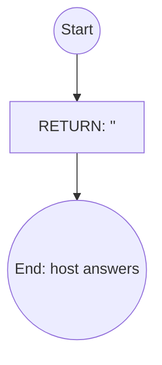

---

## CancelProcess
**ID**: `cancel-process` · **Version**: 1.0.0 · **Sub-flow**  
**Description**: Handle flow cancellation by user.

A single `RETURN` of a localized message: "The process has been cancelled. Anything else I can help with?" (Spanish when `language == 'es'`). Terminates all flows. Used with `callType: "reboot"`, e.g. by `get-search-query` on EXIT.

### Flowchart
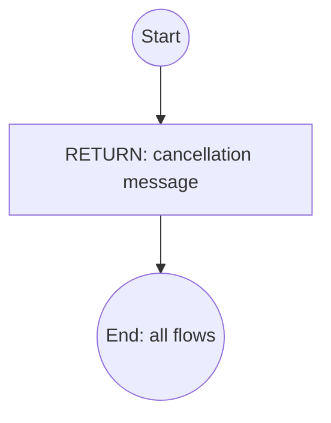

---

## ContactSupport
**ID**: `contact-support` · **Version**: 1.2.0 · **Sub-flow**  
**Description**: Provide customer service contact information. Optional `support_context` / `support_context_es` name what the caller needed help with (else `cargo.support_context`); optional `closing_prompt` / `closing_prompt_es` are spoken after the contact info.

### Parameters
*   `support_context` (string): What the caller needed help with (English), e.g. `payment`.
*   `support_context_es` (string): The same in Spanish, e.g. `pago`.
*   `closing_prompt` (string): Optional English sentence spoken after the contact info, e.g. a follow-up question.
*   `closing_prompt_es` (string): Optional Spanish sentence spoken after the contact info.

The SAY also reads `support_outcome` / `support_reason` when a caller passes them. They are not declared parameters, and no flow in this library passes them.

### Steps
1. `take_context_parameters` (SET, side effect) - when `support_context` is passed: `cargo.support_context = support_context` and `cargo.support_context_es = support_context_es || support_context`. Otherwise the cargo is left as it is.
2. `set_contact_info` / `set_contact_info_es` - `contact_info` = `cargo.contact_info`, or "please contact Customer Support" / "por favor contacte a Servicio al Cliente" when unset. On voice (`cargo.voice`) it is passed through `textWithUrlToSpeech(…, language)` so URLs are spoken.
3. `set_support_message` / `set_support_message_es` (SET) - "{opening}[For assistance with your {cargo.support_context}, ]{contact_info}.[ {closing_prompt}]". The opening is "Thank you for contacting us! " when `cargo.sessionResolved`, else "Sorry I couldn't help! ". The Spanish text ("¡Gracias por comunicarte con nosotros! " / "¡Lo siento, no pude ayudar! ", "Para asistencia con tu …") uses `cargo.support_context_es`, falling back to `support_context`.
4. `say_support_message` (SAY) - `{{support_message}}` / `{{support_message_es}}`.

### Ends
By completion. The SAY declares **`outcome`: `support_outcome` or `"unresolved"`, `reason`: `support_reason` or `"contact_support_fallback"`**. With no `support_outcome` passed (every path in this library), ContactSupport fails the transaction and sets `sessionContext.lastFlowOutcome`. Every caller in the library uses `callType: "reboot"`.

### Flowchart
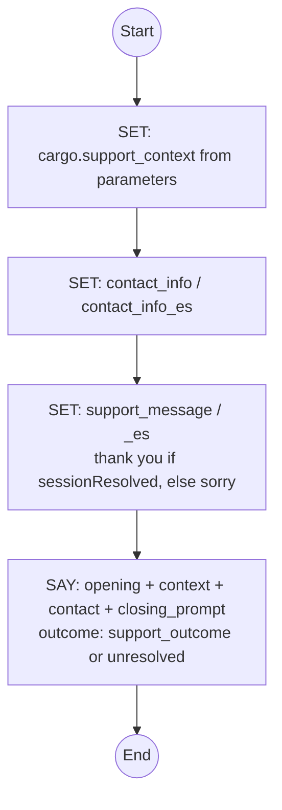

---

## SwitchToText
**ID**: `switch-to-text` · **Version**: 1.1.0 · **Primary** (prompt "Switch to text" / "Cambiar a texto")  
**Description**: Used when the user explicitly asks to switch the chat to text/SMS. It must never be used when the user asks for a live agent, human or manager. It forwards the chat context to SMS and sends a welcome message.

### Variables
*   `sms_result` (object): result of the SMS send.

The welcome text also reads `text_starter` / `text_starter_es` when a caller passes them as FLOW parameters (they are not declared here).

### Steps
1. `check_already_text` (CASE) - not on voice (`!cargo.voice`) → **END** (nothing to switch). Otherwise continue.
2. `check_can_text` (CASE) - no `cargo.callerId` → SAY "I can't send a text message to the number you're calling from."
3. `route_cannot_text` (CASE) - no `cargo.callerId` → FLOW `contact-support` (`reboot`). The SAY from step 2 is delivered with ContactSupport's output.
4. `set_welcome_message` (SET) - "Hi, I remember our phone conversation and can continue to help you here via text. You can also continue on WhatsApp: https://wa.me/18184162641?text=Hi" (Spanish variant when `language === 'es'`), followed by a blank line and `text_starter` when one was passed (Spanish: `text_starter_es`, else `text_starter`). **The WhatsApp number is hard-coded in the flow.**
5. `set_switch_user_turn` (SET) - `switch_user_turn` = "Switch to text" / "Cambiar a texto".
6. `send_welcome_sms` (CALL-TOOL [`switch-to-sms`](#switch-to-sms)) - args `accountSid: null`, `threadId: {{sessionId}}`, `from: {{cargo.twilioNumber}}`, `to: {{cargo.callerId}}`, `message: {{welcome_message}}`, `userTurn: {{switch_user_turn}}`; result in `sms_result`. `onFail` → FLOW `contact-support`, `reboot`.
7. `confirm_sms_sent` (SAY) - "I've sent you a text message. Please check your phone and reply via text. Goodbye and take care!"

### Ends
By completion after the confirmation, `END` when not on voice, or `reboot` into `contact-support` when there is no caller ID or the send fails. Besides intent detection, other flows reach it with `callType: "reboot"` (keypad 9 / "TEXT" in the retry menus, text words in validate-otp-code).

### Flowchart
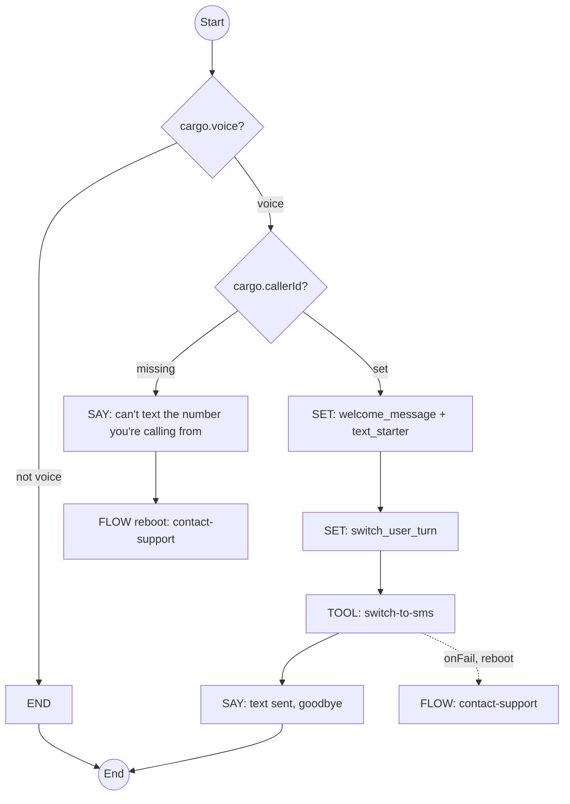

---

## AuthenticateUser
**ID**: `authenticate-user` · **Version**: 1.2.0 · **Sub-flow**  
**Description**: Generic flow to authenticate user via OTP sent to cell or email.

The gatekeeper. It collects a phone or email (via `get-cell-or-email`), optionally lets a tenant-supplied validator flow approve the contact, sends an OTP by SMS or email, and hands off to `get-and-validate-otp-code`. On success it sets `auth_result = true` and returns to its caller, with `cargo.otpVerified` set by the `validate-otp` tool.

### Parameters
*   `retry_flow` (string): Flow to reboot if the user wants to retry. The description says "default: authenticate-user", but **no step applies that default**. The value is forwarded as-is, so callers should pass it.
*   `cancel_flow` (string): Flow to reboot if the user cancels. The description says "default: cancel-process", but no step here applies it. `generic-retry-with-options` falls back to `contact-support`, and `get-cell-or-email` has no fallback.
*   `cell_number` (string): Phone already supplied by the caller. Forwarded so `get-cell-or-email` skips the contact prompt.
*   `email` (string): Email already supplied by the caller. Forwarded the same way.
*   `email_validator` (string, optional flow name): When supplied, it is called with `{email}` before an email OTP is sent, and it MUST set `contact_valid = true` to allow the send. **Fail-closed.** The validator must end by completion, because a `RETURN` in it terminates all flows.
*   `cell_validator` (string, optional flow name): Same contract, called with `{cell_number}` before an SMS OTP.

### Variables
`cell_or_email`, `cell_number`, `email`, `contact_valid` (true when no validator applies), `unverified_contact` / `unverified_contact_es` (the rejected contact phrased for the retry message: "the number 555…" / "the email a@b.c").

### Steps
1. `check_already_verified` (CASE) - `cargo.otpVerified` → **END** (return to the caller at once). Otherwise continue.
2. `get_contact_info` (FLOW `get-cell-or-email`, `call`) - passes `retry_flow`, `cancel_flow`, `cell_number`, `email`. Sets `cell_number` or `email`, or leaves the flow stack via one of its own exits.
3. `init_contact_valid` (SET) - `contact_valid` = false when a validator applies to the collected contact (`cell_validator` with a `cell_number`, or `email_validator` with an `email`); true otherwise.
4. `validate_contact` (CASE) - runs `{{cell_validator}}` with `{cell_number}` or `{{email_validator}}` with `{email}` (`call`). The cell validator is checked first.
5. `describe_unverified_contact` / `_es` (SET) - builds the phrase used below.
6. `gate_otp_on_contact_valid` (CASE) - `!contact_valid` → FLOW `generic-retry-with-options` (`replace`) with "Sorry, I could not verify {{unverified_contact}}.", `retry_flow`, `cancel_flow`, and `capture_patterns` for `cell_number` (`[0-9\-\(\)\.\s]{10,}`, normalizer `[^0-9]`) and `email`.
7. `reset_resend_count` / `reset_mismatch_count` (SET, side effect) - `cargo.otpResends = 0`, `cargo.otpMismatches = 0`.
8. `skip_line_that_cannot_text` (CASE) - `cell_number` whose last 10 digits equal `cargo.otpUndeliverableTo` → FLOW [`otp-text-undeliverable`](#otptextundeliverable) (`replace`). A number already refused for texts is never texted again in the same session; the caller is asked for another contact instead. Otherwise continue.
9. `send_otp_based_on_contact` (CASE):
   - `cell_number` → CALL-TOOL [`send-sms-otp`](#send-sms-otp) `{accountSid: null, from: cargo.twilioNumber, to: cell_number, container: cargo, language}`. `onFail` → FLOW [`otp-sms-failed`](#otpsmsfailed) (`replace`).
   - `email` → CALL-TOOL [`send-email-otp`](#send-email-otp) `{to: email, container: cargo, language}`. `onFail` → `retry-authenticate-generic` (`replace`, "Sorry, email delivery failed.", `allow_otp_entry: false`).
   - default → `retry-authenticate-generic` (`replace`, "Sorry, there was an unexpected error.", `allow_otp_entry: false`).
10. `set_cell_number_to_cargo` / `set_email_to_cargo` (SET, side effect) - `cargo.otp_cell_number = cell_number || ''`, `cargo.otp_email = email || ''`.
11. `get_and_validate_otp_code` (FLOW `get-and-validate-otp-code`, `call`).
12. `check_validation_result` (CASE) - `cargo.otpVerified` → SET `auth_result = true`. Otherwise → `retry-authenticate-generic` (`replace`, "Sorry, the code you entered was invalid or expired.", `allow_otp_entry: true`).

### Ends
Success returns to the caller (by completion) with `auth_result = true` and `cargo.otpVerified` set. Already verified → `END`. Failures leave through `generic-retry-with-options`, `otp-sms-failed`, `otp-text-undeliverable` or `retry-authenticate-generic`, or through `get-cell-or-email`'s own exits (cancel, live agent, off-topic hand-off). The two OTP workers keep this frame's variables (`retry_flow`, `cancel_flow`, the validators) because they are reached by `replace`, and they return here by `replace`.

### Flowchart
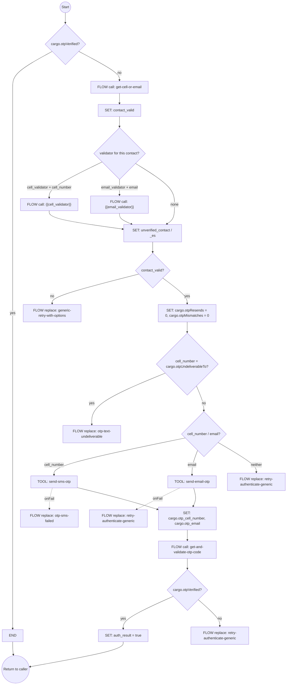

---

## GetCellOrEmail
**ID**: `get-cell-or-email` · **Version**: 1.1.0 · **Sub-flow**  
**Description**: Prompt user to provide either their cell phone number or email address for account lookup.

### Parameters
*   `retry_flow` (string): Flow to reboot if the user wants to retry.
*   `cancel_flow` (string): Flow to reboot if the user cancels.
*   Also reads `cell_number` / `email` when the caller passes them (`authenticate-user` does). These are not declared as parameters here.

### Steps
1. Guard `cell_number` and `email` to `''` when undefined.
2. `ask_cell_or_email_if_no_param` (CASE):
   - nothing supplied and `cargo.callerId` → SAY-GET `cell_or_email`: "To authenticate using your caller id, please {verb} yes. Otherwise, please {verb}[ or enter] the phone or email associated with your account[ followed by the pound key]. To exit anytime you can [press the asterisk key or ]{verb} EXIT." `digits: {min 7, max 12, autoSubmitChars ["1"], autoSubmitMs 2500}` (a single keypad "1" auto-submits).
   - nothing supplied → SAY-GET `cell_or_email`: "Please {verb} [or enter] the phone or email associated with your account[ followed by the pound key if entered using the dial pad]. To exit anytime …", `digits: {min 7, max 12}`.
   - otherwise → `cell_or_email = cell_number || email` (no prompt).
3. Normalization (SET) - `prospective_cell_number` = digits only. `prospective_email` = the first email-shaped match, or failing that `email` or a match that allows spaces, with the spaces removed. `cell_or_email` is trimmed, lower-cased and stripped of punctuation.
4. `branch_on_cell_or_email` (CASE, first match wins):
   1. `validatePhone(prospective_cell_number)` → `cell_number` = those digits.
   2. `validateEmail(prospective_email)` → `email` = it.
   3. `cargo.callerId` and the answer is exactly one of `1, yes, please, sure, thanks, thank you, ok, okay, si, sí, por favor, gracias`, or `matchesChoice` phone words (`phone, cell, caller id, number, numero, teléfono, celular, identificador de llamadas`…) → `cell_number = cargo.callerId`.
   4. EXIT words (`abort, exit, quit, cancel, salir, cancelar`) in an answer of at most two words, or `*` → FLOW `{{cancel_flow}}` (`reboot`).
   5. live-agent words (`live, agent, manager, support, customer service, representative, human, operator, someone, real person, agente, persona, humano, operador(a), recepcionista`…) or `0` → FLOW `live-agent-requested` (`reboot`).
   6. `cargo.callerId` and digits that are not a valid phone → `cell_number = cargo.callerId`.
   7. digits that are not a valid phone (no caller ID) → FLOW `generic-retry-with-options` (`replace`): "Sorry, the phone number you provided isn't valid.", with `retry_flow`, `cancel_flow` and the cell/email `capture_patterns`.
   8. `cargo.callerId` (anything else) → `cell_number = cargo.callerId`.
   9. the question was asked (`!cell_number && !email`) and the answer is three or more words containing no digit and no `@` → **`DISPATCH`** with **`outcome: "unresolved"`, `reason: "auth_prompt_off_topic"`**. The answer goes to intent detection: a matching flow starts at once (the outcome is dropped); otherwise the host answers with the outcome.
   10. default → FLOW `generic-retry-with-options` (`replace`): "Sorry, I do need the the phone or email associated with your account to proceed.", same parameters.

   Because branch 8 comes before branch 9, a caller with caller ID who says something off-topic is authenticated against the caller ID, not handed off.

### Ends
By completion (returning to `authenticate-user` with `cell_number` or `email` set), or through one of the exits above.

### Flowchart
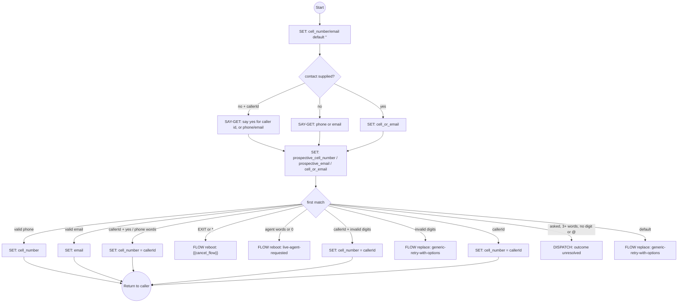

---

## GetAndValidateOtpCode
**ID**: `get-and-validate-otp-code` · **Version**: 1.0.2 · **Sub-flow**  
**Description**: Get and validate OTP code from user.

### Variables
`otp_code`, `normalized_otp_code`, `otp_destination`, `user_choice` (initial `""`), `otp_where` / `otp_where_es` (where the code is, for the prompt).

### Steps
1. `set_otp_destination` - `cargo.otp_cell_number` if set, else `cargo.otp_email`.
2. `formatted_otp_destination` - "cell ending with 1234" (the last four digits; on voice comma-separated, "1, 2, 3, 4") or "email: a@b.c". Spanish wording when `language == 'es'`.
3. `set_otp_where` / `set_otp_where_es` - `cargo.otpSentOn === 'whatsapp'` → "I just sent you here in this chat" / "que le acabo de enviar aquí en este chat". Otherwise "you received at {formatted destination}" / "que recibió en …".
4. `get_otp_from_user` (SAY-GET `otp_code`, `digits: {min 6, max 6}`) - "Please {verb} [or enter ]the 6-digit verification code {otp_where}. You can also [press * or ]{verb} EXIT to cancel." The Spanish exit sentence is "También puede presionar * o decir SALIR para cancelar." on voice and "También puede escribir SALIR para cancelar." otherwise.
5. `set_user_choice` - `user_choice` = the answer trimmed and lower-cased (for word matching).
6. `set_otp_code` - `normalized_otp_code` = digits only.
7. `proceed_to_validation` (FLOW `validate-otp-code`, `call`).

### Ends
By completion once `validate-otp-code` returns. Retries happen inside `validate-otp-code`, which replaces itself with this flow to prompt again.

### Flowchart
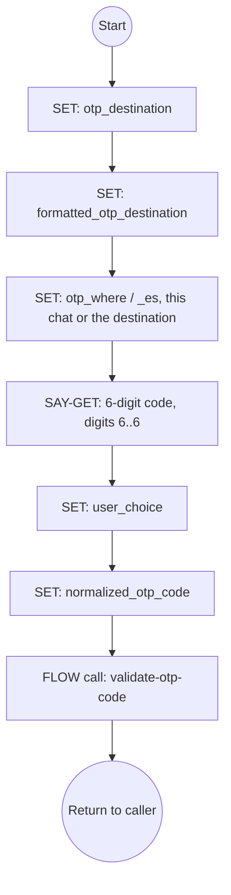

---

## ValidateOtpCode
**ID**: `validate-otp-code` · **Version**: 1.1.1 · **Sub-flow**  
**Description**: Validate OTP code entered by user; sets `cargo.otpVerified` on success. Capped at 3 wrong codes per authentication (`cargo.otpMismatches`, reset by authenticate-user): the code is withdrawn and the retry/agent/exit choice follows, where retry sends a fresh code.

Reads `normalized_otp_code` and `user_choice` from `get-and-validate-otp-code`. An expired or missing code is answered with a fresh one (via `resend-otp-code`), not with "didn't match".

### Variables
`otp_validation_result` (boolean), `invite_text` (WhatsApp invite wording for this session's language; empty means the feature is off), `whatsapp_invite_sent` (initial `false`; true only if an invite was actually sent).

### Steps
1. `validate_otp_and_lookup` (CASE, first match wins):
   - `normalized_otp_code.length === 6` → CALL-TOOL [`validate-otp`](#validate-otp) `{otp: normalized_otp_code, container: cargo}` into `otp_validation_result`. `onFail` → FLOW `get-and-validate-otp-code` (`replace`).
   - EXIT words or `*` → FLOW `contact-support` (`reboot`).
   - live-agent words or `0` → FLOW `live-agent-requested` (`reboot`).
   - text words (`text, texto, sms, message, mensaje, text me, by text, por texto, mensaje de texto, whatsapp, escríbeme`…) → FLOW `switch-to-text` (`reboot`).
   - "didn't receive / resend" phrases (`resend, send again, not received, didn t get, no code, no llegó, no recibí, reenviar`…) → FLOW [`resend-otp-code`](#resendotpcode) (`call`) with `resend_reason: "requested"`.
   - "I'm driving / busy / later" phrases → SAY "No problem. Say TEXT and I'll continue with you by message so you can do this when you are free, or {verb} the code whenever you are ready."
   - some digits, but not 6 → SAY "I was expecting a 6-digit code. Let's try again. You can also [press * or ]{verb} EXIT to cancel." (Spanish exit sentence as in GetAndValidateOtpCode.)
   - default (no digits) → SAY "Let me explain. I sent you a message with a six-digit code in it. Read those six digits back to me. You can also {verb} AGENT to reach a person, or EXIT to cancel."
2. `retry_if_bad_format` (CASE) - not 6 digits → FLOW `get-and-validate-otp-code` (`replace`), which prompts again after the SAY or the fresh code above.
3. `count_wrong_code` (SET, side effect) - `cargo.otpMismatches` + 1 when not verified and `cargo.otpFailure === 'mismatch'`.
4. `withdraw_code_at_cap` (CASE) - a mismatch with `cargo.otpMismatches >= 3` → `cargo.otpHash = null`, so the code can no longer be accepted.
5. `check_validation_result` (CASE, first match wins):
   - `cargo.otpVerified` → SET `otp_validated = true`.
   - `cargo.otpFailure === 'expired'` → FLOW `resend-otp-code` (`call`), `resend_reason: "expired"`.
   - `cargo.otpFailure === 'missing'` → FLOW `resend-otp-code` (`call`), `resend_reason: "missing"`.
   - a mismatch at the cap → FLOW `retry-authenticate-generic` (`replace`): "That code didn't match three times, so I can't accept another try with it. To reach a person, {verb} AGENT.", `allow_otp_entry: false`.
   - default → SAY "That code didn't match. Let's try again."
6. `set_invite_text` - `global_whatsapp_invite_es` (Spanish) or `global_whatsapp_invite`, `''` when undefined.
7. `invite_if_wrong_code` (CASE) - verified, or `cargo.otpFailure` is not `mismatch` → no invite. Otherwise → CALL-TOOL [`send-whatsapp-invite`](#send-whatsapp-invite) `{accountSid: null, from: cargo.twilioNumber, to: cargo.otp_cell_number, inviteText, language, container: cargo}` into `whatsapp_invite_sent`. `onFail` → SET `whatsapp_invite_sent = false`. Per the tool's contract it returns `false` when `inviteText` is empty, when it already invited on this call, or when `to` is missing. `to` is `''` when the code went by email.
8. `mention_whatsapp_invite` (CASE) - `whatsapp_invite_sent` → SAY "I texted you a WhatsApp link so you can try again on WhatsApp to help overcome voice limitations."
9. `retry_if_wrong_code` (CASE) - not verified → FLOW `get-and-validate-otp-code` (`replace`).

### Ends
Verified → completion (the caller chain returns to `authenticate-user` or `retry-authenticate-generic`). A wrong code loops back to the prompt until the third mismatch, which leaves through `retry-authenticate-generic`. An expired or missing code gets a fresh one and loops back, until `resend-otp-code`'s own cap. The exits in step 1 leave at any time.

### Flowchart
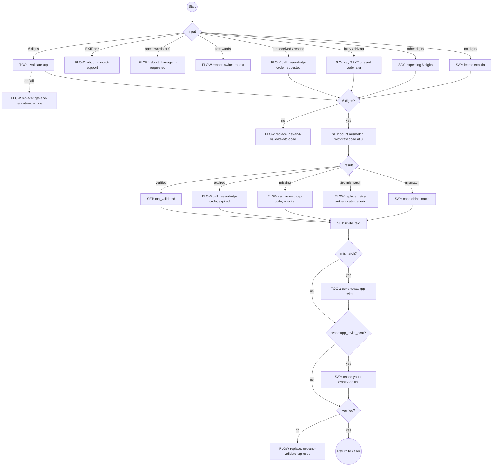

---

## ResendOtpCode
**ID**: `resend-otp-code` · **Version**: 1.0.0 · **Sub-flow**  
**Description**: Send a fresh one-time code to the destination authenticate-user already used (`cargo.otp_cell_number` or `cargo.otp_email`) and say why: the last one expired, none is pending, or the customer asked. Capped at 2 fresh codes per authentication (`cargo.otpResends`, reset by authenticate-user), then the retry/agent/exit choice.

Called by `validate-otp-code` with `callType: "call"`.

### Parameters
*   `resend_reason` (string): `expired`, `missing` or `requested`. Also declared as a variable with the default `"requested"`.

### Variables
`resend_reason`, `resend_result` (the send tool's result).

### Steps
1. `check_resend_cap` (CASE) - `cargo.otpResends >= 2` → FLOW `retry-authenticate-generic` (`replace`): "I've already sent you new codes and still couldn't verify you. To reach a person, {verb} AGENT.", `allow_otp_entry: true`.
2. `count_resend` (SET, side effect) - `cargo.otpResends` + 1.
3. `send_fresh_code` (CASE):
   - `cargo.otp_cell_number` → CALL-TOOL [`send-sms-otp`](#send-sms-otp) `{accountSid: null, from: cargo.twilioNumber, to: cargo.otp_cell_number, container: cargo, language}` into `resend_result`. `onFail` → `retry-authenticate-generic` (`replace`, "Sorry, text message delivery failed.", `allow_otp_entry: false`).
   - `cargo.otp_email` → CALL-TOOL [`send-email-otp`](#send-email-otp) `{to: cargo.otp_email, container: cargo, language}`. `onFail` → `retry-authenticate-generic` (`replace`, "Sorry, email delivery failed.", `allow_otp_entry: false`).
   - default → `retry-authenticate-generic` (`replace`, "Sorry, there was an unexpected error.", `allow_otp_entry: false`).
4. `say_why_fresh_code` (CASE) - `expired` → SAY "Your code expired, so I've sent you a new one." `missing` → SAY "I don't have an active code for you, so I've sent you a new one." Otherwise → SAY "I've sent you a new code."

### Ends
By completion, returning to `validate-otp-code`, which loops back to the code prompt. At the cap or on a failed send, by `replace` into `retry-authenticate-generic`.

### Flowchart
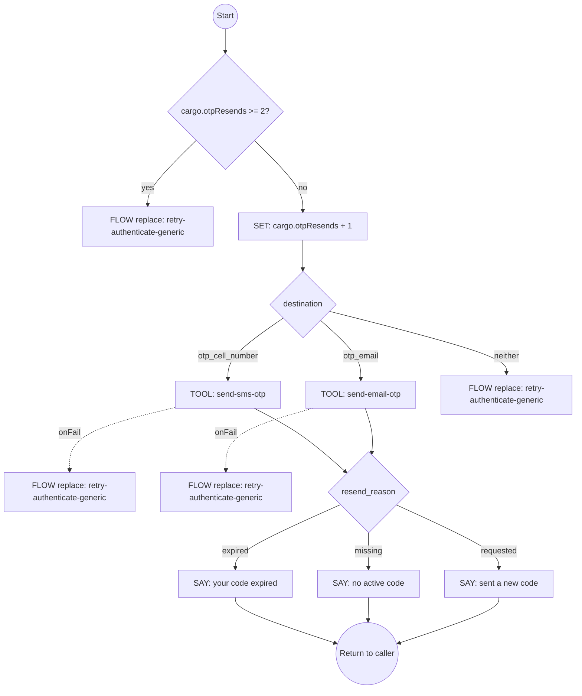

---

## GenericRetryWithOptions
**ID**: `generic-retry-with-options` · **Version**: 1.2.0 · **Sub-flow**  
**Description**: Generic flow to offer retry, switch to text, or contact support.

### Parameters
*   `error_message` (string): Error message to display.
*   `error_message_es` (string): Error message in Spanish.
*   `retry_flow` (string): Flow to reboot if the user wants to retry.
*   `cancel_flow` (string): Flow to reboot if the user cancels. The description says "default: cancel-process", but the steps fall back to `contact-support` when it is empty.
*   `capture_patterns` (array): Optional `[{variable, regex, normalizer?}]` to capture from the user's answer. Most callers omit it; the SET step guards the reference, so absence means no smart capture rather than an evaluation failure.
*   `caller_outcome`, `caller_reason` (string): Optional. The caller's declared outcome (usually `unresolved`) and reason for the failure that led here. The `DISPATCH` of an unrecognised answer declares them, so they reach the host only when intent detection matches no flow. Omitted = no outcome.

### Steps
1. `say_error_and_prompt` (SAY-GET `user_choice`, `digits: {min 1, max 1}`) - "{error_message} Would you like to try again? To retry [Press 1 or] {verb} YES. [To switch to text press 9 or {verb} TEXT.] To abort [press the asterisk key or] {verb} EXIT." The keypad wording appears on voice only, and the TEXT option only on voice with a `cargo.callerId`.
2. `reprompt_on_unknown_key` (CASE) - a single key `0` or `2` to `8` → SAY-GET `user_choice` again: "Sorry, that is not an option. To retry …" (same options, same `digits`). One re-prompt only; its answer goes on to step 3.
3. `check_smart_capture` - `smart_capture_result = normalizeAndFindCapture(user_choice, capture_patterns)` when patterns were passed, else `null`.
4. `handle_smart_capture` (CASE) - a capture → FLOW `{{retry_flow}}` (`reboot`) with parameters `{ [captured variable]: captured value, retry_flow, cancel_flow }`. So a user who answers the retry question with a corrected phone or email goes straight back in with that value.
5. `normalize_choice` - trim, lower-case, strip punctuation.
6. `handle_choice` (CASE):
   - yes words (`yes, sure, please, ok, okay, thanks, si, sí, seguro, por favor, gracias`) or contact words (`phone, email, cell, mobile, teléfono, celular, móvil, correo`…) or `1` → FLOW `{{retry_flow}}` (`reboot`).
   - `text` / `texto` or `9` → FLOW `switch-to-text` (`reboot`).
   - EXIT words or `*` → FLOW `{{cancel_flow || 'contact-support'}}` (`reboot`).
   - empty input or a lone digit (no intent to detect) → the same cancel target (`reboot`).
   - default → `DISPATCH` (outcome/reason = `caller_outcome`/`caller_reason`): the answer is routed through intent detection. A matching flow starts in the same turn, otherwise the host answers.

### Ends
By a `reboot` into another flow, or by `DISPATCH` (default branch).

### Flowchart
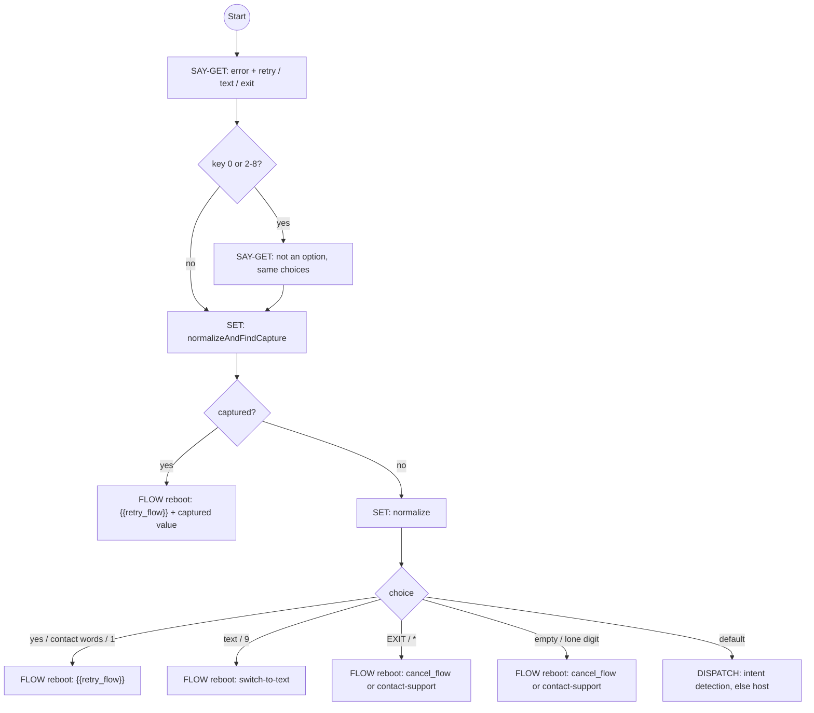

---

## OtpSmsFailed
**ID**: `otp-sms-failed` · **Version**: 1.0.0 · **Sub-flow**  
**Description**: Worker for authenticate-user: a code text failed. A line that cannot receive texts (`cargo.otpUndeliverableTo`, set by the host) goes to otp-text-undeliverable; any other failure offers the usual retry.

Reached only as `authenticate-user`'s `send-sms-otp` `onFail`, with `callType: "replace"`. `send-sms-otp` clears `cargo.otpUndeliverableTo` at the start of every send, so a value here describes this failure.

### Steps
1. `branch_on_failure` (CASE):
   - `cargo.otpUndeliverableTo` → FLOW [`otp-text-undeliverable`](#otptextundeliverable) (`replace`).
   - default → FLOW `retry-authenticate-generic` (`replace`): "Sorry, text message delivery failed.", `allow_otp_entry: false`.

### Ends
Always by `replace` into one of the two flows.

### Flowchart
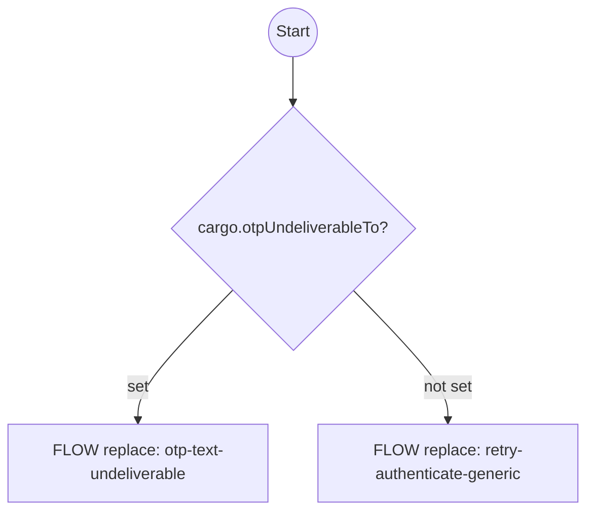

---

## OtpTextUndeliverable
**ID**: `otp-text-undeliverable` · **Version**: 1.0.0 · **Sub-flow**  
**Description**: Worker for authenticate-user: the number for the code cannot receive texts (landline, toll-free, invalid). Says so and asks for the account's email or a mobile number; never offers to text the same number again.

Reached by `replace` from `authenticate-user` (`skip_line_that_cannot_text`) and from `otp-sms-failed`, so it keeps `authenticate-user`'s variables (`retry_flow`, `cancel_flow`, the validators) and returns to it by `replace`.

### Variables
`user_choice` (the answer), `undeliverable_last4` (last four digits of the refused number; comma-spaced on voice), `choice_digits` (digits in the answer), `choice_email` (an email address in the answer, if any).

### Steps
1. `describe_number` (SET) - `undeliverable_last4` from `cargo.otpUndeliverableTo`: "1, 2, 3, 4" on voice, "1234" otherwise.
2. `ask_other_contact` (SAY-GET `user_choice`, `digits: {min 1, max 12, autoSubmitChars ["0"], autoSubmitMs 2500}`) - "The number ending with {undeliverable_last4} can't receive text messages, so I can't text it a code. Please {verb} the email address on your account, or {voice ? 'say or enter' : verb} a mobile number that can receive texts. To talk to an agent [press 0 or ]{verb} AGENT. To exit [press the asterisk key or ]{verb} EXIT."
3. `read_digits` (SET) - `choice_digits` = the answer's digits.
4. `read_email` (SET) - `choice_email` = the first email-shaped match in the answer (spaces allowed, then removed), else `''`.
5. `clear_cell` / `clear_email` (SET) - `cell_number = ''`, `email = ''`.
6. `handle_choice` (CASE, first match wins):
   - `choice_email` and `validateEmail(choice_email)` → FLOW `authenticate-user` (`replace`) with `email: {{choice_email}}`.
   - `validatePhone(choice_digits)` → FLOW `authenticate-user` (`replace`) with `cell_number: {{choice_digits}}`.
   - live-agent words or `0` → FLOW `live-agent-requested` (`reboot`).
   - EXIT words or `*` → FLOW `contact-support` (`reboot`).
   - default → FLOW `authenticate-user` (`replace`) with no contact, so `get-cell-or-email` asks again.

If the caller gives the same number again (or accepts the caller ID that is that number), `authenticate-user`'s `skip_line_that_cannot_text` sends it back here without texting it.

### Ends
By `replace` into `authenticate-user`, or `reboot` into `live-agent-requested` or `contact-support`.

### Flowchart
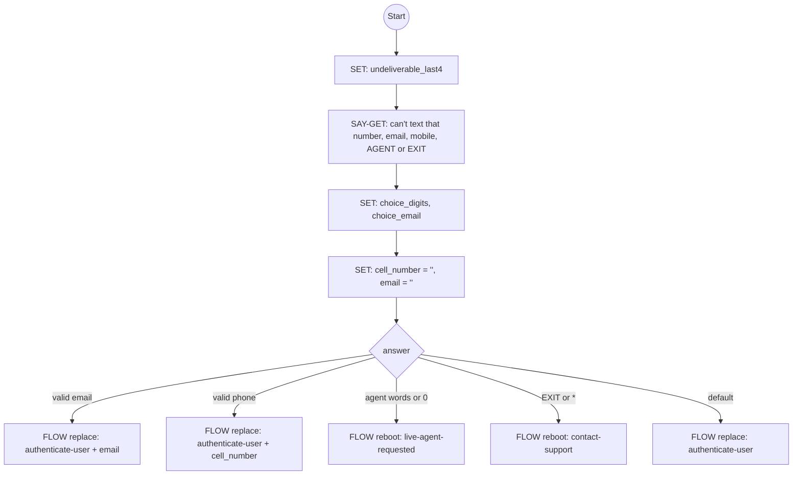

---

## RetryAuthenticateGeneric
**ID**: `retry-authenticate-generic` · **Version**: 1.0.0 · **Sub-flow**  
**Description**: Generic retry authentication flow.

Offers to retry authentication. It also accepts a 6-digit code typed straight into the retry prompt (when `allow_otp_entry`), or a new phone number or email.

### Variables / parameters
Declared as `variables` with defaults: `error_message` (default "Sorry, there was an unexpected error."), `error_message_es`, `allow_otp_entry` (declared default `"false"`), `user_choice`, `normalized_otp_code`. Every caller in the library reaches this flow with `callType: "replace"`, which does not apply declared defaults, and passes `error_message`, `error_message_es` and a boolean `allow_otp_entry` as parameters.

### Steps
1. `clear_cell` / `clear_email` - `cell_number = ''`, `email = ''`.
2. `retry_msg` (SAY-GET `user_choice`, `digits: {min 1, max 1}`) - "{error_message} Would you like to try again to get access to your account? To retry [Press 1 or] {verb} YES. [To switch to text press 9 or {verb} TEXT.] To abort … EXIT." The TEXT option appears only on voice with a `cargo.callerId`.
3. `normalize_user_choice` - trim, lower-case, strip punctuation.
4. `handle_choice` (CASE, first match wins):
   - `allow_otp_entry` and the answer has exactly 6 digits → SET `normalized_otp_code` (continues to step 5).
   - yes / phone / email words or `1` → FLOW `authenticate-user` (`replace`).
   - `text` / `texto` or `9` → FLOW `switch-to-text` (`reboot`).
   - EXIT words or `*` → FLOW `contact-support` (`reboot`).
   - live-agent words or `0` → FLOW `live-agent-requested` (`reboot`).
   - `validatePhone(digits)` → FLOW `authenticate-user` (`replace`) with `cell_number`.
   - `validateEmail(user_choice)` → FLOW `authenticate-user` (`replace`) with `email`.
   - default → FLOW `contact-support` (`reboot`).
5. `check_and_validate_otp` (CASE) - `normalized_otp_code` → FLOW `validate-otp-code` (`call`); else `contact-support` (`reboot`).
6. `check_validation_result` (CASE) - `cargo.otpVerified` → SET `auth_result = true`; else FLOW `retry-authenticate-generic` (`replace`), "Sorry, the code you entered was invalid or expired.", `allow_otp_entry: true`.

This flow does not receive `retry_flow` / `cancel_flow` from its callers. Its retry restarts `authenticate-user` in the same frame (by `replace`, so whatever `retry_flow` / `cancel_flow` the frame already holds are kept), and its cancel is always `contact-support`.

### Ends
Success by completion with `auth_result = true`. Otherwise by `replace` / `reboot` into another flow.

### Flowchart
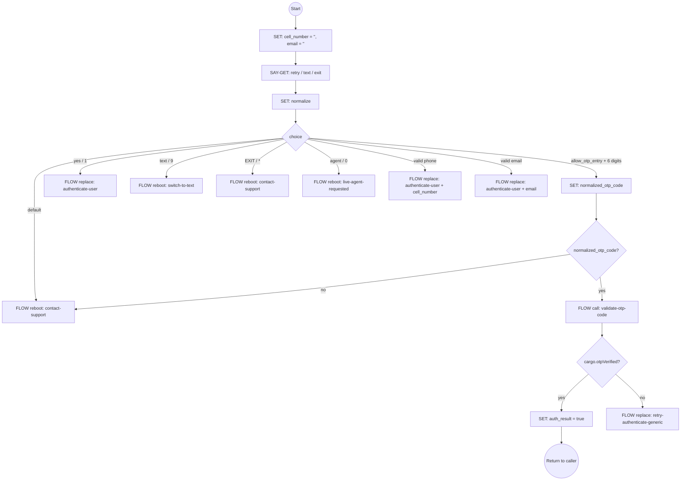

---

## LiveAgentRequested
**ID**: `live-agent-requested` · **Version**: 1.6.0 · **Primary** (prompt "live agent confirmation" / "confirmación de agente en vivo")  
**Description**: The customer's primary intent is to reach a human: live agent, representative, "customer service", "servicio al cliente", "I need to talk to someone", "speak to a person", "comunicarme con alguien", "hablar con una persona". On the phone it offers the transfer when an agent is scheduled (`cargo.agentPhoneNumber`); on every other channel it sends the Live Connect link when the tenant runs Live Connect and an agent is reachable. On the phone after hours (no agent number this turn, the number has a schedule) it says so, states the agent hours and offers to help, ending `unresolved` (`agent_unavailable`). Otherwise (any non-phone channel without a Live Connect link, or a phone number with no agents at all) it says it cannot connect the customer with a live agent and gives the tenant's contact information, ending `resolved` (`no_agent_reachable`).

The description also says "Contact information is given when the customer asks for it". No step of the after-hours path gives it; a later request reaches the host or another flow.

### Variables
*   `user_choice` (string): continue with AI or transfer.
*   `live_connect_link` (string): the Live Connect guest link on non-phone channels; `''` when not available.

### Steps
1. `get_live_connect` (CASE) - not on voice → CALL-TOOL [`get-live-connect-link`](#get-live-connect-link) `{container: cargo}` into `live_connect_link`; `onFail` → SET `live_connect_link = ''`. On voice → `live_connect_link = ''`.
2. `offer_live_connect` (CASE) - not on voice and a link → **`RETURN`** "You can talk to a live agent now, by audio or video, here: {live_connect_link}" (Spanish: "Puede hablar ahora con un agente en vivo, por audio o video, aquí: …"), **`outcome: "resolved"`, `reason: "live_connect_link"`**.
3. `cannot_connect` (CASE) - not on voice, or on voice with neither `cargo.agentPhoneNumber` nor `cargo.agentHours` (a number with no agents) → **`RETURN`**, sentences joined with spaces, **`outcome: "resolved"`, `reason: "no_agent_reachable"`**:
   - "I can't connect you with a live agent here." (Spanish: "No puedo comunicarle con un agente en vivo por aquí.");
   - not on voice: `global_live_agents_comment` / `_es`, when set;
   - `cargo.contact_info` set: "Here is how to reach Customer Support: {contact_info}." (on voice through `textWithUrlToSpeech`); otherwise "Please contact Customer Support."
4. `check_agent_available` (CASE) - no `cargo.agentPhoneNumber` (on voice, after hours) → **`RETURN`**, sentences joined with spaces, **`outcome: "unresolved"`, `reason: "agent_unavailable"`**:
   - "Our live agent team isn't available right now." (Spanish: "Nuestro equipo de agentes no está disponible en este momento.");
   - `cargo.agentHours` / `cargo.agentHours_es`, else `global_live_agents_comment` / `_es` when set;
   - `cargo.agentUnavailableMessage`, else "I can still help with many questions. Just tell me what you need." (Spanish: "Aún puedo ayudarle con muchas preguntas. Solo dígame qué necesita." on voice, "… Solo escríbame qué necesita." otherwise).
5. `ask_user_choice` (SAY-GET `user_choice`, `digits: {min 1, max 1}`) - the deflection pitch ("Before I try to transfer you, I want you to know that I can help you faster with many inquiries…"), then "To have me help you now [Press 1 or] {verb} YES. For a live agent [Press 0 or] {verb} LIVE AGENT."
6. `normalize_choice` - trim, lower-case, strip punctuation.
7. `handle_choice` (CASE):
   - **anything that is not** a yes word (`yes, continue, sure, please, ok, okay, thanks, si, sí, seguro, por favor, gracias`) and not `1` → nested CASE: `cargo.agentPhoneNumber` → **`RETURN`** "Understood. Let me transfer you to a live agent." (Spanish: "Entendido. Te transfiero a un agente en vivo."). Otherwise (the agent number is gone when the answer arrives) → **`RETURN`** the same "not available" text as step 4, `outcome: "unresolved"`, `reason: "agent_unavailable"`.
   - yes / `1` → SAY "Great! I'm glad to help. What would you like assistance with today?"

The flow only returns the transfer sentence. **Performing the transfer is the host's job**; no tool is called.

### Ends
`RETURN` (Live Connect link, cannot connect, not available, or transfer), or completion after the "Great!" SAY.

### Flowchart
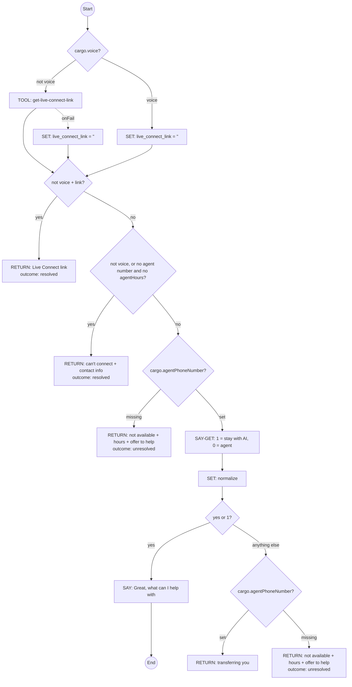

---

## Tools

All eight are `local` tools. The host supplies the function named in `implementation.function` through `APPROVED_FUNCTIONS`. Their `parameters` use the flat form (a map of properties with no top-level `type`), so the engine calls the function with **positional arguments: the `required` names in order, then the remaining properties in definition order**. For these eight tools that order matches the `implementation.args` list shown; the engine itself does not read `implementation.args`.

Each tool declares `returns`, a JSON Schema of the value the CALL-TOOL `variable` receives. It is documentation, plus an optional warning when the host sets `engine.validateToolReturns = true`. The summaries below paraphrase each `returns`. Cargo fields the reference host (hy-rag) writes beyond what `returns` describes are noted as such.

`security.requiresAuth`, `auditLevel` and `dataClassification` are declarative. The engine enforces `security.rateLimit`.

### send-sms-otp
**Name**: Send SMS OTP - send an OTP code via SMS for authentication.  
**Implementation**: local `sendSMSOTP(accountSid, from, to, container, language)`, timeout 5000 ms. Rate limit: 5 per 300 s.

| Parameter | Type | Required | Notes |
|---|---|---|---|
| `accountSid` | string | yes | Twilio Account SID (the flows pass `null`) |
| `from` | string | yes | From phone number |
| `to` | string | yes | To phone number |
| `container` | object | yes | session cargo, where the OTP hash is stored |
| `language` | string | no | message language, e.g. `es`; omitted or unrecognised → English |

**Returns** a string: the lowercase hex SHA-256 (64 chars) of the 6-digit code, which is also written to `container.otpHash` along with `container.otpTimestamp`. The plaintext code is never returned. On the test-number path (`to` normalizes to `0000000000` or `+10000000000`) it is the hash of the fixed code `123456`. The flows do not store the result, and they detect failure through `onFail`.

Reference host: every send first clears `container.otpFailure` and `container.otpUndeliverableTo`, and records `container.otpSentOn` (`sms`, or `whatsapp` when the code went into the customer's WhatsApp chat). When the destination cannot receive a text, it sets `container.otpUndeliverableTo` to the number's last 10 digits and throws.

### send-email-otp
**Name**: Send Email OTP - send an OTP code via email for authentication.  
**Implementation**: local `sendEmailOTP(to, container, language)`, timeout 5000 ms. Rate limit: 5 per 300 s.

| Parameter | Type | Required | Notes |
|---|---|---|---|
| `to` | string | yes | email address |
| `container` | object | yes | session cargo, where the OTP hash is stored |
| `language` | string | no | as above |

**Returns** `undefined` on every real send (the function has no return statement). Only for the test account (`test@instantaiguru.com`, case-insensitive) does it return the 64-char hex SHA-256 of the fixed code `123456`, also stored in `container.otpHash`. It never returns an object. Treat the result as absent; the flows do not store it.

Reference host: records `container.otpSentOn = 'email'` and clears `container.otpFailure`.

### send-whatsapp-invite
**Name**: Send WhatsApp Invite - text the caller a wa.me link so they can finish authenticating on WhatsApp.  
**Implementation**: local `sendWhatsAppInvite(accountSid, from, to, inviteText, language, container)`, timeout 5000 ms. Rate limit: 5 per 300 s.

| Parameter | Type | Required | Notes |
|---|---|---|---|
| `accountSid` | string | yes | Twilio Account SID |
| `from` | string | yes | From phone number |
| `to` | string | yes | the caller's mobile that already received the OTP text |
| `inviteText` | string | no | wording from `global_whatsapp_invite` / `_es`. **Empty means the feature is off for this tenant**; there is no separate flag |
| `language` | string | no | session language |
| `container` | object | no | session cargo, used ONLY for the once-per-call latch `container.whatsappInvited` |

**Returns** a boolean. `true` only when the invite SMS was handed to Twilio. `false` on every skip and every error; the function never throws. It skips when: the latch `container.whatsappInvited` is already set; `inviteText` is empty or whitespace; `from` or `to` is missing; the tenant has no `config.wa-*` alias config, or that config has no usable `phone_number`. Any exception (e.g. a non-SMS line) also returns `false`.

### validate-otp
**Name**: Validate OTP - validate the OTP code entered by the user.  
**Implementation**: local `validateOTP(otp, container)`, timeout 5000 ms. Rate limit: 10 per 60 s.

| Parameter | Type | Required | Notes |
|---|---|---|---|
| `otp` | string | yes | the code |
| `container` | object | yes | session cargo holding `otpHash` / `otpTimestamp` |

**Returns** a boolean.
- `true` when `sha256(otp)` equals `container.otpHash` and the code is at most 10 minutes old. It then clears `otpHash` / `otpTimestamp` and sets `container.otpVerified = true` and `container.otpVerifiedAt`. **The flows read `cargo.otpVerified`, not the return value.**
- `false` when no code is stored.
- `false` when the code expired (the container is cleared and `otpVerified = false`).
- `false` on a hash mismatch (the container is left untouched, so the same code can be retried until validate-otp-code withdraws it at the cap).

Reference host: a refusal also sets `container.otpFailure` to `missing`, `expired` or `mismatch`, and a success clears it. validate-otp-code branches on it.

### set-user-name
**Name**: Set User Name - name the person in the conversation, e.g. the account holder's first name once a lookup found the account. From the next reply on, every message addresses them by it, on every channel, and the name is returned to the caller in `context.display_name`; a name a flow set outranks whatever the channel re-sends. An empty name clears it. No flow in this library calls it.  
**Implementation**: local `setUserName(name, container)`, timeout 5000 ms. No rate limit.

| Parameter | Type | Required | Notes |
|---|---|---|---|
| `name` | string | yes | the name to address the person by (a first name), or empty for none |
| `container` | object | yes | session cargo |

**Returns** a string: the name as stored, trimmed; `''` when none. Also sets `container.displayName` and `container.displayNameSetBy = 'flow'`.

### switch-to-sms
**Name**: Switch to SMS - switch communication to SMS and send a confirmation message.  
**Implementation**: local `switchToSMS(accountSid, threadId, from, to, message, userTurn)`, timeout 10000 ms. Rate limit: 10 per 60 s.

| Parameter | Type | Required | Notes |
|---|---|---|---|
| `accountSid` | string | yes | Twilio Account SID |
| `threadId` | string | yes | the thread to switch (the flow passes `{{sessionId}}`) |
| `from` | string | yes | From phone number |
| `to` | string | yes | To phone number |
| `message` | string | yes | SMS text |
| `userTurn` | string | no | the user side of the switch as the text thread records it ("Switch to text" / "Cambiar a texto"), written with `message` as one history pair |

**Returns** always the literal `true`. The chat context is re-saved under `<toNumber>-<dbPrefix>` with a fresh engine session carrying the old cargo, and the SMS is sent. Every failure (loading or saving the context, initializing the session, sending the SMS) is thrown, so `onFail` runs.

### send-twilio-sms
**Name**: Send Twilio SMS - send an SMS via Twilio. No flow in this library calls it.  
**Implementation**: local `sendTwilioSMS(accountSid, from, to, message, messageSid)`, timeout 10000 ms. Rate limit: 10 per 60 s.

| Parameter | Type | Required | Notes |
|---|---|---|---|
| `accountSid` | string | yes | Twilio Account SID |
| `from` | string | yes | From phone number |
| `to` | string | yes | To phone number |
| `message` | string | yes | SMS text |
| `messageSid` | string | no | optional message SID for tracking (default `""`) |

**Returns** a string: the Twilio Message `status` of the **last** part sent (a long message is split and the parts are sent in sequence). The value comes from Twilio, typically `queued`, or `accepted` via a Messaging Service. Failure: throws.

### get-live-connect-link
**Name**: Get Live Connect Link - the tenant's Live Connect guest link when Live Connect is enabled and an agent is online or reachable; `''` otherwise. Never throws.  
**Implementation**: local `getLiveConnectLink(container)`, timeout 5000 ms. Rate limit: 10 per 300 s.

| Parameter | Type | Required | Notes |
|---|---|---|---|
| `container` | object | no | session cargo; annotated with `liveConnectOffered` when a link is returned |

**Returns** a string: the guest link (`{url}/?ref=<dbPrefix>`), or `''` when Live Connect is off, no agent is reachable, or the presence check fails.
