# System Flows Library

This document details the standard system flows in `flows/system.flows.json` and the tools they call in `flows/system.tools.json`. These flows handle common utility tasks such as authentication, error recovery, live-agent requests and channel switching, and provide generic workers that ask one question, collect an email address, a mailing address or a payment card.

Everything below is read from the JSON. Where a flow's `description` text and its steps disagree, the steps are what runs, and the difference is called out.

## Table of Contents
- [Conventions Used by These Flows](#conventions-used-by-these-flows)
- [Flows](#flows)
  - [NoActionNeeded](#noactionneeded)
  - [CancelProcess](#cancelprocess)
  - [ContactSupport](#contactsupport)
  - [SwitchToText](#switchtotext)
  - [AuthenticateUser](#authenticateuser)
  - [GetCellOrEmail](#getcelloremail)
  - [GetAndValidateOtpCode](#getandvalidateotpcode)
  - [ValidateOtpCode](#validateotpcode)
  - [ResendOtpCode](#resendotpcode)
  - [GenericRetryWithOptions](#genericretrywithoptions)
  - [OtpSendFailed](#otpsendfailed)
  - [TextDestination](#textdestination)
  - [SendText](#sendtext)
  - [SendOtpCode](#sendotpcode)
  - [OtpTextUndeliverable](#otptextundeliverable)
  - [LiveAgentRequested](#liveagentrequested)
  - [GiveUp](#giveup)
  - [AskChoice](#askchoice)
  - [AskEmail](#askemail)
  - [AskAddress](#askaddress)
  - [AskField](#askfield)
  - [CardEntry](#cardentry)
- [Tools](#tools)
  - [send-sms-otp](#send-sms-otp)
  - [send-email-otp](#send-email-otp)
  - [send-whatsapp-invite](#send-whatsapp-invite)
  - [validate-otp](#validate-otp)
  - [set-user-name](#set-user-name)
  - [switch-to-sms](#switch-to-sms)
  - [send-twilio-sms](#send-twilio-sms)
  - [get-live-connect-link](#get-live-connect-link)
  - [get-whatsapp-link](#get-whatsapp-link)
  - [geocode-zip](#geocode-zip)
  - [geocode-street](#geocode-street)

---

## Conventions Used by These Flows

**Primary vs. sub-flow.** Two system flows are `primary: true`, so intent detection can start them: `switch-to-text` and `live-agent-requested`. The others omit `primary` and are reached from a `FLOW` step or an `onFail`. Both primary flows are also reached that way (the retry menu reboots into `switch-to-text`, and every "agent" answer reboots into `live-agent-requested`).

**Call types** (as used here):
- `call`: run the sub-flow, then resume the caller. The sub-flow works on the caller's variables (the same object), so what it sets (`cell_number`, `email`, `contact_valid`, `auth_result`…) is visible to the caller. Any `value` the sub-flow's `variables` block declares is written into that shared object when it starts.
- `replace`: the current frame becomes the target. Its remaining steps are dropped, and its variables are kept with the FLOW step's `parameters` merged in. The target's declared variable defaults are **not** applied.
- `reboot`: clear every active flow and start the target as the only flow, with fresh variables (the global variables, the target's declared defaults, then the `parameters`). SAY output accumulated before the reboot is kept and delivered with the target's output.

**Variable scope.** The five generic workers (`ask-choice`, `ask-email`, `ask-address`, `ask-field`, `card-entry`) declare `scope: "isolated"`. A `call` or `replace` into an isolated flow starts it with only its declared variables and the parameters actually passed (an omitted parameter is `undefined`, never the caller's value), and its variables never reach the caller. They return their results in `sessionContext.cargo` instead (`cargo.choice`, `cargo.email`, `cargo.address`, `cargo.field`, `cargo.payMethod`…). Every other system flow uses the default `shared` scope described under `call` above. A FLOW parameter that is a single `{{…}}` template (e.g. `"capture_patterns": "{{cargo.authCapture}}"`, `"digits": "{{af_digits}}"`) passes the value itself, array or object included, not its string form.

**Ending a flow.**
- `RETURN` terminates **all** flows and makes its value the response. `RETURN ''` (used by `no-action-needed`) produces an empty response, so the host handles the user's message itself.
- `END` returns from the current flow only, resuming its caller.
- `DISPATCH` terminates **all** flows (queued SAYs included) and routes the turn's input through intent detection; with no match the response is empty and the host answers. The ended flows' declared outcome is kept only on a no-match. Used by `get-cell-or-email` for an off-topic answer, by `generic-retry-with-options` for an unrecognised one, and by `ask-choice` for an answer that picks no choice (it declares no outcome).
- A terminal step may declare `outcome` / `reason` (both may be `{{…}}` templates; an outcome that interpolates to empty declares nothing). The engine reports a declared outcome once in `sessionContext.lastFlowOutcome`, and `unresolved` also fails that flow's transaction. The system flows declare:

| Flow | Step | `outcome` / `reason` |
|---|---|---|
| contact-support | `say_support_message` (SAY) | `support_outcome` or `unresolved` / `support_reason` or `contact_support_fallback` |
| get-cell-or-email | `off_topic_handoff` (DISPATCH) | `unresolved` / `auth_prompt_off_topic` (kept only when no flow matches) |
| generic-retry-with-options | `dispatch_unrecognised` (DISPATCH) | `caller_outcome` / `caller_reason` (empty = none) |
| live-agent-requested | `say_live_connect` (RETURN) | `resolved` / `live_connect_link` |
| live-agent-requested | `say_cannot_connect` (RETURN) | `resolved` / `no_agent_reachable` |
| live-agent-requested | `no_agent_available`, `no_agents_available` (RETURN) | `unresolved` / `agent_unavailable` |

**`onFail` on a CALL-TOOL.** A `FLOW` `onFail` runs with its `callType` (default `replace`): `replace` / `reboot` leave the failed flow, `call` runs the handler and then resumes the failed flow at its next step. A non-FLOW `onFail` (SAY / SET / RETURN) runs **immediately** after the failed tool step; a SAY or SET then lets the flow continue with its remaining steps, a RETURN ends it. Before the onFail runs, the CALL-TOOL `variable` holds the error text (a truthy string with no `.success`), so a SET `onFail` that writes a `{ success: false }`-style value is the safest pattern, and a SAY `onFail` is followed by the flow's remaining steps, which may contradict it. This behaviour needs jsfe 0.9.89 or later.

**Cargo the flows read or write** (`sessionContext.cargo`, set by the host unless noted):

| Field | Used by | Meaning |
|---|---|---|
| `cargo.voice` | most flows | truthy on a voice call. Adds keypad wording ("press 1", "the asterisk key") to prompts, and turns on the engine's AI voice-input cleanup for SAY-GET answers |
| `cargo.verb` / `cargo.verb_es` | most prompts | the verb inserted into prompts ("Please {{cargo.verb}} …") |
| `cargo.callerId` | get-cell-or-email, switch-to-text, generic-retry-with-options, text-destination | the caller's number, offered as the contact. Without it `switch-to-text` cannot text, and the retry menu does not offer TEXT |
| `cargo.twilioNumber` | send-otp-code, switch-to-text, validate-otp-code, text-destination, send-text | the `from` number for SMS. text-destination sets no destination without it |
| `cargo.agentPhoneNumber` | live-agent-requested | a transfer number for this turn; absent when no agent can take a transfer now |
| `cargo.agentHours` / `cargo.agentHours_es` | live-agent-requested | the agent hours of the phone number's schedule, as a sentence (in or out of hours). Empty when the number has no agent schedule; absent on every non-phone channel |
| `cargo.agentUnavailableMessage` | live-agent-requested | the phone number's own "no agent available" wording (a voice setting); empty = the flow's default |
| `cargo.contact_info` | contact-support, live-agent-requested | the support contact text (one value for both languages) |
| `cargo.support_context` / `_es` | contact-support | topic phrase, e.g. set to `orders` / `pedidos` by `shopify-track-order`, or written by contact-support from its `support_context` / `support_context_es` parameters |
| `cargo.sessionResolved` | contact-support | truthy when something was resolved earlier in the session; contact-support then thanks instead of apologizing. The reference host sets it when a flow declares outcome `resolved` |
| `cargo.otpVerified` | authenticate-user, validate-otp-code, generic-retry-with-options | written by the `validate-otp` tool on success |
| `cargo.authOptions` | written by authenticate-user; read by authenticate-user when `retrying` | `{ retry_flow, cancel_flow, email_validator, cell_validator, retry_returns }` of the authentication in progress, written at its start. A retry from the menu (`retrying: true`) restores all five from it |
| `cargo.authRetry` | written by authenticate-user; read by the flow that called it | true when this run of authenticate-user is a retry from the menu with no contact and the authentication was started with `retry_returns: true`; authenticate-user then ends at once so its caller asks for the contact its own way. False on every other run. No system flow reads it |
| `cargo.authCapture` | written by get-cell-or-email; read by authenticate-user, get-cell-or-email, validate-otp-code, resend-otp-code, otp-send-failed | the contact capture patterns every authentication retry menu passes as `capture_patterns`: `[{ variable: 'cell_number', reader: 'phone' }, { variable: 'email', reader: 'email' }]` (see [`normalizeAndFindCapture`](#conventions-used-by-these-flows)) |
| `cargo.authCancelFlow` | written by authenticate-user; read by validate-otp-code, otp-text-undeliverable and the code-failure menus (`cancel_flow` of the [authentication retry parameters](#genericretrywithoptions)) | the authentication's `cancel_flow` (default `contact-support`), so EXIT goes to the same flow at every step. Readers fall back to `contact-support` when it is empty |
| `cargo.otp_cell_number` / `cargo.otp_email` | written by authenticate-user; read by send-otp-code, get-and-validate-otp-code, validate-otp-code, text-destination | where the OTP is sent |
| `cargo.otpSendFailure` | written by send-otp-code; read by authenticate-user, resend-otp-code, otp-send-failed | why the last send did not go out: `''` (sent), `undeliverable` (the line cannot receive texts), `sms`, `email` (that send failed) or `none` (no destination). Cleared at the start of every send |
| `cargo.otpSentOn` | get-and-validate-otp-code | how the code went out (`sms`, `email`, `whatsapp`), written by the host's send functions. `whatsapp` = the code was sent in this WhatsApp chat |
| `cargo.otpFailure` | validate-otp-code | why `validate-otp` refused a code: `missing`, `expired` or `mismatch`. Written by the host's `validate-otp`; cleared by a successful check and by every new send |
| `cargo.otpMismatches` | authenticate-user (reset to 0), validate-otp-code (counts, caps at 3) | wrong codes in this authentication |
| `cargo.otpResends` | authenticate-user (reset to 0), resend-otp-code (counts, caps at 2) | fresh codes sent in this authentication |
| `cargo.otpHash` | validate-otp-code | the pending code's hash (written by the send tools). validate-otp-code sets it to `null` at the wrong-code cap, which withdraws the code |
| `cargo.otpUndeliverableTo` | send-otp-code, otp-text-undeliverable, text-destination | the last 10 digits of a number that cannot receive texts (landline, toll-free, invalid). Written by the host's `send-sms-otp` when the destination refuses the text, and cleared by its next send |
| `cargo.textTo` / `cargo.textTo4` | written by text-destination; read by send-text and its callers | where a text to the customer can go: 10 digits, `''` when none; and its last four, comma-spaced on voice |
| `cargo.textSent` | written by send-text; read by its callers | true when `send-twilio-sms` returned a status for the text; false when there was no destination or the send failed |
| `cargo.choice` / `cargo.choiceText` | written by ask-choice; read by ask-email, ask-address, ask-field, card-entry and other callers | the key of the choice the answer picked (`'other'` for any other answer when `accept_other`), and the answer as given. Both `''` at the start of every ask-choice. ask-field sets `cargo.choiceText = ''` as soon as it has read it |
| `cargo.sensitive` | written by card-entry; read by ask-choice | paths inside the cargo (`['field', 'payMethod.card']`) that hold card data. When an ask-choice answer leaves through AGENT, EXIT or `DISPATCH`, each path is set to `null` first. card-entry does not clear the list |
| `cargo.email` | written by ask-email; read by its callers | the address ask-email collected, `''` when none. Not the OTP destination (`cargo.otp_email`) |
| `cargo.address` | written by ask-address; read by its callers | `{ line, street, said, verified }` once the caller confirmed the address; `null` otherwise |
| `cargo.field` / `cargo.fieldOutcome` | written by ask-field; read by card-entry | the validated value (`''` unless ok) and `'ok'`, `'link'` (the caller asked for a payment link) or `'failed'` (invalid twice) |
| `cargo.payMethod` | written by card-entry; read by its callers | `{ kind: 'card', card: { cardNumber, expirationMonth, expirationYear, cvv, zip }, save, label, label_es }` when all four fields were collected. card-entry does not clear it at the start |
| `cargo.payNext` | written by card-entry; read by its callers | `'link'` when the caller asked for a payment link at a card field, `'card_failed'` when a field failed twice. Not written when the card was collected, and not cleared at the start |

**Global variables** (tenant-level, optional): `global_whatsapp_invite` / `global_whatsapp_invite_es` (validate-otp-code; empty or absent = the WhatsApp invite is off), `global_live_agents_comment` / `global_live_agents_comment_es` (live-agent-requested: on non-phone channels, and on the phone when the number's schedule gives no hours).

**Host functions called in expressions.** The flows call `isAnswer`, `isAgentRequest`, `pickChoice`, `matchesChoice`, `readEmail`, `readPhone`, `validatePhone`, `validateEmail`, `validateCardNumber`, `validateExpiration`, `normalizeAndFindCapture` and `textWithUrlToSpeech` inside conditions and SET values. The engine does not provide them: the host must register them in `APPROVED_FUNCTIONS`. `demos/make-payment.js` has reference implementations of `matchesChoice` (exact word / word-sequence membership, not substring matching), `validatePhone`, `validateEmail` and `textWithUrlToSpeech`.

**Contact readers** (in the reference host, hy-rag-lambdas, `foundation/text/contact.js`), one way to read a contact for every flow set:
- `readEmail(text)` returns the email address in the answer, lower-cased, or `''`. `at` / `arroba` and `dot` / `punto` may be spoken, and the name before the @ may come in several pieces ("R. A Alvarado at aura.com", "j u a n"): every piece back to the first lead-in word ("my email is", "mi correo es", "yes", "hola") is kept and joined. Accents are dropped from the name, and only the last @ counts.
- `readPhone(text)` returns the answer's digits when there are exactly 10, or 11 starting with `1` (the `1` dropped); otherwise `''`.
- `callerTextNumber(cargo)` is ONE rule for whether a text can reach the caller: the caller ID as 10 digits only on a call with a sender (`cargo.twilioNumber`), for a US / Canada number (10 digits, or 11 starting with `1`), and not the number a code could not be texted to (`cargo.otpUndeliverableTo`); otherwise `''`. `textDestination(cargo)` is where a text goes: the verified cell (`cargo.otp_cell_number`, by the same rule), else `callerTextNumber`.
- `readIdentifier(text, accountPattern)` returns `{ kind: 'account' | 'phone' | 'email', value }` or `null`, the tenant's account-number shape (a regex on the answer's digits) winning first. No system flow calls it.

`normalizeAndFindCapture(answer, patterns)` is the retry menu's smart capture (in the reference host, `foundation/text/capture.js`). Each pattern is either `{ variable, reader }`, where `reader` is `'phone'` or `'email'` and the answer is read with `readPhone` / `readEmail`, or `{ variable, regex, normalizer? }`, where the `normalizer` regex (global) is removed from the answer first and `regex` is run on the result. The first pattern that yields a value returns `{ variable, value }`; for a regex pattern `value` is **the matched part only**, trimmed ("my email is a@b.com" captures `a@b.com`). No match, or `patterns` not an array, returns `null`. A pattern whose regex is invalid is skipped with a warning. Every system menu passes the reader patterns of `cargo.authCapture`. The copy in `demos/make-payment.js` handles regex patterns only and returns the whole normalized answer instead of the matched part.

**Card checks** (in the reference host, `foundation/payment/card-checks.js`), used by ask-field: `validateCardNumber(digits)` is true for 12 to 19 digits that pass the Luhn checksum; `validateExpiration(mm, yy)` is true for a real month that has not passed, at most 20 years out.

**Answer vocabulary.** The YES / NO / AGENT / EXIT / TEXT words are not in the flows. They live in the host's answer module (in the reference host, hy-rag-lambdas, `foundation/text/answer.js`), one list per kind shared by every flow set. Words match whole words or word runs, never substrings.
- `isAnswer(input, kind, extra?)` returns whether the answer is a `kind` answer (for `yes`, only an answer of nothing but affirmatives, courtesy aside), `kind` being one of `yes`, `no`, `agent`, `exit`, `text`, with the caller's `extra` words added to that kind's list. `0` is AGENT and `*` is EXIT. A negated answer ("not sure", "I don't want an agent") never matches YES, AGENT or TEXT.
- `isAgentRequest(input)` returns whether the whole answer asks for a person ("agent", "I want to talk to a representative", "hablar con una persona") or is `0`. A negated answer never does. Used at free-text prompts, where an AGENT word inside a longer answer is not a request.
- `pickChoice(answer, choices, acceptOther)` is [ask-choice](#askchoice)'s matcher: it returns the key of the choice the answer picks, `__agent`, `__exit`, or `''` for no choice. Its rules are under AskChoice.
- `isOtherRequest(input, kind)` returns whether a free-text answer to a question that expects `kind` (`number`: a digit or a number word in English or Spanish; `email`: `@`, "at", "arroba", "dot", "punto" or a common mail domain; `contact`: either) is a new request rather than an attempt: three or more words, none of that shape. ask-choice's `expect` uses it.
- `isAmountAnswer(input)` returns whether the answer names an amount: a `$`, a currency word (dollar(s), dólar(es), buck(s), cent(s), centavo(s)), or a number with one or two decimals after `.` or `,` ("12.50"). `pickChoice` never lets such an answer pick a keypad key or `0` (agent), so "$1" is never a plain `1`. ask-choice's `amount` uses it.
- `readInternationalPhone(text)` returns the digits of a number from outside the US and Canada in the answer, or `''`: with a prefix (`+`, `00`, "plus", "más"), 8 to 15 digits; without one, 11 to 13. An answer holding an email address or a US / Canadian number, or whose digits start with `1`, returns `''`, so a card or account number is never taken for one. `callerIsInternational(cargo)` returns whether, on voice, `cargo.callerId` has 8 or more digits and is not a US / Canadian number (10 digits, or 11 starting with `1`). A text can reach only US and Canadian numbers, so the flows below say so rather than offer one.

**`digits`** on a SAY-GET (`{ min, max, autoSubmitChars?, autoSubmitMs? }`) is copied by the engine to `cargo.digits` while the answer is awaited, for the host's keypad handling (e.g. Twilio ConversationRelay). The engine removes it once the input is collected. ask-choice, whose SAY-GETs carry no `digits`, writes its `digits` parameter to `cargo.digits` itself before each question and removes it after the answer.

**`asSpoken`** on a SAY-GET (jsfe ≥ 1.3.0) stores the answer exactly as given: on voice it is neither reduced to its digits (as an answer fitting `digits` otherwise is) nor sent to the AI voice cleaner. `true`, or a condition on the flow's variables. ask-choice sets it on an amount question (`asSpoken: "ac_amount === true"`), so a spoken "$1." arrives as "$1." rather than `1`.

---

## Flows

## NoActionNeeded
**ID**: `no-action-needed` · **Version**: 1.0.0 · **Sub-flow**  
**Description**: Handle case where no action is needed like when user is already authenticated.

A single `RETURN ''`. Returning an empty string terminates all flows and leaves the response empty, so the host answers the user's original message itself (usually with its conversational AI). Other flows use it as a clean hand-off, for example `shopify-product-search` when a search fails or returns nothing, and `shopify-store-policies` when the tenant has not opted in. Callers invoke it with `callType: "reboot"`. (The "already verified" and "already in text mode" branches of the system flows use `END` instead.)

### Flowchart
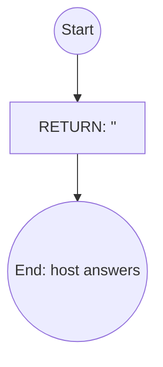

---

## CancelProcess
**ID**: `cancel-process` · **Version**: 1.0.0 · **Sub-flow**  
**Description**: Handle flow cancellation by user.

A single `RETURN` of a localized message: "The process has been cancelled. Anything else I can help with?" (Spanish when `language == 'es'`). Terminates all flows. Used with `callType: "reboot"`, e.g. by `get-search-query` on EXIT.

### Flowchart
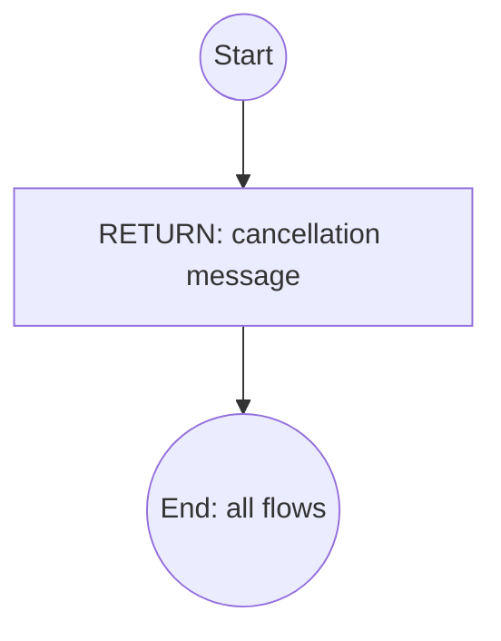

---

## ContactSupport
**ID**: `contact-support` · **Version**: 1.2.2 · **Sub-flow**  
**Description**: Provide customer service contact information. Optional `support_context` / `support_context_es` name what the caller needed help with (else `cargo.support_context`); optional `closing_prompt` / `closing_prompt_es` are spoken after the contact info.

### Parameters
*   `support_context` (string): What the caller needed help with (English), e.g. `payment`.
*   `support_context_es` (string): The same in Spanish, e.g. `pago`.
*   `closing_prompt` (string): Optional English sentence spoken after the contact info, e.g. a follow-up question.
*   `closing_prompt_es` (string): Optional Spanish sentence spoken after the contact info.

The SAY also reads `support_outcome` / `support_reason` when a caller passes them. They are not declared parameters, and no flow in this library passes them.

### Steps
1. `take_context_parameters` (SET, side effect) - when `support_context` is passed: `cargo.support_context = support_context` and `cargo.support_context_es = support_context_es || support_context`. Otherwise the cargo is left as it is.
2. `set_contact_info` / `set_contact_info_es` - `contact_info` = `cargo.contact_info`, or "please contact Customer Support" / "por favor contacte a Servicio al Cliente" when unset. On voice (`cargo.voice`) it is passed through `textWithUrlToSpeech(…, language)` so URLs are spoken.
3. `set_support_message` / `set_support_message_es` (SET) - "{opening}[For assistance with your {cargo.support_context}, ]{contact_info}.[ {closing_prompt}]". The opening is "Thank you for contacting us! " when `cargo.sessionResolved`, else "Sorry I couldn't help! ". The Spanish text ("¡Gracias por comunicarte con nosotros! " / "¡Lo siento, no pude ayudar! ", "Para asistencia con tu …") uses `cargo.support_context_es`, falling back to `support_context`.
4. `say_support_message` (SAY) - `{{support_message}}` / `{{support_message_es}}`.

### Ends
By completion. The SAY declares **`outcome`: `support_outcome` or `"unresolved"`, `reason`: `support_reason` or `"contact_support_fallback"`**. With no `support_outcome` passed (every path in this library), ContactSupport fails the transaction and sets `sessionContext.lastFlowOutcome`. Every caller in the library uses `callType: "reboot"`.

### Flowchart
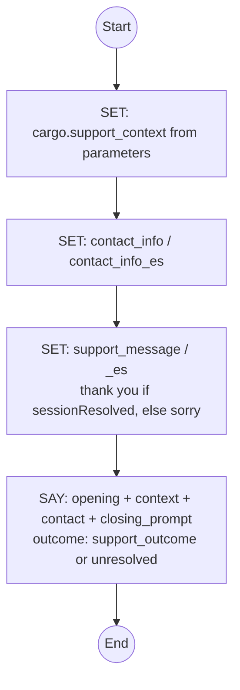

---

## SwitchToText
**ID**: `switch-to-text` · **Version**: 1.2.3 · **Primary** (prompt "Switch to text" / "Cambiar a texto")  
**Description**: Customer explicitly asks to continue this conversation by text message / SMS ('switch to text', 'text me instead', 'can we continue by text', 'pásame a texto', 'seguimos por mensaje de texto'). Not: asking for a live agent or a person (LiveAgentRequested); asking to have one thing texted, such as a link, an address or a statement, a yes or no, or any answer that does not mention text or SMS (None).

### Variables
*   `sms_result` (object): result of the SMS send.

The welcome text also reads `text_starter` / `text_starter_es` when a caller passes them as FLOW parameters (they are not declared here).

### Steps
1. `check_already_text` (CASE) - not on voice (`!cargo.voice`) → **END** (nothing to switch). Otherwise continue.
2. `check_can_text` (CASE) - `can_text = !!callerTextNumber(cargo)` (see the contact readers).
3. `route_cannot_text` (CASE, first match wins):
   - not `can_text` and `callerIsInternational(cargo)` → FLOW [give-up](#giveup) (`reboot`), `context: "texting a number outside the US and Canada"` / `context_es: "enviar un mensaje de texto a un número fuera de EE. UU. y Canadá"`.
   - not `can_text` → FLOW [give-up](#giveup) (`reboot`), `context: "texting the number you are calling from"` / `context_es: "enviar un mensaje de texto al número desde el que llama"`.
4. `get_whatsapp_link` (CALL-TOOL [`get-whatsapp-link`](#get-whatsapp-link), no args) into `wa_link`; `onFail` → `wa_link = ''`.
5. `set_welcome_message` (SET) - "Hi, I remember our phone conversation and can continue to help you here via text.", plus " You can also continue on WhatsApp: {wa_link}?text=Hi" when there is a link (Spanish variant when `language === 'es'`), followed by a blank line and `text_starter` when one was passed (Spanish: `text_starter_es`, else `text_starter`).
6. `set_switch_user_turn` (SET) - `switch_user_turn` = "Switch to text" / "Cambiar a texto".
7. `send_welcome_sms` (CALL-TOOL [`switch-to-sms`](#switch-to-sms)) - args `accountSid: null`, `threadId: {{sessionId}}`, `from: {{cargo.twilioNumber}}`, `to: {{cargo.callerId}}`, `message: {{welcome_message}}`, `userTurn: {{switch_user_turn}}`; result in `sms_result`. `onFail` → FLOW [give-up](#giveup) (`reboot`) with the caller's-number context above.
8. `confirm_sms_sent` (SAY) - "I've sent you a text message. Please check your phone and reply via text. Goodbye and take care!"

### Ends
By completion after the confirmation, `END` when not on voice, or `reboot` into `give-up` when no number can be texted or the send fails. Besides intent detection, other flows reach it with `callType: "reboot"` (keypad 9 / "TEXT" in the retry menu, text words in validate-otp-code).

### Flowchart
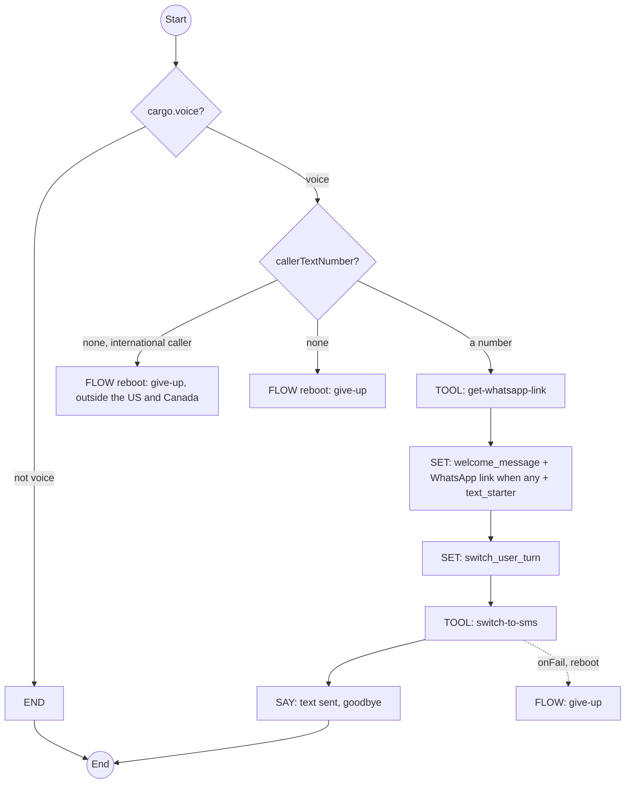

---

## AuthenticateUser
**ID**: `authenticate-user` · **Version**: 1.5.3 · **Sub-flow**  
**Description**: Generic flow to authenticate user via OTP sent to cell or email.

The gatekeeper. It records its options in `cargo.authOptions` / `cargo.authCancelFlow`, collects a phone or email (via `get-cell-or-email`), optionally lets a tenant-supplied validator flow approve the contact, records the destination in `cargo.otp_cell_number` / `cargo.otp_email`, sends the code through [`send-otp-code`](#sendotpcode), hands any send failure to [`otp-send-failed`](#otpsendfailed), and hands off to `get-and-validate-otp-code`. On success it sets `auth_result = true` and returns to its caller, with `cargo.otpVerified` set by the `validate-otp` tool.

### Parameters
*   `retry_flow` (string): Flow a failed contact step retries. Defaults to `authenticate-user` (step `default_retry_flow`). It is passed to `get-cell-or-email` and to the menu for a contact the validator rejected. The code-failure menus always retry `authenticate-user` itself.
*   `cancel_flow` (string): Flow EXIT goes to anywhere in this authentication. Defaults to `contact-support` (step `default_cancel_flow`), and is kept in `cargo.authCancelFlow` for the flows that do not receive it as a variable.
*   `cell_number` (string): Phone already supplied by the caller. Forwarded so `get-cell-or-email` skips the contact prompt.
*   `email` (string): Email already supplied by the caller. Forwarded the same way.
*   `email_validator` (string, optional flow name): When supplied, it is called with `{email}` before an email OTP is sent, and it MUST set `contact_valid = true` to allow the send. **Fail-closed.** The validator must end by completion, because a `RETURN` in it terminates all flows.
*   `cell_validator` (string, optional flow name): Same contract, called with `{cell_number}` before an SMS OTP.
*   `retrying` (boolean): Set by the retry menu. When true and `cargo.authOptions` exists, `retry_flow`, `cancel_flow`, `email_validator`, `cell_validator` and `retry_returns` are restored from `cargo.authOptions` and the values passed with the retry are ignored, so a retry keeps the options of the authentication being retried.
*   `retry_returns` (boolean): When true, a retry from the menu that carries no contact (YES or `1`, not a captured phone or email) returns to the caller with `cargo.authRetry = true`, so the caller asks for the contact again its own way. Default: authenticate-user asks (through `get-cell-or-email`). No flow in this library passes it.

### Variables
`cell_number`, `email`, `contact_valid` (true when no validator applies), `unverified_contact` / `unverified_contact_es` (the rejected contact phrased for the retry message: "the number 555…" / "the email a@b.c").

### Steps
1. `check_already_verified` (CASE) - `cargo.otpVerified` → **END** (return to the caller at once). Otherwise continue.
2. `remember_or_restore_retry_flow` / `_cancel_flow` / `_email_validator` / `_cell_validator` / `_retry_returns` (SET) - with `retrying` and a `cargo.authOptions`: each option = its value in `cargo.authOptions` (`''` when absent there; `retry_returns` = `!!cargo.authOptions.retry_returns`). Otherwise: each option = the passed value, `''` when undefined or empty (`retry_returns` = `!!retry_returns`, false when undefined).
3. `default_retry_flow` / `default_cancel_flow` (SET) - `retry_flow ||= 'authenticate-user'`, `cancel_flow ||= 'contact-support'`.
4. `remember_options` (SET, side effect) - `cargo.authOptions = { retry_flow, cancel_flow, email_validator, cell_validator, retry_returns }` and `cargo.authCancelFlow = cancel_flow`.
5. `retry_through_caller` (SET, side effect) - `cargo.authRetry = !!(retrying && !cell_number && !email && retry_returns)`.
6. `hand_retry_to_caller` (CASE) - `cargo.authRetry` → **END** (`caller_asks_again`: return to the caller, which asks again). Otherwise continue.
7. `get_contact_info` (FLOW `get-cell-or-email`, `call`) - passes `retry_flow`, `cancel_flow`, `cell_number`, `email`. Sets `cell_number` or `email`, or leaves the flow stack via one of its own exits. It also writes `cargo.authCapture`, the capture patterns of every retry menu below.
8. `init_contact_valid` (SET) - `contact_valid` = false when a validator applies to the collected contact (`cell_validator` with a `cell_number`, or `email_validator` with an `email`); true otherwise.
9. `validate_contact` (CASE) - runs `{{cell_validator}}` with `{cell_number}` or `{{email_validator}}` with `{email}` (`call`). The cell validator is checked first.
10. `describe_unverified_contact` / `_es` (SET) - builds the phrase used below.
11. `gate_otp_on_contact_valid` (CASE) - `!contact_valid` → FLOW [`generic-retry-with-options`](#genericretrywithoptions) (`replace`) with "Sorry, I could not verify {{unverified_contact}}.", `retry_flow`, `cancel_flow`, and `capture_patterns: "{{cargo.authCapture}}"`. No `retry_call_type`, `allow_code_entry` or `question`.
12. `reset_resend_count` / `reset_mismatch_count` / `reset_format_miss_count` (SET, side effect) - `cargo.otpResends = 0`, `cargo.otpMismatches = 0`, `cargo.otpFormatMisses = 0`, `cargo.otpWordMisses = 0`.
13. `set_cell_number_to_cargo` / `set_email_to_cargo` (SET, side effect) - `cargo.otp_cell_number = cell_number || ''`, `cargo.otp_email = email || ''`. This is the destination `send-otp-code` reads.
14. `send_code` (FLOW [`send-otp-code`](#sendotpcode), `call`) - sends the code by SMS to `cargo.otp_cell_number` or by email to `cargo.otp_email`, and records `cargo.otpSendFailure` (`''` when the code went out). A number already refused for texts (`cargo.otpUndeliverableTo`) is not texted again.
15. `auth_check_sent` (CASE) - `cargo.otpSendFailure` → FLOW [`otp-send-failed`](#otpsendfailed) (`replace`). Otherwise continue.
16. `get_and_validate_otp_code` (FLOW `get-and-validate-otp-code`, `call`).
17. `check_validation_result` (CASE) - `cargo.otpVerified` → SET `auth_result = true`. Otherwise → FLOW `generic-retry-with-options` (`replace`), "Sorry, the code you entered was invalid or expired.", with the [authentication retry parameters](#genericretrywithoptions) and `allow_code_entry: true`.

### Ends
Success returns to the caller (by completion) with `auth_result = true` and `cargo.otpVerified` set. Already verified → `END`. A contact-less retry with `retry_returns` → `END` with `cargo.authRetry = true`. Failures leave through `generic-retry-with-options`, `otp-send-failed` (which goes on to `otp-text-undeliverable` or `generic-retry-with-options`), or through `get-cell-or-email`'s own exits (cancel, live agent, off-topic hand-off). `otp-send-failed` and the flow it replaces itself with keep this frame's variables (`retry_flow`, `cancel_flow`, the validators) because they are reached by `replace`, and `otp-text-undeliverable` returns here by `replace`. EXIT at any step goes to the authentication's `cancel_flow`: `get-cell-or-email` and the contact menu receive it as a variable, the other steps read `cargo.authCancelFlow`.

### Flowchart
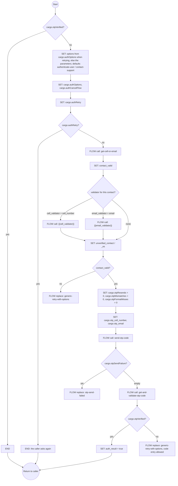

---
---

## GetCellOrEmail
**ID**: `get-cell-or-email` · **Version**: 1.2.0 · **Sub-flow**  
**Description**: Prompt user to provide either their cell phone number or email address for account lookup. Optional: account_pattern / account_name(_es) also accept the tenant's account number (sets acct_number); intro(_es) leads the question; retry_call_type is passed to the retry menu. Records cargo.contactKind ('caller' | 'phone' | 'email' | 'account') and cargo.contactValue.

The one contact question every tenant uses: `authenticate-user` calls it, and a tenant whose callers may also answer with an account number calls it directly with that number's pattern instead of keeping its own copy.

### Parameters
*   `retry_flow` (string): Flow the retry menu runs again. With `retry_call_type: 'replace'` and `retry_flow: 'get-cell-or-email'` a retry asks again in place and returns to the caller.
*   `cancel_flow` (string): Flow to reboot if the user cancels. Empty falls back to `contact-support`.
*   `account_pattern` (string, optional): a regex for the tenant's account number (e.g. `'^5\\d{6,7}$'`). An answer matching it sets `acct_number`; without it nothing about account numbers changes.
*   `account_name` / `account_name_es` (string, optional): with `account_pattern`, how the question names it ("your account number" / "su número de cuenta"): "…associated with your account, or your account number."
*   `intro` / `intro_es` (string, optional): a sentence said before the question, only when it asks ("To access your account I'll send you a one-time code.").
*   `retry_call_type` (string, optional): passed to every retry menu, `'reboot'` (default) or `'replace'`.
*   Also reads `cell_number` / `email` / `acct_number` when the caller passes them (`authenticate-user` does). The flow shares its caller's scope, so the result lands in those variables.

### Steps
1. `contact_capture_patterns` (SET, side effect) - `cargo.authCapture = [{ variable: 'cell_number', reader: 'phone' }, { variable: 'email', reader: 'email' }]`, the capture patterns every authentication retry menu passes.
2. Guard `cell_number`, `email` and `acct_number` to `''` when undefined; `gce_pattern`, `gce_or` / `gce_or_es` (", or {account_name}" when there is a pattern), `gce_intro` / `gce_intro_es`, `gce_retry_type` (default `'reboot'`) from the optional parameters.
3. `ask_cell_or_email_if_no_param` (CASE):
   - nothing supplied and `cargo.callerId` from the US or Canada (`!callerIsInternational(cargo)`) → SAY-GET `cell_or_email`: "{intro}To use your caller id, please {verb} yes. Otherwise, please {verb}[ or enter] the phone or email associated with your account{, or account_name}[ followed by the pound key]. To exit anytime you can [press the asterisk key or ]{verb} EXIT." `digits: {min 7, max 12, autoSubmitChars ["1"], autoSubmitMs 2500}` (a single keypad "1" auto-submits).
   - nothing supplied (no caller ID, or an international one) → SAY-GET `cell_or_email`: "{intro}Please {verb} [or enter] the phone or email associated with your account{, or account_name}[ followed by the pound key if entered using the dial pad]. To exit anytime …", `digits: {min 7, max 12}`.
   - otherwise → `cell_or_email = acct_number || cell_number || email` (no prompt).
4. Normalization (SET) - `prospective_cell_number` = digits only. `prospective_email` = `readEmail(cell_or_email)` (typed, spoken or spelled; see [Contact readers](#conventions-used-by-these-flows)). Then `cell_or_email` is trimmed, lower-cased and stripped of punctuation.
5. `branch_on_cell_or_email` (CASE, first match wins):
   1. with `account_pattern`, `readIdentifier(cell_or_email, pattern)` is an account number → `acct_number` = it.
   2. `validatePhone(prospective_cell_number)` → `cell_number` = those digits.
   3. `validateEmail(prospective_email)` → `email` = it.
   4. a US or Canadian `cargo.callerId` and the answer is `1`, or `isAnswer(…, 'yes', ['thanks', 'thank you', 'gracias'])` with no digit and no `@`, or `matchesChoice` phone words (`phone, cell, caller id, number, numero, teléfono, celular, identificador de llamadas`…) → `cell_number = cargo.callerId`.
   5. `readInternationalPhone(cell_or_email)` → FLOW `generic-retry-with-options` (`replace`): "A number outside the US and Canada can't be used here. Please give the email on your account{, or account_name}, or a US or Canadian mobile number.", with `retry_flow`, `cancel_flow`, `retry_call_type` and `capture_patterns: "{{cargo.authCapture}}"`.
   6. `isAnswer(…, 'exit')` (EXIT words or `*`) in an answer of at most two words → FLOW `{{cancel_flow || 'contact-support'}}` (`reboot`).
   7. `isAgentRequest` (the whole answer asks for a person, or is `0`) → FLOW `live-agent-requested` (`reboot`).
   8. a US or Canadian `cargo.callerId` and digits that are not a valid phone → `cell_number = cargo.callerId`.
   9. digits that are not a valid phone (no usable caller ID) → FLOW `generic-retry-with-options` (`replace`): "Sorry, the phone number you provided isn't valid.", same parameters.
   10. a US or Canadian `cargo.callerId` (anything else: "este", "this one", "here"…) → `cell_number = cargo.callerId`.
   11. the question was asked (`!cell_number && !email && !acct_number`) and the answer is three or more words containing no digit and no `@` → **`DISPATCH`** with **`outcome: "unresolved"`, `reason: "auth_prompt_off_topic"`**. The answer goes to intent detection: a matching flow starts at once (the outcome is dropped); otherwise the host answers with the outcome.
   12. default → FLOW `generic-retry-with-options` (`replace`): "Sorry, I do need the phone or email associated with your account{, or account_name} to proceed.", same parameters.

   Because branch 10 comes before branch 11, a caller with a US or Canadian caller ID who says something off-topic is identified by the caller ID, not handed off; the code step that follows lets them leave (EXIT, AGENT).
6. `gce_record_contact` (SET, side effect) - `cargo.contactKind` = `'account'` / `'email'` / `'caller'` (the phone is the caller ID's last 10 digits) / `'phone'`, and `cargo.contactValue` = that value.

### Ends
By completion (returning to the caller with `acct_number`, `cell_number` or `email` set and `cargo.contactKind` recorded), or through one of the exits above.

### Flowchart
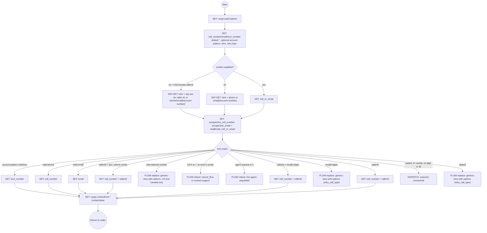

---

## GetAndValidateOtpCode
**ID**: `get-and-validate-otp-code` · **Version**: 1.0.4 · **Sub-flow**  
**Description**: Get and validate OTP code from user.

### Variables
`otp_code`, `normalized_otp_code`, `otp_destination`, `user_choice` (initial `""`), `otp_where` / `otp_where_es` (where the code is, for the prompt).

### Steps
1. `set_otp_destination` - `cargo.otp_cell_number` if set, else `cargo.otp_email`.
2. `formatted_otp_destination` - "cell ending with 1234" (the last four digits; on voice comma-separated, "1, 2, 3, 4") or "email: a@b.c". Spanish wording when `language == 'es'`.
3. `set_otp_where` / `set_otp_where_es` - `cargo.otpSentOn === 'whatsapp'` → "I just sent you here in this chat" / "que le acabo de enviar aquí en este chat". Otherwise "you received at {formatted destination}" / "que recibió en …".
4. `get_otp_from_user` (SAY-GET `otp_code`, `digits: {min 6, max 6}`) - "Please {verb} [or enter ]the 6-digit verification code {otp_where}. You can also [press * or ]{verb} EXIT to cancel." The Spanish exit sentence is "También puede presionar * o decir SALIR para cancelar." on voice and "También puede escribir SALIR para cancelar." otherwise.
5. `set_user_choice` - `user_choice` = the answer trimmed and lower-cased (for word matching).
6. `set_otp_code` - `normalized_otp_code` = digits only.
7. `proceed_to_validation` (FLOW `validate-otp-code`, `replace`). A replace, so the code question can be asked any number of times without the flow stack growing.

### Ends
Through `validate-otp-code`, which takes this flow's place. Retries happen there, by replacing itself with this flow to prompt again.

### Flowchart
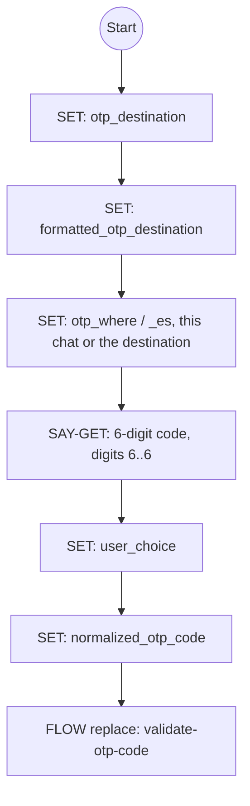

---

## ValidateOtpCode
**ID**: `validate-otp-code` · **Version**: 1.1.7 · **Sub-flow**  
**Description**: Validate OTP code entered by user; sets `cargo.otpVerified` on success. Capped at 3 wrong codes per authentication (`cargo.otpMismatches`, reset by authenticate-user): the code is withdrawn and the retry/agent/exit choice follows, where retry sends a fresh code. Also capped at 3 answers with digits but not 6 (`cargo.otpFormatMisses`, reset by authenticate-user): the same choice follows, without withdrawing the code.

Reads `normalized_otp_code` and `user_choice` from `get-and-validate-otp-code`. An expired or missing code is answered with a fresh one (via `resend-otp-code`), not with "didn't match".

### Variables
`otp_validation_result` (boolean), `invite_text` (WhatsApp invite wording for this session's language; empty means the feature is off), `whatsapp_invite_sent` (initial `false`; true only if an invite was actually sent).

### Steps
1. `validate_otp_and_lookup` (CASE, first match wins):
   - `normalized_otp_code.length === 6` → CALL-TOOL [`validate-otp`](#validate-otp) `{otp: normalized_otp_code, container: cargo}` into `otp_validation_result`. `onFail` → FLOW `get-and-validate-otp-code` (`replace`).
   - `isAnswer(…, 'exit')` (EXIT words or `*`) → FLOW `{{cargo.authCancelFlow || 'contact-support'}}` (`reboot`).
   - `isAnswer(…, 'agent')` (an AGENT word anywhere in the answer, or `0`) → FLOW `live-agent-requested` (`reboot`).
   - `isAnswer(…, 'text')` (TEXT words) → FLOW `switch-to-text` (`reboot`).
   - "didn't receive / resend" phrases (`resend, send again, not received, didn t get, no code, no llegó, no recibí, reenviar`…) → FLOW [`resend-otp-code`](#resendotpcode) (`call`) with `resend_reason: "requested"`.
   - "I'm driving / busy / later" phrases → SAY "No problem. Say TEXT and I'll continue with you by message so you can do this when you are free, or {verb} the code whenever you are ready."
   - some digits, but not 6, fewer than two such answers before → SAY "I was expecting a 6-digit code. Let's try again. You can also [press * or ]{verb} EXIT to cancel." (Spanish exit sentence as in GetAndValidateOtpCode.)
   - some digits, but not 6, the third such answer → nothing said here (step 3 answers).
   - "I don't have that phone (anymore)" / "ya no tengo ese teléfono" and similar → FLOW `generic-retry-with-options` (`replace`): "No problem. Then the code can't reach you there. You can use the email on your account instead, or {verb} AGENT to reach a person.", with the [authentication retry parameters](#genericretrywithoptions).
   - default (no digits) → SET `no_code_given = true`; the next steps explain or cap.
2. `count_no_code` (SET, side effect) - `cargo.otpWordMisses` + 1 when no code was given (words).
3. `explain_or_cap` (CASE) - no code and `cargo.otpWordMisses >= 3` → FLOW `generic-retry-with-options` (`replace`): "I still don't have the code. To reach a person, {verb} AGENT.", with the authentication retry parameters and `allow_code_entry: true`. No code otherwise → SAY "Let me explain. I sent you a message with a six-digit code in it. Read those six digits back to me. You can also {verb} AGENT to reach a person, or EXIT to cancel."
4. `count_format_miss` (SET, side effect) - `cargo.otpFormatMisses` + 1 when the answer has digits but not 6.
5. `retry_if_bad_format` (CASE) - 6 digits → continue. `cargo.otpFormatMisses >= 3` → FLOW `generic-retry-with-options` (`replace`): "I still don't have a 6-digit code. To reach a person, {verb} AGENT.", with the [authentication retry parameters](#genericretrywithoptions) and `allow_code_entry: true`. Otherwise → FLOW `get-and-validate-otp-code` (`replace`), which prompts again after the SAY or the fresh code above.
6. `count_wrong_code` (SET, side effect) - `cargo.otpMismatches` + 1 when not verified and `cargo.otpFailure === 'mismatch'`.
7. `withdraw_code_at_cap` (CASE) - a mismatch with `cargo.otpMismatches >= 3` → `cargo.otpHash = null`, so the code can no longer be accepted.
8. `check_validation_result` (CASE, first match wins):
   - `cargo.otpVerified` → SET `otp_validated = true`.
   - `cargo.otpFailure === 'expired'` → FLOW `resend-otp-code` (`call`), `resend_reason: "expired"`.
   - `cargo.otpFailure === 'missing'` → FLOW `resend-otp-code` (`call`), `resend_reason: "missing"`.
   - a mismatch at the cap → FLOW `generic-retry-with-options` (`replace`): "That code didn't match three times, so I can't accept another try with it. To reach a person, {verb} AGENT.", with the [authentication retry parameters](#genericretrywithoptions) and `allow_code_entry: false`.
   - default → SAY "That code didn't match. Let's try again."
9. `set_invite_text` - `global_whatsapp_invite_es` (Spanish) or `global_whatsapp_invite`, `''` when undefined.
10. `invite_if_wrong_code` (CASE) - verified, or `cargo.otpFailure` is not `mismatch` → no invite. Otherwise → CALL-TOOL [`send-whatsapp-invite`](#send-whatsapp-invite) `{accountSid: null, from: cargo.twilioNumber, to: cargo.otp_cell_number, inviteText, language, container: cargo}` into `whatsapp_invite_sent`. `onFail` → SET `whatsapp_invite_sent = false`. Per the tool's contract it returns `false` when `inviteText` is empty, when it already invited on this call, or when `to` is missing. `to` is `''` when the code went by email.
11. `mention_whatsapp_invite` (CASE) - `whatsapp_invite_sent` → SAY "I texted you a WhatsApp link so you can try again on WhatsApp to help overcome voice limitations."
12. `retry_if_wrong_code` (CASE) - not verified → FLOW `get-and-validate-otp-code` (`replace`).

### Ends
Verified → completion (the caller chain returns to `authenticate-user` or `generic-retry-with-options`). A wrong code loops back to the prompt until the third mismatch, which leaves through `generic-retry-with-options`. An expired or missing code gets a fresh one and loops back, until `resend-otp-code`'s own cap. The exits in step 1 leave at any time.

### Flowchart
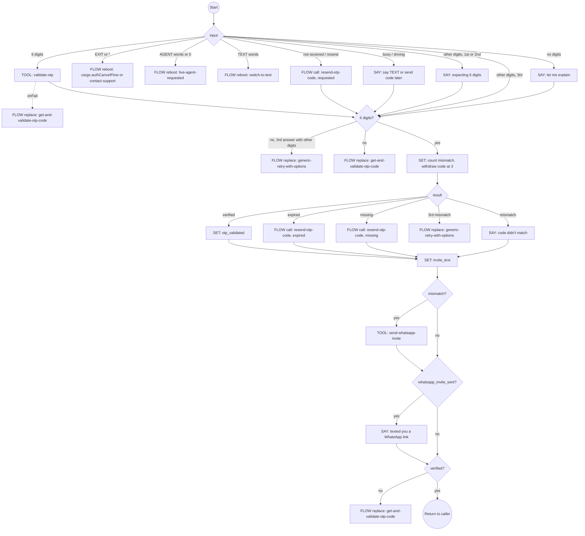

---

## ResendOtpCode
**ID**: `resend-otp-code` · **Version**: 1.1.3 · **Sub-flow**  
**Description**: Worker: sends a fresh code to the destination authenticate-user used (`cargo.otp_cell_number` / `cargo.otp_email`) and says why (`expired`, `missing` or `requested`). At most 2 per authentication (`cargo.otpResends`), then the retry menu.

Called by `validate-otp-code` with `callType: "call"`.

### Parameters
*   `resend_reason` (string): `expired`, `missing` or `requested`. Also declared as a variable with the default `"requested"`.

### Variables
`resend_reason`.

### Steps
1. `check_resend_cap` (CASE) - `cargo.otpResends >= 2` → FLOW `generic-retry-with-options` (`replace`): "I've already sent you new codes and still couldn't verify you. To reach a person, {verb} AGENT.", with the [authentication retry parameters](#genericretrywithoptions) and `allow_code_entry: true`.
2. `count_resend` (SET, side effect) - `cargo.otpResends` + 1.
3. `send_fresh_code` (FLOW [`send-otp-code`](#sendotpcode), `call`) - sends to `cargo.otp_cell_number` or `cargo.otp_email` and records `cargo.otpSendFailure`.
4. `resend_check_sent` (CASE) - `cargo.otpSendFailure` → FLOW [`otp-send-failed`](#otpsendfailed) (`replace`). Otherwise continue.
5. `say_why_fresh_code` (CASE) - `expired` → SAY "Your code expired, so I've sent you a new one." `missing` → SAY "I don't have an active code for you, so I've sent you a new one." Otherwise → SAY "I've sent you a new code."

### Ends
By completion, returning to `validate-otp-code`, which loops back to the code prompt. At the cap, by `replace` into `generic-retry-with-options`; on a failed send, by `replace` into `otp-send-failed`.

### Flowchart
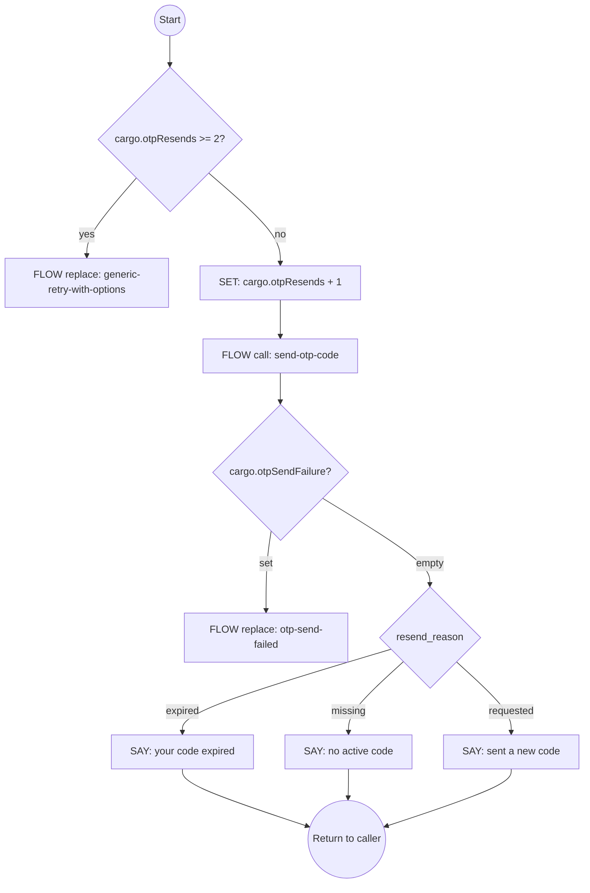

---
---

## GenericRetryWithOptions
**ID**: `generic-retry-with-options` · **Version**: 1.3.2 · **Sub-flow**  
**Description**: Worker: says what failed and offers retry (YES / 1), switch to text (TEXT / 9, when callerTextNumber can reach the caller), an agent (AGENT / 0) or exit (EXIT / *). A contact in the answer retries with it; with allow_code_entry a 6-digit code is checked on the spot; anything else goes back to intent detection.

The library's only retry menu: the authentication flows and the Shopify lookups offer their retry through it.

### Parameters
*   `error_message` / `error_message_es` (string): What failed, spoken first.
*   `question` / `question_es` (string): The question after the error. Empty or absent = "Would you like to try again?" / "¿Le gustaría intentar nuevamente?".
*   `retry_flow` (string): Flow to run again on YES / `1` or a captured contact.
*   `retry_call_type` (string): `'reboot'` (the default: start `retry_flow` afresh, alone) or `'replace'` (re-enter it in this frame, e.g. `authenticate-user` inside its caller).
*   `cancel_flow` (string): Flow to reboot on EXIT. Empty or absent = `contact-support`.
*   `capture_patterns` (array): Optional `[{variable, reader}]` or `[{variable, regex, normalizer?}]` for [`normalizeAndFindCapture`](#conventions-used-by-these-flows). Absent = no smart capture. The JSON's parameter description still names only `{variable, regex}`.
*   `allow_code_entry` (boolean): A 6-digit answer is a verification code, checked with `validate-otp-code`.
*   `caller_outcome`, `caller_reason` (string): Optional. The caller's declared outcome (usually `unresolved`) and reason for the failure that led here. The `DISPATCH` of an unrecognised answer declares them, so they reach the host only when intent detection matches no flow. Omitted = no outcome.

**Authentication retry parameters.** `authenticate-user` (wrong code), `validate-otp-code` (wrong-code cap), `resend-otp-code` (resend cap) and `otp-send-failed` (failed send) all pass the same set besides their own message and `allow_code_entry`:

| Parameter | Value |
|---|---|
| `retry_flow` | `authenticate-user` |
| `retry_call_type` | `replace` |
| `cancel_flow` | `{{cargo.authCancelFlow}}` |
| `capture_patterns` | `{{cargo.authCapture}}`: `cell_number` read with `readPhone`, `email` read with `readEmail` |
| `question` / `question_es` | "Would you like to try again to get access to your account?" / "¿Le gustaría intentar nuevamente obtener acceso a su cuenta?" |

`allow_code_entry` is `true` after a wrong code (authenticate-user) and at the resend cap, `false` at the wrong-code cap (the code was withdrawn) and after a failed send. `authenticate-user`'s rejected-contact menu and `get-cell-or-email`'s menus pass only `retry_flow`, `cancel_flow` and `capture_patterns: "{{cargo.authCapture}}"`.

### Variables
`user_choice`, `smart_capture_result`, `normalized_otp_code` (a 6-digit code typed at the menu, when `allow_code_entry`).

### Steps
1. `say_error_and_prompt` (SAY-GET `user_choice`, `digits: {min 1, max 1}`) - "{error_message} {question} To retry [Press 1 or ]{verb} YES. [To switch to text press 9 or {verb} TEXT. (only when `callerTextNumber(cargo)` returns a number)]To abort [press the asterisk key or ]{verb} EXIT." The keypad wording appears on voice only, and the TEXT option only on voice with a `cargo.callerId`. This prompt does not name the AGENT option; the error messages of the two cap menus do.
2. `reprompt_on_unknown_key` (CASE) - a single key `2` to `8` → SAY-GET `user_choice` again: "Sorry, that is not an option. To retry … [For an agent press 0. ]To abort …" (the agent sentence on voice only; same `digits`). One re-prompt only; its answer goes on to step 3.
3. `check_smart_capture` (SET) - `smart_capture_result = normalizeAndFindCapture(user_choice, capture_patterns)` when patterns were passed, else `null`.
4. `handle_smart_capture` (CASE, first match wins):
   - a capture and `retry_call_type === 'replace'` → FLOW `{{retry_flow}}` (`replace`) with `cell_number: ''`, `email: ''`, `[captured variable]: captured value`, `retry_flow`, `cancel_flow`, `retrying: true`.
   - a capture → FLOW `{{retry_flow}}` (`reboot`) with `[captured variable]: captured value`, `retry_flow`, `cancel_flow`.

   So an answer that contains a phone or email goes straight back in with that value (with the `cargo.authCapture` readers: the 10-digit number, or the email address lower-cased).
5. `read_typed_code` (SET) - with `allow_code_entry`, `normalized_otp_code` = the answer's digits when there are exactly 6; else `''`.
6. `check_typed_code` (CASE) - `normalized_otp_code` → FLOW [`validate-otp-code`](#validateotpcode) (`call`).
7. `normalize_choice` (SET) - trim, lower-case, strip punctuation.
8. `handle_choice` (CASE, first match wins):
   - `normalized_otp_code` and `cargo.otpVerified` → SET `auth_result = true` (the flow then ends by completion).
   - `(isAnswer(…, 'yes', [phone, email, cell, mobile, teléfono, telefono, celular, móvil, movil, correo electrónico, correo]) || user_choice === '1') && retry_call_type === 'replace'` (`retry_in_place`) → FLOW `{{retry_flow}}` (`replace`) with `retrying: true`, `cell_number: ''`, `email: ''`.
   - the same YES test, or `1`, without `retry_call_type: 'replace'` (`retry_from_start`) → FLOW `{{retry_flow}}` (`reboot`) with `retrying: true`.
   - `isAnswer(…, 'text')` (TEXT words) or `9` → FLOW `switch-to-text` (`reboot`).
   - `isAnswer(…, 'agent')` (an AGENT word anywhere in the answer, or `0`) → FLOW `live-agent-requested` (`reboot`).
   - `isAnswer(…, 'exit')` (EXIT words or `*`) → FLOW `cancel_flow`, else `contact-support` (`reboot`).
   - empty input or a lone digit (no intent to detect) → the same cancel target (`reboot`).
   - default → `DISPATCH` (outcome/reason = `caller_outcome`/`caller_reason`): the answer is routed through intent detection. A matching flow starts in the same turn, otherwise the host answers.

`retrying: true` makes an `authenticate-user` that the retry reaches restore the options of the authentication being retried from `cargo.authOptions` (see [AuthenticateUser](#authenticateuser)).

### Ends
By completion after a typed code was verified (with `auth_result = true`, returning to whichever flow called the frame this menu replaced), by a `replace` / `reboot` into another flow, or by `DISPATCH` (default branch).

### Flowchart
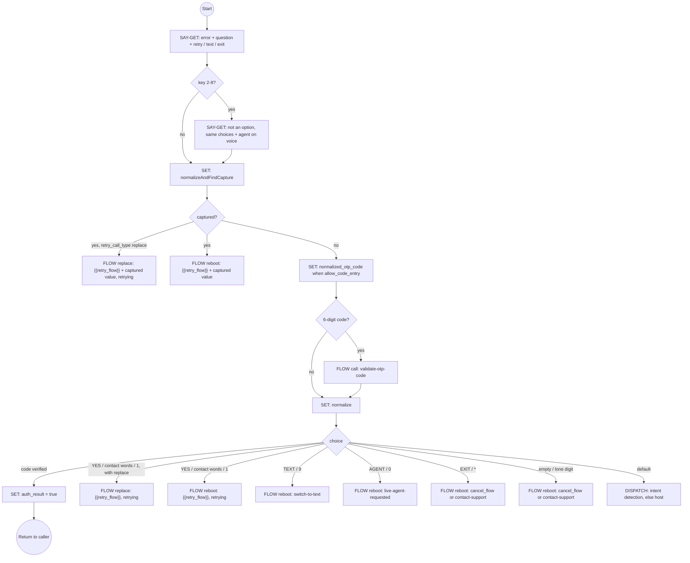

---

## OtpSendFailed
**ID**: `otp-send-failed` · **Version**: 1.0.2 · **Sub-flow**  
**Description**: Worker: a code could not be sent (`cargo.otpSendFailure`). A line that cannot receive texts goes to otp-text-undeliverable; any other failure offers the retry.

Reached by `replace` from `authenticate-user` (`auth_check_sent`) and from `resend-otp-code` (`resend_check_sent`) when [`send-otp-code`](#sendotpcode) recorded a failure, so it keeps the replaced frame's variables.

### Steps
1. `branch_on_failure` (CASE):
   - `cargo.otpSendFailure === 'undeliverable'` → FLOW [`otp-text-undeliverable`](#otptextundeliverable) (`replace`).
   Each retry branch passes the [authentication retry parameters](#genericretrywithoptions) with `allow_code_entry: false`.
   - `'sms'` → FLOW `generic-retry-with-options` (`replace`): "Sorry, text message delivery failed."
   - `'email'` → FLOW `generic-retry-with-options` (`replace`): "Sorry, email delivery failed."
   - default (`'none'`) → FLOW `generic-retry-with-options` (`replace`): "Sorry, there was an unexpected error."

### Ends
Always by `replace` into one of the two flows.

### Flowchart
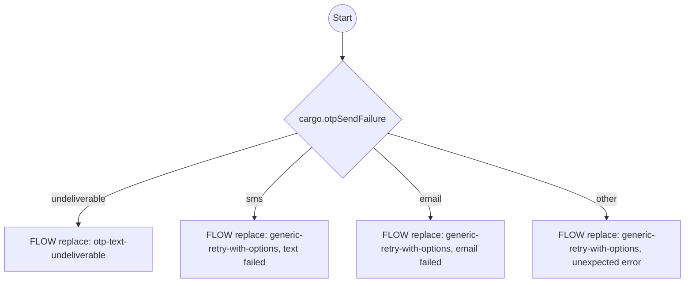

---

## TextDestination
**ID**: `text-destination` · **Version**: 1.0.2 · **Sub-flow**  
**Description**: Worker: where a text to the customer can go. Sets `cargo.textTo` (10 digits: the verified cell, else the caller's phone on a call; `''` when there is none, no sender, or the line cannot receive texts) and `cargo.textTo4` (its last four, spaced on voice).

No flow in this library calls it. A caller runs it (`call`) before [`send-text`](#sendtext), and can use `cargo.textTo4` to tell the customer where the text went.

The "verified cell" of the description is `cargo.otp_cell_number`, the number `authenticate-user` sent the code to. The step does not check `cargo.otpVerified`.

### Steps
1. `pick_destination` (SET, side effect) - `cargo.textTo = textDestination(cargo)`: the verified cell, else the caller (`callerTextNumber`); `''` when neither can be texted (see the contact readers).
2. `say_last_four` (SET, side effect) - `cargo.textTo4` = the last four digits of `cargo.textTo`, comma-spaced on voice ("1, 2, 3, 4"); `''` when `cargo.textTo` is empty.

### Ends
By completion.

### Flowchart
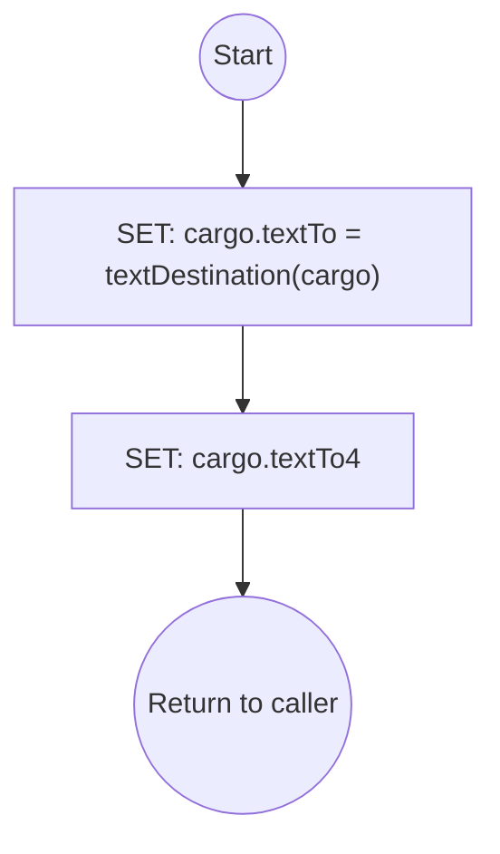

---

## SendText
**ID**: `send-text` · **Version**: 1.0.0 · **Sub-flow**  
**Description**: Worker: texts `message` to `cargo.textTo` (call text-destination first). Sets `cargo.textSent`.

No flow in this library calls it.

### Parameters
*   `message` (string): The text to send.

### Variables
`text_result` (string): what the send tool returned; `''` when it failed.

### Steps
1. `text_not_sent_yet` (SET, side effect) - `cargo.textSent = false`.
2. `send_when_possible` (CASE):
   - `cargo.textTo` → CALL-TOOL [`send-twilio-sms`](#send-twilio-sms) `{from: cargo.twilioNumber, to: "+1" + cargo.textTo, message}` into `text_result`. `accountSid` is not passed, so the function receives it as `undefined`. `onFail` → SET `text_result = ''`.
   - default → SET `text_result = ''`.
3. `record_sent` (SET, side effect) - `cargo.textSent = !!(cargo.textTo && text_result)`.

### Ends
By completion. It never leaves the flow stack; the caller reads `cargo.textSent`.

### Flowchart
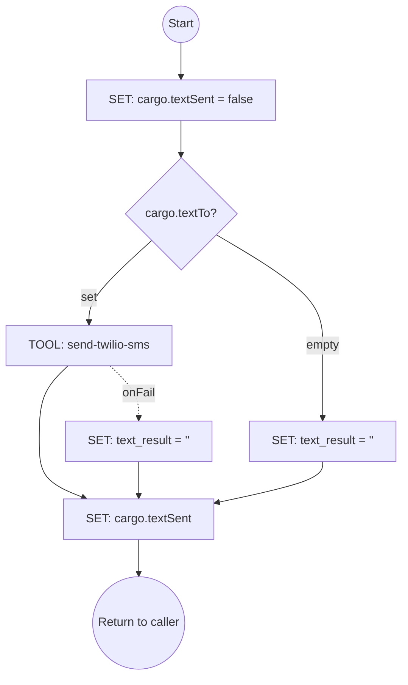

---

## SendOtpCode
**ID**: `send-otp-code` · **Version**: 1.0.0 · **Sub-flow**  
**Description**: Worker: sends a one-time code to `cargo.otp_cell_number` (SMS) or `cargo.otp_email`. Never texts a number that cannot receive texts (`cargo.otpUndeliverableTo`). Sets `cargo.otpSendFailure` (`''`, `'undeliverable'`, `'sms'`, `'email'` or `'none'`); the caller hands a failure to otp-send-failed.

Called with `callType: "call"` by `authenticate-user` (`send_code`) and `resend-otp-code` (`send_fresh_code`). Each caller checks `cargo.otpSendFailure` in its next step and, when set, replaces itself with [`otp-send-failed`](#otpsendfailed).

**Why the worker records the failure instead of handing it off itself.** An `onFail` FLOW with `callType: "replace"` replaces only the frame that holds the failed CALL-TOOL. Inside a called worker that frame is the worker, so the replacement would run in its place and, when it finished, the caller would continue to its next step (the code prompt) as if the code had been sent (jsfe `src/index.ts`, CALL-TOOL `onFail` handling). Recording the failure and letting the caller branch on it leaves the caller's own frame, the one that should end.

### Steps
1. `clear_send_failure` (SET, side effect) - `cargo.otpSendFailure = ''`.
2. `skip_line_that_cannot_text` (CASE) - `cargo.otp_cell_number` whose last 10 digits equal `cargo.otpUndeliverableTo` → `cargo.otpSendFailure = 'undeliverable'`. A number already refused for texts is never texted again in the same session. Otherwise continue.
3. `send_code` (CASE, first match wins):
   - no failure and `cargo.otp_cell_number` → CALL-TOOL [`send-sms-otp`](#send-sms-otp) `{accountSid: null, from: cargo.twilioNumber, to: cargo.otp_cell_number, container: cargo, language}`. `onFail` → SET `cargo.otpSendFailure = cargo.otpUndeliverableTo ? 'undeliverable' : 'sms'` (the host's `send-sms-otp` sets `cargo.otpUndeliverableTo` when the line refuses the text, and clears it at the start of every send, so a value here describes this failure).
   - no failure and `cargo.otp_email` → CALL-TOOL [`send-email-otp`](#send-email-otp) `{to: cargo.otp_email, container: cargo, language}`. `onFail` → SET `cargo.otpSendFailure = 'email'`.
   - no failure (no destination) → `cargo.otpSendFailure = 'none'`.
   - default (already `'undeliverable'`) → nothing is sent.

### Ends
By completion, always. The outcome is in `cargo.otpSendFailure`.

### Flowchart
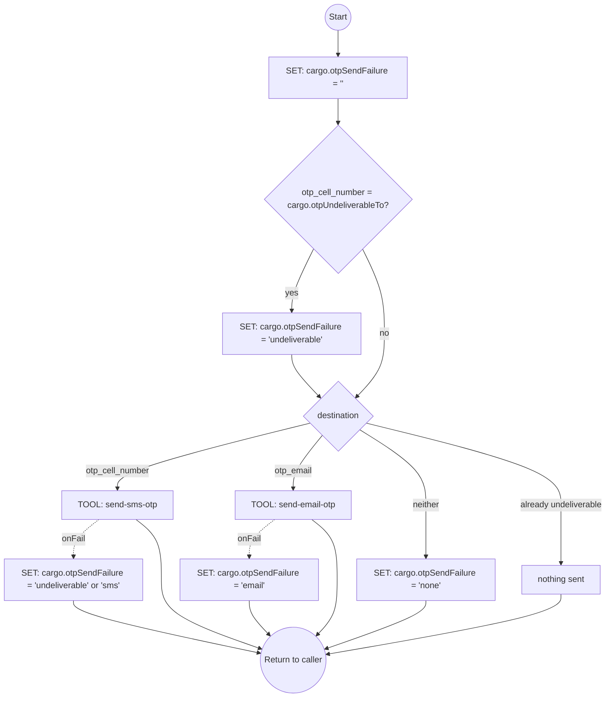

---
---

## OtpTextUndeliverable
**ID**: `otp-text-undeliverable` · **Version**: 1.0.8 · **Sub-flow**  
**Description**: Worker for authenticate-user: the number for the code cannot receive texts (landline, toll-free, invalid). Says so and asks for the account's email or a mobile number; never offers to text the same number again.

Reached by `replace` from [`otp-send-failed`](#otpsendfailed) when `cargo.otpSendFailure` is `undeliverable`, so it keeps `authenticate-user`'s variables (`retry_flow`, `cancel_flow`, the validators) and returns to it by `replace`.

### Parameters
*   `note` (string): `international` when asked again after a number outside the US and Canada; the question then says codes reach only US and Canadian numbers.

### Variables
`user_choice` (the answer), `undeliverable_last4` (last four digits of the refused number; comma-spaced on voice), `choice_digits` (the 10-digit number in the answer, if any), `choice_email` (an email address in the answer, if any).

### Steps
1. `describe_number` (SET) - `undeliverable_last4` from `cargo.otpUndeliverableTo`: "1, 2, 3, 4" on voice, "1234" otherwise.
2. `ask_other_contact` (SAY-GET `user_choice`, `digits: {min 1, max 12, autoSubmitChars ["0"], autoSubmitMs 2500}`) - "[I can only text codes to US and Canadian numbers. (when `note` is `international`)]The number ending with {undeliverable_last4} can't receive text messages, so I can't text it a code. Please {verb} the email address on your account, or {voice ? 'say or enter' : verb} a mobile number that can receive texts. To talk to an agent [press 0 or ]{verb} AGENT. To exit [press the asterisk key or ]{verb} EXIT."
3. `read_digits` (SET) - `choice_digits = readPhone(user_choice)`: the answer's digits when there are exactly 10 (or 11 with a leading `1`, dropped); else `''`.
4. `read_email` (SET) - `choice_email = readEmail(user_choice)`: the email address in the answer, typed, spoken or spelled, lower-cased; else `''`.
5. `clear_cell` / `clear_email` (SET) - `cell_number = ''`, `email = ''`.
6. `handle_choice` (CASE, first match wins):
   - `choice_email` and `validateEmail(choice_email)` → FLOW `authenticate-user` (`replace`) with `email: {{choice_email}}`.
   - `validatePhone(choice_digits)` → FLOW `authenticate-user` (`replace`) with `cell_number: {{choice_digits}}`.
   - `isAgentRequest` (the whole answer asks for a person, or is `0`) → FLOW `live-agent-requested` (`reboot`).
   - `isAnswer(…, 'exit')` (EXIT words or `*`) in an answer of at most two words → FLOW `{{cargo.authCancelFlow || 'contact-support'}}` (`reboot`).
   - `readInternationalPhone(user_choice)` → FLOW `otp-text-undeliverable` (`replace`) with `note: "international"`: asks again, saying codes reach only US and Canadian numbers.
   - default → FLOW `authenticate-user` (`replace`) with no contact, so `get-cell-or-email` asks again.

If the caller gives the same number again (or accepts the caller ID that is that number), `send-otp-code`'s `skip_line_that_cannot_text` records `undeliverable` without texting it, and `otp-send-failed` brings the caller back here.

### Ends
By `replace` into `authenticate-user`, or `reboot` into `live-agent-requested` or the authentication's cancel flow (`cargo.authCancelFlow`, else `contact-support`).

### Flowchart
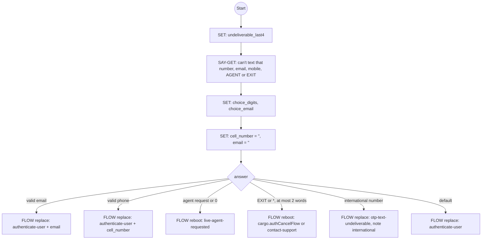

---

## LiveAgentRequested
**ID**: `live-agent-requested` · **Version**: 1.7.2 · **Primary** (prompt "live agent confirmation" / "confirmación de agente en vivo")  
**Description**: Customer wants to talk to a person: a live agent, a representative, customer service ('agent', 'speak to an agent', 'customer service representative', 'transfer me', 'I need to talk to someone', 'can I talk to a human', 'agente', 'representante', 'servicio al cliente', 'atención al cliente', 'transfiéreme', 'hablar con una persona', 'comunicarme con alguien'), including a cut-off 'service' or 'al cliente' said alone. Not: continuing by text (SwitchToText); only asking for a phone number, email or hours (None).

**Behaviour**: On the phone it offers the transfer when an agent is scheduled (`cargo.agentPhoneNumber`); on every other channel it sends the Live Connect link when the tenant runs Live Connect and an agent is reachable. On the phone after hours (no agent number this turn, the number has a schedule) it says so, states the agent hours and offers to help, ending `unresolved` (`agent_unavailable`). Otherwise (any non-phone channel without a Live Connect link, or a phone number with no agents at all) it says it cannot connect the customer with a live agent and gives the tenant's contact information, ending `resolved` (`no_agent_reachable`). Started by [give-up](#giveup) (`cargo.giveUp`), it transfers on the phone without the offer to continue with the AI, and the cannot-connect end is `unresolved` (`gave_up`). Its worded RETURNs carry `keepSay: true`, so text a calling flow queued before rebooting here is delivered first.

### Variables
*   `user_choice` (string): continue with AI or transfer.
*   `live_connect_link` (string): the Live Connect guest link on non-phone channels; `''` when not available.
*   `after_give_up` (boolean): started by give-up.

### Steps
0. `take_give_up` (SET) - `after_give_up = !!cargo.giveUp`, and `cargo.giveUp = false`.
1. `get_live_connect` (CASE) - not on voice → CALL-TOOL [`get-live-connect-link`](#get-live-connect-link) `{container: cargo}` into `live_connect_link`; `onFail` → SET `live_connect_link = ''`. On voice → `live_connect_link = ''`.
2. `offer_live_connect` (CASE) - not on voice and a link → **`RETURN`** "You can talk to a live agent now, by audio or video, here: {live_connect_link}" (Spanish: "Puede hablar ahora con un agente en vivo, por audio o video, aquí: …"), **`outcome: "resolved"`, `reason: "live_connect_link"`**.
3. `cannot_connect` (CASE) - not on voice, or on voice with neither `cargo.agentPhoneNumber` nor `cargo.agentHours` (a number with no agents) → **`RETURN`**, sentences joined with spaces, **`outcome: "resolved"`, `reason: "no_agent_reachable"`** (after a give-up: `unresolved`, `gave_up`):
   - "I can't connect you with a live agent here." (Spanish: "No puedo comunicarle con un agente en vivo por aquí.");
   - not on voice: `global_live_agents_comment` / `_es`, when set;
   - `cargo.contact_info` set: "Here is how to reach Customer Support: {contact_info}." (on voice through `textWithUrlToSpeech`); otherwise "Please contact Customer Support."
4. `check_agent_available` (CASE) - no `cargo.agentPhoneNumber` (on voice, after hours) → **`RETURN`**, sentences joined with spaces, **`outcome: "unresolved"`, `reason: "agent_unavailable"`**:
   - "Our live agent team isn't available right now." (Spanish: "Nuestro equipo de agentes no está disponible en este momento.");
   - `cargo.agentHours` / `cargo.agentHours_es`, else `global_live_agents_comment` / `_es` when set;
   - `cargo.agentUnavailableMessage`, else "I can still help with many questions. Just tell me what you need." (Spanish: "Aún puedo ayudarle con muchas preguntas. Solo dígame qué necesita." on voice, "… Solo escríbame qué necesita." otherwise).
5. `offer_unless_give_up` (CASE) - `after_give_up` → SET `user_choice = 'agent'` (no offer). Otherwise `ask_user_choice` (SAY-GET `user_choice`, `digits: {min 1, max 1}`) - the deflection pitch ("Before I try to transfer you, I want you to know that I can help you faster with many inquiries…"), then "To have me help you now [Press 1 or] {verb} YES. For a live agent [Press 0 or] {verb} LIVE AGENT."
6. `normalize_choice` - trim, lower-case, strip punctuation.
7. `handle_choice` (CASE):
   - **anything that is not** `isAnswer(…, 'yes', ['continue', 'thanks', 'gracias'])` and not `1` (so a negated answer such as "not sure" transfers) → nested CASE: `cargo.agentPhoneNumber` → **`RETURN`** "Understood. Let me transfer you to a live agent." (Spanish: "Entendido. Te transfiero a un agente en vivo."); after a give-up without "Understood." / "Entendido.". Otherwise (the agent number is gone when the answer arrives) → **`RETURN`** the same "not available" text as step 4, `outcome: "unresolved"`, `reason: "agent_unavailable"`.
   - YES / `1` → SAY "Great! I'm glad to help. What would you like assistance with today?"

The flow only returns the transfer sentence. **Performing the transfer is the host's job**; no tool is called.

### Ends
`RETURN` (Live Connect link, cannot connect, not available, or transfer), or completion after the "Great!" SAY.

### Flowchart
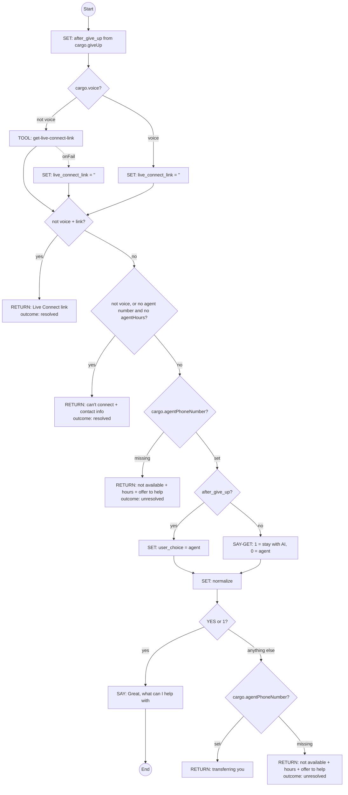

---

## GiveUp
**ID**: `give-up` · **Version**: 1.0.1 · **Sub-flow**  
**Description**: Worker: a flow could not finish, because its tries ran out or a service it needs failed. Says so and hands the caller to [LiveAgentRequested](#liveagentrequested), which transfers at once on the phone instead of offering to continue with the AI. Not for an answer that changes direction: that is `DISPATCH`ed.

### Parameters
*   `context` (string): What could not be finished (English), e.g. "your payment". Empty or absent = "your request".
*   `context_es` (string): The same in Spanish, e.g. "su pago". Empty or absent = `context`, else "su solicitud".

### Steps
1. `gu_context`, `gu_context_es` (SET) - the defaults above.
2. `gu_mark` (SET, side effect) - `cargo.giveUp = true`.
3. `gu_sorry` (SAY) - "Sorry, I wasn't able to help with {context}." (Spanish: "Lo siento, no pude ayudarle con {context_es}.")
4. `gu_to_agent` - FLOW `live-agent-requested` (`replace`).

### Ends
In LiveAgentRequested.

### Flowchart
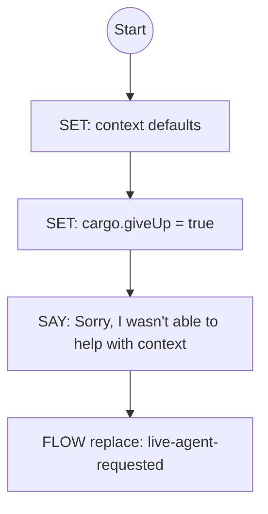

---

## AskChoice
**ID**: `ask-choice` · **Version**: 1.9.4 · **Sub-flow** · **Scope**: isolated  
**Description**: Worker: asks one question and returns the caller's choice in `cargo.choice` (the matching key) and `cargo.choiceText` (the answer as given). One re-ask on a short miss; AGENT (or `0`) reaches a person and EXIT (or `*`) ends, the same for every question; anything still unrecognised is another request and is `DISPATCH`ed, unless `accept_other`, which returns `cargo.choice = 'other'` with the text for the caller to interpret. With `accept_other` and `expect`, an answer of three or more words, none of the expected shape, is another request and is `DISPATCH`ed rather than returned as a failed try. With `amount`, an answer that names an amount returns `cargo.choice = 'amount'`.

The question primitive the other generic workers are built on: ask-email, ask-address, ask-field and card-entry ask every question through it.

### Parameters
*   `question` (string, required): The question (English).
*   `question_es` (string): The question (Spanish). Empty or absent = `question`.
*   `choices` (array, required): `[{ key, words, negative?, neutral? }]` in priority order. `words` include any keypad digit (e.g. `"1"`). See the matching rules below.
*   `retry` / `retry_es` (string): Re-ask wording. Empty or absent = "Sorry, I didn't catch that. " + `question` / "Disculpe, no le entendí. " + the Spanish question.
*   `accept_other` (boolean): Return any other answer as choice `other` instead of re-asking. `true` or `'true'`.
*   `digits` (object): Keypad bounds `{ min, max }`, written to `cargo.digits` while each answer is awaited.
*   `expect` (string): With `accept_other`: what the answer should be, `number`, `email` or `contact` (either). See `isOtherRequest` under the conventions.
*   `amount` (boolean): A payment question. Its SAY-GETs carry `asSpoken`, so a spoken amount is stored as said, and an answer that names an amount (`isAmountAnswer`: "$1", "1 dollar", "12.50") returns `cargo.choice = 'amount'` with the text, never a keypad key and never a `DISPATCH`. `true` or `'true'`.
*   `exit_context` / `exit_context_es` (string): What EXIT abandons, passed to contact-support as `support_context`. Empty or absent = "your request" / "su solicitud".

### Variables
`ac_answer`, `ac_key`, `ac_other`, `ac_amount`, `ac_q_es`, `ac_retry`, `ac_retry_es`, `ac_exit_ctx`, `ac_exit_ctx_es`.

### Matching (`pickChoice`)
The host's `pickChoice(answer, choices, accept_other)` decides; the rules, read from `foundation/text/answer.js` in the reference host:
- The answer is unescaped, lower-cased and stripped of punctuation (`*`, `@` and `.` kept).
- **A key and a YES are the whole answer.** A keypad key (one digit, `*` or `#`) picks a choice only when it is the entire answer after trim, never as part of one. A YES word (the standard list: yes, sure, ok, that's fine, sounds good, I agree, approved, sí, claro, de acuerdo, estoy de acuerdo…) picks a choice only when the answer holds nothing but affirmatives once courtesy around it is removed (please / thanks / gracias, um / uh, ma'am / señora): "Yeah, sure, thank you" is YES, "yes, I want to pay 1" is not. A choice marked `exact: true` (one that charges or cancels) holds all of its words to that rule. Other words (named actions such as LINK or RECEIPT) still match inside the answer, as below. Agreeing phrases that hold a negation word ("no problem", "why not", "no hay problema") are removed first.
- A choice keyed `yes` also takes the standard YES words. The NO-type choice (the first keyed `no`, `decline`, `done` or `cancel`, or marked `negative: true`) also takes the standard NO words.
- The answer is split into clauses (at `,` `;` `!` `?`, ". ", "but", "pero"). In each clause, the words from the first negation word on ("not", "don't", "no", "nunca"…) are negated.
- A NO-type word, or a word that itself holds a negation, matches the whole answer. Any other word picks its choice when it appears outside a negated part. Inside a negated part only, a `neutral: true` choice still matches (the negation is about the object), unless the word follows its negation within two words; any other choice is blocked.
- Choices are tried in order and the first match wins. Then: a deferral ("later", "tomorrow", "not now", "mañana", "luego"…) answers with the NO-type choice; a YES match in a reply led by a bare "no" ("no", "nope", "nah", "no thanks", "no gracias") becomes the NO-type choice; a blocked match with a NO-type choice answers NO.
- No choice matched: `0`, or an answer with no negation and no `@` that holds an AGENT word (with `accept_other`: that is entirely an agent request), returns `__agent`. `*`, or an answer that is just exit / quit / salir / abort (and, without `accept_other`, cancel / cancelar), optionally followed by "please" / "por favor", returns `__exit`. Otherwise `''`.

The flow's description says that with `accept_other` EXIT matches "exit / salir / cancel / cancelar"; `pickChoice` treats cancel / cancelar as an answer there (as the description's last sentence also says), and accepts quit and abort.

### Steps
1. `ac_reset` (SET, side effect) - `cargo.choice = ''`, `cargo.choiceText = ''`.
2. `ac_accepts_other`, `ac_takes_amount`, `ac_question_es`, `ac_retry_en`, `ac_retry_spanish`, `ac_exit_context`, `ac_exit_context_es` (SET) - the defaults above.
3. `ac_keypad` (SET, side effect) - `cargo.digits = digits` when it is an object, else `undefined`.
4. `ac_ask` (SAY-GET `ac_answer`, `asSpoken: "ac_amount === true"`) - `{{question}}` / `{{ac_q_es}}`.
   Then `ac_repeat_1` / `ac_repeat_2` (CASE) - an answer that only asks to hear the question again (repetir, repítalo, otra vez, de nuevo, repeat, again, say that again) and picks no choice → SAY-GET `ac_answer` with `{{question}}` again, up to twice. It is not a miss.
5. `ac_match` (SET) - `ac_key = pickChoice(ac_answer, choices, ac_other)`. `ac_amount_check`: with `amount` and `isAmountAnswer(ac_answer)`, `ac_key = '__amount'`.
6. `ac_keypad_again` (SET, side effect) - `cargo.digits` as in step 3, for a re-ask.
7. `ac_reask_on_miss` (CASE) - no key, no `accept_other`, and fewer than three words that contain a letter → SAY-GET `ac_answer` with the retry wording (`asSpoken` as in step 4). A longer miss is not re-asked; it is a new request.
8. `ac_match_again` (SET) - after a re-ask, `ac_key = pickChoice(…)` on the new answer; `ac_amount_check_again` as in step 5.
8a. `ac_other_request_check` (SET) - no key, `accept_other` and `expect`, and `isOtherRequest(ac_answer, expect)` → `ac_key = '__elsewhere'`.
9. `ac_keypad_done` (SET, side effect) - `cargo.digits = undefined`. When the answer leaves through AGENT, EXIT or `DISPATCH` (`__agent`, `__exit`, `__elsewhere`, or no key without `accept_other`) and `cargo.sensitive` is an array, each dotted path in it is set to `null` inside the cargo first.
10. `ac_route` (CASE, first match wins):
    - `__agent` → FLOW `live-agent-requested` (`reboot`).
    - `__exit` → FLOW `contact-support` (`reboot`) with `support_context` / `support_context_es` = the exit context.
    - `__amount` → `cargo.choice = 'amount'`, `cargo.choiceText` = the answer, unescaped.
    - `__elsewhere` → **`DISPATCH`**: a new request at a free-text question.
    - no key with `accept_other` → `cargo.choice = 'other'`, `cargo.choiceText` = the answer (the engine's `\'`, `\"` and `\\` escapes removed).
    - no key → **`DISPATCH`** (no outcome): the answer goes to intent detection, otherwise the host answers.
    - default → `cargo.choice = ac_key`, `cargo.choiceText` = the answer, unescaped.

### Ends
By completion with `cargo.choice` set, by `reboot` into `live-agent-requested` or `contact-support`, or by `DISPATCH`.

### Flowchart
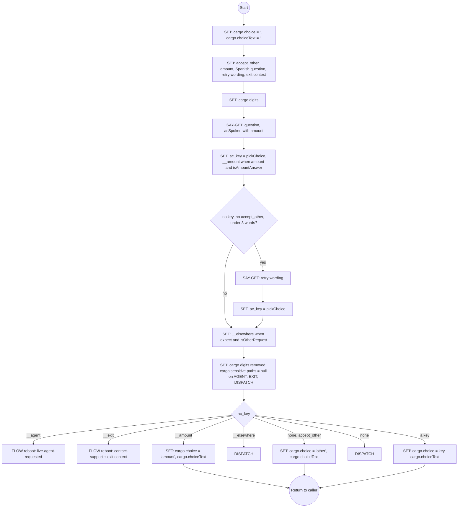

---

## AskEmail
**ID**: `ask-email` · **Version**: 1.3.1 · **Sub-flow** · **Scope**: isolated  
**Description**: Worker: an email address. With `on_file`, the question offers it (OK keeps it) and any other address the caller gives replaces it. One re-ask when the answer is not an email. Sets `cargo.email` (`''` when none).

### Parameters
*   `question` (string, required) / `question_es` (string): The question. With `on_file`, the caller's question is the one that offers it; the flow does not word the offer itself.
*   `on_file` (string): The address on file, kept by OK.
*   `confirm` (string): `'true'` when `on_file` came from the caller, so it is read back too.
*   `attempt`, `why` (string, internal): the attempt number, and `'invalid'` (not an address) or `'retry'` (the read-back was wrong), passed by the flow's own re-ask.

### Variables
`ae_n`, `ae_q`, `ae_q_es`, `ae_found`, `ae_next`, `ae_new`, `ae_why` (initial `'invalid'`).

Its free-text questions pass ask-choice `expect: `email``, so a new request there is `DISPATCH`ed, not counted as a failed try.

### Steps
1. `ae_attempt` (SET) - `ae_n` = `attempt`, else 0.
2. `ae_question` / `ae_question_es` (SET) - on a re-ask, "Okay, let's try again. " (`why === 'retry'`) or "That doesn't look like an email address. " (Spanish: "De acuerdo, intentemos de nuevo. " / "Eso no parece un correo electrónico. "), then the question.
3. `ae_ask` (FLOW [`ask-choice`](#askchoice), `call`) - one choice `ok` (`1`, ok, okay, yes, send, send it, si, sí, enviar, envíalo, correcto; only these words, since the key is not `yes`), `accept_other: true`, `digits: {min 1, max 1}`, exit context "email" / "correo".
4. `ae_read` (SET) - `ae_found = readEmail(cargo.choiceText)`; failing that, `on_file` when the choice was `ok` and `on_file` is set; else `''`.
5. `ae_is_new` (SET) - `ae_new` = an address was found, and `confirm === 'true'` or it differs from `on_file` (compared with `on_file` lower-cased).
6. `ae_readback` / `ae_readback_es` (SET) - "I have {address}. Is that right? Press 1 or say YES, or press 2 or say NO." On voice the address is spelled out character by character, `@` as "at" and `.` as "dot" ("arroba" / "punto" in Spanish); in text it is shown as is, with "Type YES, or type NO.". Spanish: "Tengo {address}. ¿Es correcto? Presione 1 o diga SÍ, o presione 2 o diga NO." / "Escriba SÍ, o escriba NO.".
7. `ae_confirm_new` (CASE) - `ae_new` → FLOW `ask-choice` (`call`) with the read-back, choices `no` (`2`, wrong, incorrect, incorrecto, plus the standard NO words) and `yes` (`1`, plus the standard YES words), `digits: {min 1, max 1}`, exit context "email". No `accept_other`, so a miss is re-asked once and then `DISPATCH`ed.
8. `ae_wrong` / `ae_drop_wrong` (SET) - a read-back not answered YES: `ae_why = 'retry'` and `ae_found = ''`.
9. `ae_next_attempt` (SET) - `ae_next = String(ae_n + 1)`.
10. `ae_route` (CASE, first match wins):
    - `ae_found` → `cargo.email = ae_found`.
    - first attempt (`ae_n < 1`) → FLOW `ask-email` (`replace`) with `question`, `question_es`, `on_file`, `confirm`, `attempt: ae_next`, `why: ae_why`.
    - default → `cargo.email = ''`.

An `on_file` kept by OK is used as given while `readEmail` lower-cases, so an `on_file` with capital letters is read back like a new address. ask-email does not clear `cargo.email` at the start: when ask-choice leaves through AGENT, EXIT or `DISPATCH`, `cargo.email` keeps its earlier value.

### Ends
By completion with `cargo.email` set (`''` after two failed attempts), or through ask-choice's exits.

### Flowchart
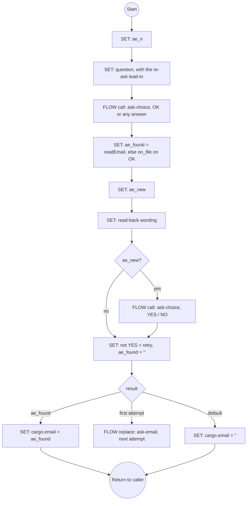

---

## AskAddress
**ID**: `ask-address` · **Version**: 1.2.2 · **Sub-flow** · **Scope**: isolated  
**Description**: Worker: a new mailing address, zip first: the zip (city and state from Google; asked only when Google has none), the street (normalized by Google when it matches exactly inside that zip, otherwise kept as said), the unit, then read back for YES / NO; NO collects it once more. Sets `cargo.address = { line, street, said, verified }` or `null`.

Every question goes through [`ask-choice`](#askchoice) with exit context "address change" / "cambio de dirección". The unit question and the read-back use `cargo.verb` / `cargo.verb_es` directly (`cargo.verb.charAt(0)`), so the host must set them.

### Parameters
*   `attempt` (string, internal): the attempt number, passed by the flow's own restart.

### Variables
`ad_n`, `ad_zip`, `ad_components` (the Google component filter), `ad_zip_result`, `ad_place` ("City, ST"), `ad_said` (the street as said), `ad_street_result`, `ad_street`, `ad_norm` (Google's street), `ad_verified`, `ad_unit`, `ad_line`, `ad_q`, `ad_q_es`, `ad_next`.

Its free-text questions pass ask-choice `expect: `number` (the zip and the street questions)`, so a new request there is `DISPATCH`ed, not counted as a failed try.

### Steps
1. `ad_attempt` (SET) - `ad_n` = `attempt`, else 0.
2. `ad_start` (SET, side effect) - `cargo.address = null`.
3. `ad_next_attempt` (SET) - `ad_next = String(ad_n + 1)`.
4. `ad_zip_question` / `_es` (SET) - "[Let's try again. ]What is the 5-digit zip code of your new address?[ When entering on the keypad, press the pound key when you are done.]" (the keypad sentence on voice only).
5. `ad_ask_zip` (FLOW `ask-choice`, `call`) - no choices, `accept_other: true`, `digits: {min 5, max 5}`.
6. `ad_read_zip` (SET) - `ad_zip` = the first standalone 5-digit run in the answer, else the answer's digits when there are exactly 5, else `''`.
7. `ad_bad_zip` (CASE) - no zip on the first attempt → FLOW `ask-address` (`replace`) with the next `attempt`.
8. `ad_give_up_zip` (CASE) - still no zip → **END** (`cargo.address` stays `null`).
9. `ad_filter` (SET) - `ad_components = 'postal_code:' + ad_zip + '|country:US'`.
10. `ad_lookup_zip` (CALL-TOOL [`geocode-zip`](#geocode-zip)) `{components}` into `ad_zip_result`. `onFail` → SET `ad_zip_result = null`.
11. `ad_city_state` (SET) - `ad_place` = "City, ST" when the status is `OK`, the country is `US`, and the result has a city (`locality`, else `postal_town`, `sublocality_level_1`, `sublocality`, `neighborhood`) and a state (`administrative_area_level_1`, short name); else `''`.
12. `ad_ask_city` (CASE) - no `ad_place` → FLOW `ask-choice` (`call`): "What city and state is that in?" / "¿En qué ciudad y estado está?", no choices, `accept_other: true`.
13. `ad_city_given` (SET) - `ad_place` ||= the answer, trimmed, with whitespace collapsed.
14. `ad_street_question` / `_es` (SET) - "[Got it, {ad_place}. ]What is the street address, with the house number? For example, 123 Main Street."
15. `ad_ask_street` (FLOW `ask-choice`, `call`) - no choices, `accept_other: true`.
16. `ad_read_street` (SET) - `ad_said` = the answer, trimmed, whitespace collapsed, a final period dropped.
17. `ad_street_shape` (CASE) - not 1 to 6 digits, a space, then a word of two or more letters → FLOW `ask-choice` (`call`): "Please include the house number and the street name, like 123 Main Street."
18. `ad_read_street_again` (SET) - after that question, `ad_said` = its answer, cleaned the same way.
19. `ad_no_street` (CASE) - still not that shape → **END** (`cargo.address` stays `null`), on any attempt.
20. `ad_lookup_street` (CALL-TOOL [`geocode-street`](#geocode-street)) `{address: ad_said, components: ad_components}` into `ad_street_result`. `onFail` → SET `ad_street_result = null`.
21. `ad_street_match` (SET) - `ad_norm` = "{street_number} {route}" from Google when the status is `OK`, it is not a `partial_match`, its `postal_code` equals `ad_zip`, and its street number equals the number said; else `''`.
22. `ad_street_verified` / `ad_street_final` (SET) - `ad_verified = !!ad_norm`; `ad_street = ad_norm || ad_said`.
23. `ad_unit_question` / `_es` (SET) - "Is there an apartment or unit number? {Verb} the number, or NONE." / "¿Tiene número de apartamento o unidad? {Verbo} el número, o NINGUNO."
24. `ad_ask_unit` (FLOW `ask-choice`, `call`) - choice `none` (none, no, skip, n/a, no apartment, no unit, ninguno, ninguna, no tengo, no aplica, omitir), `accept_other: true`.
25. `ad_read_unit` (SET) - `''` when the choice was `none` and the answer has no digit. Otherwise the answer, trimmed, a final period dropped; a single token of up to 6 characters (letters, digits, `-`, `#`) becomes "Apt {token}" (`#` removed).
26. `ad_full_line` (SET) - `ad_line = "{ad_street}[ {ad_unit}], {ad_place} {ad_zip}"`.
27. `ad_readback` / `_es` (SET) - "Your new address is {ad_line}. Is that correct? Press 1 or {verb} YES, or press 2 or {verb} NO." (text: "{Verb} YES, or {verb} NO."). Spanish: "Su nueva dirección es {ad_line}. ¿Es correcta? …".
28. `ad_confirm` (FLOW `ask-choice`, `call`) - choices `yes` (`1`, así es, plus the standard YES words) and `no` (`2`, wrong, incorrect, not right, incorrecto, no es correcto, plus the standard NO words), `digits: {min 1, max 1}`. No `accept_other`.
29. `ad_route` (CASE, first match wins):
    - `cargo.choice === 'yes'` → `cargo.address = { line: ad_line, street: ad_street, said: ad_said, verified: ad_verified }`.
    - first attempt → FLOW `ask-address` (`replace`) with the next `attempt`: the whole address is collected once more, starting at the zip.
    - default → nothing (`cargo.address` stays `null`).

### Ends
By completion (`cargo.address` set, or `null` after a second NO), by `END` with `cargo.address = null` when no zip or no street shape could be read, or through ask-choice's exits.

### Flowchart
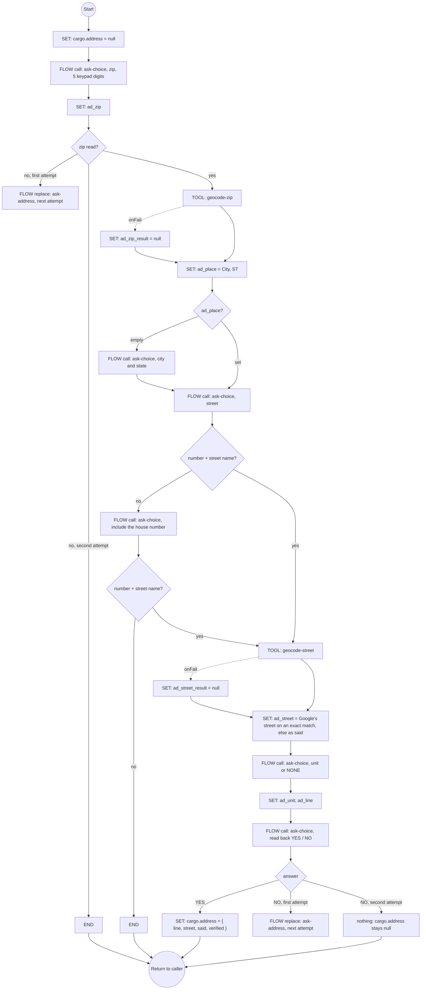

---

## AskField
**ID**: `ask-field` · **Version**: 1.2.2 · **Sub-flow** · **Scope**: isolated  
**Description**: Worker: one card field, kind `card` (13 to 19 digits, checksum), `exp` (MMYY, not expired), `cvv` (3 to 4 digits) or `zip` (5 digits). One re-ask with the error; LINK switches to a payment link. Sets `cargo.field` (the value) and `cargo.fieldOutcome` (`'ok'`, `'link'` or `'failed'`). The answer is erased from `cargo.choiceText` as soon as it is read.

The card check is the host's `validateCardNumber`, which accepts 12 to 19 digits; the description's 13 is the lower keypad bound only.

### Parameters
*   `kind` (string, required): `'card'`, `'exp'`, `'cvv'` or `'zip'`.
*   `question` (string, required) / `question_es` (string): The question.
*   `error` / `error_es` (string): Said before the re-ask.
*   `attempt` (string, internal): the attempt number, passed by the flow's own re-ask.

### Variables
`af_n`, `af_q`, `af_q_es`, `af_digits` (keypad bounds), `af_value`, `af_next_attempt`.

Its free-text questions pass ask-choice `expect: `number``, so a new request there is `DISPATCH`ed, not counted as a failed try.

### Steps
1. `af_attempt` (SET) - `cargo.field = ''`; `af_n` = `attempt`, else 0.
2. `af_question` / `af_question_es` (SET) - on a re-ask, `error` / `error_es` first, then the question; on voice, except for `exp`, "When entering on the keypad, press the pound key when you are done." / "Si usa el teclado, presione la tecla de numeral al terminar.".
3. `af_keypad` (SET) - `af_digits` by kind: card `{13, 19}`, exp `{3, 6}`, cvv `{3, 4}`, zip `{5, 5}`.
4. `af_ask` (FLOW [`ask-choice`](#askchoice), `call`) - choice `link` (link, enlace, payment link, enlace de pago), `accept_other: true`, `digits: af_digits`, exit context "payment" / "pago".
5. `af_read` (SET) - `''` when the choice was `link`. Otherwise the answer's digits, checked by kind:
   - `card`: `validateCardNumber(digits)`.
   - `exp`: MMYYYY with a `20` year and MYYYY are first shortened to MMYY; a 3-digit answer is MYY. The month must be 01 to 12 and `validateExpiration(mm, yy)` must pass. The value is MMYY.
   - `cvv`: 3 or 4 digits. `zip`: 5 digits.
6. `af_forget_answer` (SET, side effect) - `cargo.choiceText = ''`.
7. `af_next` (SET) - `af_next_attempt = String(af_n + 1)`.
8. `af_route` (CASE, first match wins):
   - `link` → `cargo.field = ''`, `cargo.fieldOutcome = 'link'`.
   - a valid value → `cargo.field = af_value`, `cargo.fieldOutcome = 'ok'`.
   - first attempt → FLOW `ask-field` (`replace`) with `kind`, `question`, `question_es`, `error`, `error_es` and the next `attempt`.
   - default → `cargo.field = ''`, `cargo.fieldOutcome = 'failed'`.

### Ends
By completion with `cargo.fieldOutcome` set, or through ask-choice's exits (which null the `cargo.sensitive` paths card-entry marked).

### Flowchart
```mermaid
graph TD
    start((Start)) --> af_attempt["SET: cargo.field = '', af_n"]
    af_attempt --> af_question[SET: question, error first on a re-ask]
    af_question --> af_keypad[SET: keypad bounds by kind]
    af_keypad --> af_ask[FLOW call: ask-choice, LINK or any answer]
    af_ask --> af_read[SET: af_value, checked by kind]
    af_read --> af_forget["SET: cargo.choiceText = ''"]
    af_forget --> af_route{result}
    af_route -->|LINK| af_link["SET: cargo.fieldOutcome = 'link'"]
    af_route -->|valid| af_ok["SET: cargo.field, cargo.fieldOutcome = 'ok'"]
    af_route -->|invalid, first attempt| af_again[FLOW replace: ask-field + error]
    af_route -->|invalid, second attempt| af_failed["SET: cargo.fieldOutcome = 'failed'"]
    af_link --> stop((Return to caller))
    af_ok --> stop
    af_failed --> stop
```

---

## CardEntry
**ID**: `card-entry` · **Version**: 1.1.1 · **Sub-flow** · **Scope**: isolated  
**Description**: Worker: a new card's number, expiration, security code and billing zip (each through ask-field), and whether to save it. Sets `cargo.payMethod = { kind: 'card', card, save, label }`, or `cargo.payNext` `'link'` / `'card_failed'`.

`cargo.payMethod` also carries `label_es`. card-entry clears neither `cargo.payMethod` nor `cargo.payNext` at the start, so its caller resets them before calling it when a stale value matters.

### Variables
`ce_number_value`, `ce_exp_value`, `ce_cvv_value`, `ce_zip_value`, `ce_q`, `ce_q_es`.

### Steps
1. `ce_mark_sensitive` (SET, side effect) - `cargo.sensitive = ['field', 'payMethod.card']`, so any later ask-choice that leaves through AGENT, EXIT or `DISPATCH` nulls the card data first.
2. For each field, in order, FLOW [`ask-field`](#askfield) (`call`), then the same three steps (`ce_<field>_stop`, `ce_<field>_end`, `ce_<field>_keep`): when `cargo.fieldOutcome` is not `ok`, `cargo.payNext` = `'link'` (for `link`) or `'card_failed'`, then **END**; otherwise the value is kept in `ce_<field>_value`.

   | Step | `kind` | Question | Error |
   |---|---|---|---|
   | `ce_number` | `card` | "Please say or enter the card number." | "That doesn't look like a valid card number." |
   | `ce_exp` | `exp` | "Please say or enter the expiration month and year, for example 0 4 2 8 for April 2028." | "That isn't a valid, unexpired date." |
   | `ce_cvv` | `cvv` | "Please say or enter the 3 or 4 digit security code on the card." | "That isn't a valid security code." |
   | `ce_zip` | `zip` | "Please say or enter the card's 5 digit billing zip code." | "The zip code must be 5 digits." |

   Each also passes its Spanish question and error.
3. `ce_save_question` / `_es` (SET) - "Would you like to save this card for future payments? Press 1 or say YES, or press 2 or say NO." (text: "Type YES, or type NO."). Spanish: "¿Desea guardar esta tarjeta para pagos futuros? …".
4. `ce_save` (FLOW [`ask-choice`](#askchoice), `call`) - choices `yes` (`1`, save, guardar, plus the standard YES words) and `no` (`2`, don't, do not, rather not, don't save, do not save, no guardar, no la guarde, mejor no, plus the standard NO words), `digits: {min 1, max 1}`, exit context "payment" / "pago". No `accept_other`.
5. `ce_method` (SET, side effect) - `cargo.payMethod = { kind: 'card', card: { cardNumber, expirationMonth, expirationYear, cvv, zip }, save: cargo.choice === 'yes', label: 'the card ending in 1234', label_es: 'la tarjeta que termina en 1234' }` (the last four comma-spaced on voice, "1, 2, 3, 4"), and `cargo.field = ''`.
6. `ce_forget` (SET, side effect) - `ce_number_value = ''`, `ce_cvv_value = ''`.

### Ends
By completion with `cargo.payMethod` set, by `END` with `cargo.payNext` set when a field was not collected, or through ask-choice's exits (card data nulled through `cargo.sensitive`). `cargo.sensitive` stays set after card-entry ends.

### Flowchart
```mermaid
graph TD
    start((Start)) --> ce_mark_sensitive["SET: cargo.sensitive = ['field', 'payMethod.card']"]
    ce_mark_sensitive --> ce_number[FLOW call: ask-field card]
    ce_number --> n_ok{fieldOutcome ok?}
    n_ok -->|no| stop_field["SET: cargo.payNext = 'link' or 'card_failed', END"]
    n_ok -->|yes| ce_exp[FLOW call: ask-field exp]
    ce_exp --> e_ok{fieldOutcome ok?}
    e_ok -->|no| stop_field
    e_ok -->|yes| ce_cvv[FLOW call: ask-field cvv]
    ce_cvv --> c_ok{fieldOutcome ok?}
    c_ok -->|no| stop_field
    c_ok -->|yes| ce_zip[FLOW call: ask-field zip]
    ce_zip --> z_ok{fieldOutcome ok?}
    z_ok -->|no| stop_field
    z_ok -->|yes| ce_save[FLOW call: ask-choice, save the card?]
    ce_save --> ce_method["SET: cargo.payMethod, cargo.field = ''"]
    ce_method --> ce_forget[SET: forget number and cvv]
    ce_forget --> stop((Return to caller))
    stop_field --> stop
```

---

## Tools

The first eight are `local` tools. The host supplies the function named in `implementation.function` through `APPROVED_FUNCTIONS`. Their `parameters` use the flat form (a map of properties with no top-level `type`), so the engine calls the function with **positional arguments: the `required` names in order, then the remaining properties in definition order**. For these eight tools that order matches the `implementation.args` list shown; the engine itself does not read `implementation.args`.

The two geocode tools are `http` tools: the engine itself calls Google's Geocoding API, and no host function is involved.

Each local tool declares `returns`, a JSON Schema of the value the CALL-TOOL `variable` receives. It is documentation, plus an optional warning when the host sets `engine.validateToolReturns = true`. The summaries below paraphrase each `returns`. Cargo fields the reference host (hy-rag) writes beyond what `returns` describes are noted as such.

`security.requiresAuth`, `auditLevel` and `dataClassification` are declarative. The engine enforces `security.rateLimit`.

### send-sms-otp
**Name**: Send SMS OTP - send an OTP code via SMS for authentication.  
**Implementation**: local `sendSMSOTP(accountSid, from, to, container, language)`, timeout 5000 ms. Rate limit: 5 per 300 s.

| Parameter | Type | Required | Notes |
|---|---|---|---|
| `accountSid` | string | yes | Twilio Account SID (the flows pass `null`) |
| `from` | string | yes | From phone number |
| `to` | string | yes | To phone number |
| `container` | object | yes | session cargo, where the OTP hash is stored |
| `language` | string | no | message language, e.g. `es`; omitted or unrecognised → English |

**Returns** a string: the lowercase hex SHA-256 (64 chars) of the 6-digit code, which is also written to `container.otpHash` along with `container.otpTimestamp`. The plaintext code is never returned. On the test-number path (`to` normalizes to `0000000000` or `+10000000000`) it is the hash of the fixed code `123456`. The flows do not store the result, and they detect failure through `onFail`.

Reference host: every send first clears `container.otpFailure` and `container.otpUndeliverableTo`, and records `container.otpSentOn` (`sms`, or `whatsapp` when the code went into the customer's WhatsApp chat). When the destination cannot receive a text, it sets `container.otpUndeliverableTo` to the number's last 10 digits and throws.

### send-email-otp
**Name**: Send Email OTP - send an OTP code via email for authentication.  
**Implementation**: local `sendEmailOTP(to, container, language)`, timeout 5000 ms. Rate limit: 5 per 300 s.

| Parameter | Type | Required | Notes |
|---|---|---|---|
| `to` | string | yes | email address |
| `container` | object | yes | session cargo, where the OTP hash is stored |
| `language` | string | no | as above |

**Returns** `undefined` on every real send (the function has no return statement). Only for the test account (`test@instantaiguru.com`, case-insensitive) does it return the 64-char hex SHA-256 of the fixed code `123456`, also stored in `container.otpHash`. It never returns an object. Treat the result as absent; the flows do not store it.

Reference host: records `container.otpSentOn = 'email'` and clears `container.otpFailure`.

### send-whatsapp-invite
**Name**: Send WhatsApp Invite - text the caller a wa.me link so they can finish authenticating on WhatsApp.  
**Implementation**: local `sendWhatsAppInvite(accountSid, from, to, inviteText, language, container)`, timeout 5000 ms. Rate limit: 5 per 300 s.

| Parameter | Type | Required | Notes |
|---|---|---|---|
| `accountSid` | string | yes | Twilio Account SID |
| `from` | string | yes | From phone number |
| `to` | string | yes | the caller's mobile that already received the OTP text |
| `inviteText` | string | no | wording from `global_whatsapp_invite` / `_es`. **Empty means the feature is off for this tenant**; there is no separate flag |
| `language` | string | no | session language |
| `container` | object | no | session cargo, used ONLY for the once-per-call latch `container.whatsappInvited` |

**Returns** a boolean. `true` only when the invite SMS was handed to Twilio. `false` on every skip and every error; the function never throws. It skips when: the latch `container.whatsappInvited` is already set; `inviteText` is empty or whitespace; `from` or `to` is missing; the tenant has no `config.wa-*` alias config, or that config has no usable `phone_number`. Any exception (e.g. a non-SMS line) also returns `false`.

### validate-otp
**Name**: Validate OTP - validate the OTP code entered by the user.  
**Implementation**: local `validateOTP(otp, container)`, timeout 5000 ms. Rate limit: 10 per 60 s.

| Parameter | Type | Required | Notes |
|---|---|---|---|
| `otp` | string | yes | the code |
| `container` | object | yes | session cargo holding `otpHash` / `otpTimestamp` |

**Returns** a boolean.
- `true` when `sha256(otp)` equals `container.otpHash` and the code is at most 10 minutes old. It then clears `otpHash` / `otpTimestamp` and sets `container.otpVerified = true` and `container.otpVerifiedAt`. **The flows read `cargo.otpVerified`, not the return value.**
- `false` when no code is stored.
- `false` when the code expired (the container is cleared and `otpVerified = false`).
- `false` on a hash mismatch (the container is left untouched, so the same code can be retried until validate-otp-code withdraws it at the cap).

Reference host: a refusal also sets `container.otpFailure` to `missing`, `expired` or `mismatch`, and a success clears it. validate-otp-code branches on it.

### set-user-name
**Name**: Set User Name - name the person in the conversation, e.g. the account holder's first name once a lookup found the account. From the next reply on, every message addresses them by it, on every channel, and the name is returned to the caller in `context.display_name`; a name a flow set outranks whatever the channel re-sends. An empty name clears it. No flow in this library calls it.  
**Implementation**: local `setUserName(name, container)`, timeout 5000 ms. No rate limit.

| Parameter | Type | Required | Notes |
|---|---|---|---|
| `name` | string | yes | the name to address the person by (a first name), or empty for none |
| `container` | object | yes | session cargo |

**Returns** a string: the name as stored, trimmed; `''` when none. Also sets `container.displayName` and `container.displayNameSetBy = 'flow'`.

### switch-to-sms
**Name**: Switch to SMS - switch communication to SMS and send a confirmation message.  
**Implementation**: local `switchToSMS(accountSid, threadId, from, to, message, userTurn)`, timeout 10000 ms. Rate limit: 10 per 60 s.

| Parameter | Type | Required | Notes |
|---|---|---|---|
| `accountSid` | string | yes | Twilio Account SID |
| `threadId` | string | yes | the thread to switch (the flow passes `{{sessionId}}`) |
| `from` | string | yes | From phone number |
| `to` | string | yes | To phone number |
| `message` | string | yes | SMS text |
| `userTurn` | string | no | the user side of the switch as the text thread records it ("Switch to text" / "Cambiar a texto"), written with `message` as one history pair |

**Returns** always the literal `true`. The chat context is re-saved under `<toNumber>-<dbPrefix>` with a fresh engine session carrying the old cargo, and the SMS is sent. Every failure (loading or saving the context, initializing the session, sending the SMS) is thrown, so `onFail` runs.

### send-twilio-sms
**Name**: Send Twilio SMS - send an SMS via Twilio. Called by [`send-text`](#sendtext), with `from`, `to` and `message` only.  
**Implementation**: local `sendTwilioSMS(accountSid, from, to, message, messageSid)`, timeout 10000 ms. Rate limit: 10 per 60 s.

| Parameter | Type | Required | Notes |
|---|---|---|---|
| `accountSid` | string | yes | Twilio Account SID |
| `from` | string | yes | From phone number |
| `to` | string | yes | To phone number |
| `message` | string | yes | SMS text |
| `messageSid` | string | no | optional message SID for tracking (default `""`) |

**Returns** a string: the Twilio Message `status` of the **last** part sent (a long message is split and the parts are sent in sequence). The value comes from Twilio, typically `queued`, or `accepted` via a Messaging Service. Failure: throws.

### get-live-connect-link
**Name**: Get Live Connect Link - the tenant's Live Connect guest link when Live Connect is enabled and an agent is online or reachable; `''` otherwise. Never throws.  
**Implementation**: local `getLiveConnectLink(container)`, timeout 5000 ms. Rate limit: 10 per 300 s.

| Parameter | Type | Required | Notes |
|---|---|---|---|
| `container` | object | no | session cargo; annotated with `liveConnectOffered` when a link is returned |

**Returns** a string: the guest link (`{url}/?ref=<dbPrefix>`), or `''` when Live Connect is off, no agent is reachable, or the presence check fails.

### get-whatsapp-link
**Name**: Get WhatsApp Link - the tenant's WhatsApp chat link when all three hold: a WhatsApp channel, its admin switch "Invite callers to switch to WhatsApp" (`inviteCallers`), and Meta's APPROVED invite template. Never throws.  
**Implementation**: local `getWhatsAppLink()`, no arguments, timeout 5000 ms.

**Returns** a string: `https://wa.me/<digits>`, or `''` when any of the three is missing.

### geocode-zip
**Name**: Geocode Zip - looks up the city and state for a 5-digit US zip code via Google Geocoding, so address collection can skip the city and state prompts. Called by [ask-address](#askaddress).  
**Implementation**: `http` `GET` to Google's Geocoding API, timeout 5000 ms, no retries. Rate limit: 20 per 60 s. `security`: no auth, audit `low`, data `public`.

| Parameter | Type | Required | Notes |
|---|---|---|---|
| `components` | string | yes | Google component filter, e.g. `postal_code:90015\|country:US` (default `""`) |

The parameters use the JSON Schema form (`type: object`, `additionalProperties: false`). On a `GET` the engine sends every argument as a query parameter.

**Returns** (by `responseMapping`, no `returns` schema) an object: `status` (Google's status, e.g. `OK`; fallback `''`) and `components` (`results[0].address_components`; fallback `[]`).

### geocode-street
**Name**: Geocode Street - looks up a spoken or typed street address inside a known US zip code via Google Geocoding, so address collection can replace what the caller said with Google's normalized street when there is a precise match. Called by [ask-address](#askaddress).  
**Implementation**: `http` `GET` to Google's Geocoding API, with the same timeout, retries, rate limit and `security` as geocode-zip.

| Parameter | Type | Required | Notes |
|---|---|---|---|
| `address` | string | yes | the street address as given, e.g. `1605 west olimpic blvd` (default `""`) |
| `components` | string | yes | Google component filter, e.g. `postal_code:90015\|country:US` (default `""`) |

**Returns** (by `responseMapping`) an object: `status` (fallback `''`), `components` (`results[0].address_components`, fallback `[]`), `types` (`results[0].types`, fallback `[]`), `location_type` (`results[0].geometry.location_type`, fallback `''`), `partial_match` (`results[0].partial_match`, fallback `false`) and `formatted_address` (fallback `''`). ask-address reads `status`, `partial_match` and `components`.
