# System Flows Library

This document details the standard system flows in `flows/system.flows.json` and the tools they call in `flows/system.tools.json`. These flows handle common utility tasks such as authentication, error recovery, live-agent requests and channel switching, and provide generic workers that ask one question, collect an email address, a mailing address or a payment card.

Everything below is read from the JSON. Where a flow's `description` text and its steps disagree, the steps are what runs, and the difference is called out.

## Table of Contents
- [Conventions Used by These Flows](#conventions-used-by-these-flows)
- [Flows](#flows)
  - [NoActionNeeded](#noactionneeded)
  - [CancelProcess](#cancelprocess)
  - [ContactSupport](#contactsupport)
  - [SwitchToText](#switchtotext)
  - [AuthenticateUser](#authenticateuser)
  - [GetCellOrEmail](#getcelloremail)
  - [GetAndValidateOtpCode](#getandvalidateotpcode)
  - [ValidateOtpCode](#validateotpcode)
  - [ResendOtpCode](#resendotpcode)
  - [GenericRetryWithOptions](#genericretrywithoptions)
  - [OtpSendFailed](#otpsendfailed)
  - [TextDestination](#textdestination)
  - [SendText](#sendtext)
  - [SendOtpCode](#sendotpcode)
  - [OtpTextUndeliverable](#otptextundeliverable)
  - [LiveAgentRequested](#liveagentrequested)
  - [GiveUp](#giveup)
  - [AskChoice](#askchoice)
  - [AskEmail](#askemail)
  - [AskAddress](#askaddress)
  - [AskField](#askfield)
  - [CardEntry](#cardentry)
  - [Keypad9](#keypad9)
  - [Keypad0](#keypad0)
  - [SendEmailMessage](#sendemailmessage)
- [Tools](#tools)
  - [send-sms-otp](#send-sms-otp)
  - [send-email-otp](#send-email-otp)
  - [send-whatsapp-invite](#send-whatsapp-invite)
  - [validate-otp](#validate-otp)
  - [set-user-name](#set-user-name)
  - [switch-to-sms](#switch-to-sms)
  - [send-twilio-sms](#send-twilio-sms)
  - [get-live-connect-link](#get-live-connect-link)
  - [get-whatsapp-link](#get-whatsapp-link)
  - [geocode-zip](#geocode-zip)
  - [geocode-street](#geocode-street)
  - [send-email](#send-email)

---

## Conventions Used by These Flows

**Primary vs. sub-flow.** Two system flows are `primary: true`, so intent detection can start them: `switch-to-text` and `live-agent-requested`. The others omit `primary` and are reached from a `FLOW` step or an `onFail`. Both primary flows are also reached that way (the retry menu reboots into `switch-to-text`, and every "agent" answer reboots into `live-agent-requested`).

**Keypad flows.** The flows with ids `9` and `0` are not primary. Intent detection first compares the whole input with every flow's id and name (case-insensitive), primary or not, before any AI is asked, so an input of exactly `9` or `0` that reaches intent detection (no flow running, or a question that passed it on with `DISPATCH`) starts [Keypad9](#keypad9) or [Keypad0](#keypad0).

**Call types** (as used here):
- `call`: run the sub-flow, then resume the caller. The sub-flow works on the caller's variables (the same object), so what it sets (`cell_number`, `email`, `contact_valid`, `auth_result`…) is visible to the caller. Any `value` the sub-flow's `variables` block declares is written into that shared object when it starts.
- `replace`: the current frame becomes the target. Its remaining steps are dropped, and its variables are kept with the FLOW step's `parameters` merged in. The target's declared variable defaults are **not** applied.
- `reboot`: clear every active flow and start the target as the only flow, with fresh variables (the global variables, the target's declared defaults, then the `parameters`). SAY output accumulated before the reboot is kept and delivered with the target's output.

**Variable scope.** The five generic workers (`ask-choice`, `ask-email`, `ask-address`, `ask-field`, `card-entry`) declare `scope: "isolated"`. A `call` or `replace` into an isolated flow starts it with only its declared variables and the parameters actually passed (an omitted parameter is `undefined`, never the caller's value), and its variables never reach the caller. They return their results in `sessionContext.cargo` instead (`cargo.choice`, `cargo.email`, `cargo.address`, `cargo.field`, `cargo.payMethod`…). Every other system flow uses the default `shared` scope described under `call` above. A FLOW parameter that is a single `{{…}}` template (e.g. `"capture_patterns": "{{cargo.authCapture}}"`, `"digits": "{{af_digits}}"`) passes the value itself, array or object included, not its string form.

**Ending a flow.**
- `RETURN` terminates **all** flows and makes its value the response. `RETURN ''` (used by `no-action-needed`) produces an empty response, so the host handles the user's message itself.
- `END` returns from the current flow only, resuming its caller.
- `DISPATCH` terminates **all** flows (queued SAYs included) and routes the turn's input through intent detection; with no match the response is empty and the host answers. The ended flows' declared outcome is kept only on a no-match. Used by `get-cell-or-email` for an off-topic answer, by `generic-retry-with-options` for an unrecognised one, and by `ask-choice` for an answer that picks no choice or is a new request (it declares an outcome only when its exit context is `payment`).
- A terminal step may declare `outcome` / `reason` (both may be `{{…}}` templates; an outcome that interpolates to empty declares nothing). The engine reports a declared outcome once in `sessionContext.lastFlowOutcome`, and `unresolved` also fails that flow's transaction. The system flows declare:

| Flow | Step | `outcome` / `reason` |
|---|---|---|
| contact-support | `say_support_message` (SAY) | `support_outcome` or `unresolved` / `support_reason` or `contact_support_fallback` |
| get-cell-or-email | `off_topic_handoff` (DISPATCH) | `unresolved` / `auth_prompt_off_topic` (kept only when no flow matches) |
| generic-retry-with-options | `dispatch_unrecognised` (DISPATCH) | `caller_outcome` / `caller_reason` (empty = none) |
| ask-choice | `ac_elsewhere`, `ac_other_request` (DISPATCH) | `unresolved` / `payment_incomplete` when the exit context is `payment` (empty = none otherwise) |
| live-agent-requested | `say_live_connect` (RETURN) | `resolved` / `live_connect_link` |
| live-agent-requested | `say_cannot_connect` (RETURN) | `resolved` / `no_agent_reachable` |
| live-agent-requested | `no_agent_available`, `no_agents_available` (RETURN) | `unresolved` / `agent_unavailable` |

**`onFail` on a CALL-TOOL.** A `FLOW` `onFail` runs with its `callType` (default `replace`): `replace` / `reboot` leave the failed flow, `call` runs the handler and then resumes the failed flow at its next step. A non-FLOW `onFail` (SAY / SET / RETURN) runs **immediately** after the failed tool step; a SAY or SET then lets the flow continue with its remaining steps, a RETURN ends it. Before the onFail runs, the CALL-TOOL `variable` holds the error text (a truthy string with no `.success`), so a SET `onFail` that writes a `{ success: false }`-style value is the safest pattern, and a SAY `onFail` is followed by the flow's remaining steps, which may contradict it. This behaviour needs jsfe 0.9.89 or later.

**Cargo the flows read or write** (`sessionContext.cargo`, set by the host unless noted):

| Field | Used by | Meaning |
|---|---|---|
| `cargo.voice` | most flows | truthy on a voice call. Adds keypad wording ("press 1", "the asterisk key") to prompts, and turns on the engine's AI voice-input cleanup for SAY-GET answers |
| `cargo.verb` / `cargo.verb_es` | most prompts | the verb inserted into prompts ("Please {{cargo.verb}} …") |
| `cargo.callerId` | get-cell-or-email, switch-to-text, generic-retry-with-options, text-destination | the caller's number, offered as the contact. Without it `switch-to-text` cannot text, and the retry menu does not offer TEXT |
| `cargo.twilioNumber` | send-otp-code, switch-to-text, validate-otp-code, text-destination, send-text | the `from` number for SMS. text-destination sets no destination without it |
| `cargo.agentPhoneNumber` | live-agent-requested | a transfer number for this turn; absent when no agent can take a transfer now |
| `cargo.agentHours` / `cargo.agentHours_es` | live-agent-requested | the agent hours of the phone number's schedule, as a sentence (in or out of hours). Empty when the number has no agent schedule; absent on every non-phone channel |
| `cargo.agentUnavailableMessage` | live-agent-requested | the phone number's own "no agent available" wording (a voice setting); empty = the flow's default |
| `cargo.contact_info` | contact-support, live-agent-requested | the support contact text (one value for both languages) |
| `cargo.support_context` / `_es` | contact-support | topic phrase, e.g. set to `orders` / `pedidos` by `shopify-track-order`, or written by contact-support from its `support_context` / `support_context_es` parameters |
| `cargo.sessionResolved` | contact-support | truthy when something was resolved earlier in the session; contact-support then thanks instead of apologizing. The reference host sets it when a flow declares outcome `resolved` |
| `cargo.displayName` / `cargo.callerNamed` | get-and-validate-otp-code, Keypad9; cleared by authenticate-user (ANOTHER ACCOUNT) | the name the conversation addresses the customer by (set by the host or by `set-user-name`), and whether the tenant took it from the caller ID's account |
| `cargo.otpVerified` | authenticate-user, validate-otp-code, generic-retry-with-options | written by the `validate-otp` tool on success |
| `cargo.authOptions` | written by authenticate-user; read by authenticate-user when `retrying` | `{ retry_flow, cancel_flow, email_validator, cell_validator, code_validator, answer_handler, retry_returns }` of the authentication in progress, written at its start. A retry from the menu (`retrying: true`) restores all seven from it. validate-otp-code reads `code_validator` and `answer_handler` from it |
| `cargo.authRetry` | written by authenticate-user; read by the flow that called it | true when this run of authenticate-user is a retry from the menu with no contact and the authentication was started with `retry_returns: true`; authenticate-user then ends at once so its caller asks for the contact its own way. False on every other run. No system flow reads it |
| `cargo.authOtherAccount` | written by validate-otp-code; read by the flow that called authenticate-user | the account the caller named at the code question, when the authentication's `code_validator` answered `answer_key: 'another_account'` with it as `answer_value`. No system flow reads it |
| `cargo.callerDeclined` | written by authenticate-user (ANOTHER ACCOUNT); read by get-cell-or-email | true once the caller said ANOTHER ACCOUNT after the caller ID was used without asking. For the rest of the session get-cell-or-email treats `caller_on_file` as `'no'`: the caller ID is neither offered nor used |
| `cargo.gcePartial` | get-cell-or-email (with `merge_partials`) | the digits of an account number given so far in pieces; `''` when none is being joined |
| `cargo.gceChecks` | get-cell-or-email | `{ '<validate_flow>|phone:<10 digits>' or '<validate_flow>|email:<address>': contactCheck }`: what `validate_flow` answered for each contact this session, so a contact is validated once |
| `cargo.authCapture` | written by get-cell-or-email; read by authenticate-user, get-cell-or-email, validate-otp-code, resend-otp-code, otp-send-failed | the contact capture patterns every authentication retry menu passes as `capture_patterns`: `[{ variable: 'cell_number', reader: 'phone' }, { variable: 'email', reader: 'email' }]` (see [`normalizeAndFindCapture`](#conventions-used-by-these-flows)) |
| `cargo.authCancelFlow` | written by authenticate-user; read by validate-otp-code, otp-text-undeliverable and the code-failure menus (`cancel_flow` of the [authentication retry parameters](#genericretrywithoptions)) | the authentication's `cancel_flow` (default `contact-support`), so EXIT goes to the same flow at every step. Readers fall back to `contact-support` when it is empty |
| `cargo.otp_cell_number` / `cargo.otp_email` | written by authenticate-user; read by send-otp-code, get-and-validate-otp-code, validate-otp-code, text-destination | where the OTP is sent |
| `cargo.otpSendFailure` | written by send-otp-code; read by authenticate-user, resend-otp-code, otp-send-failed | why the last send did not go out: `''` (sent), `undeliverable` (the line cannot receive texts), `sms`, `email` (that send failed) or `none` (no destination). Cleared at the start of every send |
| `cargo.otpSentOn` | get-and-validate-otp-code | how the code went out (`sms`, `email`, `whatsapp`), written by the host's send functions. `whatsapp` = the code was sent in this WhatsApp chat |
| `cargo.otpFailure` | validate-otp-code | why `validate-otp` refused a code: `missing`, `expired` or `mismatch`. Written by the host's `validate-otp`; cleared by a successful check and by every new send |
| `cargo.otpMismatches` | authenticate-user (reset to 0), validate-otp-code (counts, caps at 3) | wrong codes in this authentication |
| `cargo.otpResends` | authenticate-user (reset to 0), resend-otp-code (counts, caps at 2) | fresh codes sent in this authentication |
| `cargo.otpHash` | validate-otp-code | the pending code's hash (written by the send tools). validate-otp-code sets it to `null` at the wrong-code cap, which withdraws the code |
| `cargo.otpUndeliverableTo` | send-otp-code, otp-text-undeliverable, text-destination | the last 10 digits of a number that cannot receive texts (landline, toll-free, invalid). Written by the host's `send-sms-otp` when the destination refuses the text, and cleared by its next send |
| `cargo.textTo` / `cargo.textTo4` | written by text-destination; read by send-text and its callers | where a text to the customer can go: 10 digits, `''` when none; and its last four, comma-spaced on voice |
| `cargo.textSent` | written by send-text; read by its callers | true when `send-twilio-sms` returned a status for the text; false when there was no destination or the send failed |
| `cargo.emailSent` | written by send-email-message; read by its callers | true when `send-email` completed; false when `to` is not a valid address or the send failed or was refused |
| `cargo.choice` / `cargo.choiceText` | written by ask-choice; read by ask-email, ask-address, ask-field, card-entry and other callers | the key of the choice the answer picked (`'other'` for any other answer when `accept_other`), and the answer as given. Both `''` at the start of every ask-choice. ask-field sets `cargo.choiceText = ''` as soon as it has read it |
| `cargo.sensitive` | written by card-entry; read by ask-choice | paths inside the cargo (`['field']`) that hold card data. When an ask-choice answer leaves through AGENT, EXIT or `DISPATCH`, each path is set to `null` first. card-entry does not clear the list |
| `cargo.email` | written by ask-email; read by its callers | the address ask-email collected, `''` when none. Not the OTP destination (`cargo.otp_email`) |
| `cargo.address` | written by ask-address; read by its callers | `{ line, street, said, verified }` once the caller confirmed the address; `null` otherwise |
| `cargo.addressDraft` | ask-address | `{ zip, said, unit, place }`: the parts of the address the caller has given so far, from `given` or from any answer. Each question is asked only while its part is missing. Kept until the read-back is answered: `null` after YES and after any other answer |
| `cargo.field` / `cargo.fieldOutcome` | written by ask-field; read by card-entry | the validated value (`''` unless ok) and `'ok'`, `'link'` (the caller asked for a payment link) or `'failed'` (invalid twice; the card number three times when its second answer was another card entry) |
| `cargo.payMethod` | written by card-entry; read by its callers | the card just collected, `cargo.pendingCards[0]`: `{ kind: 'card', card: { cardNumber, expirationMonth, expirationYear, cvv, zip }, save, last4, type: '', pending: true, label, label_es }`. card-entry does not clear it at the start |
| `cargo.cardDraft` | card-entry | `{ number, exp, cvv, zip }`: the card fields collected so far. Each field is asked only while it is missing, so a card entry that stopped part way resumes there. `null` once the card is complete |
| `cargo.pendingCards` | written by card-entry; read by its callers | every card completed in this session, newest first (a card entered again replaces its earlier entry). card-entry never clears it |
| `cargo.saveCardPick` | card-entry | `'yes'` / `'no'`: the caller's answer to the save question. When set, card-entry does not ask it again |
| `cargo.payNext` | written by card-entry; read by its callers | `'link'` when the caller asked for a payment link at a card field, `'card_failed'` when a field failed (ask-field's `'failed'`). Not written when the card was collected, and not cleared at the start |

**Global variables** (tenant-level, optional): `global_whatsapp_invite` / `global_whatsapp_invite_es` (validate-otp-code; empty or absent = the WhatsApp invite is off), `global_live_agents_comment` / `global_live_agents_comment_es` (live-agent-requested: on non-phone channels, and on the phone when the number's schedule gives no hours).

**Host functions called in expressions.** The flows call `isAnswer`, `isAgentRequest`, `isOtherRequest`, `isAmountAnswer`, `amountInAnswer`, `pickChoice`, `matchesChoice`, `readEmail`, `readPhone`, `readIdentifier`, `readInternationalPhone`, `callerIsInternational`, `callerTextNumber`, `textDestination`, `validatePhone`, `validateEmail`, `validateCardNumber`, `validateExpiration`, `normalizeAndFindCapture`, `textWithUrlToSpeech`, `last4` and `anythingElse` inside conditions, SET values and `{{…}}` templates. The engine does not provide them: the host must register them in `APPROVED_FUNCTIONS`. `demos/make-payment.js` has reference implementations of `matchesChoice` (exact word / word-sequence membership, not substring matching), `validatePhone`, `validateEmail` and `textWithUrlToSpeech`.

**Contact readers** (in the reference host, hy-rag-lambdas, `foundation/text/contact.js`), one way to read a contact for every flow set:
- `readEmail(text)` returns the email address in the answer, lower-cased, or `''`. `at` / `arroba` and `dot` / `punto` may be spoken, and the name before the @ may come in several pieces ("R. A Alvarado at aura.com", "j u a n"): every piece back to the first lead-in word ("my email is", "mi correo es", "yes", "hola") is kept and joined. Accents are dropped from the name, and only the last @ counts.
- `readPhone(text)` returns the answer's digits when there are exactly 10, or 11 starting with `1` (the `1` dropped); otherwise `''`.
- `callerTextNumber(cargo)` is ONE rule for whether a text can reach the caller: the caller ID as 10 digits only on a call with a sender (`cargo.twilioNumber`), for a US / Canada number (10 digits, or 11 starting with `1`), and not the number a code could not be texted to (`cargo.otpUndeliverableTo`); otherwise `''`. `textDestination(cargo)` is where a text goes: the verified cell (`cargo.otp_cell_number`, by the same rule), else `callerTextNumber`.
- `readIdentifier(text, accountPattern)` returns `{ kind: 'account' | 'phone' | 'email', value }` or `null`, the tenant's account-number shape (a regex on the answer's digits) winning first. get-cell-or-email calls it with its `account_pattern`.
- `last4(value, voice)` returns the last four characters of a number as said to the customer: one by one with commas on a call ("1, 2, 3, 4"), as written otherwise ("1234").

`normalizeAndFindCapture(answer, patterns)` is the retry menu's smart capture (in the reference host, `foundation/text/capture.js`). Each pattern is either `{ variable, reader }`, where `reader` is `'phone'` or `'email'` and the answer is read with `readPhone` / `readEmail`, or `{ variable, regex, normalizer? }`, where the `normalizer` regex (global) is removed from the answer first and `regex` is run on the result. The first pattern that yields a value returns `{ variable, value }`; for a regex pattern `value` is **the matched part only**, trimmed ("my email is a@b.com" captures `a@b.com`). No match, or `patterns` not an array, returns `null`. A pattern whose regex is invalid is skipped with a warning. Every system menu passes the reader patterns of `cargo.authCapture`. The copy in `demos/make-payment.js` handles regex patterns only and returns the whole normalized answer instead of the matched part.

**Phrases** (in the reference host, `foundation/text/phrases.js`): `anythingElse(lang, name)` is the closing question in the turn's language (`'en'` when it is neither `'en'` nor `'es'`), addressed by name when one is known: "Is there anything else I can help you with[, {name}]?" / "¿Hay algo más en lo que pueda ayudarle[, {name}]?". A name stored in capitals is said in title case.

**Card checks** (in the reference host, `foundation/payment/card-checks.js`), used by ask-field: `validateCardNumber(digits)` is true for 12 to 19 digits that pass the Luhn checksum; `validateExpiration(mm, yy)` is true for a real month that has not passed, at most 20 years out.

**Answer vocabulary.** The YES / NO / AGENT / EXIT / TEXT words are not in the flows. They live in the host's answer module (in the reference host, hy-rag-lambdas, `foundation/text/answer.js`), one list per kind shared by every flow set. Words match whole words or word runs, never substrings.
- `isAnswer(input, kind, extra?)` returns whether the answer is a `kind` answer (for `yes`, only an answer of nothing but affirmatives, courtesy aside), `kind` being one of `yes`, `no`, `agent`, `exit`, `text`, with the caller's `extra` words added to that kind's list. `0` is AGENT and `*` is EXIT. A negated answer ("not sure", "I don't want an agent") never matches YES, AGENT or TEXT.
- `isAgentRequest(input)` returns whether the whole answer asks for a person ("agent", "I want to talk to a representative", "hablar con una persona") or is `0`. A negated answer never does. Used at free-text prompts, where an AGENT word inside a longer answer is not a request.
- `pickChoice(answer, choices, acceptOther)` is [ask-choice](#askchoice)'s matcher: it returns the key of the choice the answer picks, `__agent`, `__exit`, or `''` for no choice. Its rules are under AskChoice.
- `isOtherRequest(input, kind)` returns whether a free-text answer to a question that expects `kind` (`number`: a digit or a number word in English or Spanish; `email`: `@`, "at", "arroba", "dot", "punto" or a common mail domain; `contact`: either) is a new request rather than an attempt: three or more words, none of that shape. ask-choice's `expect` uses it.
- `isAmountAnswer(input)` returns whether the answer names an amount: a `$`, a currency word (dollar(s), dólar(es), buck(s), cent(s), centavo(s)), or a number with one or two decimals after `.` or `,` ("12.50"). `pickChoice` never lets such an answer pick a keypad key or `0` (agent), so "$1" is never a plain `1`. ask-choice's `amount` uses it.
- `readInternationalPhone(text)` returns the digits of a number from outside the US and Canada in the answer, or `''`: with a prefix (`+`, `00`, "plus", "más"), 8 to 15 digits; without one, 11 to 13. An answer holding an email address or a US / Canadian number, or whose digits start with `1`, returns `''`, so a card or account number is never taken for one. `callerIsInternational(cargo)` returns whether, on voice, `cargo.callerId` has 8 or more digits and is not a US / Canadian number (10 digits, or 11 starting with `1`). A text can reach only US and Canadian numbers, so the flows below say so rather than offer one.

**`digits`** on a SAY-GET (`{ min, max, autoSubmitChars?, autoSubmitMs?, complete? }`) is copied by the engine to `cargo.digits` while the answer is awaited, for the host's keypad handling (e.g. Twilio ConversationRelay). The engine removes it once the input is collected. ask-choice, whose SAY-GETs carry no `digits`, writes its `digits` parameter to `cargo.digits` itself before each question and removes it after the answer.

**`asSpoken`** on a SAY-GET (jsfe ≥ 1.3.0) stores the answer exactly as given: on voice it is neither reduced to its digits (as an answer fitting `digits` otherwise is) nor sent to the AI voice cleaner. `true`, or a condition on the flow's variables. ask-choice sets it on an amount question (`asSpoken: "ac_amount === true"`), so a spoken "$1." arrives as "$1." rather than `1`.

**`pii`** on a SAY-GET (jsfe ≥ 1.3.5) marks its answer as sensitive: while the question waits, the awaiting frame carries `pendingVariablePii`, so the host can keep the next input out of its own logs and records, and the engine replaces the answer with `•••` in its log lines for the turn that processes it. How the answer is stored and used is unchanged. `true`, or a condition on the flow's variables. ask-choice sets it on every question when its `pii` parameter is true (`pii: "ac_pii === true"`); ask-field passes `pii: true` for the security code (`kind: 'cvv'`).

---

## Flows

## NoActionNeeded
**ID**: `no-action-needed` · **Version**: 1.0.0 · **Sub-flow**  
**Description**: Handle case where no action is needed like when user is already authenticated.

A single `RETURN ''`. Returning an empty string terminates all flows and leaves the response empty, so the host answers the user's original message itself (usually with its conversational AI). Other flows use it as a clean hand-off: `shopify-store-policies` when the tenant has not opted in, when the policy search fails, and when it finds nothing. Callers invoke it with `callType: "reboot"`. (The "already verified" and "already in text mode" branches of the system flows use `END` instead.)

### Flowchart
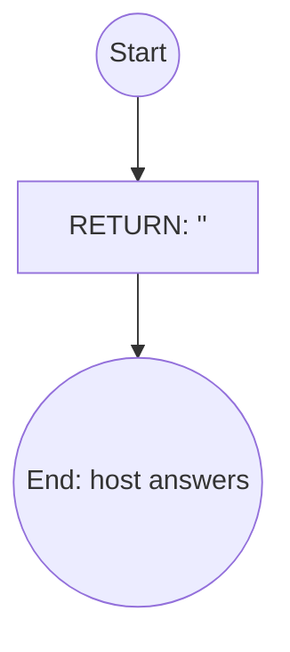

---

## CancelProcess
**ID**: `cancel-process` · **Version**: 1.0.0 · **Sub-flow**  
**Description**: Handle flow cancellation by user.

A single `RETURN` of a localized message: "The process has been cancelled. Anything else I can help with?" (Spanish when `language == 'es'`). Terminates all flows. Used with `callType: "reboot"`, by `get-search-query` and `shipstation-track-by-number-verified` on EXIT.

### Flowchart
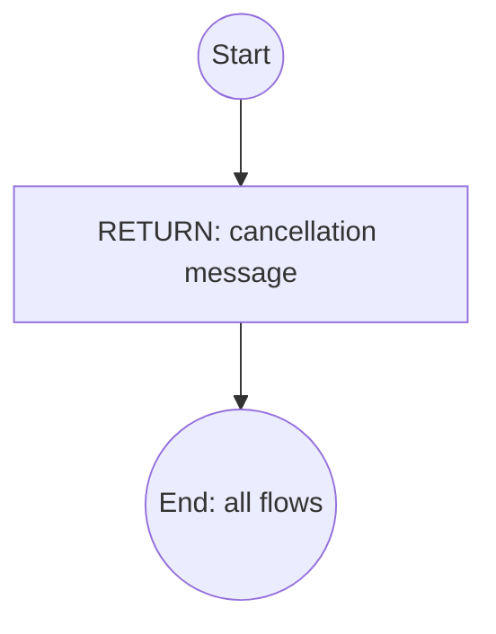

---

## ContactSupport
**ID**: `contact-support` · **Version**: 1.2.2 · **Sub-flow**  
**Description**: Provide customer service contact information. Optional `support_context` / `support_context_es` name what the caller needed help with (else `cargo.support_context`); optional `closing_prompt` / `closing_prompt_es` are spoken after the contact info.

### Parameters
*   `support_context` (string): What the caller needed help with (English), e.g. `payment`.
*   `support_context_es` (string): The same in Spanish, e.g. `pago`.
*   `closing_prompt` (string): Optional English sentence spoken after the contact info, e.g. a follow-up question.
*   `closing_prompt_es` (string): Optional Spanish sentence spoken after the contact info.

The SAY also reads `support_outcome` / `support_reason` when a caller passes them. They are not declared parameters, and no flow in this library passes them.

### Steps
1. `take_context_parameters` (SET, side effect) - when `support_context` is passed: `cargo.support_context = support_context` and `cargo.support_context_es = support_context_es || support_context`. Otherwise the cargo is left as it is.
2. `set_contact_info` / `set_contact_info_es` - `contact_info` = `cargo.contact_info`, or "please contact Customer Support" / "por favor contacte a Servicio al Cliente" when unset. On voice (`cargo.voice`) it is passed through `textWithUrlToSpeech(…, language)` so URLs are spoken.
3. `set_support_message` / `set_support_message_es` (SET) - "{opening}[For assistance with your {cargo.support_context}, ]{contact_info}.[ {closing_prompt}]". The opening is "Thank you for contacting us! " when `cargo.sessionResolved`, else "Sorry I couldn't help! ". The Spanish text ("¡Gracias por comunicarte con nosotros! " / "¡Lo siento, no pude ayudar! ", "Para asistencia con tu …") uses `cargo.support_context_es`, falling back to `support_context`.
4. `say_support_message` (SAY) - `{{support_message}}` / `{{support_message_es}}`.

### Ends
By completion. The SAY declares **`outcome`: `support_outcome` or `"unresolved"`, `reason`: `support_reason` or `"contact_support_fallback"`**. With no `support_outcome` passed (every path in this library), ContactSupport fails the transaction and sets `sessionContext.lastFlowOutcome`. Every caller in the library uses `callType: "reboot"`.

### Flowchart
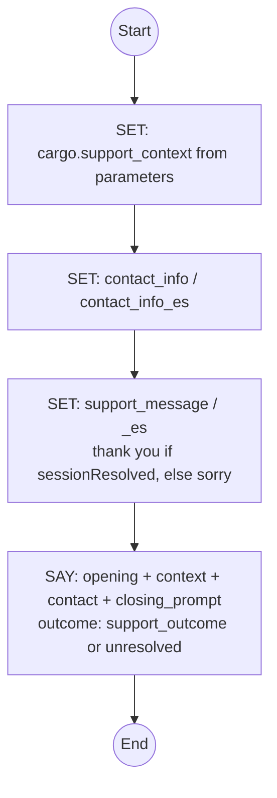

---

## SwitchToText
**ID**: `switch-to-text` · **Version**: 1.2.3 · **Primary** (prompt "Switch to text" / "Cambiar a texto")  
**Description**: Customer explicitly asks to continue this conversation by text message / SMS ('switch to text', 'text me instead', 'can we continue by text', 'pásame a texto', 'seguimos por mensaje de texto'). Not: asking for a live agent or a person (LiveAgentRequested); asking to have one thing texted, such as a link, an address or a statement, a yes or no, or any answer that does not mention text or SMS (None).

### Variables
*   `sms_result` (object): result of the SMS send.

The welcome text also reads `text_starter` / `text_starter_es` when a caller passes them as FLOW parameters (they are not declared here).

### Steps
1. `check_already_text` (CASE) - not on voice (`!cargo.voice`) → **END** (nothing to switch). Otherwise continue.
2. `check_can_text` (CASE) - `can_text = !!callerTextNumber(cargo)` (see the contact readers).
3. `route_cannot_text` (CASE, first match wins):
   - not `can_text` and `callerIsInternational(cargo)` → FLOW [give-up](#giveup) (`reboot`), `context: "texting a number outside the US and Canada"` / `context_es: "enviar un mensaje de texto a un número fuera de EE. UU. y Canadá"`.
   - not `can_text` → FLOW [give-up](#giveup) (`reboot`), `context: "texting the number you are calling from"` / `context_es: "enviar un mensaje de texto al número desde el que llama"`.
4. `get_whatsapp_link` (CALL-TOOL [`get-whatsapp-link`](#get-whatsapp-link), no args) into `wa_link`; `onFail` → `wa_link = ''`.
5. `set_welcome_message` (SET) - "Hi, I remember our phone conversation and can continue to help you here via text.", plus " You can also continue on WhatsApp: {wa_link}?text=Hi" when there is a link (Spanish variant when `language === 'es'`), followed by a blank line and `text_starter` when one was passed (Spanish: `text_starter_es`, else `text_starter`).
6. `set_switch_user_turn` (SET) - `switch_user_turn` = "Switch to text" / "Cambiar a texto".
7. `send_welcome_sms` (CALL-TOOL [`switch-to-sms`](#switch-to-sms)) - args `accountSid: null`, `threadId: {{sessionId}}`, `from: {{cargo.twilioNumber}}`, `to: {{cargo.callerId}}`, `message: {{welcome_message}}`, `userTurn: {{switch_user_turn}}`; result in `sms_result`. `onFail` → FLOW [give-up](#giveup) (`reboot`) with the caller's-number context above.
8. `confirm_sms_sent` (SAY) - "I've sent you a text message. Please check your phone and reply via text. Goodbye and take care!"

### Ends
By completion after the confirmation, `END` when not on voice, or `reboot` into `give-up` when no number can be texted or the send fails. Besides intent detection, other flows reach it with `callType: "reboot"` (keypad 9 / "TEXT" in the retry menu, text words in validate-otp-code, a lone `9` at an ask-choice question on a call), and [Keypad9](#keypad9) with `callType: "replace"`.

### Flowchart
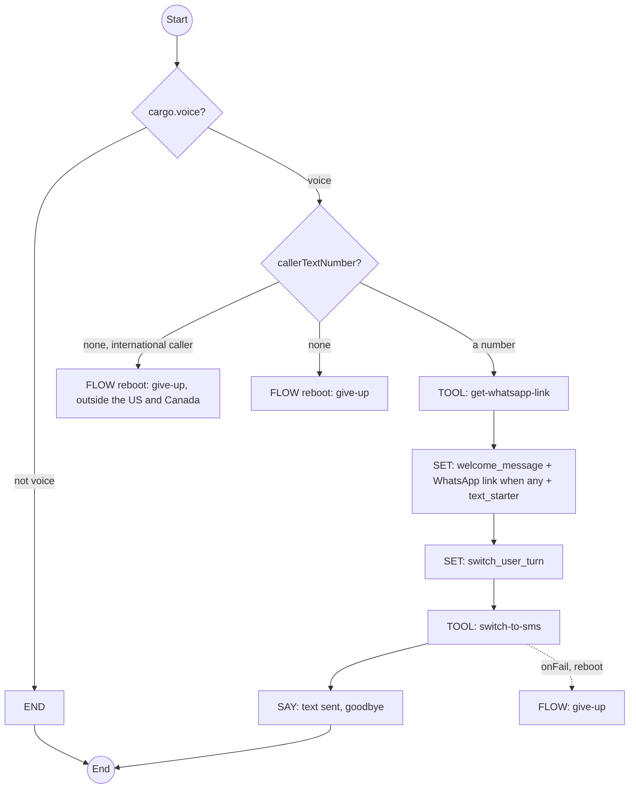

---

## AuthenticateUser
**ID**: `authenticate-user` · **Version**: 1.7.0 · **Sub-flow** · **Scope**: shared  
**Description**: Generic flow to authenticate user via OTP sent to cell or email

The gatekeeper. It records its options in `cargo.authOptions` / `cargo.authCancelFlow`, collects a phone or email through [`get-cell-or-email`](#getcelloremail), optionally lets a tenant validator flow approve the contact, records the destination in `cargo.otp_cell_number` / `cargo.otp_email`, sends the code through [`send-otp-code`](#sendotpcode), hands a send failure to [`otp-send-failed`](#otpsendfailed), and asks for the code through `get-and-validate-otp-code`. On success it sets `auth_result = true` and returns to its caller, with `cargo.otpVerified` set by the `validate-otp` tool.

### Parameters
*   `retry_flow` (string): Flow a failed contact step retries. Empty or absent = `authenticate-user`. Passed to `get-cell-or-email` and to the menu for a contact the validator rejected. The code-failure menu always retries `authenticate-user` itself.
*   `cancel_flow` (string): Flow EXIT goes to anywhere in this authentication. Empty or absent = `contact-support`. Kept in `cargo.authCancelFlow` for the flows that do not receive it as a variable.
*   `cell_number` (string): A phone already supplied. Forwarded, so `get-cell-or-email` does not ask.
*   `email` (string): An email already supplied. Forwarded the same way.
*   `email_validator` (string, flow name): When set, it is called (`call`) with `{ email }` before an email code is sent, and it MUST set `contact_valid = true` to allow the send. **Fail-closed.** The validator must end by completion: a `RETURN` in it terminates all flows.
*   `cell_validator` (string, flow name): The same contract, called with `{ cell_number }` before a text code. Checked before `email_validator`.
*   `code_validator` (string, flow name): Optional. A flow of the caller's, run by validate-otp-code (`call`, `{ answer }`) when the answer to the code question holds a digit but is not a 6-digit code. When it sets `answer_key = 'another_account'` (and the account the caller named as `answer_value`), the answer takes the [ANOTHER ACCOUNT](#another-account) path, and the value is kept in `cargo.authOtherAccount` for the caller's own retry. Any other result leaves the answer to validate-otp-code.
*   `answer_handler` (string, flow name): Optional. A flow of the caller's, run by validate-otp-code (`call`, `{ answer }`) when the answer to the code question is not a 6-digit code and no other account was asked for, BEFORE validate-otp-code's own handling. The caller takes responsibility for the answers it handles (e.g. AGENT); a handler that returns without taking over leaves the answer to validate-otp-code.
*   `retrying` (boolean): Set by the retry menu and by ANOTHER ACCOUNT. When true and `cargo.authOptions` exists, `retry_flow`, `cancel_flow`, `email_validator`, `cell_validator`, `code_validator`, `answer_handler` and `retry_returns` are restored from `cargo.authOptions` and the values passed with the retry are ignored.
*   `retry_returns` (boolean): When true, a retry that carries no contact (YES or `1` at the menu, or ANOTHER ACCOUNT; not a captured phone or email) returns to the caller with `cargo.authRetry = true`, so the caller asks for the contact its own way. Default: `get-cell-or-email` asks here.
*   `declined_caller` (boolean, `true` or `'true'`): Passed by `validate-otp-code` when the caller said ANOTHER ACCOUNT at the code question after the caller ID was used without asking.

`get-cell-or-email` is reached by `call` with only `retry_flow`, `cancel_flow`, `cell_number` and `email`. It shares this flow's variables, so it also reads `caller_on_file`, `validate_flow`, `account_pattern` and its other parameters when they are in the shared variables (a tenant flow that called it first, in the same variables, left them there). A contact that tenant flow's `get-cell-or-email` already validated is not validated again (`cargo.gceChecks`).

### Variables
`cell_number`, `email`, `contact_valid` (true when no validator applies), `unverified_contact` / `unverified_contact_es` ("the number <cell_number>" / "el número <cell_number>", or "the email <email>" / "el correo electrónico <email>"). Also sets `retry_flow`, `cancel_flow`, `email_validator`, `cell_validator`, `code_validator`, `answer_handler`, `retry_returns`, `auth_result` and `proceed`.

**Cargo read:** `cargo.otpVerified`, `cargo.authOptions`, `cargo.authCapture` (written by `get-cell-or-email`), `cargo.authCancelFlow`, `cargo.otpSendFailure`, `cargo.callerNamed`. **Cargo written:** `cargo.authOptions`, `cargo.authCancelFlow`, `cargo.authRetry`, `cargo.otpResends`, `cargo.otpMismatches`, `cargo.otpFormatMisses`, `cargo.otpWordMisses` (all `0`), `cargo.otp_cell_number`, `cargo.otp_email`; with `declined_caller`: `cargo.callerDeclined = true`, `cargo.callerPreselected = false`, `cargo.otpHash = null` (the pending code is withdrawn), `cargo.contactIntroSkip = true`, and, when the caller was named from the caller ID (`cargo.callerNamed`), `cargo.displayName = ''`, `cargo.displayNameSetBy = 'flow'`, `cargo.callerNamed = false`.

### Steps
1. `remember_declined_caller` (SET, side effect) - with `declined_caller`: the `declined_caller` cargo writes listed above. Otherwise nothing.
2. `check_already_verified` (CASE) - `cargo.otpVerified` → **END** (`already_verified`: return to the caller at once). Otherwise continue.
3. `remember_or_restore_retry_flow` / `_cancel_flow` / `_email_validator` / `_cell_validator` / `_code_validator` / `_answer_handler` / `_retry_returns` (SET) - with `retrying` and a `cargo.authOptions`: each option = its value in `cargo.authOptions` (`''` when absent there; `retry_returns` = `!!cargo.authOptions.retry_returns`). Otherwise: the passed value, `''` when undefined or empty (`retry_returns` = `!!retry_returns`).
4. `default_retry_flow` / `default_cancel_flow` (SET) - `retry_flow ||= 'authenticate-user'`, `cancel_flow ||= 'contact-support'`.
5. `remember_options` (SET, side effect) - `cargo.authOptions = { retry_flow, cancel_flow, email_validator, cell_validator, code_validator, answer_handler, retry_returns }`, `cargo.authCancelFlow = cancel_flow`.
6. `retry_through_caller` (SET, side effect) - `cargo.authRetry = retrying && !cell_number && !email && retry_returns` (undefined `cell_number` / `email` read as empty).
7. `hand_retry_to_caller` (CASE) - `cargo.authRetry` → **END** (`caller_asks_again`). Otherwise continue.
8. `get_contact_info` (FLOW [`get-cell-or-email`](#getcelloremail), `call`) - sets `cell_number`, `email` or `acct_number`, or leaves through one of its exits. It writes `cargo.authCapture`, the capture patterns of every retry menu below.
9. `init_contact_valid` (SET) - `contact_valid` = false when a validator applies to the collected contact (`cell_validator` and a `cell_number`, or `email_validator` and an `email`); true otherwise.
10. `validate_contact` (CASE) - `cell_validator` and `cell_number` → FLOW `{{cell_validator}}` (`call`, `{ cell_number }`); else `email_validator` and `email` → FLOW `{{email_validator}}` (`call`, `{ email }`); else nothing.
11. `describe_unverified_contact` / `_es` (SET) - the phrase above (the number when there is one, else the email).
12. `gate_otp_on_contact_valid` (CASE) - `!contact_valid` → FLOW [`generic-retry-with-options`](#genericretrywithoptions) (`replace`): "Sorry, I could not verify {{unverified_contact}}." / "Lo siento, no pude verificar {{unverified_contact_es}}.", with `retry_flow`, `cancel_flow` and `capture_patterns: "{{cargo.authCapture}}"` (no `retry_call_type`, so the menu's default `reboot`; no `question`, no `allow_code_entry`).
13. `reset_resend_count` / `reset_mismatch_count` / `reset_format_miss_count` / `reset_word_miss_count` (SET, side effect) - `cargo.otpResends`, `cargo.otpMismatches`, `cargo.otpFormatMisses`, `cargo.otpWordMisses` = 0.
14. `set_cell_number_to_cargo` / `set_email_to_cargo` (SET, side effect) - `cargo.otp_cell_number = cell_number || ''`, `cargo.otp_email = email || ''`: the destination `send-otp-code` reads.
15. `send_code` (FLOW [`send-otp-code`](#sendotpcode), `call`) - texts `cargo.otp_cell_number` or emails `cargo.otp_email`, and records `cargo.otpSendFailure` (`''` when the code went out).
16. `auth_check_sent` (CASE) - `cargo.otpSendFailure` → FLOW [`otp-send-failed`](#otpsendfailed) (`replace`). Otherwise continue.
17. `get_and_validate_otp_code` (FLOW `get-and-validate-otp-code`, `call`).
18. `check_validation_result` (CASE, first match wins):
    - `cargo.otpVerified` → SET `auth_result = true`.
    - `cargo.authRetry && cargo.callerDeclined` → **END** (`auth_handed_back`): ANOTHER ACCOUNT with `retry_returns` ran `authenticate-user` in place of the code question and ended there; this frame hands back to its caller, which asks again.
    - default → FLOW `generic-retry-with-options` (`replace`): "Sorry, the code you entered was invalid or expired." / "Lo siento, el código que ingresó era inválido o había expirado.", question "Would you like to try again to get access to your account?" / "¿Le gustaría intentar nuevamente obtener acceso a su cuenta?", `retry_flow: 'authenticate-user'`, `retry_call_type: 'replace'`, `cancel_flow: "{{cargo.authCancelFlow}}"`, `allow_code_entry: true`, `capture_patterns: "{{cargo.authCapture}}"`.

### ANOTHER ACCOUNT
When `get-cell-or-email` used the caller ID without asking (`caller_on_file: 'yes'`, `cargo.callerPreselected`), the code question offers ANOTHER ACCOUNT. That answer, or a `code_validator` result of `answer_key: 'another_account'` (with or without the caller ID), makes `validate-otp-code` replace itself with `authenticate-user` (`cell_number: ''`, `email: ''`, `retrying: true`, `declined_caller: true`). Step 1 withdraws the code and records the refusal in `cargo.callerDeclined`; with `retry_returns` the run ends at step 7, the original frame ends at step 18, and the caller asks again, without the intro (`cargo.contactIntroSkip`). Without `retry_returns`, step 8 asks at once. Either way, every later `get-cell-or-email` in the session reads `cargo.callerDeclined` as `caller_on_file: 'no'`, whatever `caller_on_file` the shared variables or the calling flow pass: the caller ID is not offered, not taken from YES and not the fallback for an unclear answer, so no further code goes to it.

### Ends
Success returns to the caller (by completion) with `auth_result = true` and `cargo.otpVerified` set. Already verified → `END`. A contact-less retry with `retry_returns` → `END` with `cargo.authRetry = true`. Failures leave through `generic-retry-with-options`, `otp-send-failed` (which goes on to `otp-text-undeliverable` or `generic-retry-with-options`), or `get-cell-or-email`'s own exits (cancel, live agent, off-topic `DISPATCH`, its retry menus). `otp-send-failed` and the flow it replaces itself with keep this frame's variables (`retry_flow`, `cancel_flow`, the validators) because they are reached by `replace`. EXIT at any step goes to the authentication's `cancel_flow`: `get-cell-or-email` and the contact menu receive it as a variable, the other steps read `cargo.authCancelFlow`.

### Flowchart
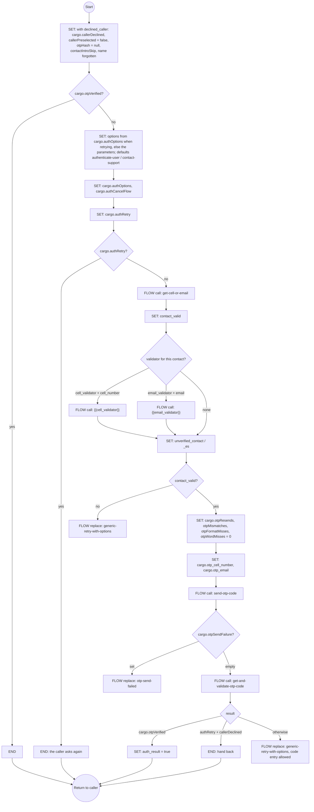

---

## GetCellOrEmail
**ID**: `get-cell-or-email` · **Version**: 1.6.2 · **Sub-flow** · **Scope**: shared  
**Description**: Prompt user to provide either their cell phone number or email address for account lookup. Optional: account_pattern / account_name(_es) also accept the tenant's account number (sets acct_number); intro(_es) leads the question; retry_call_type is passed to the retry menu. Records cargo.contactKind ('caller' | 'phone' | 'email' | 'account') and cargo.contactValue. Optional validate_flow: a tenant flow called with the phone or email just given (cargo.contactKind / contactValue) that sets cargo.contactCheck; 'none' (no account for it) asks again at once, before any code is sent, and the third rejection in a row goes to the retry menu. Any other answer, or none, proceeds as before. Each contact is validated once per session (cargo.gceChecks); a retry from this flow's own retry menu starts the rejection count again, without the intro. With caller_on_file 'no', or after ANOTHER ACCOUNT (cargo.callerDeclined), the caller ID is never used: not offered, not taken from YES, and not the fallback for an unclear answer. On voice, the keypad completes by shape (digits.complete: the phone shapes plus account_shape): a number is submitted when it is complete (after the 3 s pause when it could still grow) and waits otherwise; a caller who stops hears the idle prompt. After ANOTHER ACCOUNT (authenticate-user sets cargo.contactIntroSkip), the next question is asked without the intro, once: the caller has already heard it. Optional merge_partials (with account_shape): an account number spoken in pieces is put together. A piece whose digits could only be the start of an account number (its first digit, fewer digits than the shortest account) is never looked up: it is kept (cargo.gcePartial), the caller hears only "Go on.", and the next piece is appended, as often as needed. The joined number is read as any answer is; one longer than the longest account is dropped and the number asked for again on the keypad. Any other answer ends the join.

The one contact question every tenant uses: `authenticate-user` calls it, and a tenant whose callers may also answer with an account number calls it directly with that number's pattern and keypad shape.

### Parameters
*   `retry_flow` (string): Flow the retry menus run again. With `retry_call_type: 'replace'` and `retry_flow: 'get-cell-or-email'`, a retry asks again in place and returns to the caller.
*   `cancel_flow` (string): Flow EXIT reboots into. Empty or absent = `contact-support`.
*   `caller_on_file` (string): `'yes'` = the tenant found an account for the caller ID (its own lookup): a US or Canadian caller ID is used without asking, and the code question then offers ANOTHER ACCOUNT. `'no'` = the caller ID is never used: not offered, not taken from YES or `1`, and not the fallback for an unclear answer. Empty or absent = the caller ID is offered. After ANOTHER ACCOUNT (`cargo.callerDeclined`) it is read as `'no'` whatever is passed.
*   `validate_flow` (string, flow name): A tenant flow called (`call`) whenever the contact is a phone, an email or the caller ID (not an account number, and not when the caller ID was used without asking), whether it came from the answer or was passed in. It reads `cargo.contactKind` / `cargo.contactValue` and sets `cargo.contactCheck`; `'none'` = no account for it. Any other value, or none, proceeds. Each contact is validated once per session: the answer is kept in `cargo.gceChecks` (keyed by the validator and the phone's last 10 digits or the lower-cased email), and the same contact again, here or in a later `get-cell-or-email` (the one `authenticate-user` runs, which reads `validate_flow` from the shared variables), reuses it as `cargo.contactCheck` without calling the validator. Anything else the validator writes is therefore written once, by its first run.
*   `account_pattern` (string): A regex for the tenant's account number (e.g. `'^5\\d{6,7}$'`), applied by `readIdentifier` to the answer's digits. A match sets `acct_number`. Without it nothing about account numbers applies.
*   `account_name` / `account_name_es` (string): With `account_pattern`, how the questions and retry messages name it ("your account number" / "su número de cuenta"), added as ", or <account_name>" / ", o <account_name_es>". Without `account_name_es` the English phrase is used in Spanish too.
*   `account_shape` (array): With `account_pattern`, the account number as keypad shapes for the voice relay, `[{ first, lengths }]` (e.g. `[{ first: '5', lengths: [7, 8] }]`). See [Keypad](#getcelloremail-keypad).
*   `intro` / `intro_es` (string): A sentence said before the question, only when it asks. Without `intro_es` the English intro is used in Spanish.
*   `retry_call_type` (string): Passed to every retry menu: `'reboot'` (default) or `'replace'`.
*   `merge_partials` (boolean, `true` or `'true'`): With `account_shape`, an account number spoken in pieces is put together. See [Pieces](#getcelloremail-pieces).
*   `gce_rejected` (boolean): Internal. Set when the flow asks again after `validate_flow` answered `'none'` (and carried over when a NO to the caller ID asks again), so the rejection count continues.
*   `gce_partial` (boolean): Internal. Passed by this flow when it asks for the next piece of an account number, so the answer is appended to `cargo.gcePartial`. Read and set to `false` at the start.
*   `gce_menu` (boolean): Internal. Passed by this flow to each of its retry menus; the menu's retry `replace`s back into this frame with it, so the flow knows the caller chose to try again from its own menu. Read and set to `false` at the start.
*   Also reads `cell_number`, `email` and `acct_number` when they are set (`authenticate-user` passes the first two). A non-empty one is used without asking. The flow shares its caller's variables, so the result lands in them.

### Variables
`cell_or_email` (the answer), `gce_pattern`, `gce_or` / `gce_or_es`, `gce_intro` / `gce_intro_es`, `gce_retry_type`, plus `gce_caller_use` (`'no'` after ANOTHER ACCOUNT, else `caller_on_file`), `gce_after_menu` (true on a retry from this flow's own retry menu), `gce_caller_ok` (a US or Canadian `cargo.callerId` and `gce_caller_use` not `'no'`), `gce_validator`, `gce_shapes`, `gce_partial_on` (a piece is being joined), `gce_rest` (the keypad shapes of the rest of the account number), `gce_join_intro` / `_es`, `gce_check_key` (the `cargo.gceChecks` key of a contact the validator applies to, else `''`), `prospective_cell_number` (the answer's digits), `prospective_email` (`readEmail` of the answer), `gce_reject_intro` / `_es`, `gce_again_caller`, `gce_reject_error` / `_es`.

**Cargo read:** `cargo.callerId`, `cargo.callerDeclined`, `cargo.voice`, `cargo.verb` / `cargo.verb_es`, `cargo.contactIntroSkip`, `cargo.contactCheck` (written by `validate_flow`), `cargo.gceChecks`, `cargo.gceRejects`, `cargo.callerPreselected`, `cargo.gcePartial`. **Cargo written:** `cargo.authCapture`, `cargo.gcePartial`, `cargo.gceRejects` (0 on a fresh run and on a retry from this flow's own retry menu, +1 per `'none'`, 0 on anything else), `cargo.gceChecks`, `cargo.contactIntroSkip = false` (after the question step, asked or not), `cargo.callerPreselected` (true when the caller ID was used without asking, false when nothing was supplied otherwise; unchanged when a contact was passed in), `cargo.contactKind` / `cargo.contactValue`, `cargo.contactCheck` (the remembered answer when the contact was validated before; `''` when no validator applies). While a question is awaited the engine copies its `digits` to `cargo.digits`.

### Questions
With the reference host's verbs (`cargo.verb` = say / type, `cargo.verb_es` = diga / escriba). `{intro}` is `intro` + a space, empty when there is none or `cargo.contactIntroSkip` is set; `{or}` is ", or <account_name>" / ", o <account_name_es>".

**`ask_cell_or_email_with_caller_id`** (the caller ID is offered):

| | English | Spanish |
|---|---|---|
| voice | {intro}To use your caller id, please say yes. Otherwise, please say or enter the phone or email associated with your account{or} followed by the pound key. To exit anytime you can press the asterisk key or say EXIT. | {intro}Para usar su identificador de llamadas, por favor diga sí. De lo contrario, por favor diga o ingrese el teléfono o correo electrónico asociado con su cuenta{or} seguido de la tecla numeral. Para salir en cualquier momento, puede presionar la tecla de asterisco o decir SALIR. |
| text | {intro}To use your caller id, please type yes. Otherwise, please type the phone or email associated with your account{or}. To exit anytime you can type EXIT. | {intro}Para usar su identificador de llamadas, por favor escriba sí. De lo contrario, por favor escriba el teléfono o correo electrónico asociado con su cuenta{or}. Para salir en cualquier momento, puede escribir SALIR. |

`digits: { min: 7, max: 12, autoSubmitChars: ['1'], autoSubmitMs: 3000, complete: "{{gce_shapes}}" }`.

**`ask_cell_or_email`** (no caller ID offered):

| | English | Spanish |
|---|---|---|
| voice | {intro}Please say or enter the phone or email associated with your account{or} followed by the pound key if entered using the dial pad. To exit anytime you can press the asterisk key or say EXIT. | {intro}Por favor diga o ingrese el teléfono o correo electrónico asociado con su cuenta{or} seguido de la tecla numeral si se ingresó usando el teclado de marcación. Para salir en cualquier momento, puede presionar la tecla de asterisco o decir SALIR. |
| text | {intro}Please type the phone or email associated with your account{or}. To exit anytime you can type EXIT. | {intro}Por favor escriba el teléfono o correo electrónico asociado con su cuenta{or}. Para salir en cualquier momento, puede escribir SALIR. |

`digits: { min: 7, max: 12, autoSubmitMs: 3000, complete: "{{gce_shapes}}" }`.

**`ask_next_piece`** (the next piece of an account number, `gce_partial_on`): "Go on." / "Continúe.", `digits: { min: 1, max: 12, autoSubmitMs: 3000, complete: "{{gce_rest}}" }`, `asSpoken: true`.

<a id="getcelloremail-keypad"></a>**Keypad.** `gce_shapes` = `[{ first: '23456789', lengths: [10] }, { first: '1', lengths: [11] }]` plus `account_shape` when it is an array. jsfe ≥ 1.3.4 fills the `{{gce_shapes}}` template inside `digits`, so the relay receives the array in `cargo.digits.complete`. In the reference relay (`services/voice-relay/src/digit-shapes.js`), each keyed or spoken digit run is judged against the shapes whose `first` holds its first digit: complete and unable to grow (a 10-digit phone not starting with `1`, an 11-digit one starting with `1`, an account at its longest length) → submitted at once; complete but able to grow (an account at 7 of `[7, 8]`) → submitted after `autoSubmitMs` (3 s) with no further digit; not complete (including a first digit no shape allows, such as `0`) → waits for more digits, `#` or `*`, and a caller who stops hears the relay's idle prompt; every digit restarts that clock. A single keyed `1` on the caller-ID question is the `autoSubmitChars` shortcut: submitted after 3 s with no further key. A spoken answer is reduced to digits only when it has at most two words that are not number words; a spoken "one" therefore waits as an incomplete number.

<a id="getcelloremail-pieces"></a>**Pieces** (`merge_partials` with `account_shape`). A piece's digits are read from the answer with the number words zero to nine / cero to nueve turned into digits; an answer with an `@`, an email, or other than one run of digits (spaces, `.`, `,` and `-` inside it allowed) has none. An answer whose digits could only be the start of an account number (an `account_shape` whose `first` holds its first digit and whose shortest length is longer) is never looked up: the digits are kept in `cargo.gcePartial`, and the flow asks again in place with "Go on.", without the caller-ID option and without the intro. The next answer's digits are appended, as often as needed, and the joined number is read as any answer is. A joined number longer than the longest account length is dropped and the question is asked again without the caller-ID option, led by "I could not put that number together. Please enter it on your keypad." (text: "… Please type the whole number."; Spanish: "No pude juntar ese número. Por favor ingréselo con el teclado." / "… Por favor escriba el número completo."). An answer with no digits ends the join and is read as any answer is. `gce_rest` gives the relay the lengths still missing (`[{ first: '0123456789', lengths }]`), so a keyed piece is submitted when it completes the number.

### Steps
1. `contact_capture_patterns` (SET, side effect) - `cargo.authCapture = [{ variable: 'cell_number', reader: 'phone' }, { variable: 'email', reader: 'email' }]`.
2. Guards (SET) - `cell_number`, `email`, `acct_number` = `''` when undefined; `gce_caller_use` (`'no'` when `cargo.callerDeclined`, else `caller_on_file`, `''` when absent); `gce_after_menu` = `gce_menu`, then `gce_menu = false`; `gce_partial_on` (`merge_partials`, `gce_partial` and a non-empty `cargo.gcePartial`), then `gce_partial = false`, and `cargo.gcePartial = ''` unless `gce_partial_on`; `gce_pattern`, `gce_or` / `gce_or_es`, `gce_intro` / `gce_intro_es` (empty when `cargo.contactIntroSkip` or `gce_after_menu`: after the menu the caller has heard what failed, so the last rejection sentence is not said again), `gce_retry_type` (default `'reboot'`), `gce_caller_ok`, `gce_validator`, `gce_shapes`, `gce_rest`. `gce_rejections_start`: `cargo.gceRejects = 0` unless `gce_rejected` and not `gce_after_menu`.
3. `ask_cell_or_email_if_no_param` (CASE, first match wins):
   - `gce_partial_on` → SAY-GET `ask_next_piece` ("Go on.").
   - nothing supplied, a US or Canadian `cargo.callerId` (`!callerIsInternational(cargo)`), `gce_caller_use === 'yes'` → `cell_or_email = 'yes'` (no question).
   - nothing supplied, a US or Canadian `cargo.callerId`, `gce_caller_use` not `'no'` → SAY-GET `ask_cell_or_email_with_caller_id`.
   - nothing supplied → SAY-GET `ask_cell_or_email`.
   - default → `cell_or_email = acct_number || cell_number || email` (no question).
4. `gce_intro_used` (SET, side effect) - `cargo.contactIntroSkip = false`.
5. `gce_mark_caller_preselected` (SET, side effect) - `cargo.callerPreselected` as above.
6. Pieces (see [Pieces](#getcelloremail-pieces)): `gce_join_piece` (SET) - with `gce_partial_on` and digits in the answer, `cell_or_email` = `cargo.gcePartial` + those digits; `gce_piece_consumed` - `cargo.gcePartial = ''`; `gce_hold_piece` - with `merge_partials`, the digits of a number that can only be the start of an account go to `cargo.gcePartial`; `gce_join_intro` / `_es` (SET); `gce_pieces` (CASE, first match wins):
   - such a start → FLOW `get-cell-or-email` (`replace`) with `retry_flow`, `cancel_flow`, `account_pattern`, `account_name(_es)`, `retry_call_type`, `validate_flow`, `account_shape`, `merge_partials`, `gce_rejected: "{{gce_rejected}}"`, `cell_number` / `email` / `acct_number` = `''`, `caller_on_file: 'no'`, `intro` / `intro_es` = `''`, `gce_partial: true`.
   - `gce_partial_on` and the joined number longer than the longest account length → FLOW `get-cell-or-email` (`replace`) with the same parameters, without `gce_partial`, and `intro` / `intro_es` = `gce_join_intro` / `_es`.
   - default → continue.
7. Normalization (SET) - `prospective_cell_number` = the answer's digits; `prospective_email` = `readEmail(answer)` (typed, spoken or spelled; see [Contact readers](#conventions-used-by-these-flows)); then `cell_or_email` is trimmed, lower-cased and stripped of everything but ASCII letters, digits, `_`, whitespace, `*` and `áéíóúüñ` (an `@` is gone). Branches 2, 3, 9 and 10 below use the `prospective_` values; the others test the normalized answer.
8. `branch_on_cell_or_email` (CASE, first match wins):
   1. `gce_pattern` and `readIdentifier(answer, gce_pattern).kind === 'account'` → `acct_number` = its value.
   2. `validatePhone(prospective_cell_number)` → `cell_number` = those digits.
   3. `validateEmail(prospective_email)` → `email` = it.
   4. `gce_caller_ok` and (the answer is `1`, or `isAnswer(answer, 'yes', ['thanks', 'thank you', 'gracias'])` with no digit and no `@`, or `matchesChoice` of `phone, cell, caller id, number, numero, número, telefono, teléfono, celular, identificador de llamadas`) → `cell_number = cargo.callerId`.
   5. `readInternationalPhone(answer)` → FLOW `generic-retry-with-options` (`replace`): "A number outside the US and Canada can't be used here. Please give the email on your account{or}, or a US or Canadian mobile number." / "Un número fuera de EE. UU. y Canadá no se puede usar aquí. Por favor indique el correo de su cuenta{or}, o un celular de EE. UU. o Canadá."
   6. `isAnswer(answer, 'exit')` (exit, quit, abort, salir, cancel, cancelar, or `*`) in an answer of at most two words → FLOW `{{cancel_flow || 'contact-support'}}` (`reboot`).
   7. `isAgentRequest(answer)` (the whole answer asks for a person, or is `0`) → FLOW `live-agent-requested` (`reboot`).
   8. `gce_caller_ok`, the answer is a NO (`isAnswer(answer, 'no')`, or it starts with "no", "nope" or "nah") and holds no digit and no `@` → FLOW `get-cell-or-email` (`replace`) with `caller_on_file: 'no'`, `intro` / `intro_es` = `''`, `cell_number` / `email` / `acct_number` = `''`, `gce_rejected: "{{gce_rejected}}"`, and `retry_flow`, `cancel_flow`, `account_pattern`, `account_name(_es)`, `retry_call_type`, `validate_flow`, `account_shape`, `merge_partials` passed on: the question is asked again without the caller-ID option and without the intro ("No", "Nope.", "No, use my email").
   9. `gce_caller_ok` and digits that are not a valid phone → `cell_number = cargo.callerId`.
   10. digits that are not a valid phone → FLOW `generic-retry-with-options` (`replace`): "Sorry, the phone number you provided isn't valid." / "El número de teléfono que proporcionó no es válido."
   11. `gce_caller_ok` (anything else: "este", "here", "this one"…) → `cell_number = cargo.callerId`.
   12. nothing supplied, the answer has three or more words and no digit or `@` → **`DISPATCH`**, `outcome: "unresolved"`, `reason: "auth_prompt_off_topic"`: a matching flow starts at once (the outcome dropped); otherwise the host answers with the outcome.
   13. default → FLOW `generic-retry-with-options` (`replace`): "Sorry, I do need the phone or email associated with your account{or} to proceed." / "Lo siento, necesito el teléfono o correo electrónico asociado con su cuenta{or} para continuar."

   Every retry menu here gets `retry_flow`, `cancel_flow`, `capture_patterns: "{{cargo.authCapture}}"`, `retry_call_type: "{{gce_retry_type}}"` and `gce_menu: true`. With `retry_flow: 'get-cell-or-email'` and `retry_call_type: 'replace'`, a YES (or a captured contact) at the menu re-enters this frame with `gce_menu`, so the question is asked without an intro and the rejection count starts again. Because branch 11 comes before 12, a caller whose caller ID may be used is never handed off as off-topic: any answer that is not a contact, EXIT, AGENT or NO uses the caller ID.
9. `gce_record_contact` (SET, side effect) - `cargo.contactKind` = `'account'` / `'email'` / `'caller'` (the phone's last 10 digits equal the caller ID's) / `'phone'`; `cargo.contactValue` = that value.
10. `gce_check_key` (SET) - with `gce_validator`, `cargo.contactKind` `phone`, `email` or `caller`, and not `cargo.callerPreselected`: `<gce_validator>|phone:<last 10 digits>` or `<gce_validator>|email:<lower-cased address>`; otherwise `''`.
11. `gce_validate` (CASE, first match wins):
    - the key is in `cargo.gceChecks` → `cargo.contactCheck` = the remembered answer (`gce_already_validated`; the validator is not called).
    - `gce_check_key` → FLOW `{{gce_validator}}` (`call`).
    - default → `cargo.contactCheck = ''`.
12. `gce_remember_check` (SET, side effect) - with `gce_check_key`: `cargo.gceChecks[gce_check_key] = cargo.contactCheck` (`''` when the validator set none).
13. `gce_count_rejection` (SET, side effect) - `'none'` → `cargo.gceRejects + 1`; otherwise `cargo.gceRejects = 0`.
14. Rejection wording (SET) - `gce_reject_intro` / `_es`: "I could not find an account with that email." / "No encontré una cuenta con ese correo.", "I could not find an account with the number you are calling from." / "No encontré una cuenta con el número desde el que llama." (kind `caller`), or "I could not find an account with that phone number." / "No encontré una cuenta con ese número de teléfono."; `gce_again_caller` = `'no'` when the rejected contact was the caller ID or `gce_caller_use` is `'no'`, else `''`; `gce_reject_error` / `_es` = the email or phone sentence.
15. `gce_rejected_route` (CASE):
    - `'none'` and `cargo.gceRejects <= 2` → FLOW `get-cell-or-email` (`replace`) with `retry_flow`, `cancel_flow`, `account_pattern`, `account_name(_es)`, `retry_call_type`, `validate_flow`, `account_shape`, `merge_partials`, `cell_number` / `email` / `acct_number` = `''`, `gce_rejected: true`, `caller_on_file: "{{gce_again_caller}}"`, and the rejection sentence as `intro` / `intro_es`: the question is asked again, led by it.
    - `'none'` (the third in a row) → FLOW `generic-retry-with-options` (`replace`) with `gce_reject_error` / `_es` and the same retry parameters.
    - default → continue (return to the caller).

### Ends
By completion, with `acct_number`, `cell_number` or `email` set and `cargo.contactKind` / `cargo.contactValue` recorded. Otherwise through a retry menu (`replace`), `cancel_flow` (`reboot`), `live-agent-requested` (`reboot`), the off-topic `DISPATCH`, or a re-ask of itself (`replace`) after a NO to the caller ID, a rejection, a piece of an account number, or a joined number that is too long.

### Flowchart
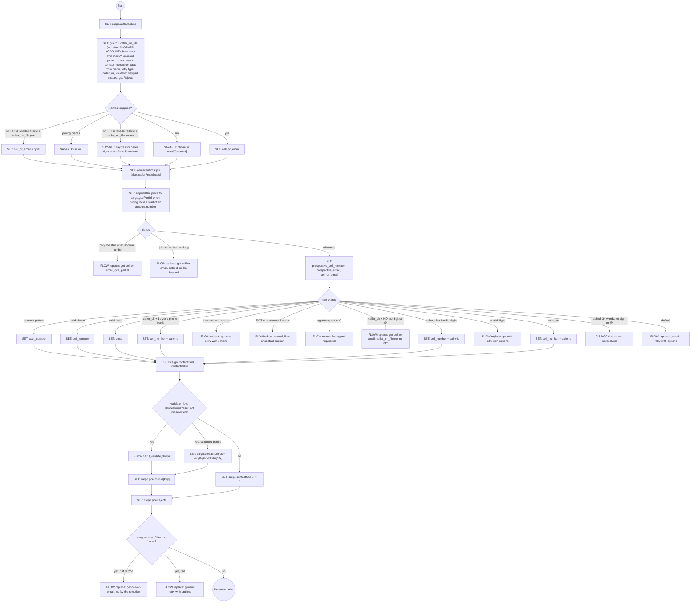

---

## GetAndValidateOtpCode
**ID**: `get-and-validate-otp-code` · **Version**: 1.0.6 · **Sub-flow**  
**Description**: Get and validate OTP code from user When the code went to the caller ID and the tenant named the caller from it (cargo.callerNamed), the question leads with the first name.

### Variables
`otp_code`, `normalized_otp_code`, `otp_destination`, `user_choice` (initial `""`), `otp_where` / `otp_where_es` (where the code is, for the prompt).

### Steps
1. `set_otp_destination` - `cargo.otp_cell_number` if set, else `cargo.otp_email`.
2. `formatted_otp_destination` - "cell ending with 1234" (the last four digits; on voice comma-separated, "1, 2, 3, 4") or "email: a@b.c". Spanish wording when `language == 'es'`.
3. `set_otp_where` / `set_otp_where_es` - `cargo.otpSentOn === 'whatsapp'` → "I just sent you here in this chat" / "que le acabo de enviar aquí en este chat". Otherwise "you received at {formatted destination}" / "que recibió en …".
4. `get_otp_from_user` (SAY-GET `otp_code`, `digits: {min 6, max 6}`; when `cargo.callerPreselected`, it ends "To use another account, {verb} ANOTHER ACCOUNT." / "Para usar otra cuenta, {verbo} OTRA CUENTA.") - "[{cargo.displayName}, please | Please] {verb} [or enter ]the 6-digit verification code {otp_where}. You can also [press * or ]{verb} EXIT to cancel." The question leads with `cargo.displayName` ("{name}, please" / "{name}, por favor") when the caller ID was used without asking (`cargo.callerPreselected`) and the tenant named the caller from it (`cargo.callerNamed`). The Spanish exit sentence is "También puede presionar * o decir SALIR para cancelar." on voice and "También puede escribir SALIR para cancelar." otherwise.
5. `set_user_choice` - `user_choice` = the answer trimmed and lower-cased (for word matching).
6. `set_otp_code` - `normalized_otp_code` = digits only.
7. `proceed_to_validation` (FLOW `validate-otp-code`, `replace`). A replace, so the code question can be asked any number of times without the flow stack growing.

### Ends
Through `validate-otp-code`, which takes this flow's place. Retries happen there, by replacing itself with this flow to prompt again.

### Flowchart
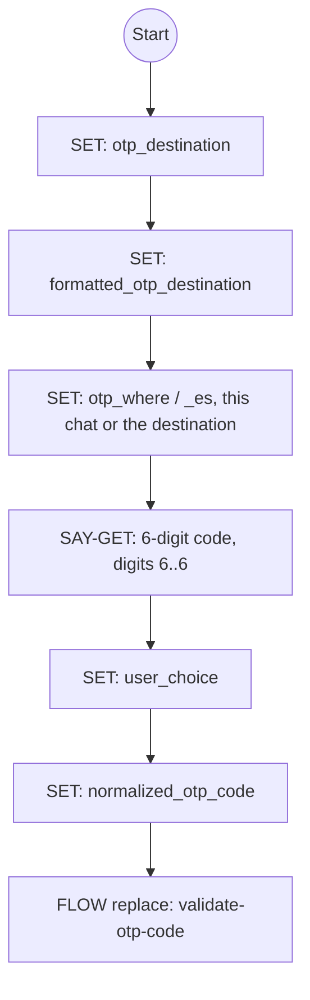

---

## ValidateOtpCode
**ID**: `validate-otp-code` · **Version**: 1.3.0 · **Sub-flow**  
**Description**: Worker: validate the one-time code the customer enters; sets cargo.otpVerified on success. An answer that is not a 6-digit code is given to cargo.authOptions.code_validator when the caller set one (authenticate-user's code_validator): answer_key 'another_account' takes the ANOTHER ACCOUNT path with that value (cargo.authOtherAccount). Any other answer that is not a code goes first to cargo.authOptions.answer_handler when the caller set one (authenticate-user's answer_handler), which may take it over; otherwise it is handled here.

Capped at 3 wrong codes per authentication (`cargo.otpMismatches`, reset by authenticate-user): the code is withdrawn and the retry/agent/exit choice follows, where retry sends a fresh code. Also capped at 3 answers with digits but not 6 (`cargo.otpFormatMisses`, reset by authenticate-user): the same choice follows, without withdrawing the code.

Reads `normalized_otp_code` and `user_choice` from `get-and-validate-otp-code`. An expired or missing code is answered with a fresh one (via `resend-otp-code`), not with "didn't match".

### Variables
`otp_validation_result` (boolean), `invite_text` (WhatsApp invite wording for this session's language; empty means the feature is off), `whatsapp_invite_sent` (true only if an invite was sent on this answer). The flow is entered by `replace`, which does not apply declared defaults, so step 0 sets both flags itself.

### Steps
0. `reset_no_code_given`, `reset_whatsapp_invite_sent` (SET) - `no_code_given = false` and `whatsapp_invite_sent = false` on every answer, so a right code after a non-answer is not explained again and the invite is mentioned only on the answer that sent it.
1. The caller's flows (with `cargo.authOptions` from [authenticate-user](#authenticateuser)), each run with `call` and `{ answer: user_choice }`:
   - `otp_init_answer_key` (SET) - `answer_key = ''`.
   - `otp_code_validator` (CASE) - `cargo.authOptions.code_validator`, an answer that is not 6 digits and holds a digit → FLOW `{{cargo.authOptions.code_validator}}`.
   - `otp_other_account_given` (SET) - `other_account_given` = `answer_key === 'another_account'`; then `cargo.authOtherAccount = answer_value` (as a string, `''` when unset).
   - `another_account_check` (SET) - `wants_other_account` = `other_account_given`, or the caller ID was used without asking (`cargo.callerPreselected`), the answer is not 6 digits, and it is "another account" / "otra cuenta" / "different number" / "not my account"….
   - `otp_answer_handler` (CASE) - `cargo.authOptions.answer_handler`, an answer that is not 6 digits, and not `wants_other_account` → FLOW `{{cargo.authOptions.answer_handler}}`. The handler may take the answer over; one that returns without taking over leaves it to the steps below.
2. `validate_otp_and_lookup` (CASE, first match wins):
   - `normalized_otp_code.length === 6` → CALL-TOOL [`validate-otp`](#validate-otp) `{otp: normalized_otp_code, container: cargo}` into `otp_validation_result`. `onFail` → FLOW `get-and-validate-otp-code` (`replace`).
   - `wants_other_account` → FLOW `authenticate-user` (`replace`) with `cell_number: ''`, `email: ''`, `retrying: true`, `declined_caller: true`: the contact question again, without the caller ID.
   - `isAnswer(…, 'exit')` (EXIT words or `*`) → FLOW `{{cargo.authCancelFlow || 'contact-support'}}` (`reboot`).
   - `isAnswer(…, 'agent')` (an AGENT word anywhere in the answer, or `0`) → FLOW `live-agent-requested` (`reboot`).
   - `isAnswer(…, 'text')` (TEXT words) → FLOW `switch-to-text` (`reboot`).
   - "didn't receive / resend" phrases (`resend, send again, not received, didn t get, no code, no llegó, no recibí, reenviar`…) → FLOW [`resend-otp-code`](#resendotpcode) (`call`) with `resend_reason: "requested"`.
   - "I'm driving / busy / later" phrases → SAY "No problem. Say TEXT and I'll continue with you by message so you can do this when you are free, or {verb} the code whenever you are ready."
   - some digits, but not 6, fewer than two such answers before → SAY "I was expecting a 6-digit code. Let's try again. You can also [press * or ]{verb} EXIT to cancel." (Spanish exit sentence as in GetAndValidateOtpCode.)
   - some digits, but not 6, the third such answer → nothing said here (step 6 answers).
   - "I don't have that phone (anymore)", "I don't have a phone", "I don't have access to that phone" / "ya no tengo ese teléfono", "no tengo celular", "no tengo acceso a ese teléfono" and similar → FLOW `generic-retry-with-options` (`replace`): "No problem. Then the code can't reach you there. You can use the email on your account instead, or {verb} AGENT to reach a person.", with the [authentication retry parameters](#genericretrywithoptions).
   - default (no digits) → SET `no_code_given = true`; the next steps explain or cap.
3. `count_no_code` (SET, side effect) - `cargo.otpWordMisses` + 1 when no code was given (words).
4. `explain_or_cap` (CASE) - no code and `cargo.otpWordMisses >= 3` → FLOW `generic-retry-with-options` (`replace`): "I still don't have the code. To reach a person, {verb} AGENT.", with the authentication retry parameters and `allow_code_entry: true`. No code otherwise → SAY "Let me explain. I sent you a message with a six-digit code in it. Read those six digits back to me. You can also {verb} AGENT to reach a person, or EXIT to cancel."
5. `count_format_miss` (SET, side effect) - `cargo.otpFormatMisses` + 1 when the answer has digits but not 6.
6. `retry_if_bad_format` (CASE) - 6 digits → continue. `cargo.otpFormatMisses >= 3` → FLOW `generic-retry-with-options` (`replace`): "I still don't have a 6-digit code. To reach a person, {verb} AGENT.", with the [authentication retry parameters](#genericretrywithoptions) and `allow_code_entry: true`. Otherwise → FLOW `get-and-validate-otp-code` (`replace`), which prompts again after the SAY or the fresh code above.
7. `count_wrong_code` (SET, side effect) - `cargo.otpMismatches` + 1 when not verified and `cargo.otpFailure === 'mismatch'`.
8. `withdraw_code_at_cap` (CASE) - a mismatch with `cargo.otpMismatches >= 3` → `cargo.otpHash = null`, so the code can no longer be accepted.
9. `check_validation_result` (CASE, first match wins):
   - `cargo.otpVerified` → SET `otp_validated = true`.
   - `cargo.otpFailure === 'expired'` → FLOW `resend-otp-code` (`call`), `resend_reason: "expired"`.
   - `cargo.otpFailure === 'missing'` → FLOW `resend-otp-code` (`call`), `resend_reason: "missing"`.
   - a mismatch at the cap → FLOW `generic-retry-with-options` (`replace`): "That code didn't match three times, so I can't accept another try with it. To reach a person, {verb} AGENT.", with the [authentication retry parameters](#genericretrywithoptions) and `allow_code_entry: false`.
   - default → SAY "That code didn't match. Let's try again."
10. `set_invite_text` - `global_whatsapp_invite_es` (Spanish) or `global_whatsapp_invite`, `''` when undefined.
11. `invite_if_wrong_code` (CASE) - verified, or `cargo.otpFailure` is not `mismatch` → no invite. Otherwise → CALL-TOOL [`send-whatsapp-invite`](#send-whatsapp-invite) `{accountSid: null, from: cargo.twilioNumber, to: cargo.otp_cell_number, inviteText, language, container: cargo}` into `whatsapp_invite_sent`. `onFail` → SET `whatsapp_invite_sent = false`. Per the tool's contract it returns `false` when `inviteText` is empty, when it already invited on this call, or when `to` is missing. `to` is `''` when the code went by email.
12. `mention_whatsapp_invite` (CASE) - `whatsapp_invite_sent` → SAY "I texted you a WhatsApp link so you can try again on WhatsApp to help overcome voice limitations."
13. `retry_if_wrong_code` (CASE) - not verified → FLOW `get-and-validate-otp-code` (`replace`).

### Ends
Verified → completion (the caller chain returns to `authenticate-user` or `generic-retry-with-options`). A wrong code loops back to the prompt until the third mismatch, which leaves through `generic-retry-with-options`. An expired or missing code gets a fresh one and loops back, until `resend-otp-code`'s own cap. The exits in step 2, and a caller's `answer_handler` that takes the answer over, leave at any time.

### Flowchart
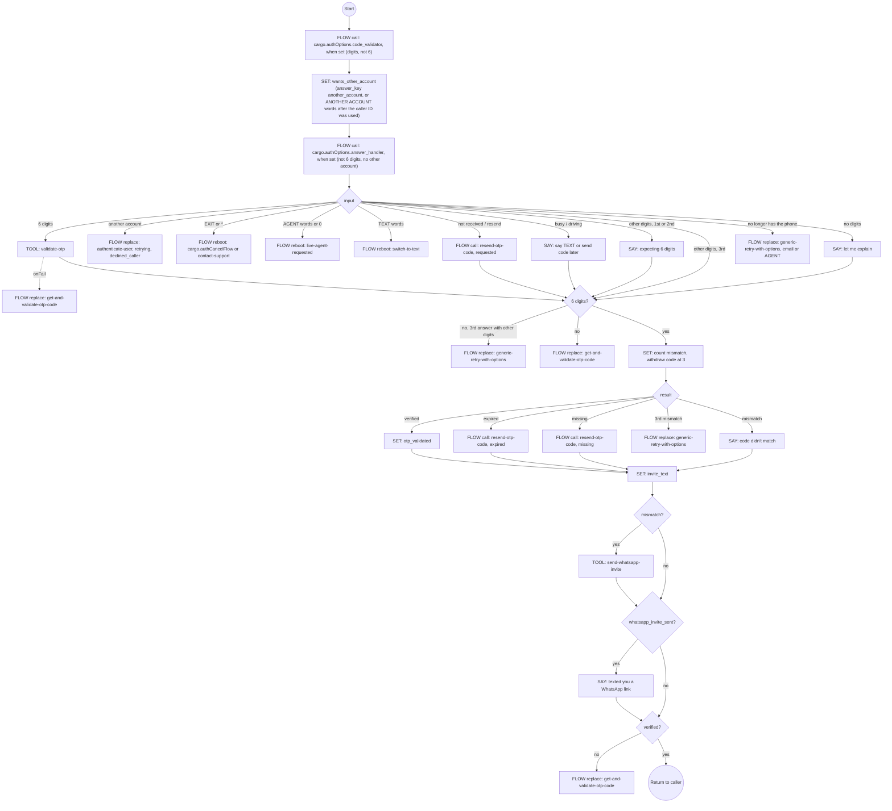

---

## ResendOtpCode
**ID**: `resend-otp-code` · **Version**: 1.1.3 · **Sub-flow**  
**Description**: Worker: sends a fresh code to the destination authenticate-user used (`cargo.otp_cell_number` / `cargo.otp_email`) and says why (`expired`, `missing` or `requested`). At most 2 per authentication (`cargo.otpResends`), then the retry menu.

Called by `validate-otp-code` with `callType: "call"`.

### Parameters
*   `resend_reason` (string): `expired`, `missing` or `requested`. Also declared as a variable with the default `"requested"`.

### Variables
`resend_reason`.

### Steps
1. `check_resend_cap` (CASE) - `cargo.otpResends >= 2` → FLOW `generic-retry-with-options` (`replace`): "I've already sent you new codes and still couldn't verify you. To reach a person, {verb} AGENT.", with the [authentication retry parameters](#genericretrywithoptions) and `allow_code_entry: true`.
2. `count_resend` (SET, side effect) - `cargo.otpResends` + 1.
3. `send_fresh_code` (FLOW [`send-otp-code`](#sendotpcode), `call`) - sends to `cargo.otp_cell_number` or `cargo.otp_email` and records `cargo.otpSendFailure`.
4. `resend_check_sent` (CASE) - `cargo.otpSendFailure` → FLOW [`otp-send-failed`](#otpsendfailed) (`replace`). Otherwise continue.
5. `say_why_fresh_code` (CASE) - `expired` → SAY "Your code expired, so I've sent you a new one." `missing` → SAY "I don't have an active code for you, so I've sent you a new one." Otherwise → SAY "I've sent you a new code."

### Ends
By completion, returning to `validate-otp-code`, which loops back to the code prompt. At the cap, by `replace` into `generic-retry-with-options`; on a failed send, by `replace` into `otp-send-failed`.

### Flowchart
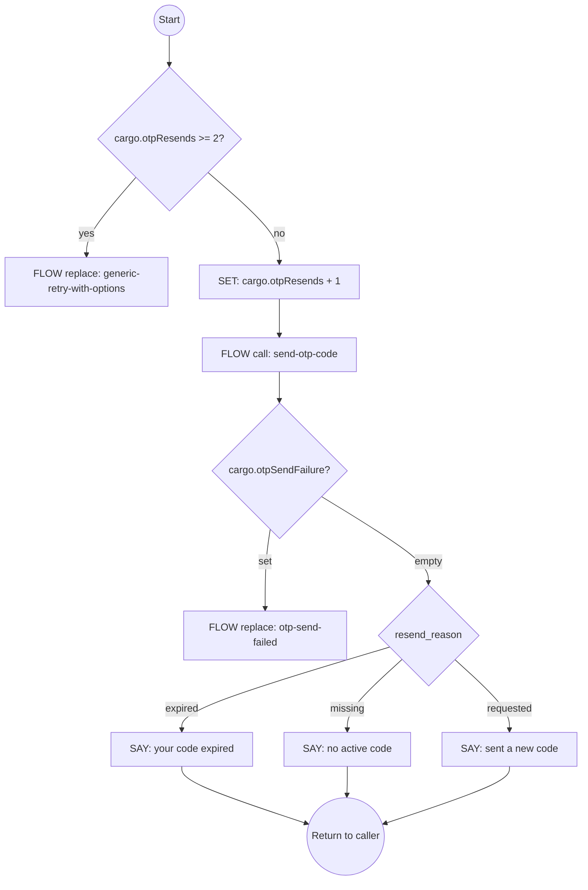

---
---

## GenericRetryWithOptions
**ID**: `generic-retry-with-options` · **Version**: 1.3.2 · **Sub-flow**  
**Description**: Worker: says what failed and offers retry (YES / 1), switch to text (TEXT / 9, when callerTextNumber can reach the caller), an agent (AGENT / 0) or exit (EXIT / *). A contact in the answer retries with it; with allow_code_entry a 6-digit code is checked on the spot; anything else goes back to intent detection.

The library's only retry menu: the authentication flows and the Shopify lookups offer their retry through it.

### Parameters
*   `error_message` / `error_message_es` (string): What failed, spoken first.
*   `question` / `question_es` (string): The question after the error. Empty or absent = "Would you like to try again?" / "¿Le gustaría intentar nuevamente?".
*   `retry_flow` (string): Flow to run again on YES / `1` or a captured contact.
*   `retry_call_type` (string): `'reboot'` (the default: start `retry_flow` afresh, alone) or `'replace'` (re-enter it in this frame, e.g. `authenticate-user` inside its caller).
*   `cancel_flow` (string): Flow to reboot on EXIT. Empty or absent = `contact-support`.
*   `capture_patterns` (array): Optional `[{variable, reader}]` or `[{variable, regex, normalizer?}]` for [`normalizeAndFindCapture`](#conventions-used-by-these-flows). Absent = no smart capture. The JSON's parameter description still names only `{variable, regex}`.
*   `allow_code_entry` (boolean): A 6-digit answer is a verification code, checked with `validate-otp-code`.
*   `caller_outcome`, `caller_reason` (string): Optional. The caller's declared outcome (usually `unresolved`) and reason for the failure that led here. The `DISPATCH` of an unrecognised answer declares them, so they reach the host only when intent detection matches no flow. Omitted = no outcome.

**Authentication retry parameters.** `authenticate-user` (wrong code), `validate-otp-code` (wrong-code cap), `resend-otp-code` (resend cap) and `otp-send-failed` (failed send) all pass the same set besides their own message and `allow_code_entry`:

| Parameter | Value |
|---|---|
| `retry_flow` | `authenticate-user` |
| `retry_call_type` | `replace` |
| `cancel_flow` | `{{cargo.authCancelFlow}}` |
| `capture_patterns` | `{{cargo.authCapture}}`: `cell_number` read with `readPhone`, `email` read with `readEmail` |
| `question` / `question_es` | "Would you like to try again to get access to your account?" / "¿Le gustaría intentar nuevamente obtener acceso a su cuenta?" |

`allow_code_entry` is `true` after a wrong code (authenticate-user) and at the resend cap, `false` at the wrong-code cap (the code was withdrawn) and after a failed send. `authenticate-user`'s rejected-contact menu and `get-cell-or-email`'s menus pass only `retry_flow`, `cancel_flow` and `capture_patterns: "{{cargo.authCapture}}"`.

### Variables
`user_choice`, `smart_capture_result`, `normalized_otp_code` (a 6-digit code typed at the menu, when `allow_code_entry`).

### Steps
1. `say_error_and_prompt` (SAY-GET `user_choice`, `digits: {min 1, max 1}`) - "{error_message} {question} To retry [Press 1 or ]{verb} YES. [To switch to text press 9 or {verb} TEXT. (only when `callerTextNumber(cargo)` returns a number)]To abort [press the asterisk key or ]{verb} EXIT." The keypad wording appears on voice only, and the TEXT option only on voice with a `cargo.callerId`. This prompt does not name the AGENT option; the error messages of the two cap menus do.
2. `reprompt_on_unknown_key` (CASE) - a single key `2` to `8` → SAY-GET `user_choice` again: "Sorry, that is not an option. To retry … [For an agent press 0. ]To abort …" (the agent sentence on voice only; same `digits`). One re-prompt only; its answer goes on to step 3.
3. `check_smart_capture` (SET) - `smart_capture_result = normalizeAndFindCapture(user_choice, capture_patterns)` when patterns were passed, else `null`.
4. `handle_smart_capture` (CASE, first match wins):
   - a capture and `retry_call_type === 'replace'` → FLOW `{{retry_flow}}` (`replace`) with `cell_number: ''`, `email: ''`, `[captured variable]: captured value`, `retry_flow`, `cancel_flow`, `retrying: true`.
   - a capture → FLOW `{{retry_flow}}` (`reboot`) with `[captured variable]: captured value`, `retry_flow`, `cancel_flow`.

   So an answer that contains a phone or email goes straight back in with that value (with the `cargo.authCapture` readers: the 10-digit number, or the email address lower-cased).
5. `read_typed_code` (SET) - with `allow_code_entry`, `normalized_otp_code` = the answer's digits when there are exactly 6; else `''`.
6. `check_typed_code` (CASE) - `normalized_otp_code` → FLOW [`validate-otp-code`](#validateotpcode) (`call`).
7. `normalize_choice` (SET) - trim, lower-case, strip punctuation.
8. `handle_choice` (CASE, first match wins):
   - `normalized_otp_code` and `cargo.otpVerified` → SET `auth_result = true` (the flow then ends by completion).
   - `(isAnswer(…, 'yes', [phone, email, cell, mobile, teléfono, telefono, celular, móvil, movil, correo electrónico, correo]) || user_choice === '1') && retry_call_type === 'replace'` (`retry_in_place`) → FLOW `{{retry_flow}}` (`replace`) with `retrying: true`, `cell_number: ''`, `email: ''`.
   - the same YES test, or `1`, without `retry_call_type: 'replace'` (`retry_from_start`) → FLOW `{{retry_flow}}` (`reboot`) with `retrying: true`.
   - `isAnswer(…, 'text')` (TEXT words) or `9` → FLOW `switch-to-text` (`reboot`).
   - `isAnswer(…, 'agent')` (an AGENT word anywhere in the answer, or `0`) → FLOW `live-agent-requested` (`reboot`).
   - `isAnswer(…, 'exit')` (EXIT words or `*`) → FLOW `cancel_flow`, else `contact-support` (`reboot`).
   - empty input or a lone digit (no intent to detect) → the same cancel target (`reboot`).
   - default → `DISPATCH` (outcome/reason = `caller_outcome`/`caller_reason`): the answer is routed through intent detection. A matching flow starts in the same turn, otherwise the host answers.

`retrying: true` makes an `authenticate-user` that the retry reaches restore the options of the authentication being retried from `cargo.authOptions` (see [AuthenticateUser](#authenticateuser)).

### Ends
By completion after a typed code was verified (with `auth_result = true`, returning to whichever flow called the frame this menu replaced), by a `replace` / `reboot` into another flow, or by `DISPATCH` (default branch).

### Flowchart
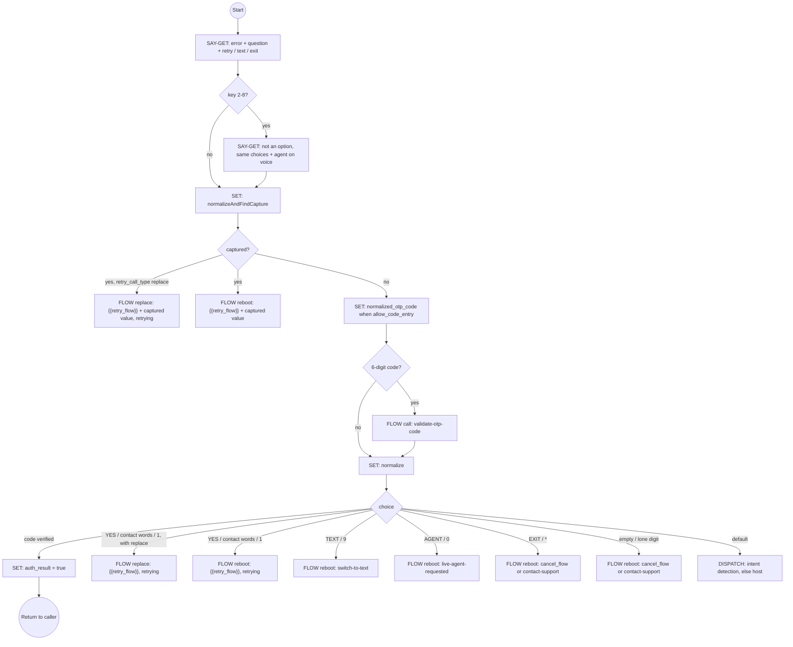

---

## OtpSendFailed
**ID**: `otp-send-failed` · **Version**: 1.0.2 · **Sub-flow**  
**Description**: Worker: a code could not be sent (`cargo.otpSendFailure`). A line that cannot receive texts goes to otp-text-undeliverable; any other failure offers the retry.

Reached by `replace` from `authenticate-user` (`auth_check_sent`) and from `resend-otp-code` (`resend_check_sent`) when [`send-otp-code`](#sendotpcode) recorded a failure, so it keeps the replaced frame's variables.

### Steps
1. `branch_on_failure` (CASE):
   - `cargo.otpSendFailure === 'undeliverable'` → FLOW [`otp-text-undeliverable`](#otptextundeliverable) (`replace`).
   Each retry branch passes the [authentication retry parameters](#genericretrywithoptions) with `allow_code_entry: false`.
   - `'sms'` → FLOW `generic-retry-with-options` (`replace`): "Sorry, text message delivery failed."
   - `'email'` → FLOW `generic-retry-with-options` (`replace`): "Sorry, email delivery failed."
   - default (`'none'`) → FLOW `generic-retry-with-options` (`replace`): "Sorry, there was an unexpected error."

### Ends
Always by `replace` into one of the two flows.

### Flowchart
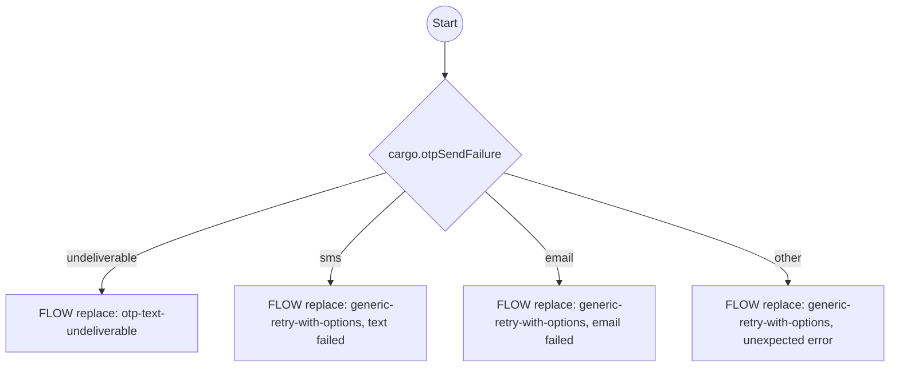

---

## TextDestination
**ID**: `text-destination` · **Version**: 1.0.2 · **Sub-flow**  
**Description**: Worker: where a text to the customer can go. Sets `cargo.textTo` (10 digits: the verified cell, else the caller's phone on a call; `''` when there is none, no sender, or the line cannot receive texts) and `cargo.textTo4` (its last four, spaced on voice).

No flow in this library calls it. A caller runs it (`call`) before [`send-text`](#sendtext), and can use `cargo.textTo4` to tell the customer where the text went.

The "verified cell" of the description is `cargo.otp_cell_number`, the number `authenticate-user` sent the code to. The step does not check `cargo.otpVerified`.

### Steps
1. `pick_destination` (SET, side effect) - `cargo.textTo = textDestination(cargo)`: the verified cell, else the caller (`callerTextNumber`); `''` when neither can be texted (see the contact readers).
2. `say_last_four` (SET, side effect) - `cargo.textTo4` = the last four digits of `cargo.textTo`, comma-spaced on voice ("1, 2, 3, 4"); `''` when `cargo.textTo` is empty.

### Ends
By completion.

### Flowchart
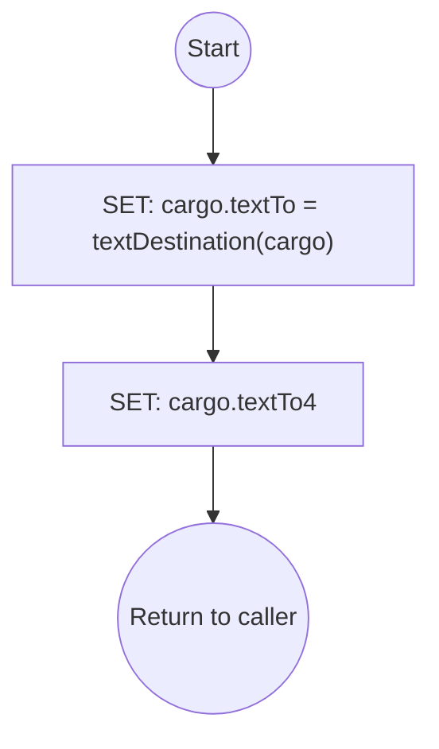

---

## SendText
**ID**: `send-text` · **Version**: 1.0.0 · **Sub-flow**  
**Description**: Worker: texts `message` to `cargo.textTo` (call text-destination first). Sets `cargo.textSent`.

No flow in this library calls it.

### Parameters
*   `message` (string): The text to send.

### Variables
`text_result` (string): what the send tool returned; `''` when it failed.

### Steps
1. `text_not_sent_yet` (SET, side effect) - `cargo.textSent = false`.
2. `send_when_possible` (CASE):
   - `cargo.textTo` → CALL-TOOL [`send-twilio-sms`](#send-twilio-sms) `{from: cargo.twilioNumber, to: "+1" + cargo.textTo, message}` into `text_result`. `accountSid` is not passed, so the function receives it as `undefined`. `onFail` → SET `text_result = ''`.
   - default → SET `text_result = ''`.
3. `record_sent` (SET, side effect) - `cargo.textSent = !!(cargo.textTo && text_result)`.

### Ends
By completion. It never leaves the flow stack; the caller reads `cargo.textSent`.

### Flowchart
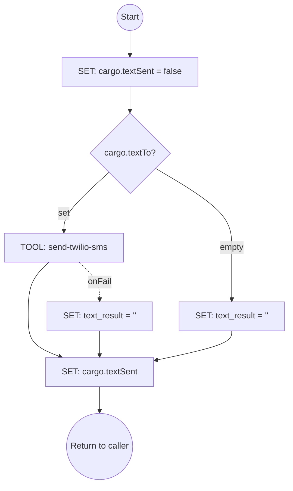

---

## SendOtpCode
**ID**: `send-otp-code` · **Version**: 1.0.0 · **Sub-flow**  
**Description**: Worker: sends a one-time code to `cargo.otp_cell_number` (SMS) or `cargo.otp_email`. Never texts a number that cannot receive texts (`cargo.otpUndeliverableTo`). Sets `cargo.otpSendFailure` (`''`, `'undeliverable'`, `'sms'`, `'email'` or `'none'`); the caller hands a failure to otp-send-failed.

Called with `callType: "call"` by `authenticate-user` (`send_code`) and `resend-otp-code` (`send_fresh_code`). Each caller checks `cargo.otpSendFailure` in its next step and, when set, replaces itself with [`otp-send-failed`](#otpsendfailed).

**Why the worker records the failure instead of handing it off itself.** An `onFail` FLOW with `callType: "replace"` replaces only the frame that holds the failed CALL-TOOL. Inside a called worker that frame is the worker, so the replacement would run in its place and, when it finished, the caller would continue to its next step (the code prompt) as if the code had been sent (jsfe `src/index.ts`, CALL-TOOL `onFail` handling). Recording the failure and letting the caller branch on it leaves the caller's own frame, the one that should end.

### Steps
1. `clear_send_failure` (SET, side effect) - `cargo.otpSendFailure = ''`.
2. `skip_line_that_cannot_text` (CASE) - `cargo.otp_cell_number` whose last 10 digits equal `cargo.otpUndeliverableTo` → `cargo.otpSendFailure = 'undeliverable'`. A number already refused for texts is never texted again in the same session. Otherwise continue.
3. `send_code` (CASE, first match wins):
   - no failure and `cargo.otp_cell_number` → CALL-TOOL [`send-sms-otp`](#send-sms-otp) `{accountSid: null, from: cargo.twilioNumber, to: cargo.otp_cell_number, container: cargo, language}`. `onFail` → SET `cargo.otpSendFailure = cargo.otpUndeliverableTo ? 'undeliverable' : 'sms'` (the host's `send-sms-otp` sets `cargo.otpUndeliverableTo` when the line refuses the text, and clears it at the start of every send, so a value here describes this failure).
   - no failure and `cargo.otp_email` → CALL-TOOL [`send-email-otp`](#send-email-otp) `{to: cargo.otp_email, container: cargo, language}`. `onFail` → SET `cargo.otpSendFailure = 'email'`.
   - no failure (no destination) → `cargo.otpSendFailure = 'none'`.
   - default (already `'undeliverable'`) → nothing is sent.

### Ends
By completion, always. The outcome is in `cargo.otpSendFailure`.

### Flowchart
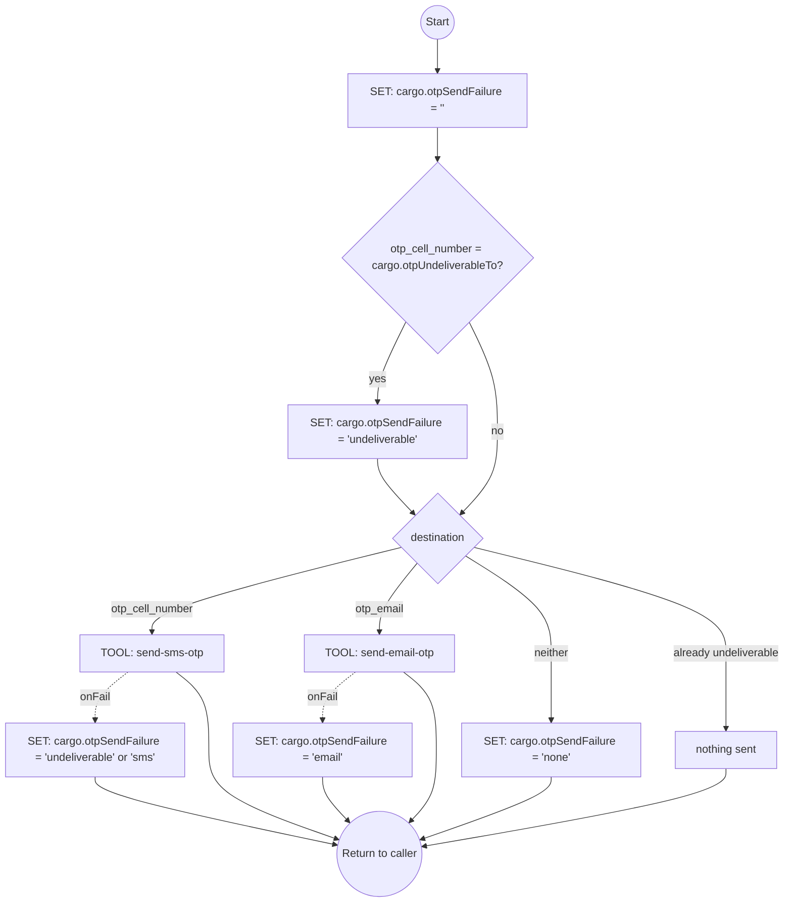

---
---

## OtpTextUndeliverable
**ID**: `otp-text-undeliverable` · **Version**: 1.0.8 · **Sub-flow**  
**Description**: Worker for authenticate-user: the number for the code cannot receive texts (landline, toll-free, invalid). Says so and asks for the account's email or a mobile number; never offers to text the same number again.

Reached by `replace` from [`otp-send-failed`](#otpsendfailed) when `cargo.otpSendFailure` is `undeliverable`, so it keeps `authenticate-user`'s variables (`retry_flow`, `cancel_flow`, the validators) and returns to it by `replace`.

### Parameters
*   `note` (string): `international` when asked again after a number outside the US and Canada; the question then says codes reach only US and Canadian numbers.

### Variables
`user_choice` (the answer), `undeliverable_last4` (last four digits of the refused number; comma-spaced on voice), `choice_digits` (the 10-digit number in the answer, if any), `choice_email` (an email address in the answer, if any).

### Steps
1. `describe_number` (SET) - `undeliverable_last4` from `cargo.otpUndeliverableTo`: "1, 2, 3, 4" on voice, "1234" otherwise.
2. `ask_other_contact` (SAY-GET `user_choice`, `digits: {min 1, max 12, autoSubmitChars ["0"], autoSubmitMs 2500}`) - "[I can only text codes to US and Canadian numbers. (when `note` is `international`)]The number ending with {undeliverable_last4} can't receive text messages, so I can't text it a code. Please {verb} the email address on your account, or {voice ? 'say or enter' : verb} a mobile number that can receive texts. To talk to an agent [press 0 or ]{verb} AGENT. To exit [press the asterisk key or ]{verb} EXIT."
3. `read_digits` (SET) - `choice_digits = readPhone(user_choice)`: the answer's digits when there are exactly 10 (or 11 with a leading `1`, dropped); else `''`.
4. `read_email` (SET) - `choice_email = readEmail(user_choice)`: the email address in the answer, typed, spoken or spelled, lower-cased; else `''`.
5. `clear_cell` / `clear_email` (SET) - `cell_number = ''`, `email = ''`.
6. `handle_choice` (CASE, first match wins):
   - `choice_email` and `validateEmail(choice_email)` → FLOW `authenticate-user` (`replace`) with `email: {{choice_email}}`.
   - `validatePhone(choice_digits)` → FLOW `authenticate-user` (`replace`) with `cell_number: {{choice_digits}}`.
   - `isAgentRequest` (the whole answer asks for a person, or is `0`) → FLOW `live-agent-requested` (`reboot`).
   - `isAnswer(…, 'exit')` (EXIT words or `*`) in an answer of at most two words → FLOW `{{cargo.authCancelFlow || 'contact-support'}}` (`reboot`).
   - `readInternationalPhone(user_choice)` → FLOW `otp-text-undeliverable` (`replace`) with `note: "international"`: asks again, saying codes reach only US and Canadian numbers.
   - default → FLOW `authenticate-user` (`replace`) with no contact, so `get-cell-or-email` asks again.

If the caller gives the same number again (or accepts the caller ID that is that number), `send-otp-code`'s `skip_line_that_cannot_text` records `undeliverable` without texting it, and `otp-send-failed` brings the caller back here.

### Ends
By `replace` into `authenticate-user`, or `reboot` into `live-agent-requested` or the authentication's cancel flow (`cargo.authCancelFlow`, else `contact-support`).

### Flowchart
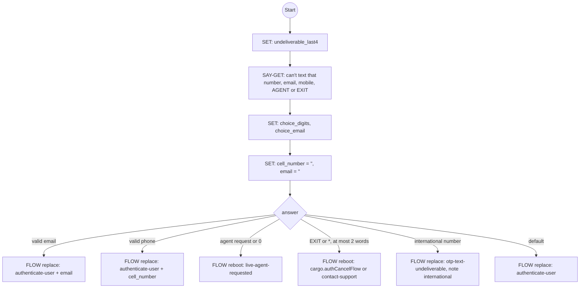

---

## LiveAgentRequested
**ID**: `live-agent-requested` · **Version**: 1.7.2 · **Primary** (prompt "live agent confirmation" / "confirmación de agente en vivo")  
**Description**: Customer wants to talk to a person: a live agent, a representative, customer service ('agent', 'speak to an agent', 'customer service representative', 'transfer me', 'I need to talk to someone', 'can I talk to a human', 'agente', 'representante', 'servicio al cliente', 'atención al cliente', 'transfiéreme', 'hablar con una persona', 'comunicarme con alguien'), including a cut-off 'service' or 'al cliente' said alone. Not: continuing by text (SwitchToText); only asking for a phone number, email or hours (None).

**Behaviour**: On the phone it offers the transfer when an agent is scheduled (`cargo.agentPhoneNumber`); on every other channel it sends the Live Connect link when the tenant runs Live Connect and an agent is reachable. On the phone after hours (no agent number this turn, the number has a schedule) it says so, states the agent hours and offers to help, ending `unresolved` (`agent_unavailable`). Otherwise (any non-phone channel without a Live Connect link, or a phone number with no agents at all) it says it cannot connect the customer with a live agent and gives the tenant's contact information, ending `resolved` (`no_agent_reachable`). Started by [give-up](#giveup) (`cargo.giveUp`), it transfers on the phone without the offer to continue with the AI, and the cannot-connect end is `unresolved` (`gave_up`). Its worded RETURNs carry `keepSay: true`, so text a calling flow queued before rebooting here is delivered first.

### Variables
*   `user_choice` (string): continue with AI or transfer.
*   `live_connect_link` (string): the Live Connect guest link on non-phone channels; `''` when not available.
*   `after_give_up` (boolean): started by give-up.

### Steps
0. `take_give_up` (SET) - `after_give_up = !!cargo.giveUp`, and `cargo.giveUp = false`.
1. `get_live_connect` (CASE) - not on voice → CALL-TOOL [`get-live-connect-link`](#get-live-connect-link) `{container: cargo}` into `live_connect_link`; `onFail` → SET `live_connect_link = ''`. On voice → `live_connect_link = ''`.
2. `offer_live_connect` (CASE) - not on voice and a link → **`RETURN`** "You can talk to a live agent now, by audio or video, here: {live_connect_link}" (Spanish: "Puede hablar ahora con un agente en vivo, por audio o video, aquí: …"), **`outcome: "resolved"`, `reason: "live_connect_link"`**.
3. `cannot_connect` (CASE) - not on voice, or on voice with neither `cargo.agentPhoneNumber` nor `cargo.agentHours` (a number with no agents) → **`RETURN`**, sentences joined with spaces, **`outcome: "resolved"`, `reason: "no_agent_reachable"`** (after a give-up: `unresolved`, `gave_up`):
   - "I can't connect you with a live agent here." (Spanish: "No puedo comunicarle con un agente en vivo por aquí.");
   - not on voice: `global_live_agents_comment` / `_es`, when set;
   - `cargo.contact_info` set: "Here is how to reach Customer Support: {contact_info}." (on voice through `textWithUrlToSpeech`); otherwise "Please contact Customer Support."
4. `check_agent_available` (CASE) - no `cargo.agentPhoneNumber` (on voice, after hours) → **`RETURN`**, sentences joined with spaces, **`outcome: "unresolved"`, `reason: "agent_unavailable"`**:
   - "Our live agent team isn't available right now." (Spanish: "Nuestro equipo de agentes no está disponible en este momento.");
   - `cargo.agentHours` / `cargo.agentHours_es`, else `global_live_agents_comment` / `_es` when set;
   - `cargo.agentUnavailableMessage`, else "I can still help with many questions. Just tell me what you need." (Spanish: "Aún puedo ayudarle con muchas preguntas. Solo dígame qué necesita." on voice, "… Solo escríbame qué necesita." otherwise).
5. `offer_unless_give_up` (CASE) - `after_give_up` → SET `user_choice = 'agent'` (no offer). Otherwise `ask_user_choice` (SAY-GET `user_choice`, `digits: {min 1, max 1}`) - the deflection pitch ("Before I try to transfer you, I want you to know that I can help you faster with many inquiries…"), then "To have me help you now [Press 1 or] {verb} YES. For a live agent [Press 0 or] {verb} LIVE AGENT."
6. `normalize_choice` - trim, lower-case, strip punctuation.
7. `handle_choice` (CASE):
   - **anything that is not** `isAnswer(…, 'yes', ['continue', 'thanks', 'gracias'])` and not `1` (so a negated answer such as "not sure" transfers) → nested CASE: `cargo.agentPhoneNumber` → **`RETURN`** "Understood. Let me transfer you to a live agent." (Spanish: "Entendido. Te transfiero a un agente en vivo."); after a give-up without "Understood." / "Entendido.". Otherwise (the agent number is gone when the answer arrives) → **`RETURN`** the same "not available" text as step 4, `outcome: "unresolved"`, `reason: "agent_unavailable"`.
   - YES / `1` → SAY "Great! I'm glad to help. What would you like assistance with today?"

The flow only returns the transfer sentence. **Performing the transfer is the host's job**; no tool is called.

### Ends
`RETURN` (Live Connect link, cannot connect, not available, or transfer), or completion after the "Great!" SAY.

### Flowchart
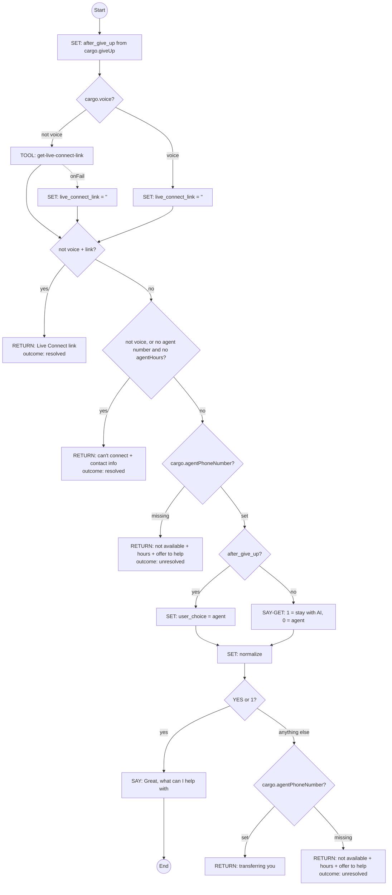

---

## GiveUp
**ID**: `give-up` · **Version**: 1.0.1 · **Sub-flow**  
**Description**: Worker: a flow could not finish, because its tries ran out or a service it needs failed. Says so and hands the caller to [LiveAgentRequested](#liveagentrequested), which transfers at once on the phone instead of offering to continue with the AI. Not for an answer that changes direction: that is `DISPATCH`ed.

### Parameters
*   `context` (string): What could not be finished (English), e.g. "your payment". Empty or absent = "your request".
*   `context_es` (string): The same in Spanish, e.g. "su pago". Empty or absent = `context`, else "su solicitud".

### Steps
1. `gu_context`, `gu_context_es` (SET) - the defaults above.
2. `gu_mark` (SET, side effect) - `cargo.giveUp = true`.
3. `gu_sorry` (SAY) - "Sorry, I wasn't able to help with {context}." (Spanish: "Lo siento, no pude ayudarle con {context_es}.")
4. `gu_to_agent` - FLOW `live-agent-requested` (`replace`).

### Ends
In LiveAgentRequested.

### Flowchart
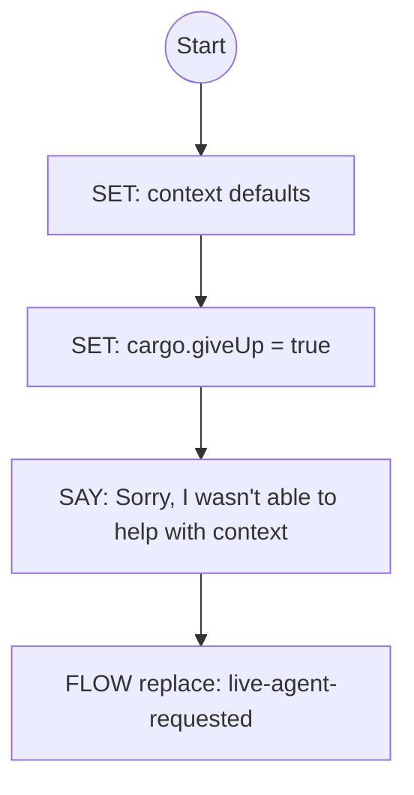

---

## AskChoice
**ID**: `ask-choice` · **Version**: 1.16.0 · **Sub-flow** · **Scope**: isolated  
**Description**: Worker: ask one question; sets cargo.choice (the matched key, or 'other' with accept_other) and cargo.choiceText. AGENT / 0 reaches a person, EXIT / * ends, a new request is DISPATCHed. With amount: an answer naming an amount returns 'amount' — one marked as money ($, dollars, cents, decimals), or, when it matched no choice, any answer amountInAnswer reads as one ("109 con 47"), except an answer with a single digit and no payment verb ("5", "5 please"), which is a key press ("pay 5" is an amount). An exact choice keyed no / decline / done / cancel (or negative) is picked only by its own words and keys, never by a refusal or a deferral. Optional answer_precheck: a caller flow run with { answer } BEFORE the choices are matched; an answer_key it sets wins (the answer_validator contract, which runs only when no choice matched). Optional reask_long: a long answer that matches nothing is asked again once before it is DISPATCHed. Params: question(_es), choices [{key, words, negative?, neutral?}], retry(_es), accept_other, expect ('number' | 'email' | 'contact'), amount, digits, exit_context(_es).

The question primitive the other generic workers are built on: ask-email, ask-address, ask-field and card-entry ask every question through it.

### Parameters
*   `question` (string, required): The question (English). Said as given on every channel.
*   `question_es` (string): The question (Spanish). Empty or absent = `question`.
*   `choices` (array, required): `[{ key, words, negative?, neutral?, exact? }]` in priority order. `words` include any keypad key (`"1"`, `"*"`, `"#"`). `exact: true` marks a choice that charges or cancels. See [Matching](#matching-pickchoice). An `exact` choice keyed `no`, `decline`, `done` or `cancel` (or `negative: true`) is picked only by its own words and keys (steps `ac_exact_no_own_words`).
*   `retry` / `retry_es` (string): Re-ask wording. Empty or absent = "Sorry, I didn't catch that. " + `question` / "Disculpe, no le entendí. " + the Spanish question.
*   `accept_other` (boolean, `true` or `'true'`): Return an answer that picks no choice as `cargo.choice = 'other'` instead of re-asking or `DISPATCH`ing it.
*   `expect` (string): With `accept_other`: `number`, `email` or `contact`. An unmatched answer that [`isOtherRequest`](#conventions-used-by-these-flows) calls a new request (three or more words, none of that shape) is `DISPATCH`ed instead of returned as `other`.
*   `amount` (boolean, `true` or `'true'`): A payment question. Every SAY-GET carries `asSpoken`, so a spoken amount is stored as said, and an answer that names an amount returns `cargo.choice = 'amount'` (the [amount gate](#askchoice-amount)).
*   `digits` (object): Keypad settings (`{ min, max, … }`), written to `cargo.digits` before each question and removed after the answer. The SAY-GETs themselves carry no `digits`.
*   `reask_long` (boolean, `true` or `'true'`): An answer of three words or more that picks no choice is asked again once (the retry wording) instead of being `DISPATCH`ed at once; the second miss is `DISPATCH`ed. For a question whose loss costs the caller real work, such as a charge confirmation after a card was typed. Without `accept_other` only.
*   `pii` (boolean, `true` or `'true'`): The answer is sensitive (a card's security code). Every SAY-GET here carries [`pii`](#conventions-used-by-these-flows), so the host keeps the answer out of its logs and records (jsfe ≥ 1.3.5).
*   `answer_precheck` (string, flow name): Optional. Called (`call`) with `{ answer }` before the choices are matched, for every non-blank answer; an `answer_key` it sets is the answer's key in place of `pickChoice` (for an answer that must not be read as a choice, such as a question). See [Answer flows](#askchoice-answer-flows).
*   `answer_validator` (string, flow name): Optional. Called (`call`) with `{ answer }` when a non-blank answer picked no choice; an `answer_key` it sets is the answer's key. It sets none → the answer is handled as before (the amount gate, the re-ask). The validator must end by completion: a `RETURN` in it terminates the turn.
*   `exit_context` / `exit_context_es` (string): What EXIT abandons, passed to contact-support as `support_context` / `support_context_es`. Empty or absent = "your request" / "su solicitud". An exit context of `payment` also makes the `DISPATCH`es declare `outcome: "unresolved"`, `reason: "payment_incomplete"`.

### Variables
Declared: `ac_answer`, `ac_key`, `ac_other`, `ac_q_es`, `ac_retry`, `ac_retry_es`, `ac_exit_ctx`, `ac_exit_ctx_es`, `ac_missed` (true when the first answer was re-asked), `answer_key` (set by `answer_precheck` / `answer_validator`, `''` before each run). `ac_amount`, `ac_pii` and `ac_prechecked` are set without a declaration.

The answer flows are run with `call`. A shared-scope answer flow works on ask-choice's own variables, so the `answer_key` it sets is read here; the variables of the flow that called ask-choice are not visible to it.

**Cargo written:** `cargo.choice` / `cargo.choiceText` (both `''` at the start), `cargo.digits` (while an answer is awaited), and, when the answer leaves through AGENT, EXIT or `DISPATCH`, `null` at each path listed in `cargo.sensitive`. **Cargo read:** `cargo.sensitive`.

### Matching (`pickChoice`)
`pickChoice(answer, choices, accept_other)` decides, in the host (reference: hy-rag-lambdas `foundation/text/answer.js`). It returns a choice's key, `__agent`, `__exit`, or `''`.

**Reading the answer.** The engine's `\'`, `\"`, `\\` escapes are removed, the answer is lower-cased and stripped of punctuation (`*`, `@`, `.` and accented letters kept), and agreeing phrases that hold a negation word ("no problem", "no worries", "no hay problema", "no te preocupes", "why not", "por qué no") are removed. Words match whole words or word runs (`matchesChoice`), never substrings; a vowel the caller elongated ("yesss", "sii") still matches. The answer is split into clauses at `,` `;` `!` `?` ". " " but " " pero "; in each clause, the words from the first negation word on (no, not, nope, nah, never, dont, doesnt, didnt, cant, cannot, wont, nunca, ni, tampoco, jamás; apostrophes are dropped first) are the negated part.

**Each choice's words.** A choice keyed `yes` also takes the general YES words (`ANSWER_WORDS.yes`), or, when `exact`, only **`CONFIRM_WORDS`**: yes, yeah, yep, yup, sure, of course, absolutely, definitely, confirm, I confirm, confirmed, approve, I approve, approved, agree, I agree, agreed, proceed, go ahead, go ahead please, do it, correct, that's correct, that is correct, that's right, that is right, yes I do, si, sí, claro, claro que sí, por supuesto, confirmo, confirmado, apruebo, aprobado, adelante, dale, hazlo, procede, proceda, proceder, procedo, sí proceda, correcto, de acuerdo, estoy de acuerdo, sí quiero. General YES words that are not confirm words (ok, okay, fine, está bien, sounds good, perfecto, alright, bueno, please, por favor, right, seguro, exactly, así es, eso es, continue, continuar, go on, seguir…) never confirm an `exact` choice on their own; the acknowledgements among them may stand beside a confirm word (below). A bare "quiero" / "I want" / "I would like" is no YES word anywhere. The **NO-type choice** (the first keyed `no`, `decline`, `done` or `cancel`, or marked `negative: true`) also takes the NO words: no, nope, nah, no thanks, no thank you, not now, not today, no gracias, ahora no, hoy no. A choice keyed `cancel`, `done` or `decline` is therefore picked by "no" in `pickChoice`; ask-choice takes that pick of an `exact` one back (below).

**Strict words: the whole answer.** A choice's keys (one digit, `*` or `#`), its YES words, and on an `exact` choice every one of its words, pick it only as the whole answer, courtesy aside. Courtesy: please, por favor, thanks, thank you, thank you so much, thanks a lot, gracias, muchas gracias, um, umm, uh, uhm, hmm, oh, ah, well, so, like, este, pues, ma'am, madam, sir, miss, señor, señora, señorita, mija, mijo.
- A non-key strict word picks when the answer is nothing but that choice's strict words and filler, at least one strict word. Filler is courtesy; on an `exact` choice it is also the **acknowledgements** (ok, okay, okey, está bien, bueno, fine, that's fine, alright, all right, perfect, perfecto, sounds good, great, excelente, muy bien), and on an `exact` choice not keyed `yes` also the confirm words and the articles and possessives "the", "my", "el", "la", "mi". So "Yeah, sure, thank you", "Sí, claro, por favor", "Sí, está bien" and "Yes, okay" are YES at an `exact` YES, while "ok" or "está bien" alone is not; "Yes, full balance", "Yes, the full balance", "okay, saldo completo" and "Sí, el saldo completo" pick an `exact` choice whose words are "full balance" / "saldo completo", while "the" or "yes the" alone picks nothing; "yes, pay it" is YES only where "pay it" is a word of that same choice.
- On an `exact` choice an answer containing "?" or "¿" never picks it ("sure?", "1?"): a question is not a confirmation. Elsewhere "yes?" is still YES.
- A key picks when the answer is exactly the key (surrounding spaces and punctuation trimmed), or holds the key once with nothing else but courtesy and, except for the NO-type choice's key, general YES words ("1 please", "um, 2", "yes 1", "sí, 1", "ok 1"). "yes 2", where 2 is the NO-type key, picks nothing. Any other word blocks the key ("no 1", "1 or 2", "I paid 1 already", "1 1").
- A key said as a word is that key under the same rules: zero/cero … nine/nueve in English and Spanish ("dos", "two", "uno, por favor", "sí, uno"), never inside a sentence ("quiero pagar dos" picks nothing).
- An answer that names an amount (`isAmountAnswer`: a `$`, dollar(s) / dólar(es) / buck(s) / cent(s) / centavo(s), or a number with one or two decimals after `.` or `,`) never matches a word that is all digits, so "$1" never picks key `1`, and `0` with an amount is not AGENT.

**Other words: inside the answer.** On a choice that is not `exact`, a word that is not strict (named actions: LINK, RECEIPT, "keep it") matches inside a longer answer:
- a word of the NO-type choice, of a choice keyed `no` or marked `negative`, or a word that holds a negation itself ("don't save") matches anywhere in the answer;
- any other word matches outside a negated part. Inside a negated part only, a `neutral: true` choice still matches (the negation is about something else), unless the word comes within the two words after its negation word ("not the card"); any other choice is blocked.

**Order and overrides.** Choices are tried in order; the first match wins. Then, when there is a NO-type choice: a deferral (later, tomorrow, next week, not now, not today, another time, mañana, después, luego, otro día, ahora no, hoy no) answers with it whatever matched; a `yes` match in an answer whose first clause is a bare "no", "nope", "nah", "no thanks" or "no gracias" becomes it; a blocked match with nothing found becomes it. So "no, sí", "sí, no" and "yes no" are NO.

**No choice matched.**
- `__agent`: the answer is `0` (and names no amount), or it holds no negation and no `@` and either the whole answer asks for a person ("I want to talk to an agent", "un representante por favor") or, without `accept_other`, it holds an AGENT word anywhere: live agent, agent(s), representative, rep, human, operator, manager, supervisor, real person, customer service, agente(s), representante, humano, operador(a), gerente, servicio al cliente, recepcionista, recepción. The AGENT words that also mean something else (servicio, support, someone, somebody, alguien, persona, a person, gente, al cliente) never count inside a longer answer, only through the whole-answer rule, which takes "someone", "somebody", "alguien", "persona" and "a person" alone but not "servicio", "support", "gente" or "al cliente": "quiero pagar mi servicio" and "servicio" are not requests for a person.
- `__exit`: `*`, or the whole answer is exit / quit / salir / abort (and, without `accept_other`, cancel / cancelar), optionally followed by "please" / "por favor". With `accept_other`, "cancel" is an answer.
- otherwise `''`.

<a id="askchoice-exact-no"></a>**An `exact` NO-type choice** (steps `ac_exact_no_own_words` / `_again`): when `pickChoice` returns an `exact` choice keyed `no`, `decline`, `done` or `cancel` (or `negative: true`), ask-choice asks `pickChoice` again with that choice alone, under a key that is not NO-type (so it takes no NO words and no deferral). When that does not pick it, the answer did not use the choice's own words or keys, and the answer is matched once more against the other choices, without any `exact` NO-type one: a non-exact choice keyed `no` then takes "no", and otherwise the answer picks nothing (and is re-asked or `DISPATCH`ed as any miss). So with `{ key: 'cancel', exact: true, words: ['1', 'cancel service'] }`, "no", "no thanks", "not now", "maybe later" and "tomorrow" do not cancel, while "1" and "cancel service" do; "yes 1" still picks nothing.

<a id="askchoice-amount"></a>**The amount gate** (steps `ac_amount_check` / `ac_amount_check_again`, only with `amount`): after `pickChoice`, the answer is an amount (`ac_key = '__amount'`) when `isAmountAnswer(answer)` (whatever it matched, `__agent` and `__exit` included), or when it matched nothing, either does not contain exactly one digit or holds a payment verb (pay, paying, pagar, pagarle, abonar, as whole words), is not single digits separated only by spaces, `,` `.` or `;` ("1 1", "2, 2"), and `amountInAnswer(answer)` returns a number. `amountInAnswer` reads 1,234.56 / 1.234,56 / 12,50, "N con/and/y MM cents/centavos" and "N con MM" (speech-to-text's "76 con50" too), "$82 y 50" / "82 dollars and 5" as dollars and cents; it drops numbers after account, sub-account, card, ending in, code, ZIP, número / number words and digits spoken one by one (three or more); two different remaining numbers are no amount unless exactly one is marked as money; "50 cents" alone is 0.50. So "12", "109 con 47", "pay 5" and "quiero pagar 5" are amounts, and so is "1,2" (a decimal comma, 1.20, through `isAmountAnswer`); "1 1", "1, 2", "5" and "5 please" are not (a lone digit, with or without courtesy, is a key press). The verb counts only when the answer matched no choice: where a choice has the word "pay" (a menu's PAY option), "pay 5" picks that choice, as "pay 50" does.

<a id="askchoice-answer-flows"></a>**Answer flows.** `answer_precheck` sees every non-blank answer first, and the key it sets replaces `pickChoice`; the exact NO-type check and the amount gate still apply after it. `answer_validator` sees only an answer that picked no choice. Both are passed `{ answer }` and report through `answer_key`; a key is returned as `cargo.choice` like a choice's key.

<a id="askchoice-nine"></a>**A lone `9` on a call.** When an answer is exactly `9` and picked nothing, on a question with no `accept_other` and no `amount`, on voice, and `callerTextNumber(cargo)` can reach the caller, ask-choice reboots into [switch-to-text](#switchtotext) instead of re-asking. The card data in `cargo.sensitive` is not cleared on this path. Where none of that holds, `9` is handled as any other miss, and a `DISPATCH`ed `9` starts [Keypad9](#keypad9).

### Steps
1. `ac_reset` (SET, side effect) - `cargo.choice = ''`, `cargo.choiceText = ''`.
2. `ac_accepts_other`, `ac_takes_amount`, `ac_takes_pii`, `ac_question_es`, `ac_retry_en`, `ac_retry_spanish`, `ac_exit_context`, `ac_exit_context_es` (SET) - `ac_other`, `ac_amount`, `ac_pii`, and the defaults above.
3. `ac_keypad` (SET, side effect) - `cargo.digits = digits` when it is an object, else `undefined`.
4. `ac_ask` (SAY-GET `ac_answer`, `asSpoken: "ac_amount === true"`, `pii: "ac_pii === true"`) - `{{question}}` / `{{ac_q_es}}`. Every SAY-GET below carries the same `asSpoken` and `pii`.
5. `ac_repeat_1` / `ac_repeat_2` (CASE) - an answer that only asks to hear the question again and picks no choice → the same SAY-GET again, at most twice; not a miss. The answer may start with `¿` or `¡` and be led by por favor / please / a / que / me lo / me / lo / puede / can you / could you, must then be repetir, repite, repita / repite + lo, la, me, melo or nos, repítamelo, otra vez, de nuevo, repeat (that / it), say that / it again, again or one more time, and may end with por favor / please / la pregunta / las opciones / eso / that / it.
6. `ac_init_precheck_key`, `ac_precheck`, `ac_precheck_key` - `answer_key = ''`; with `answer_precheck` and a non-blank answer, FLOW `{{answer_precheck}}` (`call`, `{ answer }`); `ac_prechecked` = the `answer_key` it set, else `''`.
7. `ac_match` (SET) - `ac_key` = `ac_prechecked`, else `pickChoice(ac_answer, choices, ac_other)`; then `ac_exact_no_own_words` ([an `exact` NO-type choice](#askchoice-exact-no)); then `answer_key = ''` and, when `ac_key` is `''`, `answer_validator` is set and the answer is not blank, FLOW `{{answer_validator}}` (`call`, `{ answer }`), whose `answer_key` becomes `ac_key` (`ac_take_answer_key`); then `ac_amount_check` (the amount gate); then `ac_switch_to_text_key` ([a lone `9`](#askchoice-nine)).
8. `ac_keypad_again` (SET, side effect) - `cargo.digits` as in step 3, for a re-ask.
9. `ac_missed_once` (SET) - `ac_missed` = `ac_key === ''`, no `accept_other`, and fewer than three words that contain a letter (any number of words with `reask_long`).
10. `ac_reask_on_miss` (CASE) - `ac_missed` → SAY-GET `ac_answer` with `{{ac_retry}}` / `{{ac_retry_es}}`. This is the only re-ask; a longer miss is not re-asked unless `reask_long` is set.
11. `ac_repeat_after_miss_1` / `_2` (CASE) - after the re-ask (`ac_missed`), a request to repeat that picks no choice, read as in step 5 → the question (`{{question}}` / `{{ac_q_es}}`) again, at most twice; not a miss.
12. `ac_precheck_again` and `ac_match_again` (SET) - `answer_precheck` runs again on the (new) answer as in step 6; `ac_key` = its key, else, with `ac_key === ''` and no `accept_other`, `pickChoice` on the answer; then `ac_exact_no_own_words_again`, `ac_validate_answer_again` / `ac_take_answer_key_again` (as in step 7) and `ac_amount_check_again`.
13. `ac_other_request_check` (SET) - `ac_key === ''`, `accept_other` and `expect`, and `isOtherRequest(ac_answer, expect)` → `ac_key = '__elsewhere'`.
14. `ac_switch_to_text_key_again` (SET) - a lone `9`, as in step 7.
15. `ac_keypad_done` (SET, side effect) - `cargo.digits = undefined`; when `ac_key` is `__agent`, `__exit`, `__elsewhere`, or `''` without `accept_other`, and `cargo.sensitive` is an array, each dotted path in it is set to `null` inside the cargo.
16. `ac_route` (CASE, first match wins):
    - `__agent` → FLOW `live-agent-requested` (`reboot`).
    - `__exit` → FLOW `contact-support` (`reboot`), `support_context` / `support_context_es` = the exit context.
    - `__text` → FLOW `switch-to-text` (`reboot`).
    - `__amount` → `cargo.choice = 'amount'`, `cargo.choiceText` = the answer, unescaped.
    - `__elsewhere` → **`DISPATCH`**, `outcome: "unresolved"`, `reason: "payment_incomplete"` when the exit context is `payment` (otherwise no outcome).
    - `''` with `accept_other` → `cargo.choice = 'other'`, `cargo.choiceText` = the answer, unescaped.
    - `''` → **`DISPATCH`**, with the same outcome: the answer goes to intent detection; with no match the host answers.
    - default → `cargo.choice = ac_key`, `cargo.choiceText` = the answer, unescaped.

"Unescaped": the engine's `\'`, `\"` and `\\` escapes removed.

### Ends
By completion with `cargo.choice` set (a key, an answer flow's key, `amount` or `other`), by `reboot` into `live-agent-requested`, `contact-support` or `switch-to-text`, or by `DISPATCH`.

### Flowchart
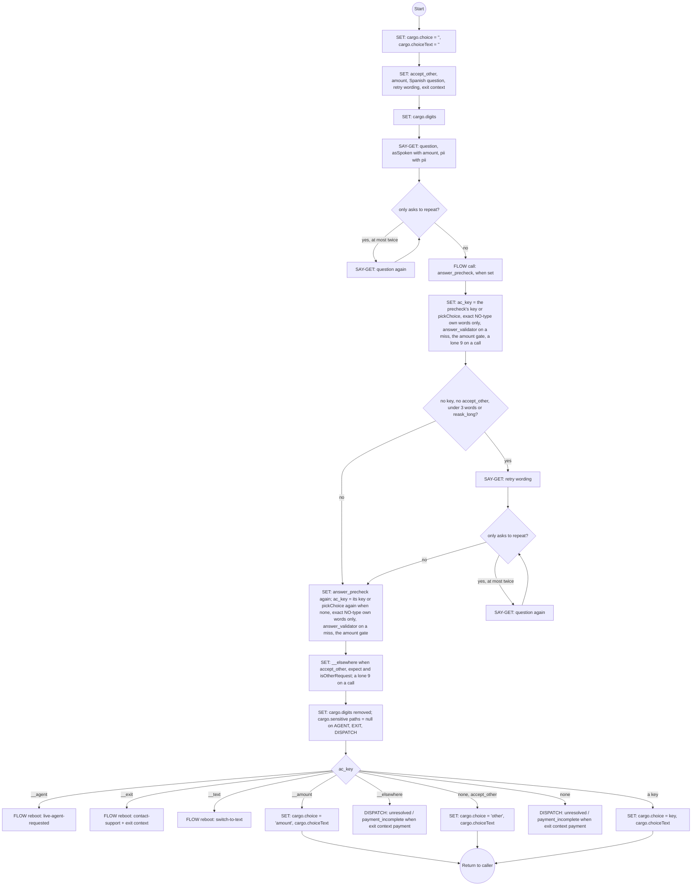

### Known gaps
- **A key beside a general YES word confirms an `exact` choice.** The key rule allows the general YES words around a key, not only confirm words: "ok 1", "bueno, 1", "está bien 1" and "continue 1" pick an `exact` choice keyed `1`, where "continue" alone would not.
- **Question-like confirm words.** `CONFIRM_WORDS` leaves out "right", "seguro", "exactly" and "así es" because speech-to-text drops the "?" of a question, but keeps "sure", "claro", "correct" and "that's right", which can be questions the same way. A typed "sure?" does not confirm an `exact` choice (the "?" rule above); a spoken one whose "?" speech-to-text dropped still does.

---

## AskEmail
**ID**: `ask-email` · **Version**: 1.3.1 · **Sub-flow** · **Scope**: isolated  
**Description**: Worker: an email address. With `on_file`, the question offers it (OK keeps it) and any other address the caller gives replaces it. One re-ask when the answer is not an email. Sets `cargo.email` (`''` when none).

### Parameters
*   `question` (string, required) / `question_es` (string): The question. With `on_file`, the caller's question is the one that offers it; the flow does not word the offer itself.
*   `on_file` (string): The address on file, kept by OK.
*   `confirm` (string): `'true'` when `on_file` came from the caller, so it is read back too.
*   `attempt`, `why` (string, internal): the attempt number, and `'invalid'` (not an address) or `'retry'` (the read-back was wrong), passed by the flow's own re-ask.

### Variables
`ae_n`, `ae_q`, `ae_q_es`, `ae_found`, `ae_next`, `ae_new`, `ae_why` (initial `'invalid'`).

Its free-text questions pass ask-choice `expect: `email``, so a new request there is `DISPATCH`ed, not counted as a failed try.

### Steps
1. `ae_attempt` (SET) - `ae_n` = `attempt`, else 0.
2. `ae_question` / `ae_question_es` (SET) - on a re-ask, "Okay, let's try again. " (`why === 'retry'`) or "That doesn't look like an email address. " (Spanish: "De acuerdo, intentemos de nuevo. " / "Eso no parece un correo electrónico. "), then the question.
3. `ae_ask` (FLOW [`ask-choice`](#askchoice), `call`) - one choice `ok` (`1`, ok, okay, yes, send, send it, si, sí, enviar, envíalo, correcto; only these words, since the key is not `yes`), `accept_other: true`, `digits: {min 1, max 1}`, exit context "email" / "correo".
4. `ae_read` (SET) - `ae_found = readEmail(cargo.choiceText)`; failing that, `on_file` when the choice was `ok` and `on_file` is set; else `''`.
5. `ae_is_new` (SET) - `ae_new` = an address was found, and `confirm === 'true'` or it differs from `on_file` (compared with `on_file` lower-cased).
6. `ae_readback` / `ae_readback_es` (SET) - "I have {address}. Is that right? Press 1 or say YES, or press 2 or say NO." On voice the address is spelled out character by character, `@` as "at" and `.` as "dot" ("arroba" / "punto" in Spanish); in text it is shown as is, with "Type YES, or type NO.". Spanish: "Tengo {address}. ¿Es correcto? Presione 1 o diga SÍ, o presione 2 o diga NO." / "Escriba SÍ, o escriba NO.".
7. `ae_confirm_new` (CASE) - `ae_new` → FLOW `ask-choice` (`call`) with the read-back, choices `no` (`2`, wrong, incorrect, incorrecto, plus the standard NO words) and `yes` (`1`, plus the standard YES words), `digits: {min 1, max 1}`, exit context "email". No `accept_other`, so a miss is re-asked once and then `DISPATCH`ed.
8. `ae_wrong` / `ae_drop_wrong` (SET) - a read-back not answered YES: `ae_why = 'retry'` and `ae_found = ''`.
9. `ae_next_attempt` (SET) - `ae_next = String(ae_n + 1)`.
10. `ae_route` (CASE, first match wins):
    - `ae_found` → `cargo.email = ae_found`.
    - first attempt (`ae_n < 1`) → FLOW `ask-email` (`replace`) with `question`, `question_es`, `on_file`, `confirm`, `attempt: ae_next`, `why: ae_why`.
    - default → `cargo.email = ''`.

An `on_file` kept by OK is used as given while `readEmail` lower-cases, so an `on_file` with capital letters is read back like a new address. ask-email does not clear `cargo.email` at the start: when ask-choice leaves through AGENT, EXIT or `DISPATCH`, `cargo.email` keeps its earlier value.

### Ends
By completion with `cargo.email` set (`''` after two failed attempts), or through ask-choice's exits.

### Flowchart
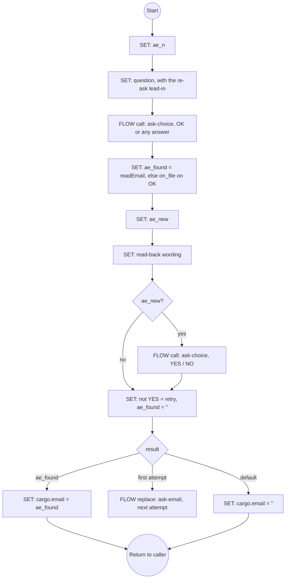

---

## AskAddress
**ID**: `ask-address` · **Version**: 1.3.0 · **Sub-flow** · **Scope**: isolated  
**Description**: Worker: a new mailing address (zip, street, unit; Google-checked; read back for YES / NO). The address is step data: what the caller already said — the `given` text (a full or partial address), or any answer holding more than was asked (a whole address typed at the zip question) — fills cargo.addressDraft { zip, said, unit }, and each question is asked only while its field is missing; the draft is kept until the address is confirmed, so a request resumed later asks only what is still missing. Sets cargo.address = { line, street, said, verified } or null.

Every question goes through [`ask-choice`](#askchoice) with exit context "address change" / "cambio de dirección". The unit question and the read-back use `cargo.verb` / `cargo.verb_es` directly (`cargo.verb.charAt(0)`), so the host must set them.

### Parameters
*   `given` (string): An address the caller already gave, full or partial (street, city, state, zip). Its parts fill `cargo.addressDraft`, so only what is missing is asked.
*   `attempt` (string, internal): the attempt number, passed by the flow's own restart (which passes nothing else, so a restart does not read `given` again).

### Variables
`ad_n`, `ad_zip`, `ad_components` (the Google component filter), `ad_zip_result`, `ad_place` ("City, ST"), `ad_said` (the street as said), `ad_street_result`, `ad_street`, `ad_norm` (Google's street), `ad_verified`, `ad_unit`, `ad_line`, `ad_q`, `ad_q_es`, `ad_next`.

<a id="askaddress-draft"></a>**The draft.** `cargo.addressDraft = { zip, said, unit, place }` holds the parts of the address given so far, and each of the zip, street and unit questions is asked only while its part is missing; a kept part is used as that question's answer. The parts are read from text by one reader: the zip is the last standalone 5-digit run followed by no other digit, else the first standalone 5-digit run; the street is the first line (or the part before the first comma), whitespace collapsed and a final period dropped, when it starts with a house number of 1 to 6 digits (optionally followed by a fraction such as `1/2`) and holds a word of two or more letters, with the zip and anything after it removed (a text with no zip yields no street: the removal then empties it); the unit is the word after apt, apartment, unit, suite, ste, depto, departamento, apartamento or `#` (1 to 6 letters, digits or `-`), as "Apt {unit}"; the place is "City, ST" when the text holds a city name, a two-capital-letter state and a zip. `given` is read at the start, and each answer to the zip and street questions is read the same way, so an answer that holds more than was asked (a whole address typed at the zip question) fills the later parts too; a part already in the draft is never replaced, except the zip and the street, which take the answer to their own question. The draft is kept when the flow leaves early (an exit, no zip, no street), so a later ask-address asks only what is still missing, and is set to `null` once the read-back is answered, YES or not.

Its free-text questions pass ask-choice `expect: `number` (the zip and the street questions)`, so a new request there is `DISPATCH`ed, not counted as a failed try.

### Steps
1. `ad_attempt` (SET) - `ad_n` = `attempt`, else 0.
2. `ad_start` (SET, side effect) - `cargo.address = null`; `cargo.addressDraft` (an empty object when there is none) takes the zip, street, unit and place read from `given`, where they are missing.
3. `ad_next_attempt` (SET) - `ad_next = String(ad_n + 1)`.
4. `ad_zip_question` / `_es` (SET) - "[Let's try again. ]What is the 5-digit zip code of your new address?[ When entering on the keypad, press the pound key when you are done.]" (the keypad sentence on voice only).
5. `ad_ask_zip_unless_kept` (CASE) - no zip in the draft → `ad_ask_zip` (FLOW `ask-choice`, `call`): no choices, `accept_other: true`, `digits: {min 5, max 5}`, `expect: 'number'`. Otherwise `cargo.choiceText` = the kept zip (no question).
6. `ad_read_zip` (SET) - the answer fills the draft's missing street, unit and place; `ad_zip` = the first standalone 5-digit run in the answer, else the answer's digits when there are exactly 5, else `''`; `cargo.addressDraft.zip = ad_zip`.
7. `ad_bad_zip` (CASE) - no zip on the first attempt → FLOW `ask-address` (`replace`) with the next `attempt`.
8. `ad_give_up_zip` (CASE) - still no zip → **END** (`cargo.address` stays `null`).
9. `ad_filter` (SET) - `ad_components = 'postal_code:' + ad_zip + '|country:US'`.
10. `ad_lookup_zip` (CALL-TOOL [`geocode-zip`](#geocode-zip)) `{components}` into `ad_zip_result`. `onFail` → SET `ad_zip_result = null`.
11. `ad_city_state` (SET) - `ad_place` = "City, ST" when the status is `OK`, the country is `US`, and the result has a city (`locality`, else `postal_town`, `sublocality_level_1`, `sublocality`, `neighborhood`) and a state (`administrative_area_level_1`, short name); else the draft's place; else `''`.
12. `ad_ask_city` (CASE) - no `ad_place` → FLOW `ask-choice` (`call`): "What city and state is that in?" / "¿En qué ciudad y estado está?", no choices, `accept_other: true`.
13. `ad_city_given` (SET) - `ad_place` ||= the answer, trimmed, with whitespace collapsed.
14. `ad_street_question` / `_es` (SET) - "[Got it, {ad_place}. ]What is the street address, with the house number? For example, 123 Main Street."
15. `ad_ask_street_unless_kept` (CASE) - no street in the draft → `ad_ask_street` (FLOW `ask-choice`, `call`): no choices, `accept_other: true`, `expect: 'number'`. Otherwise `cargo.choiceText` = the kept street (no question).
16. `ad_read_street` / `ad_keep_street` (SET) - `ad_said` = the answer, trimmed, whitespace collapsed, a final period dropped; when the reader finds a street in it, `ad_said` = that street (a unit in the answer fills the draft's missing unit); `cargo.addressDraft.said = ad_said`.
17. `ad_street_shape` (CASE) - not 1 to 6 digits, a space, then a word of two or more letters → FLOW `ask-choice` (`call`): "Please include the house number and the street name, like 123 Main Street."
18. `ad_read_street_again` (SET) - after that question, `ad_said` = its answer, cleaned the same way.
19. `ad_no_street` (CASE) - still not that shape → **END** (`cargo.address` stays `null`), on any attempt.
20. `ad_lookup_street` (CALL-TOOL [`geocode-street`](#geocode-street)) `{address: ad_said, components: ad_components}` into `ad_street_result`. `onFail` → SET `ad_street_result = null`.
21. `ad_street_match` (SET) - `ad_norm` = "{street_number} {route}" from Google when the status is `OK`, it is not a `partial_match`, its `postal_code` equals `ad_zip`, and its street number equals the number said; else `''`.
22. `ad_street_verified` / `ad_street_final` (SET) - `ad_verified = !!ad_norm`; `ad_street = ad_norm || ad_said`.
23. `ad_unit_question` / `_es` (SET) - "Is there an apartment or unit number? {Verb} the number, or NONE." / "¿Tiene número de apartamento o unidad? {Verbo} el número, o NINGUNO."
24. `ad_ask_unit_unless_kept` (CASE) - a unit in the draft → no question. Otherwise `ad_ask_unit` (FLOW `ask-choice`, `call`): choice `none` (none, no, skip, n/a, no apartment, no unit, ninguno, ninguna, no tengo, no aplica, omitir), `accept_other: true`.
25. `ad_read_unit` (SET) - the draft's unit when there is one. Otherwise `''` when the choice was `none` and the answer has no digit. Otherwise the answer, trimmed, a final period dropped; a single token of up to 6 characters (letters, digits, `-`, `#`) becomes "Apt {token}" (`#` removed).
26. `ad_full_line` (SET) - `ad_line = "{ad_street}[ {ad_unit}], {ad_place} {ad_zip}"`.
27. `ad_readback` / `_es` (SET) - "Your new address is {ad_line}. Is that correct? Press 1 or {verb} YES, or press 2 or {verb} NO." (text: "{Verb} YES, or {verb} NO."). Spanish: "Su nueva dirección es {ad_line}. ¿Es correcta? …".
28. `ad_confirm` (FLOW `ask-choice`, `call`) - choices `yes` (`1`, así es, plus the standard YES words) and `no` (`2`, wrong, incorrect, not right, incorrecto, no es correcto, plus the standard NO words), `digits: {min 1, max 1}`. No `accept_other`.
29. `ad_wrong_address` (SET, side effect) - an answer that is not YES → `cargo.addressDraft = null`.
30. `ad_route` (CASE, first match wins):
    - `cargo.choice === 'yes'` → `cargo.address = { line: ad_line, street: ad_street, said: ad_said, verified: ad_verified }`, `cargo.addressDraft = null`.
    - first attempt → FLOW `ask-address` (`replace`) with the next `attempt`: the whole address is collected once more, starting at the zip.
    - default → nothing (`cargo.address` stays `null`).

### Ends
By completion (`cargo.address` set, or `null` after a second NO), by `END` with `cargo.address = null` when no zip or no street shape could be read, or through ask-choice's exits.

### Flowchart
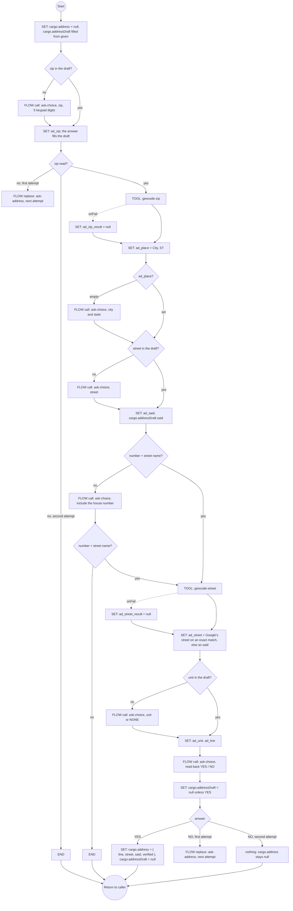

---

## AskField
**ID**: `ask-field` · **Version**: 1.4.0 · **Sub-flow** · **Scope**: isolated  
**Description**: Worker: one card field, kind `card` (checksum), `exp` (MMYY, not expired), `cvv` (3 to 4 digits) or `zip` (5 digits). One re-ask with the error, and for `card` a second one when the second answer was another card entry (12 or more digits); LINK switches to a payment link. Sets `cargo.field` (the value) and `cargo.fieldOutcome` (`'ok'`, `'link'` or `'failed'`). The answer is erased from `cargo.choiceText` as soon as it is read. An answer with no digits ("tarjeta nueva" said again) is asked again without the error line.

The card check is the host's `validateCardNumber`, which accepts 12 to 19 digits; the keypad bounds and shapes below decide when the voice relay submits a number, and which voice answers the engine takes as heard (13 to 19 digits).

### Parameters
*   `kind` (string, required): `'card'`, `'exp'`, `'cvv'` or `'zip'`.
*   `question` (string, required) / `question_es` (string): The question.
*   `error` / `error_es` (string): Said before the re-ask.
*   `attempt` (string, internal): the attempt number, passed by the flow's own re-ask.
*   `show_error` (string, internal): `'no'` when the previous answer had no digits, so the re-ask leaves out the error line; passed by the flow's own re-ask (`'yes'` otherwise). Absent: the error is said.

### Variables
`af_n`, `af_q`, `af_q_es`, `af_digits` (keypad bounds and shapes), `af_pii` (true for `cvv`), `af_value`, `af_reentry`, `af_show`, `af_next_attempt`.

Its free-text questions pass ask-choice `expect: `number``, so a new request there is `DISPATCH`ed, not counted as a failed try.

### Steps
1. `af_attempt` (SET) - `cargo.field = ''`; `af_n` = `attempt`, else 0.
2. `af_question` / `af_question_es` (SET) - on a re-ask, `error` / `error_es` first (unless `show_error` is `'no'`), then the question; on voice, except for `exp`, "When entering on the keypad, press the pound key when you are done." / "Si usa el teclado, presione la tecla de numeral al terminar.".
3. `af_keypad` (SET) - `af_digits` by kind: card `{13, 19}` with `complete` shapes, exp `{3, 6}`, cvv `{3, 4}`, zip `{5, 5}`. The card shapes, by first digit: `4` (Visa) 16 or 19, `2` and `5` (Mastercard) 16, `3` 15 (American Express), `6` (Discover) 16 or 19. The voice relay submits a number as soon as it is complete and no shape can grow (a Mastercard at 16, an American Express at 15, a Visa at 19); when it is complete but could grow (a Visa or Discover at 16), keyed digits are submitted after the relay's keypad pause (the step sets no `autoSubmitMs`, so the relay's default) and spoken digits at once; a number that is not complete waits for more digits, `#` or `*` (a caller who stops hears the idle prompt), so a 14-digit fragment of a 16-digit card is never submitted. A number of no listed shape (a 14-digit Diners Club card, a stray leading `1`) needs `#`; a 16-digit card starting with `3` (JCB) is submitted at 15 when keyed, and fails the check.
4. `af_sensitive` (SET) - `af_pii = kind === 'cvv'`.
5. `af_ask` (FLOW [`ask-choice`](#askchoice), `call`) - choice `link` (link, enlace, payment link, enlace de pago), `accept_other: true`, `digits: af_digits`, `expect: 'number'`, `pii: af_pii` (the security code is a `pii` answer), exit context "payment" / "pago".
6. `af_read` (SET) - `''` when the choice was `link`. Otherwise the answer's digits, checked by kind:
   - `card`: `validateCardNumber(digits)`.
   - `exp`: MMYYYY with a `20` year and MYYYY are first shortened to MMYY; a 3-digit answer is MYY. The month must be 01 to 12 and `validateExpiration(mm, yy)` must pass. The value is MMYY.
   - `cvv`: 3 or 4 digits. `zip`: 5 digits.
7. `af_reentry_check` (SET) - `af_reentry`: `kind` is `card`, the choice was not `link`, and the answer holds 12 or more digits (everything else in it ignored).
8. `af_error_if_digits` (SET) - `af_show` = `'yes'` when the answer holds a digit, else `'no'`.
9. `af_forget_answer` (SET, side effect) - `cargo.choiceText = ''`.
10. `af_next` (SET) - `af_next_attempt = String(af_n + 1)`.
11. `af_route` (CASE, first match wins):
   - `link` → `cargo.field = ''`, `cargo.fieldOutcome = 'link'`.
   - a valid value → `cargo.field = af_value`, `cargo.fieldOutcome = 'ok'`.
   - first attempt, or second attempt with `af_reentry` → FLOW `ask-field` (`replace`) with `kind`, `question`, `question_es`, `error`, `error_es`, the next `attempt` and `show_error: af_show`. So every field has two tries, and the card number three when its second answer was another card entry; a refusal, words or a short number there ends it after two.
   - default → `cargo.field = ''`, `cargo.fieldOutcome = 'failed'`.

### Ends
By completion with `cargo.fieldOutcome` set, or through ask-choice's exits (which null the `cargo.sensitive` paths card-entry marked).

### Flowchart
```mermaid
graph TD
    start((Start)) --> af_attempt["SET: cargo.field = '', af_n"]
    af_attempt --> af_question[SET: question, error first on a re-ask]
    af_question --> af_keypad[SET: keypad bounds by kind]
    af_keypad --> af_sensitive["SET: af_pii (cvv)"]
    af_sensitive --> af_ask[FLOW call: ask-choice, LINK or any answer, pii for cvv]
    af_ask --> af_read[SET: af_value, checked by kind]
    af_read --> af_reentry["SET: af_reentry (card, 12+ digits)"]
    af_reentry --> af_show["SET: af_show (digits in the answer?)"]
    af_show --> af_forget["SET: cargo.choiceText = ''"]
    af_forget --> af_route{result}
    af_route -->|LINK| af_link["SET: cargo.fieldOutcome = 'link'"]
    af_route -->|valid| af_ok["SET: cargo.field, cargo.fieldOutcome = 'ok'"]
    af_route -->|invalid: first attempt, or second with af_reentry| af_again["FLOW replace: ask-field + error, unless no digits"]
    af_route -->|invalid, otherwise| af_failed["SET: cargo.fieldOutcome = 'failed'"]
    af_link --> stop((Return to caller))
    af_ok --> stop
    af_failed --> stop
```

---

## CardEntry
**ID**: `card-entry` · **Version**: 1.3.0 · **Sub-flow** · **Scope**: isolated  
**Description**: Worker: a new card's number, expiration, security code and billing zip (each through ask-field), and whether to save it. Every field the caller gives is kept in cargo.cardDraft and asked only while it is missing, so a card half entered is resumed, never asked again. A complete card is PENDING: first in cargo.pendingCards { kind: 'card', card, save, last4, label, label_es, pending: true }, kept for the session (never erased; the session's expiry ends it), and the payment uses it without asking which card. Sets cargo.payMethod to it, or cargo.payNext 'link' / 'card_failed'. The save question is skipped when the caller already said (cargo.saveCardPick 'yes'/'no'), and an answer is kept there.

card-entry clears neither `cargo.payMethod` nor `cargo.payNext` at the start, so its caller resets them before calling it when a stale value matters. `cargo.pendingCards` holds the card number and security code for the rest of the session; nothing in this library clears it.

### Variables
`ce_number_value`, `ce_exp_value`, `ce_cvv_value`, `ce_zip_value`, `ce_q`, `ce_q_es`.

### Steps
1. `ce_mark_sensitive` (SET, side effect) - `cargo.sensitive = ['field']`, so any later ask-choice that leaves through AGENT, EXIT or `DISPATCH` nulls `cargo.field` first; `cargo.cardDraft` = `{}` when there is none.
2. For each field, in order: `ce_<field>_unless_kept` (CASE) - the field is not in `cargo.cardDraft` → FLOW [`ask-field`](#askfield) (`call`); otherwise `cargo.fieldOutcome = 'ok'` and `cargo.field` = the kept value (no question). Then the same three steps (`ce_<field>_stop`, `ce_<field>_end`, `ce_<field>_keep`): when `cargo.fieldOutcome` is not `ok`, `cargo.payNext` = `'link'` (for `link`) or `'card_failed'`, then **END** (the fields collected so far stay in `cargo.cardDraft`); otherwise the value is kept in `ce_<field>_value` and in `cargo.cardDraft.<number | exp | cvv | zip>`.

   | Step | `kind` | Question | Error |
   |---|---|---|---|
   | `ce_number` | `card` | "Please say or enter the card number." | "That doesn't look like a valid card number." |
   | `ce_exp` | `exp` | "Please say or enter the expiration month and year, for example 0 4 2 8 for April 2028." | "That isn't a valid, unexpired date." |
   | `ce_cvv` | `cvv` | "Please say or enter the 3 or 4 digit security code on the card." | "That isn't a valid security code." |
   | `ce_zip` | `zip` | "Please say or enter the card's 5 digit billing zip code." | "The zip code must be 5 digits." |

   Each also passes its Spanish question and error.
3. `ce_pending` (SET, side effect) - the complete card goes first in `cargo.pendingCards`: `{ kind: 'card', card: { cardNumber, expirationMonth, expirationYear, cvv, zip }, save: false, last4, type: '', pending: true, label: 'the card ending in 1234', label_es: 'la tarjeta que termina en 1234' }` (the label's last four through `last4`, comma-spaced on voice, "1, 2, 3, 4"); an earlier entry with the same card number is dropped. `cargo.cardDraft = null`.
4. `ce_save_question` / `_es` (SET) - "Would you like to save this card for future payments? Press 1 or say YES, or press 2 or say NO." (text: "Type YES, or type NO."). Spanish: "¿Desea guardar esta tarjeta para pagos futuros? …".
5. `ce_save_unless_said` (CASE) - `cargo.saveCardPick` is `'yes'` or `'no'` → `cargo.choice` = it (no question). Otherwise `ce_save` (FLOW [`ask-choice`](#askchoice), `call`) - choices `yes` (`1`, save, guardar, plus the standard YES words) and `no` (`2`, don't, do not, rather not, don't save, do not save, no guardar, no la guarde, mejor no, plus the standard NO words), `digits: {min 1, max 1}`, exit context "payment" / "pago". No `accept_other`.
6. `ce_method` (SET, side effect) - `cargo.saveCardPick` = `'yes'` on YES, else `'no'`; `cargo.pendingCards[0].save` = YES; `cargo.payMethod = cargo.pendingCards[0]`; `cargo.field = ''`.
7. `ce_forget` (SET, side effect) - `ce_number_value = ''`, `ce_cvv_value = ''`.

### Ends
By completion with `cargo.payMethod` set, by `END` with `cargo.payNext` set when a field was not collected, or through ask-choice's exits (`cargo.field` nulled through `cargo.sensitive`). `cargo.sensitive` stays set after card-entry ends.

### Flowchart
```mermaid
graph TD
    start((Start)) --> ce_mark_sensitive["SET: cargo.sensitive = ['field'], cargo.cardDraft"]
    ce_mark_sensitive --> n_kept{number in the draft?}
    n_kept -->|no| ce_number[FLOW call: ask-field card]
    n_kept -->|yes| n_ok
    ce_number --> n_ok{fieldOutcome ok?}
    n_ok -->|no| stop_field["SET: cargo.payNext = 'link' or 'card_failed', END"]
    n_ok -->|yes| e_kept{exp in the draft?}
    e_kept -->|no| ce_exp[FLOW call: ask-field exp]
    e_kept -->|yes| e_ok
    ce_exp --> e_ok{fieldOutcome ok?}
    e_ok -->|no| stop_field
    e_ok -->|yes| c_kept{cvv in the draft?}
    c_kept -->|no| ce_cvv[FLOW call: ask-field cvv]
    c_kept -->|yes| c_ok
    ce_cvv --> c_ok{fieldOutcome ok?}
    c_ok -->|no| stop_field
    c_ok -->|yes| z_kept{zip in the draft?}
    z_kept -->|no| ce_zip[FLOW call: ask-field zip]
    z_kept -->|yes| z_ok
    ce_zip --> z_ok{fieldOutcome ok?}
    z_ok -->|no| stop_field
    z_ok -->|yes| ce_pending["SET: cargo.pendingCards first, cargo.cardDraft = null"]
    ce_pending --> save_said{cargo.saveCardPick?}
    save_said -->|yes / no| ce_method
    save_said -->|none| ce_save[FLOW call: ask-choice, save the card?]
    ce_save --> ce_method["SET: cargo.saveCardPick, save, cargo.payMethod = cargo.pendingCards[0], cargo.field = ''"]
    ce_method --> ce_forget[SET: forget number and cvv]
    ce_forget --> stop((Return to caller))
    stop_field --> stop
```

---

## Keypad9
**ID**: `9` · **Version**: 1.0.0 · **Sub-flow**  
**Description**: Worker: the keypad key 9 when no question took it (no flow running, or a question passed it on with DISPATCH): matched by id, with no AI. On a call it is the switch to text; in writing it is not a request.

Started by the engine's direct id match (see [Keypad flows](#conventions-used-by-these-flows)), not by a FLOW step.

### Steps
1. `k9_route` (CASE):
   - `cargo.voice` → FLOW [`switch-to-text`](#switchtotext) (`replace`).
   - default → SAY "Sorry, I didn't catch that. {anythingElse}" / "Disculpe, no le entendí. {anythingElse}" (`anythingElse('en', cargo.displayName)` / `anythingElse('es', cargo.displayName)`, see [Phrases](#conventions-used-by-these-flows)).

### Ends
In SwitchToText on a call; by completion otherwise.

### Flowchart
```mermaid
graph TD
    start((Start)) --> k9_route{cargo.voice?}
    k9_route -->|voice| k9_switch_to_text[FLOW replace: switch-to-text]
    k9_route -->|not voice| k9_not_a_request["SAY: Sorry, I didn't catch that + anythingElse"]
    k9_not_a_request --> stop((End))
```

---

## Keypad0
**ID**: `0` · **Version**: 1.0.0 · **Sub-flow**  
**Description**: Worker: the keypad key 0 when no question took it (no flow running, or a question passed it on with DISPATCH): matched by id, with no AI. A request for a person (the operator reflex), handled once here, not at every question.

Started by the engine's direct id match, on every channel.

### Steps
1. `k0_agent` - FLOW [`live-agent-requested`](#liveagentrequested) (`replace`).

### Ends
In LiveAgentRequested.

### Flowchart
```mermaid
graph TD
    start((Start)) --> k0_agent[FLOW replace: live-agent-requested]
```

---

## SendEmailMessage
**ID**: `send-email-message` · **Version**: 1.0.0 · **Sub-flow**  
**Description**: Worker: emails `message` with `subject` to `to`, with an optional copy to `cc` (e.g. the account's email on file when the caller chose another address). Any valid address: sendEmail refuses one that cannot receive mail. Sets `cargo.emailSent`; a refused or failed send leaves it false.

No flow in this library calls it. The email counterpart of [send-text](#sendtext).

### Parameters
*   `to` (string): The email address.
*   `subject` (string): The subject line.
*   `message` (string): The email text.
*   `cc` (string): An optional copy address; empty for none.

### Variables
`email_result` (string): `'__failed__'` when the send failed or there was no valid address.

### Steps
1. `email_not_sent_yet` (SET, side effect) - `cargo.emailSent = false`.
2. `send_when_possible` (CASE):
   - `validateEmail(to)` (trimmed) → CALL-TOOL [`send-email`](#send-email) `{to, cc, subject, body: message}` into `email_result`. `onFail` (a refused address or a failed send) → SET `email_result = '__failed__'`.
   - default → SET `email_result = '__failed__'`.
3. `record_email_sent` (SET, side effect) - `cargo.emailSent = email_result !== '__failed__'`.

### Ends
By completion. It never leaves the flow stack; the caller reads `cargo.emailSent`.

### Flowchart
```mermaid
graph TD
    start((Start)) --> email_not_sent_yet[SET: cargo.emailSent = false]
    email_not_sent_yet --> send_when_possible{valid to?}
    send_when_possible -->|yes| send_email[TOOL: send-email]
    send_when_possible -->|no| no_address["SET: email_result = '__failed__'"]
    send_email -.->|onFail| send_email_failed["SET: email_result = '__failed__'"]
    send_email --> record_email_sent[SET: cargo.emailSent]
    send_email_failed --> record_email_sent
    no_address --> record_email_sent
    record_email_sent --> stop((Return to caller))
```

---

## Tools

All twelve are `local` tools. The host supplies the function named in `implementation.function` through `APPROVED_FUNCTIONS`. All but the two geocode tools use the flat `parameters` form (a map of properties with no top-level `type`), so the engine calls the function with **positional arguments: the `required` names in order, then the remaining properties in definition order**. For these ten tools that order matches the `implementation.args` list shown; the engine itself does not read `implementation.args`. That is why `send-email` lists its optional `cc` in `required`: it keeps `cc` second, where `sendEmail` takes it. The two geocode tools use the JSON Schema form (`type: object`), so the engine calls the function with one object holding the arguments.

Every tool except the two geocode tools and `send-email` declares `returns`, a JSON Schema of the value the CALL-TOOL `variable` receives. It is documentation, plus an optional warning when the host sets `engine.validateToolReturns = true`. The summaries below paraphrase each `returns`. Cargo fields the reference host (hy-rag) writes beyond what `returns` describes are noted as such.

`security.requiresAuth`, `auditLevel` and `dataClassification` are declarative. The engine enforces `security.rateLimit`.

### send-sms-otp
**Name**: Send SMS OTP - send an OTP code via SMS for authentication.  
**Implementation**: local `sendSMSOTP(accountSid, from, to, container, language)`, timeout 5000 ms. Rate limit: 5 per 300 s.

| Parameter | Type | Required | Notes |
|---|---|---|---|
| `accountSid` | string | yes | Twilio Account SID (the flows pass `null`) |
| `from` | string | yes | From phone number |
| `to` | string | yes | To phone number |
| `container` | object | yes | session cargo, where the OTP hash is stored |
| `language` | string | no | message language, e.g. `es`; omitted or unrecognised → English |

**Returns** a string: the lowercase hex SHA-256 (64 chars) of the 6-digit code, which is also written to `container.otpHash` along with `container.otpTimestamp`. The plaintext code is never returned. On the test-number path (`to` normalizes to `0000000000` or `+10000000000`) it is the hash of the fixed code `123456`. The flows do not store the result, and they detect failure through `onFail`.

Reference host: every send first clears `container.otpFailure` and `container.otpUndeliverableTo`, and records `container.otpSentOn` (`sms`, or `whatsapp` when the code went into the customer's WhatsApp chat). When the destination cannot receive a text, it sets `container.otpUndeliverableTo` to the number's last 10 digits and throws.

### send-email-otp
**Name**: Send Email OTP - send an OTP code via email for authentication.  
**Implementation**: local `sendEmailOTP(to, container, language)`, timeout 5000 ms. Rate limit: 5 per 300 s.

| Parameter | Type | Required | Notes |
|---|---|---|---|
| `to` | string | yes | email address |
| `container` | object | yes | session cargo, where the OTP hash is stored |
| `language` | string | no | as above |

**Returns** `undefined` on every real send (the function has no return statement). Only for the test account (`test@instantaiguru.com`, case-insensitive) does it return the 64-char hex SHA-256 of the fixed code `123456`, also stored in `container.otpHash`. It never returns an object. Treat the result as absent; the flows do not store it.

Reference host: records `container.otpSentOn = 'email'` and clears `container.otpFailure`.

### send-whatsapp-invite
**Name**: Send WhatsApp Invite - text the caller a wa.me link so they can finish authenticating on WhatsApp.  
**Implementation**: local `sendWhatsAppInvite(accountSid, from, to, inviteText, language, container)`, timeout 5000 ms. Rate limit: 5 per 300 s.

| Parameter | Type | Required | Notes |
|---|---|---|---|
| `accountSid` | string | yes | Twilio Account SID |
| `from` | string | yes | From phone number |
| `to` | string | yes | the caller's mobile that already received the OTP text |
| `inviteText` | string | no | wording from `global_whatsapp_invite` / `_es`. **Empty means the feature is off for this tenant**; there is no separate flag |
| `language` | string | no | session language |
| `container` | object | no | session cargo, used ONLY for the once-per-call latch `container.whatsappInvited` |

**Returns** a boolean. `true` only when the invite SMS was handed to Twilio. `false` on every skip and every error; the function never throws. It skips when: the latch `container.whatsappInvited` is already set; `inviteText` is empty or whitespace; `from` or `to` is missing; the tenant has no `config.wa-*` alias config, or that config has no usable `phone_number`. Any exception (e.g. a non-SMS line) also returns `false`.

### validate-otp
**Name**: Validate OTP - validate the OTP code entered by the user.  
**Implementation**: local `validateOTP(otp, container)`, timeout 5000 ms. Rate limit: 10 per 60 s.

| Parameter | Type | Required | Notes |
|---|---|---|---|
| `otp` | string | yes | the code |
| `container` | object | yes | session cargo holding `otpHash` / `otpTimestamp` |

**Returns** a boolean.
- `true` when `sha256(otp)` equals `container.otpHash` and the code is at most 10 minutes old. It then clears `otpHash` / `otpTimestamp` and sets `container.otpVerified = true` and `container.otpVerifiedAt`. **The flows read `cargo.otpVerified`, not the return value.**
- `false` when no code is stored.
- `false` when the code expired (the container is cleared and `otpVerified = false`).
- `false` on a hash mismatch (the container is left untouched, so the same code can be retried until validate-otp-code withdraws it at the cap).

Reference host: a refusal also sets `container.otpFailure` to `missing`, `expired` or `mismatch`, and a success clears it. validate-otp-code branches on it.

### set-user-name
**Name**: Set User Name - name the person in the conversation, e.g. the account holder's first name once a lookup found the account. From the next reply on, every message addresses them by it, on every channel, and the name is returned to the caller in `context.display_name`; a name a flow set outranks whatever the channel re-sends. An empty name clears it. No flow in this library calls it.  
**Implementation**: local `setUserName(name, container)`, timeout 5000 ms. No rate limit.

| Parameter | Type | Required | Notes |
|---|---|---|---|
| `name` | string | yes | the name to address the person by (a first name), or empty for none |
| `container` | object | yes | session cargo |

**Returns** a string: the name as stored, trimmed; `''` when none. Also sets `container.displayName` and `container.displayNameSetBy = 'flow'`.

### switch-to-sms
**Name**: Switch to SMS - switch communication to SMS and send a confirmation message.  
**Implementation**: local `switchToSMS(accountSid, threadId, from, to, message, userTurn)`, timeout 10000 ms. Rate limit: 10 per 60 s.

| Parameter | Type | Required | Notes |
|---|---|---|---|
| `accountSid` | string | yes | Twilio Account SID |
| `threadId` | string | yes | the thread to switch (the flow passes `{{sessionId}}`) |
| `from` | string | yes | From phone number |
| `to` | string | yes | To phone number |
| `message` | string | yes | SMS text |
| `userTurn` | string | no | the user side of the switch as the text thread records it ("Switch to text" / "Cambiar a texto"), written with `message` as one history pair |

**Returns** always the literal `true`. The chat context is re-saved under `<toNumber>-<dbPrefix>` with a fresh engine session carrying the old cargo, and the SMS is sent. Every failure (loading or saving the context, initializing the session, sending the SMS) is thrown, so `onFail` runs.

### send-twilio-sms
**Name**: Send Twilio SMS - send an SMS via Twilio. Called by [`send-text`](#sendtext), with `from`, `to` and `message` only.  
**Implementation**: local `sendTwilioSMS(accountSid, from, to, message, messageSid)`, timeout 10000 ms. Rate limit: 10 per 60 s.

| Parameter | Type | Required | Notes |
|---|---|---|---|
| `accountSid` | string | yes | Twilio Account SID |
| `from` | string | yes | From phone number |
| `to` | string | yes | To phone number |
| `message` | string | yes | SMS text |
| `messageSid` | string | no | optional message SID for tracking (default `""`) |

**Returns** a string: the Twilio Message `status` of the **last** part sent (a long message is split and the parts are sent in sequence). The value comes from Twilio, typically `queued`, or `accepted` via a Messaging Service. Failure: throws.

### get-live-connect-link
**Name**: Get Live Connect Link - the tenant's Live Connect guest link when Live Connect is enabled and an agent is online or reachable; `''` otherwise. Never throws.  
**Implementation**: local `getLiveConnectLink(container)`, timeout 5000 ms. Rate limit: 10 per 300 s.

| Parameter | Type | Required | Notes |
|---|---|---|---|
| `container` | object | no | session cargo; annotated with `liveConnectOffered` when a link is returned |

**Returns** a string: the guest link (`{url}/?ref=<dbPrefix>`), or `''` when Live Connect is off, no agent is reachable, or the presence check fails.

### get-whatsapp-link
**Name**: Get WhatsApp Link - the tenant's WhatsApp chat link. By default (an invitation) only when all three hold: a WhatsApp channel, its admin switch "Invite callers to switch to WhatsApp" (`inviteCallers`), and Meta's APPROVED invite template. With `notTemplateInvite` (a link inside a message the flow writes itself, not the invite template): whenever the tenant has a WhatsApp channel with a number. Never throws.  
**Implementation**: local `getWhatsAppLink(notTemplateInvite)`, timeout 5000 ms. No rate limit.

| Parameter | Type | Required | Notes |
|---|---|---|---|
| `notTemplateInvite` | boolean | no | `true` for a link inside the flow's own message: only the channel and its number are required (default `false`) |

**Returns** a string: `https://wa.me/<digits>`, or `''` when what the call requires is missing. switch-to-text calls it with no arguments (the invitation rule); shopify-product-search passes `notTemplateInvite: true`.

### geocode-zip
**Name**: Geocode Zip - looks up the city and state for a 5-digit US zip code via Google Geocoding, so address collection can skip the city and state prompts. Called by [ask-address](#askaddress).  
**Implementation**: local `geocodeAddress({ address, components })` (one object argument), timeout 6000 ms. Rate limit: 20 per 60 s. `security`: no auth, audit `low`, data `public`.

| Parameter | Type | Required | Notes |
|---|---|---|---|
| `components` | string | yes | Google component filter, e.g. `postal_code:90015\|country:US` (default `""`) |
| `address` | string | no | not used for a zip lookup (default `""`) |

The parameters use the JSON Schema form (`type: object`, `additionalProperties: false`).

**Returns** (no `returns` schema) an object, in the reference host: `status` (Google's status, e.g. `OK`; `''` when absent), `components` (`results[0].address_components`; `[]` when absent), `types`, `location_type`, `partial_match`, `formatted_address`, `lat` and `lon`, as for geocode-street. An HTTP error from Google throws, so `onFail` runs.

### geocode-street
**Name**: Geocode Street - looks up a spoken or typed street address inside a known US zip code via Google Geocoding, so address collection can replace what the caller said with Google's normalized street when there is a precise match. Called by [ask-address](#askaddress).  
**Implementation**: local `geocodeAddress({ address, components })`, with the same timeout, rate limit and `security` as geocode-zip.

| Parameter | Type | Required | Notes |
|---|---|---|---|
| `address` | string | yes | the street address as given, e.g. `1605 west olimpic blvd` (default `""`) |
| `components` | string | yes | Google component filter, e.g. `postal_code:90015\|country:US` (default `""`) |

**Returns** (no `returns` schema) an object, in the reference host: `status` (`''` when absent), `components` (`results[0].address_components`, `[]`), `types` (`results[0].types`, `[]`), `location_type` (`results[0].geometry.location_type`, `''`), `partial_match` (`results[0].partial_match === true`), `formatted_address` (`''`), `lat` / `lon` (`results[0].geometry.location`, `null` when absent). ask-address reads `status`, `partial_match` and `components`. An HTTP error from Google throws.

### send-email
**Name**: Send Email - send a plain-text email to a customer: the host's `sendEmail` (in the reference host, Amazon SES from the platform's sender address; an address that cannot receive mail is refused). For a message the flow wrote itself, e.g. a receipt; never a code (that is [send-email-otp](#send-email-otp)). Called by [send-email-message](#sendemailmessage).  
**Implementation**: local `sendEmail(to, cc, subject, body)`, timeout 8000 ms. Rate limit: 5 per 300 s. `security`: no auth, audit `medium`, data `customer`.

| Parameter | Type | Required | Notes |
|---|---|---|---|
| `to` | string | yes | the recipient's email address |
| `cc` | string | yes | a copy address, or empty for none. Listed in `required` only to keep the argument order |
| `subject` | string | yes | the subject line |
| `body` | string | yes | the message, plain text |

**Returns** nothing (no `returns` schema; the reference host's `sendEmail` returns `undefined`). A refused address or a failed send throws, so `onFail` runs.
